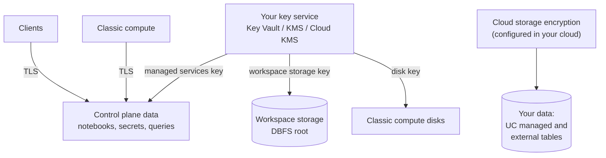

# Encryption

Mastery: `INPUT[inlineSelect(option(new), option(learning), option(solid)):mastery]`

> [!story] Context
> [[Serverless Network Security]] controls where data can travel. Encryption protects the data itself, both where it is stored and while it moves. This note maps which Databricks data is encrypted by default, and which parts you can encrypt with keys you control.

> [!eli5] Summary
> Encryption scrambles data so that only someone with the right key can read it. Databricks and the cloud providers encrypt data by default. Companies with strict rules can supply and control their own keys, which lets them cut off access by revoking the key.

## Background

Data in a Databricks deployment lives in several places: the control plane (notebooks, secrets, query history), the workspace storage bucket or account, cloud disks attached to classic compute, and your own data storage. Regulations and customer contracts often require two things beyond default encryption: proof that data is encrypted everywhere, and the ability to control and revoke the keys.

## Overview

**Default behavior.** Without any configuration, data at rest is encrypted by the cloud provider's storage encryption with a Databricks-managed or provider-managed key. Connections to the control plane and APIs use TLS.

**Customer-managed keys (CMK)** let you supply a key from your cloud key service (Azure Key Vault or Managed HSM, AWS KMS, Google Cloud KMS). Databricks groups CMK into use cases:

| Use case | What it protects | Azure | AWS | GCP |
|---|---|---|---|---|
| **Managed services** | Control-plane data: notebook source and results, secrets, Databricks SQL queries and query history; also Lakebase project data and default storage in serverless workspaces | Yes | Yes | Yes |
| **Workspace storage** | The workspace storage bucket or account (DBFS root) and, on AWS, classic compute EBS volumes | Yes ("DBFS root") | Yes (S3 + optional EBS) | Yes (the workspace's GCS buckets) |
| **Managed disks** | Temporary disks on classic compute VMs | Yes | Covered by workspace storage key (EBS) | Not listed |

Plan requirements: **Premium** on Azure, **Enterprise** on AWS and GCP.

Rules that apply across clouds:

- **Serverless workspaces** need only the managed services key, because their default storage is treated as a managed service.
- **Serverless compute disks** are short-lived and are not covered by the EBS or managed-disk keys.
- **Existing data is not re-encrypted.** After adding a managed services key, Databricks uses it to protect the key that encrypts *future* writes.
- **Revocation is final for that workspace's data.** If the key is removed or access to it is revoked, all control-plane data for the workspace becomes inaccessible.
- **Your own data** (tables and volumes in your storage accounts) is encrypted by the storage service's own settings. Configure CMK on those buckets or accounts in the cloud provider, not in Databricks.

**In transit.** Traffic between clients and Databricks, and between classic compute and the control plane, uses TLS. By default, data exchanged **between worker nodes** of a classic cluster is not encrypted by Databricks. Options:

- **AWS:** use AWS Nitro instance types, which encrypt traffic between instances. The [[Compliance Security Profile]] enforces Nitro instances.
- **All clouds:** Databricks provides an init script that configures Spark to encrypt inter-node traffic (the current AWS docs describe AES 128-bit over TLS 1.3). The script derives its secret from a keystore file in DBFS, so any user with DBFS access can retrieve it.
- **Azure:** the compliance security profile requires Azure Virtual Network encryption on the workspace, with VM types that support it.

## How it works



### Procedure: add a managed services key on AWS (outline)

1. Create a symmetric key in AWS KMS and add a key policy that allows Databricks to use it. The policy text is in the AWS CMK guide.
2. Register the key in the account: account console, **Security**, encryption keys, or the account API:

```bash
databricks account encryption-keys create --json '{
  "aws_key_info": {
    "key_arn": "arn:aws:kms:us-east-1:111122223333:key/<key-id>",
    "key_alias": "alias/databricks-managed-services"
  },
  "use_cases": ["MANAGED_SERVICES"]
}'
```

3. Set the returned key configuration ID on the workspace (`managed_services_customer_managed_key_id`) when you create it, or update an existing workspace. The KMS key must be in the workspace's region.

On AWS, the account console does not support adding *workspace storage* keys to existing workspaces; use the CLI or the update workspace API. On GCP, encryption key configurations can be added only at workspace creation. Details per cloud are in [[Customer-Managed Keys on AWS]], [[Customer-Managed Keys on Azure]], and [[Customer-Managed Keys on Google Cloud]].

## Small-business considerations

> [!smallbiz] Small-business considerations
> - Default encryption is sufficient for most small companies. Data at rest and in transit to Databricks is already encrypted.
> - Adopt customer-managed keys only when a contract, regulator, or security policy requires key control. CMK adds operational risk: losing or revoking the key makes control-plane data unreadable.
> - Encrypt your own data storage according to your cloud provider's guidance. Databricks CMK settings do not change your own buckets or storage accounts.
> - Key services charge per key and per operation on the cloud bill. See the cloud provider's pricing pages.

## Cloud differences

> [!azure]- Azure Databricks
> - Three CMK features: **managed services**, **managed disks**, and **DBFS root** (workspace storage account). Premium plan required.
> - Keys come from Azure Key Vault vaults or Azure Key Vault Managed HSM. See [[Customer-Managed Keys on Azure]].
> - Managed disk keys do not apply to serverless compute.
> - The compliance security profile requires Azure Virtual Network encryption. The Azure docs state that enforcement of the VNet encryption requirements begins on 1 February 2027.

> [!aws]- Databricks on AWS
> - Two CMK use cases: **managed services** and **workspace storage** (the workspace S3 bucket, plus optional EBS volume encryption for classic compute). Enterprise tier required.
> - Keys come from AWS KMS. See [[Customer-Managed Keys on AWS]].
> - Workspace storage keys do not apply to legacy DBFS mounts of other S3 buckets.
> - Nitro instance types provide encryption between instances; the compliance security profile enforces them.

> [!gcp]- Databricks on Google Cloud
> - CMK covers managed services and the two GCS buckets in the Google Cloud project that Databricks creates with the workspace. Keys come from Google Cloud KMS. See [[Customer-Managed Keys on Google Cloud]].
> - In classic workspaces, keys can be added only during workspace creation; serverless workspaces can add a managed services key afterward. The feature is in Public Preview on Google Cloud (as of October 2026).

## Advanced topics

> [!deepdive]- Advanced topics (301–401)
> - **Key hierarchy.** The Azure docs describe the managed services key as controlling access to the key that encrypts future writes. That is why adding a key does not re-encrypt existing data.
> - **Key configurations (AWS).** On AWS, a key configuration is an account-level object created with `databricks account encryption-keys create` or the Key configurations API. It is referenced from a workspace as `managed_services_customer_managed_key_id` or `storage_customer_managed_key_id`. The KMS key must be in the same region as the workspace. For the `STORAGE` use case, `reuse_key_for_cluster_volumes` controls whether the key also encrypts EBS volumes (default true).
> - **Propagation (AWS).** Terminate running compute before changing workspace storage keys. Updates can take up to 24 hours to take effect.
> - **Rotation (Azure).** Rotate by updating the workspace with new key parameters. Keep the old key available for 24 hours after rotation. Pin a specific key version rather than `latest`. Managed disk keys support optional auto-rotation for RSA 2048, 3072, and 4096-bit keys.
> - **Irreversible on Azure.** Once CMK for managed services is enabled on an Azure workspace, it cannot be disabled.
> - **SQL encryption.** Databricks SQL queries, query history, and results are managed services data and are covered by the managed services key.

## Common misconceptions

> [!confusion] CMK in Databricks does not encrypt your data lake
> Databricks CMK covers control-plane data, workspace storage, and compute disks. Tables in your own storage are encrypted by that storage's settings, which you manage in the cloud provider.

> [!confusion] Encryption at rest is not optional
> Data at rest is always encrypted. CMK changes **who controls the key**, not whether encryption happens.

## Recall

Which CMK use case protects notebooks, secrets, and SQL query history?::Managed services.
Which plan is required for CMK on Azure, and on AWS and GCP?::Premium on Azure; Enterprise on AWS and GCP.
Which CMK use case does a serverless workspace need?::Only managed services; default storage counts as a managed service.
Does adding a managed services key re-encrypt existing data?::No. It applies to future writes.
What happens if you revoke the managed services key?::All control-plane data for that workspace becomes inaccessible.
Is traffic between classic cluster worker nodes encrypted by default?::No. Use Nitro instances on AWS, or the Databricks encryption init script.
When can CMK be added on GCP?::Only during workspace creation.
Which three CMK features does Azure Databricks list?::Managed services, managed disks, and DBFS root.

## Next steps

> [!path] Learning path
> **Needs first:** [[Control Plane and Compute Plane]], [[Encryption at Rest]], [[Encryption in Transit]]
> **Unlocks next:** [[Customer-Managed Keys on Azure]], [[Customer-Managed Keys on AWS]], [[Customer-Managed Keys on Google Cloud]], [[Compliance Security Profile]]

> [!nextup] Next
> [[Compliance Security Profile]] bundles encryption, hardened images, and monitoring into one workspace setting for regulated data.

> [!sources]- Sources (last verified: 2026-10-25)
> - [Data security and encryption (AWS)](https://docs.databricks.com/aws/en/security/keys)
> - [Data security and encryption (Azure)](https://learn.microsoft.com/en-us/azure/databricks/security/keys/)
> - [Customer-managed keys for encryption (AWS)](https://docs.databricks.com/aws/en/security/keys/customer-managed-keys)
> - [Customer-managed keys for encryption (Azure)](https://learn.microsoft.com/en-us/azure/databricks/security/keys/customer-managed-keys)
> - [Customer-managed keys for encryption (GCP)](https://docs.databricks.com/gcp/en/security/keys/customer-managed-keys)
> - [Configure customer-managed keys for encryption (AWS)](https://docs.databricks.com/aws/en/security/keys/configure-customer-managed-keys)
> - [Configure customer-managed keys for encryption (GCP)](https://docs.databricks.com/gcp/en/security/keys/configure-customer-managed-keys)
> - [Best practices for serverless workspaces (GCP)](https://docs.databricks.com/gcp/en/admin/workspace/serverless-workspaces-best-practices)
> - [Customer-managed keys for managed services (Azure)](https://learn.microsoft.com/en-us/azure/databricks/security/keys/cmk-managed-services-azure/)
> - [Configure customer-managed keys for Azure managed disks (Azure)](https://learn.microsoft.com/en-us/azure/databricks/security/keys/cmk-managed-disks-azure/cmk-managed-disks-azure)
> - [Encrypt queries, query history, and query results (GCP)](https://docs.databricks.com/gcp/en/security/keys/sql-encryption)
> - [Encrypt traffic between cluster worker nodes (AWS)](https://docs.databricks.com/aws/en/security/keys/encrypt-otw)
> - [Key configurations API](https://docs.databricks.com/api/account/encryptionkeys)
> - [Enable HSM customer-managed keys for managed services (Azure)](https://learn.microsoft.com/en-us/azure/databricks/security/keys/cmk-managed-services-azure/cmk-hsm-managed-services-azure)
> - [account encryption-keys command group (CLI)](https://docs.databricks.com/aws/en/dev-tools/cli/reference/account-encryption-keys-commands)
> - [Configure enhanced security and compliance settings (Azure)](https://learn.microsoft.com/en-us/azure/databricks/security/privacy/enhanced-security-compliance)
