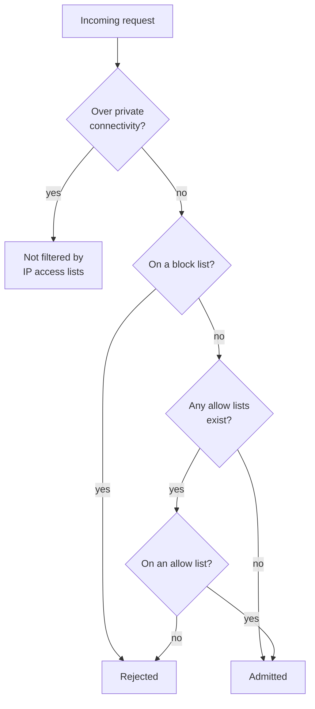

# IP Access Lists

Mastery: `INPUT[inlineSelect(option(new), option(learning), option(solid)):mastery]`

> [!story] Context
> The [[Network Security Overview]] describes three network paths. IP access lists control the front-end path by restricting which public IP addresses can reach the workspace or account console.

> [!eli5] Summary
> An IP access list tells Databricks which network addresses may connect and which may not. Requests from addresses outside the allowed list are rejected, even with valid credentials.

## Background

Authentication verifies identity, not location. A stolen laptop or leaked token works from any network. An IP access list adds a second condition: the request must come from an approved network, such as an office, a VPN, or the fixed egress addresses of CI runners.

IP access lists require no cloud networking changes, which makes them simpler to adopt than private connectivity.

## Overview

IP access lists exist at two levels:

| Level | Protects | Who manages | Status |
|---|---|---|---|
| **Workspace** | The workspace UI and workspace REST APIs | Workspace admins | GA |
| **Account console** | The account console and account-level APIs | Account admins | GA on AWS; the Azure docs marked account-console lists Public Preview as of October 2026 |

How a request is judged:

1. **Block lists first:** If the address matches a block list, it is rejected, even if it is also on an allow list.
2. **Allow lists next:** If any allow list exists, only addresses on one are admitted.
3. **No lists**, with the feature enabled, means every address is admitted.

Facts from the docs:

- At most **1,000 IP/[[CIDR]] values** across all allow and block lists combined. Each CIDR counts as one value. Going over returns a 400 `QUOTA_EXCEEDED` error.
- **IPv4 only.**
- The API refuses a change that would block **your own current IP**, returning `INVALID_STATE`. This prevents most self-lockouts.
- Changes usually take effect within a few minutes.
- Lists apply only to traffic **over the public internet**. Traffic over private connectivity is not filtered by them.
- Plan: the AWS docs say Enterprise tier, the Azure docs say Premium plan.

Databricks now recommends **context-based ingress** policies as the primary inbound control, because they combine IP ranges with identity and access type. Workspace IP lists still work as an extra IP-only layer, and a request must pass both. See [[Network Security Overview]].

## How it works



Setting it up on a workspace with the [[Databricks CLI]]:

```bash
# 1. Check whether the feature is enabled
databricks workspace-conf get-status enableIpAccessLists

# 2. Create the allow list FIRST, including where you are now
databricks ip-access-lists create --json '{
  "label": "office-and-vpn",
  "list_type": "ALLOW",
  "ip_addresses": ["203.0.113.0/24", "198.51.100.17/32"]
}'

# 3. Optionally block a known-bad range
databricks ip-access-lists create --json '{
  "label": "blocked",
  "list_type": "BLOCK",
  "ip_addresses": ["192.0.2.0/24"]
}'

# 4. Turn the feature on (lists have no effect until you do)
databricks workspace-conf set-status --json '{"enableIpAccessLists": "true"}'

# Review what is configured
databricks ip-access-lists list
```

(The addresses above are documentation ranges. Use your own public IPs.)

## Small-business considerations

> [!smallbiz] Small-business considerations
> Use IP access lists only if all users connect from known networks, such as an office or a company VPN. If users work from changing networks without a VPN, an allow list blocks them; rely on SSO with MFA instead.
>
> If you use an allow list:
> 1. Include office and VPN ranges, plus the fixed outbound IPs of external tools that call Databricks (for example a hosted BI service or CI runner).
> 2. Keep a second admin on a different network while testing.
> 3. Before enabling account-console lists, note that serverless compute calls to the account come from internal Databricks addresses that cannot be allowlisted. Contact your account team if you automate against the account.

## Cloud differences

> [!azure]- Azure Databricks
> - Requires the **Premium plan**.
> - IP lists do not filter [[Azure Private Link]] traffic. To go private-only, set **Allow Public Network Access** to **Disabled** on the workspace. In the *hybrid* model, Private Link is on and public access stays on, guarded by context-based ingress and IP lists.
> - Entra ID **conditional access** can also restrict sign-in by network location, at the identity layer instead of the workspace. See [[Single Sign-On]].

> [!aws]- Databricks on AWS
> - Requires the **Enterprise tier**.
> - With [[AWS PrivateLink]], IP lists apply only to requests over the public internet.

> [!gcp]- Databricks on Google Cloud
> - IP lists do not affect requests from VPC networks connected through [[Private Service Connect]]. Those are governed by the PSC access level configuration.
> - For a PSC workspace, public access is allowed by default. One documented way to block the internet is to enable IP access lists and add a **BLOCK** rule for `0.0.0.0/0`. Private traffic is unaffected.
> - If account-level IP lists are on, requests from serverless compute to the account come from internal addresses you cannot allowlist, so they may be blocked. Exemptions go through your Databricks account team.

## Advanced topics

> [!deepdive]- Advanced topics (301–401)
> - **Order of creation matters:** Create allow lists, then enable the feature. Once enabled, adding an allow list immediately blocks everything else.
> - **Disable vs delete:** Each list has an `enabled` flag. Disabling a list is a quick, reversible way to test.
> - **Outbound IPs of your tools:** SaaS BI, ETL, and CI tools often publish their egress ranges. These change; keep them in code (for example with the [[Terraform Provider]]) and review them.
> - **Lockout recovery:** If you lock out the UI, a workspace admin can still fix the lists through the API from an allowed network, or over private connectivity if it exists.
> - **Compliance:** IP lists help but do not by themselves meet "no public access" requirements. Those need private connectivity with public access disabled.
> - **Ingress logging:** Context-based ingress denials (including dry runs) appear in `system.access.inbound_network`, which helps you see what an allow list would block before you enforce it.

## Common misconceptions

> [!confusion] IP access lists do not protect data from your clusters
> They filter who can reach the workspace's UI and APIs. They do nothing about where your clusters or serverless compute send data. That is egress control: see [[Serverless Network Security]].

> [!confusion] An allow list does not apply to private connectivity
> Traffic over Private Link, PrivateLink, or PSC bypasses IP access lists. Use the private connectivity settings or ingress policies to control it.

## Recall

What does an IP access list do?::Allows or blocks access to the workspace or account console based on the client's public IP address.
Which is evaluated first, allow or block lists?::Block lists.
What happens if the feature is enabled but no lists exist?::All IP addresses are admitted.
What is the limit on IP/CIDR values?::1,000 values across all allow and block lists combined.
What error do you get if a change would block your own IP?::`INVALID_STATE`.
Do IP access lists filter Private Link or PSC traffic?::No. They apply only to requests over the public internet.
Which IP version do IP access lists support?::IPv4 only.
What does Databricks now recommend as the primary inbound control?::Context-based ingress policies, with IP access lists as an extra IP-only layer.
Which CLI command enables workspace IP access lists?::`databricks workspace-conf set-status` with `enableIpAccessLists` set to `true`.

## Next steps

> [!path] Learning path
> **Needs first:** [[Network Security Overview]], [[Public vs Private IP]]
> **Unlocks next:** [[Serverless Network Security]], [[Compliance Security Profile]]

> [!nextup] Next
> [[Serverless Network Security]] covers outbound connections from serverless compute, which IP access lists do not control.

> [!sources]- Sources (last verified: 2026-10-25)
> - [Manage IP access lists (AWS)](https://docs.databricks.com/aws/en/security/network/front-end/ip-access-list)
> - [Manage IP access lists (Azure)](https://learn.microsoft.com/en-us/azure/databricks/security/network/front-end/ip-access-list)
> - [Manage IP access lists (GCP)](https://docs.databricks.com/gcp/en/security/network/front-end/ip-access-list)
> - [Configure IP access lists for workspaces (AWS)](https://docs.databricks.com/aws/en/security/network/front-end/ip-access-list-workspace)
> - [Configure IP access lists for workspaces (Azure)](https://learn.microsoft.com/en-us/azure/databricks/security/network/front-end/ip-access-list-workspace)
> - [Configure IP access lists for the account console (AWS)](https://docs.databricks.com/aws/en/security/network/front-end/ip-access-list-account)
> - [Configure IP access lists for the account console (GCP)](https://docs.databricks.com/gcp/en/security/network/front-end/ip-access-list-account)
> - [ip-access-lists command group (CLI)](https://docs.databricks.com/aws/en/dev-tools/cli/reference/ip-access-lists-commands)
> - [Users to Azure Databricks networking](https://learn.microsoft.com/en-us/azure/databricks/security/network/front-end/)
> - [Context-based ingress control (Azure)](https://learn.microsoft.com/en-us/azure/databricks/security/network/front-end/context-based-ingress)
> - [Users to Databricks networking (GCP)](https://docs.databricks.com/gcp/en/security/network/front-end/)
