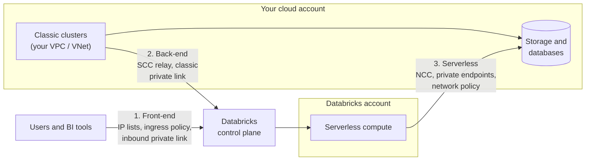

# Network Security Overview

Mastery: `INPUT[inlineSelect(option(new), option(learning), option(solid)):mastery]`

> [!story] Context
> [[Secrets Management]] completes the identity and credential controls. The remaining layer is the network: which clients can reach the workspace, how classic compute connects to the control plane, and where serverless compute can send data.

> [!eli5] Summary
> Databricks traffic follows three paths: people and tools connecting in, classic compute connecting to Databricks, and serverless compute connecting out to your data. Each path has its own controls, from address allow lists to fully private connections.

## Background

By default, a Databricks workspace is reachable over the public internet and protected by authentication. Regulated and larger organizations typically add network requirements:

- Restrict workspace access to corporate networks or a VPN.
- Keep cluster traffic off the public internet.
- Prevent workloads from sending data to unapproved destinations (data exfiltration).
- Demonstrate these controls to auditors.

Databricks separates the **control plane** (operated by Databricks) from **compute planes**: classic compute in your cloud account and serverless compute in the Databricks account. See [[Control Plane and Compute Plane]]. Each connection between them is secured separately.

## Overview

| Path | What travels on it | Controls | Deeper note |
|---|---|---|---|
| **Front-end (inbound)** | Users, BI tools, API clients reaching the workspace and account console | IP access lists, context-based ingress policies, inbound private connectivity, disabling public access | [[IP Access Lists]] |
| **Back-end (classic)** | Classic clusters in your network talking to the control plane | Secure cluster connectivity (no public IPs), your own VPC or VNet, classic private connectivity, firewalls on egress | [[Secure Cluster Connectivity]], [[VNet Injection]], [[Customer-Managed VPC on AWS]] |
| **Serverless (outbound)** | Serverless compute reaching your storage, databases, and the internet | Network connectivity configurations (NCCs), private endpoint rules, network policies (egress control) | [[Serverless Network Security]] |

Databricks' Private Link docs describe these as three paths that can be enabled in any combination. For the strictest isolation they suggest enabling all three.

**Secure cluster connectivity (SCC)** is the baseline for classic compute. New workspaces have it by default: your VPC or VNet has no open inbound ports and cluster nodes have no public IP addresses. Each cluster opens an outbound HTTPS tunnel (port 443) to a relay in the control plane, and administration tasks flow back through that tunnel. Serverless compute does not use SCC, but it also has no public IPs.

**Context-based ingress** is the newer front-end control. A rule combines network source (public IPs or CIDRs, or private endpoints), identity (all users, all service principals, or selected ones), and access type into one allow-or-deny policy. Databricks now recommends it as the primary inbound control, with workspace IP access lists as an extra IP-only layer. A request must pass both. Status differs by feature: the AWS overview calls context-based ingress GA with some parts in Beta, while the workspace management page and the Data + AI Summit 2026 post call it Public Preview. It requires the Enterprise tier.

## How it works

A practical path from simplest to most locked down:

| Level | What you do | Who it fits |
|---|---|---|
| **0. Defaults** | SSO plus MFA, SCC on (default), Databricks-managed network | Most small businesses |
| **1. Known networks** | Add IP access lists or a context-based ingress policy for office and VPN ranges | Small companies with an office or VPN |
| **2. Your own network** | Deploy classic compute into your own VPC or VNet, control egress with your firewall | Companies with a cloud network team |
| **3. Private everything** | Inbound and classic private connectivity, public access disabled, serverless private endpoints, restricted network policy | Regulated industries, large enterprises |

## Small-business considerations

> [!smallbiz] Small-business considerations
> Level 0 or 1 meets the needs of most small companies:
> 1. Enable SSO with MFA ([[Single Sign-On]]). Identity controls provide more protection than network controls for most small teams.
> 2. Keep secure cluster connectivity enabled (the default).
> 3. Prefer serverless compute, which removes the classic back-end path from your network.
> 4. Add an IP allow list for office and VPN ranges only if all users connect from known networks. Test before enforcing.
>
> Private connectivity requires cloud networking expertise and incurs cloud provider charges for endpoints and data processing. Adopt it when a customer or regulator requires it.

## Cloud differences

The three paths are the same idea everywhere. The products and names differ.

> [!azure]- Azure Databricks
> - **Your own network:** [[VNet Injection]] deploys classic compute into your own VNet with two subnets. Required for some upgrades, such as enabling SCC on an older workspace.
> - **SCC** is also called **No Public IP (NPIP)** on Azure. Databricks has said it plans to require SCC for all classic workspaces in a future release.
> - **Private connectivity:** [[Azure Private Link]] covers front-end (inbound) and back-end (classic) paths. Public access is a separate setting: set *Allow Public Network Access* to *Disabled* for private-only access.
> - **Serverless:** NCCs provide private endpoints to Azure resources, and stable subnet IDs for storage firewalls. Microsoft also suggests a network security perimeter with the `AzureDatabricksServerless` service tag for storage.

> [!aws]- Databricks on AWS
> - **Your own network:** a [[Customer-Managed VPC on AWS]] (network configuration with a VPC and at least two subnets).
> - **Private connectivity:** [[AWS PrivateLink]] for front-end and classic back-end, using VPC interface endpoints. Classic PrivateLink requires the Enterprise plan.
> - **Serverless:** NCCs manage private endpoints to S3 and to resources in your VPC. The docs give quotas such as 30 S3 private endpoints per region and 100 VPC resources per region shared across NCCs, and an NCC can attach to up to 50 workspaces in its region.

> [!gcp]- Databricks on Google Cloud
> - **Your own network:** a [[Customer-Managed VPC on Google Cloud]].
> - **Private connectivity:** [[Private Service Connect]] (PSC) for front-end and classic back-end. For PSC workspaces, public access is allowed by default; block it with an IP access list rule for `0.0.0.0/0` or the PSC access level settings.
> - **Serverless:** outbound PSC through NCCs reaches **your own** resources behind an internal load balancer. It does **not** support PSC to Google-managed services; serverless reaches Cloud Storage and BigQuery through Private Google Access.

## Advanced topics

> [!deepdive]- Advanced topics (301–401)
> - **Reference architectures.** The docs describe deployment patterns such as *managed security*, *hardened connectivity*, and *isolated environment*, from Databricks-managed networks to fully private, no-public-access setups. Start from one of them rather than inventing your own.
> - **TLS inspection breaks clusters.** Do not inspect TLS on the SCC relay traffic. The docs warn it causes cluster failures.
> - **Private link is not "no internet".** Enabling inbound private connectivity does not by itself block public access. You must disable public access (Azure), use IP lists or PSC access levels (GCP), or use ingress policies.
> - **Databricks Apps.** Apps traffic authenticates with the control plane, then flows straight to the serverless compute plane. With front-end private connectivity, you need conditional DNS forwarding for the `databricksapps.com` domain.
> - **Logging.** Ingress denials are logged in `system.access.inbound_network` and serverless egress denials in `system.access.outbound_network`. Both support dry-run modes, so you can test a policy before enforcing it.
> - **IPv4 only** for IP access lists.

## Common misconceptions

> [!confusion] "Front-end" and "back-end" are about who connects, not about web code
> Front-end means users and clients connecting in. Back-end means classic compute connecting to the control plane. They have nothing to do with web developers' front-end and back-end.

> [!confusion] Serverless needs its own network setup
> VNet injection, customer-managed VPCs, and classic private links do not cover serverless compute, because serverless runs in Databricks' account. Serverless uses NCCs and network policies instead. See [[Serverless Network Security]].

## Recall

What are the three Databricks network paths?::Front-end (inbound users and clients), back-end or classic (classic compute to control plane), and serverless (serverless compute to your resources).
What does secure cluster connectivity do?::Removes public IPs and open inbound ports from classic compute; clusters open an outbound HTTPS tunnel to a control-plane relay.
What is SCC called on Azure?::No Public IP (NPIP).
What does context-based ingress combine?::Network source, identity, and access type in one allow-or-deny policy.
Does enabling inbound private connectivity block public internet access by itself?::No. You must disable public access or add rules separately.
Which private connectivity product does each cloud use?::Azure Private Link, AWS PrivateLink, and Google Cloud Private Service Connect.
Which system table logs ingress denials?::`system.access.inbound_network`.
Can serverless on GCP use Private Service Connect to Cloud Storage?::No. Serverless reaches Google-managed services through Private Google Access; PSC is for your own resources.

## Next steps

> [!path] Learning path
> **Needs first:** [[Control Plane and Compute Plane]], [[VPC and VNet]], [[Public vs Private IP]]
> **Unlocks next:** [[IP Access Lists]], [[Serverless Network Security]], [[Compliance Security Profile]]

> [!nextup] Next
> [[IP Access Lists]] covers the simplest front-end control: restricting access to known network addresses.

> [!sources]- Sources (last verified: 2026-10-25)
> - [Networking (AWS)](https://docs.databricks.com/aws/en/security/network/)
> - [Networking (Azure)](https://learn.microsoft.com/en-us/azure/databricks/security/network/)
> - [Networking (GCP)](https://docs.databricks.com/gcp/en/security/network)
> - [Private Link concepts (AWS)](https://docs.databricks.com/aws/en/security/network/concepts/privatelink-concepts)
> - [Private Link concepts (Azure)](https://learn.microsoft.com/en-us/azure/databricks/security/network/concepts/privatelink-concepts)
> - [Private Service Connect concepts (GCP)](https://docs.databricks.com/gcp/en/security/network/concepts/privatelink-concepts)
> - [Classic compute plane networking (AWS)](https://docs.databricks.com/aws/en/security/network/classic)
> - [Enable secure cluster connectivity (Azure)](https://learn.microsoft.com/en-us/azure/databricks/security/network/classic/secure-cluster-connectivity)
> - [Phase 4: Design network architecture (AWS)](https://docs.databricks.com/aws/en/lakehouse-architecture/deployment-guide/network)
> - [Context-based ingress control (AWS)](https://docs.databricks.com/aws/en/security/network/front-end/context-based-ingress)
> - [Manage context-based ingress policies (AWS)](https://docs.databricks.com/aws/en/security/network/front-end/manage-ingress-policies)
> - [Users to Azure Databricks networking (Azure)](https://learn.microsoft.com/en-us/azure/databricks/security/network/front-end/)
> - [Configure networking for Databricks Apps (AWS)](https://docs.databricks.com/aws/en/dev-tools/databricks-apps/networking)
> - [Isolated environment (AWS)](https://docs.databricks.com/aws/en/security/network/deployment-architecture/isolated-environment)
> - [What's new in platform security and compliance at Data + AI Summit 2026](https://www.databricks.com/blog/whats-new-databricks-platform-security-and-compliance-data-ai-summit-2026)
