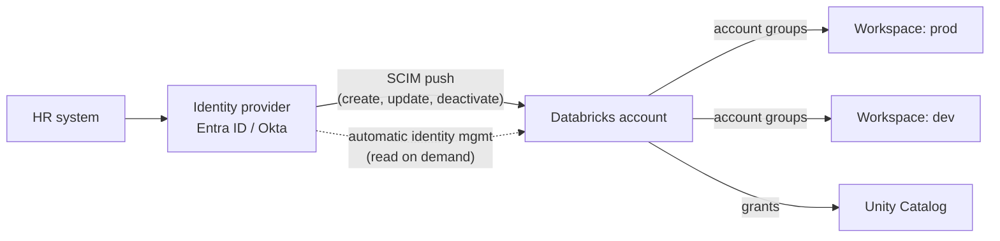

# SCIM Provisioning

Mastery: `INPUT[inlineSelect(option(new), option(learning), option(solid)):mastery]`

> [!story] Context
> [[Users Groups and Service Principals]] recommends account groups as the unit of access. Those users and groups should come from the company identity provider rather than being created by hand.

> [!eli5] Summary
> SCIM provisioning connects Databricks to the system a company already uses to manage employee accounts, such as Microsoft Entra ID or Okta. New hires, team changes, and departures then appear in Databricks automatically.

## Background

Manual user management drifts from the company's source of record. Departing employees keep access until someone removes them, new employees wait for accounts, and group names diverge from the identity provider. Auditors also expect evidence that access follows the HR process.

**SCIM** (System for Cross-domain Identity Management) is an open standard API for this problem: the identity provider pushes creates, updates, and deactivations to the target system. Databricks also offers **automatic identity management**, which reads identities from the identity provider on demand instead of receiving pushes.

## Overview

There are two supported ways to get identities from your IdP into a Databricks account, plus one legacy way:

| Method | How it works | Status and fit |
|---|---|---|
| **Account-level SCIM** | Your IdP's Databricks app calls the account SCIM API with a token. It pushes users, groups, and (for Entra ID) service principals. | Recommended SCIM route on every cloud. |
| **Automatic identity management** | Databricks reads users, groups, and service principals from the IdP when they are first used: at sign-in, or when an admin adds them. No SCIM app to run. | Recommended on Azure, and on by default for Azure accounts created after 1 August 2025. Also offered on AWS and GCP. |
| **Workspace-level SCIM** | SCIM straight into one workspace. Creates workspace-local groups. | Legacy. Migrate to account level. |

**Account-level SCIM**, step by step (Okta shown; Entra ID is similar):

1. In the [[Account Console]], go to **Security**, then **Identity provider setup**, and generate a SCIM token. Copy the **Account SCIM URL**.
2. In Okta, add the Databricks app from the catalog. Under *Provisioning*, paste the URL and token, click *Test API Credentials*, then *Save*.
3. Enable *Create users*, *Update user attributes*, and *Deactivate users*.
4. Assign users. Databricks suggests assigning Okta's `Everyone` group so every employee exists in the account, then using *Push Groups* for the groups you actually grant on.
5. Set up [[Single Sign-On]] too. SCIM creates identities; it does not log anyone in.

Requirements: Premium plan or above, account admin rights in Databricks, and (for Okta) Lifecycle Management in your Okta tenant.

## How it works



The SCIM API is a plain [[REST]] API. You rarely call it directly, but it helps to see what the IdP is doing:

```bash
# What Okta or Entra ID sends when it creates a user (simplified)
# <account-scim-url> is the Account SCIM URL copied from the account console
curl -X POST "<account-scim-url>/Users" \
  -H "Authorization: Bearer $SCIM_TOKEN" \
  -H "Content-Type: application/scim+json" \
  -d '{
    "schemas": ["urn:ietf:params:scim:schemas:core:2.0:User"],
    "userName": "maria@shop.com",
    "displayName": "Maria Lopez",
    "active": true
  }'
```

When someone leaves, the IdP sends a `PATCH` setting `"active": false`. Their sessions and tokens stop working, but their history and owned objects remain.

### How automatic identity management differs

- **Just-in-time.** Users and group memberships are fetched when someone signs in or an admin adds them. The docs give sync delays of up to about 5 minutes for browser sign-in and up to 40 minutes for jobs, CLI, and service principals.
- **Nested groups work** (Entra ID only). Membership is resolved transitively, so a member of a child group counts as a member of the parent. Only groups added to Databricks are looked up, and the full IdP hierarchy is not copied.
- **Limits.** It does not support cross-tenant Entra ID directories. Nested groups that are not directly provisioned are visible in the console but not through the APIs or Terraform. For nested group structures, the migration guide suggests keeping SCIM running alongside it.

## Small-business considerations

> [!smallbiz] Small-business considerations
> - **Small teams without IdP provisioning:** add users manually in the account console and keep an offboarding checklist.
> - **Microsoft 365 customers on Azure Databricks:** use automatic identity management. It is on by default for Azure accounts created after 1 August 2025.
> - **Okta or other IdPs:** configure account-level SCIM. Departures in the IdP then deactivate users in Databricks automatically.
>
> SCIM has no Databricks charge. Some identity providers include provisioning only in paid tiers.

## Cloud differences

> [!azure]- Azure Databricks
> - **Automatic identity management is the recommended route** and is on by default for accounts created after 1 August 2025. It reads users, groups, and service principals straight from Entra ID, supports nested groups, and needs no enterprise application.
> - The Entra ID **SCIM connector** (an enterprise application in Entra) is still supported, including service principal sync. It does not configure sign-in; Entra ID SSO is on by default anyway. See [[Microsoft Entra ID Integration]].
> - To move from SCIM to automatic identity management, follow Microsoft's *Migrate to automatic identity management* guide. If you rely on nested groups, it suggests keeping SCIM alongside.

> [!aws]- Databricks on AWS
> - Use account-level SCIM from your IdP: Okta, Entra ID, OneLogin, or others with a SCIM 2.0 client. The token and URL come from the account console's Identity provider setup tab.
> - Automatic identity management is also documented on AWS. With Okta, neither SCIM nor automatic identity management syncs nested groups or service principals.

> [!gcp]- Databricks on Google Cloud
> - Account-level SCIM works the same way (Databricks documents Okta and Entra ID on GCP).
> - Without an external IdP, users sign in with Google Cloud Identity, and admins add them in the console. Automatic identity management for Entra ID is also documented on GCP.

## Advanced topics

> [!deepdive]- Advanced topics (301–401)
> - **Deletion is destructive.** Removing a user or group from the account-level IdP app deletes them from the Databricks account, not just from a workspace. Unassigning `Everyone` by mistake removes everyone. Use deactivation flows, and test changes on a small group first.
> - **Renames.** Do not rename groups in Okta once they are pushed. Databricks does not support renaming groups through that path, and the sync breaks.
> - **Matching.** Existing users are matched by email address (the username). Changing an email in the IdP without a matching update can create a duplicate.
> - **Do not mix levels.** Workspace-level SCIM keeps creating workspace-local groups. Turn it off before migrating to account groups.
> - **Terraform and SCIM together.** If SCIM owns groups, let Terraform reference them with data sources rather than create them, so the two systems do not overwrite each other. See [[Terraform Provider]].
> - **System group migration.** If your sync deletes unknown workspace groups, exclude the `users-clone-*` group created by the 2026 entitlement migration.

## Common misconceptions

> [!confusion] SCIM is not SSO
> SCIM decides **who exists** in Databricks and which groups they are in. [[Single Sign-On]] decides **how they log in**. You need both, and they are configured separately.

> [!confusion] Automatic identity management is not "SCIM, but automatic"
> SCIM pushes changes on a schedule. Automatic identity management looks identities up when they are used. That is why it handles nested Entra groups better, and why a user may not appear in the account until their first sign-in.

## Recall

What does SCIM stand for?::System for Cross-domain Identity Management.
What does SCIM do for Databricks?::Lets your identity provider automatically create, update, and deactivate users and groups in the Databricks account.
Where do you get the SCIM token and URL?::Account console, Security, Identity provider setup.
Why is workspace-level SCIM discouraged?::It is legacy and creates workspace-local groups that cannot receive Unity Catalog grants.
What is automatic identity management?::A Databricks feature that reads users, groups, and service principals from the IdP on demand, without a SCIM app.
For which Azure accounts is automatic identity management on by default?::Accounts created after 1 August 2025.
Which IdP's nested groups does automatic identity management support?::Microsoft Entra ID (not Okta).
What happens if you remove a group from the account-level Okta app?::Its users are deleted from the Databricks account.

## Next steps

> [!path] Learning path
> **Needs first:** [[Users Groups and Service Principals]], [[Identity Provider]]
> **Unlocks next:** [[Single Sign-On]], [[Privileges and Grants]]

> [!nextup] Next
> [[Single Sign-On]] covers how provisioned users authenticate with the company identity provider.

> [!sources]- Sources (last verified: 2026-10-25)
> - [Sync users and groups from your identity provider using SCIM (AWS)](https://docs.databricks.com/aws/en/admin/users-groups/scim/)
> - [Configure SCIM provisioning for Okta (AWS)](https://docs.databricks.com/aws/en/admin/users-groups/scim/okta)
> - [Configure SCIM provisioning for Okta (GCP)](https://docs.databricks.com/gcp/en/admin/users-groups/scim/okta)
> - [Configure SCIM provisioning using Microsoft Entra ID (AWS)](https://docs.databricks.com/aws/en/admin/users-groups/scim/aad)
> - [Configure SCIM provisioning using Microsoft Entra ID (Azure)](https://learn.microsoft.com/en-us/azure/databricks/admin/users-groups/scim/aad)
> - [Automatic identity management (Azure)](https://learn.microsoft.com/en-us/azure/databricks/admin/users-groups/automatic-identity-management/)
> - [Automatic identity management (AWS)](https://docs.databricks.com/aws/en/admin/users-groups/automatic-identity-management/)
> - [Automatic identity management (GCP)](https://docs.databricks.com/gcp/en/admin/users-groups/automatic-identity-management)
> - [Migrate to automatic identity management with Microsoft Entra ID (Azure)](https://learn.microsoft.com/en-us/azure/databricks/admin/users-groups/automatic-identity-management/migrate-to-aim)
> - [Provision identities to a Databricks workspace (legacy) (GCP)](https://docs.databricks.com/gcp/en/archive/workspace-level-scim)
> - [Identity best practices (AWS)](https://docs.databricks.com/aws/en/admin/users-groups/best-practices)
