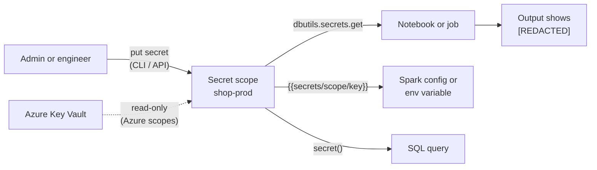

# Secrets Management

Mastery: `INPUT[inlineSelect(option(new), option(learning), option(solid)):mastery]`

> [!story] Context
> [[Compute Policies]] governs compute configuration. Pipelines also need credentials for external systems, such as database passwords and API keys. Secrets management keeps those values out of notebooks, job settings, and Git.

> [!eli5] Summary
> A secret is a password, key, or token that code needs. Databricks stores secrets in named containers with access lists. Code refers to a secret by name, and Databricks hides the value if it appears in output.

## Background

Hard-coded credentials are a common cause of security incidents. In a data platform they appear in notebook cells, job parameters, cluster settings, and copied code. Once a credential is committed to Git history, the only remediation is to rotate it.

Databricks secrets store each credential in one place with an access list. Code references the secret by scope and key, not by value.

## Overview

Databricks has two generations of secret storage.

### 1. Secret scopes (workspace-level)

The long-standing system. A scope is a named collection of secrets inside one workspace.

| Scope type | Where values live | Who can write | Clouds |
|---|---|---|---|
| **Databricks-backed** | An encrypted database owned and managed by Databricks | Users with WRITE or MANAGE on the scope | All |
| **Azure Key Vault-backed** | Your Azure Key Vault. The scope is a read-only interface. | Nobody through Databricks. You manage values in Key Vault. | Azure |

Limits from the docs: a workspace can have at most **100 secret scopes**, a scope at most **1,000 secrets**, and a secret value at most **128 KB**. Scope names are unique per workspace, case-insensitive, up to 128 characters, and readable by every user in the workspace (so do not put sensitive words in the name).

Access lists on a scope have three levels: **READ** (read secrets), **WRITE** (read and write), and **MANAGE** (also change the ACL). Only users with MANAGE can change ACLs.

### 2. Secrets in Unity Catalog

A newer system where a secret is a [[Unity Catalog]] securable that lives in a schema (`catalog.schema.secret`), governed by SQL grants: `CREATE SECRET` (on a catalog or schema), `READ SECRET`, `WRITE SECRET`, and `REFERENCE SECRET` (use it without seeing the value). Unity Catalog secrets can also be **external**, backed by AWS Secrets Manager or Azure Key Vault, in which case they are read-only. The docs describe these as distinct from workspace secret scopes. I could not confirm the release stage (preview or GA) for every cloud as of October 2026, so check your workspace.

## How it works



**Create a scope, add a secret, share read access** (Databricks CLI 0.205 and later):

```bash
# Scope name is positional in the newer CLI
databricks secrets create-scope shop-prod

# Add a secret (run `databricks secrets put-secret --help` for the ways to pass the value)
databricks secrets put-secret shop-prod orders-db-password

# Let the pipeline's service principal and the engineers group read it
databricks secrets put-acl shop-prod sp-nightly-etl READ
databricks secrets put-acl shop-prod data-engineers READ

# Check who has access
databricks secrets list-acls shop-prod
```

On a workspace below the Premium plan, the creator cannot be given MANAGE by default, so create the scope with `--initial-manage-principal users`.

**Use it in a notebook:**

```python
password = dbutils.secrets.get(scope="shop-prod", key="orders-db-password")

orders = (spark.read.format("jdbc")
  .option("url", "jdbc:postgresql://orders.internal:5432/shop")
  .option("dbtable", "public.orders")
  .option("user", "reporting")
  .option("password", password)
  .load())

print(password)   # prints [REDACTED]
```

**Use it in compute configuration**, without any code:

```text
spark.shop.dbpassword {{secrets/shop-prod/orders-db-password}}
SHOP_DB_PASSWORD={{secrets/shop-prod/orders-db-password}}
```

The first line is a Spark configuration property, the second an environment variable. The cluster owner needs READ on the scope, and the cluster must restart to pick up a changed secret.

**Use it in SQL** (Databricks Runtime 11.3 LTS and above): `SELECT secret('shop-prod', 'orders-db-password')`. A missing key raises `INVALID_SECRET_LOOKUP`; `try_secret()` returns NULL instead.

**Unity Catalog secrets** are granted like tables:

```sql
GRANT CREATE SECRET, USE SCHEMA ON SCHEMA ops.credentials TO `data-engineers`;
GRANT READ SECRET ON SCHEMA ops.credentials TO `sp-nightly-etl`;
```

## Small-business considerations

> [!smallbiz] Small-business considerations
> - Create one scope per environment, such as `shop-prod` and `shop-dev`, and store all passwords, API keys, and tokens there.
> - Grant `READ` to the service principal that runs each job rather than to all users.
> - On Azure, if credentials are already in Key Vault, use a Key Vault-backed scope so rotation happens in one place.
> - Periodically search notebooks for literal credentials, for example `password=` and `token=`.
>
> Secret scopes have no separate charge.

## Cloud differences

> [!azure]- Azure Databricks
> - **Azure Key Vault-backed scopes** let a scope read straight from an existing Key Vault. They are read-only from Databricks, so you add, rotate, and delete values in Azure. Creating one grants Databricks Get and List on the vault through access policies. See [[Azure Key Vault Secret Scopes]].
> - For Unity Catalog, Azure Key Vault can back **external secrets**.
> - For storage access, prefer Unity Catalog with an access connector and [[Managed Identity|managed identity]] over storing storage keys as secrets. See [[ADLS and Access Connectors]].

> [!aws]- Databricks on AWS
> - Secret scopes are Databricks-backed. The scope docs describe Azure Key Vault as the only external scope backend, so there is no AWS Secrets Manager-backed *scope*.
> - **AWS Secrets Manager** can back Unity Catalog **external secrets**.
> - For S3, prefer Unity Catalog storage credentials (IAM roles) over access keys in secrets. See [[S3 Access via Unity Catalog]].

> [!gcp]- Databricks on Google Cloud
> - Secret scopes are Databricks-backed. I found no Google Secret Manager-backed scope type in the docs.
> - For GCS, prefer Unity Catalog storage credentials (Databricks-generated Google service accounts) over keys in secrets. See [[GCS Access via Unity Catalog]].

## Advanced topics

> [!deepdive]- Advanced topics (301–401)
> - **Redaction is not a security boundary:** Databricks redacts literal secret values in notebook output and Spark config, but not deliberate transformations (reversing the string, inserting spaces). Secrets are also not redacted from the Spark driver log's stdout and stderr. The real control is the ACL on the scope plus who can run code on the cluster.
> - **Anyone on the cluster:** A secret placed in a cluster's Spark config or environment can be read by code from any user who can attach to that cluster, even without direct READ permission on the scope. Keep secret-bearing config on dedicated compute.
> - **The CLI cannot show values:** `list-secrets` is metadata only. `get-secret` returns base64-encoded bytes to principals with READ, so treat CLI access as read access.
> - **Encryption:** Secrets in Databricks-backed scopes are part of control-plane "managed services" data, which a customer-managed key can protect. See [[Encryption]].
> - **Prefer identities to secrets:** Many secrets can be removed entirely: storage access through Unity Catalog credentials, CI through OAuth token federation, and database connections through Unity Catalog connections used by [[Lakeflow Connect]] and [[Lakehouse Federation]] (check each connector's docs for how it stores credentials).

## Common misconceptions

> [!confusion] `[REDACTED]` does not mean the value is hidden from the code
> The code holds the real value. Redaction only stops it from being shown as literal output. Anyone who can run code with READ access can still use, and with effort reveal, the secret.

> [!confusion] Secret scopes and Unity Catalog secrets are different systems
> Scopes are per workspace with their own ACLs. Unity Catalog secrets live in the catalog, are governed by SQL grants, and can be shared across workspaces on the same metastore.

## Recall

What is a secret scope?::A named collection of secrets in a Databricks workspace, with its own access list.
What are the two secret scope types?::Databricks-backed and Azure Key Vault-backed.
How do you read a secret in a notebook?::`dbutils.secrets.get(scope="...", key="...")`.
What are the three secret scope ACL levels?::READ, WRITE, and MANAGE.
What are the limits on scopes, secrets per scope, and secret size?::100 scopes per workspace, 1,000 secrets per scope, 128 KB per secret value.
How do you reference a secret in a Spark config property?::`spark.<property> {{secrets/<scope>/<key>}}`.
Can you write secrets into an Azure Key Vault-backed scope from Databricks?::No. It is read-only; manage values in Key Vault.
Which SQL function reads a secret?::`secret(scope, key)`, or `try_secret()` to return NULL on failure.
Which Unity Catalog privilege lets an object use a secret without seeing its value?::REFERENCE SECRET.

## Next steps

> [!path] Learning path
> **Needs first:** [[Notebooks]], [[Users Groups and Service Principals]]
> **Unlocks next:** [[Azure Key Vault Secret Scopes]], [[Lakeflow Connect]], [[Encryption]]

> [!nextup] Next
> [[Network Security Overview]] covers the network paths between users, Databricks, and your cloud resources, and the controls on each.

> [!sources]- Sources (last verified: 2026-10-25)
> - [Secret management (AWS)](https://docs.databricks.com/aws/en/security/secrets/)
> - [Secret management (Azure)](https://learn.microsoft.com/en-us/azure/databricks/security/secrets/)
> - [Tutorial: Create and use a Databricks secret (AWS)](https://docs.databricks.com/aws/en/security/secrets/example-secret-workflow)
> - [secrets command group (CLI)](https://docs.databricks.com/aws/en/dev-tools/cli/reference/secrets-commands)
> - [Secret Scope REST API](https://docs.databricks.com/api/secrets/v1/secret-scope)
> - [Use a secret in a Spark configuration property or environment variable (AWS)](https://docs.databricks.com/aws/en/security/secrets/secrets-spark-conf-env-var)
> - [secret function (Azure)](https://learn.microsoft.com/en-us/azure/databricks/sql/language-manual/functions/secret)
> - [secret function (GCP)](https://docs.databricks.com/gcp/en/sql/language-manual/functions/secret)
> - [Secrets in Unity Catalog (AWS)](https://docs.databricks.com/aws/en/security/secrets/unity-catalog-secrets)
> - [Secrets in Unity Catalog (Azure)](https://learn.microsoft.com/en-us/azure/databricks/security/secrets/unity-catalog-secrets)
> - [External secrets in Unity Catalog (AWS)](https://docs.databricks.com/aws/en/security/secrets/external-secrets)
> - [Unity Catalog privileges reference (AWS)](https://docs.databricks.com/aws/en/data-governance/unity-catalog/access-control/privileges-reference)
