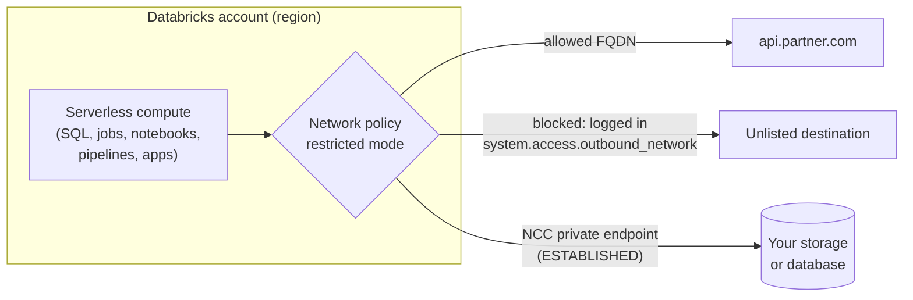

# Serverless Network Security

Mastery: `INPUT[inlineSelect(option(new), option(learning), option(solid)):mastery]`

> [!story] Context
> [[IP Access Lists]] control inbound access to the workspace. [[Serverless Compute]] runs in the Databricks account, outside your VPC or VNet, so the classic controls (VNet injection, customer-managed VPCs, your own firewall) do not apply to it. Serverless outbound traffic is governed by two account-level objects: network connectivity configurations and network policies.

> [!eli5] Summary
> Serverless compute runs on machines that Databricks operates. These settings decide which of your systems those machines can reach, whether that traffic stays on private cloud networks, and which internet destinations they are allowed to contact.

## Background

With classic compute, clusters run in a network you own. You control egress with route tables, firewalls, and security groups. Serverless compute removes that network from your account, which simplifies operations but creates two requirements:

1. **Reaching protected resources:** A storage account or database behind a firewall must admit serverless compute, either by IP address or over a private endpoint.
2. **Preventing exfiltration:** Code running on serverless compute must not be able to send data to arbitrary internet destinations.

Databricks addresses the first with **network connectivity configurations (NCCs)** and the second with **network policies**, also called **serverless egress control**.

## Overview

| Object | Scope | Purpose | Managed in |
|---|---|---|---|
| **Network connectivity configuration (NCC)** | Account-level, one cloud region | Private endpoint rules from serverless compute to your resources; stable network identities for firewalls | Account console, Security, Network connectivity configurations; API; CLI `databricks account network-connectivity` |
| **Network policy** | Account-level, attached to workspaces | Egress control: Full access, or Restricted access with allowed destinations | Account console, Security, network policies; API |

**NCC facts from the docs:**

- An NCC is regional and can be attached to up to **50 workspaces** in the same region.
- **Private endpoint rules** create a private endpoint from serverless compute to a target resource. A rule takes effect only after the resource owner approves the connection and its state is `ESTABLISHED`.
- On AWS, the docs list quotas of **30 S3 private endpoints per region** and **100 VPC resources per region**, shared across NCCs. On GCP, the docs list **20 NCCs per region per account**, **10 private endpoints per region**, and **100 domain names per rule**.
- The docs state that there are currently no networking charges for serverless features, and that charges may apply later with advance notice.

**Network policy facts from the docs:**

- Each account has a **default policy** that applies to every workspace without an explicit assignment, including new workspaces. It can be modified but not deleted.
- **Full access** allows unrestricted outbound internet. **Restricted access** allows only Unity Catalog external locations, explicitly listed FQDNs and storage destinations, and the workspace's own APIs.
- Up to **2,500 allowed destinations** per policy.
- **Blocked destinations** (Public Preview, REST API only) are always enforced, take precedence over allowed destinations, and support DNS names only.
- **Dry-run mode** logs violations without blocking them. Databricks recommends starting in dry run.
- Denials are logged in `system.access.outbound_network`, with action `DROP` for enforced denials and `DRY_RUN_DENIAL` for dry-run hits.
- Most changes propagate within ten minutes. Switching internet access mode, changing dry-run mode, or switching between policies with different enforcement types can take up to 24 hours, and may require restarting compute.
- Plan requirement: Enterprise tier on AWS, Premium on Azure. The GCP Apps networking page states Premium tier for GCP.

### Stable IPs (legacy)

Databricks previously published a fixed list of serverless egress IPs for allowlisting in firewalls. The AWS docs state that the legacy stable IP list was deprecated on **25 May 2026**. The replacement method is to download the published IP ranges file, filter for Databricks outbound entries for your region, and allowlist those CIDR blocks. The docs mark this method as Public Preview and warn that IPs can change as often as every 30 days, with new IPs active as soon as 60 days after publication, so the allowlist must be refreshed on a schedule. Where possible, use private endpoints instead.

## How it works



### Procedure: private access from serverless to an Azure storage account

1. In the account console, open **Security**, then **Network connectivity configurations**, and create an NCC in the workspace's region.
2. Attach the NCC to the workspace.
3. Add a private endpoint rule with the storage account's resource ID. Create one rule per subresource: `dfs` and `blob`.
4. Wait until the rules show `PENDING`.
5. In the Azure portal, open the storage account, **Networking**, **Private endpoint connections**, and approve the pending connections.
6. Confirm the rule status in the account console.

### Procedure: restrict serverless egress

1. Create a network policy with **Restricted access**.
2. Add allowed destinations: FQDNs for each external API, and storage destinations for buckets or containers not already registered as Unity Catalog external locations.
3. Enable **dry-run mode** and attach the policy to the workspace.
4. Run representative workloads, then review denials:

```sql
-- Destinations that a restricted policy would block, last 7 days
SELECT event_time, workspace_id, network_source_type,
       destination_type, destination, access_type
FROM system.access.outbound_network
WHERE event_time >= current_timestamp() - INTERVAL 7 DAYS
  AND access_type = 'DRY_RUN_DENIAL'
ORDER BY event_time DESC;
```

5. Add legitimate destinations, then disable dry-run mode to enforce.

`destination_type` is `DNS`, `IP`, or `STORAGE`. `network_source_type` names the product that made the call (for example `DBSQL`, `General Compute`, `MLServing`, `Apps`).

## Small-business considerations

> [!smallbiz] Small-business considerations
> - Most small companies do not need NCCs or restricted network policies. The default policy (full access) is acceptable when storage access goes through Unity Catalog and no regulated data is processed.
> - Adopt an NCC when serverless compute must read a storage account or database that sits behind a firewall.
> - Adopt a restricted network policy when a customer contract, auditor, or the [[Compliance Security Profile]] requires egress control. Start in dry-run mode and review `system.access.outbound_network` for a week before enforcing.
> - Plan requirements differ by cloud (Enterprise on AWS, Premium on Azure). See [[How Databricks Pricing Works]].

## Cloud differences

> [!azure]- Azure Databricks
> - NCCs create private endpoints to Azure resources (storage accounts, SQL databases, and resources in your VNet behind a Private Link service). Endpoints must be approved on the target resource.
> - NCCs also provide **stable subnet IDs** that you can add to a storage account firewall instead of private endpoints. For the workspace storage account, serverless can use service endpoints without a private endpoint rule.
> - For storage, Microsoft documents a **network security perimeter** with the regional `AzureDatabricksServerless` service tag as an alternative to IP lists.
> - The Azure docs warn that serverless compute can receive `403 Forbidden` from your resources after the legacy stable IP list is removed, until you migrate.
> - Network policies require the Premium tier. Azure China supports only the all-products dry-run option.

> [!aws]- Databricks on AWS
> - NCCs manage private endpoints to S3 and to resources in your VPC (through a VPC endpoint service). Quotas: 30 S3 private endpoints and 100 VPC resources per region, shared across NCCs.
> - Network policies require the Enterprise tier. SQL warehouses and model serving endpoints can be placed in dry-run mode individually.
> - S3 buckets used as Unity Catalog external locations in a different region from the metastore are not allowed automatically under restricted mode. Add them as allowed storage destinations.
> - Configuring a serverless firewall allowlist does not cover classic compute; classic compute needs its own rules. The method cannot reach IPv6-only resources.

> [!gcp]- Databricks on Google Cloud
> - Outbound [[Private Service Connect]] through NCCs is GA for **customer-managed resources** fronted by an internal load balancer with a service attachment in the same region. You approve the connection in your Google Cloud project.
> - Serverless does **not** support PSC to Google-managed services. Cloud Storage and BigQuery are reached through Private Google Access. If VPC Service Controls block that path, the docs recommend classic compute.
> - Private-use TLDs such as `.internal` and `.test` are not supported in private endpoint rules. The private endpoint rule is not available in the Terraform provider and must be created in the account console.

## Advanced topics

> [!deepdive]- Advanced topics (401)
> - **NCC and policy are independent:** An NCC defines private paths; a network policy defines which destinations are permitted. A destination reached over an NCC private endpoint must still be allowed by the policy in restricted mode.
> - **Cross-workspace access** is not granted by full access mode. It is controlled separately.
> - **Databricks Apps** need build-time and runtime domains (package repositories, for example) on the allowlist. Validate with dry run.
> - **Inbound vs outbound logs:** `system.access.inbound_network` records ingress policy denials; `system.access.outbound_network` records egress denials. Account-level ingress policy denials are not logged.
> - **Account console and serverless:** If account-level IP access lists are enabled, requests from serverless compute to the account come from internal Databricks addresses that cannot be allowlisted.
> - **On-premises resources:** The GCP docs describe an SSH reverse tunnel pattern for reaching on-premises systems from serverless compute.

## Common misconceptions

> [!confusion] VNet injection and customer-managed VPCs do not cover serverless
> Those controls apply to classic compute in your network. Serverless compute is governed by NCCs and network policies.

> [!confusion] An NCC does not restrict egress
> An NCC adds private connectivity. Restricting where serverless compute can connect requires a network policy in restricted mode.

## Recall

What is a network connectivity configuration (NCC)?::An account-level, regional object that manages private endpoint rules and network identities for serverless compute.
How many workspaces can one NCC be attached to?::Up to 50 in the same region.
When does an NCC private endpoint rule take effect?::After the resource owner approves it and its state is `ESTABLISHED`.
What does a network policy in restricted mode allow by default?::Unity Catalog external locations, the workspace's own APIs, and explicitly listed FQDNs and storage destinations.
What happens to the account's default network policy?::It applies to all workspaces without an explicit assignment; it can be edited but not deleted.
Where are serverless egress denials logged?::`system.access.outbound_network`.
How are dry-run denials labeled in the log?::`DRY_RUN_DENIAL` (enforced denials are `DROP`).
When was the legacy serverless stable IP list deprecated on AWS?::25 May 2026.
Can serverless compute on GCP use PSC to reach Cloud Storage?::No. It uses Private Google Access; PSC is for customer-managed resources.

## Next steps

> [!path] Learning path
> **Needs first:** [[Network Security Overview]], [[Serverless Compute]], [[Egress]]
> **Unlocks next:** [[Compliance Security Profile]], [[Encryption]]

> [!nextup] Next
> [[Encryption]] covers how data is protected at rest and in transit, and where customer-managed keys apply.

> [!sources]- Sources (last verified: 2026-10-25)
> - [Serverless compute plane networking (GCP)](https://docs.databricks.com/gcp/en/security/network/serverless-network-security)
> - [What is serverless egress control? (AWS)](https://docs.databricks.com/aws/en/security/network/serverless-network-security/network-policies)
> - [What is serverless egress control? (Azure)](https://learn.microsoft.com/en-us/azure/databricks/security/network/serverless-network-security/network-policies)
> - [Manage network policies for serverless egress control (AWS)](https://docs.databricks.com/aws/en/security/network/serverless-network-security/manage-network-policies)
> - [Manage network policies for serverless egress control (Azure)](https://learn.microsoft.com/en-us/azure/databricks/security/network/serverless-network-security/manage-network-policies)
> - [Configure private connectivity to Azure resources (Azure)](https://learn.microsoft.com/en-us/azure/databricks/security/network/serverless-network-security/serverless-private-link)
> - [Configure private connectivity to resources in your VNet (Azure)](https://learn.microsoft.com/en-us/azure/databricks/security/network/serverless-network-security/pl-to-internal-network)
> - [Configure private connectivity to resources in your VPC (GCP)](https://docs.databricks.com/gcp/en/security/network/serverless-network-security/pl-to-internal-network)
> - [Configure a firewall for serverless compute access (legacy) (AWS)](https://docs.databricks.com/aws/en/security/network/serverless-network-security/serverless-firewall)
> - [Configure a firewall for serverless compute access (Azure)](https://learn.microsoft.com/en-us/azure/databricks/security/network/serverless-network-security/serverless-firewall-config)
> - [Enable firewall support for your workspace storage account (Azure)](https://learn.microsoft.com/en-us/azure/databricks/security/network/storage/firewall-support)
> - [Private Link concepts (AWS)](https://docs.databricks.com/aws/en/security/network/concepts/privatelink-concepts)
> - [Network Connectivity Config API](https://docs.databricks.com/api/networking/v1/network-connectivity-config)
> - [account network-connectivity command group (GCP)](https://docs.databricks.com/gcp/en/dev-tools/cli/reference/account-network-connectivity-commands)
> - [Network access events system table reference (AWS)](https://docs.databricks.com/aws/en/admin/system-tables/network)
> - [Network access events system table reference (Azure)](https://learn.microsoft.com/en-us/azure/databricks/admin/system-tables/outbound-network)
> - [Configure networking for Databricks Apps (GCP)](https://docs.databricks.com/gcp/en/dev-tools/databricks-apps/networking)
