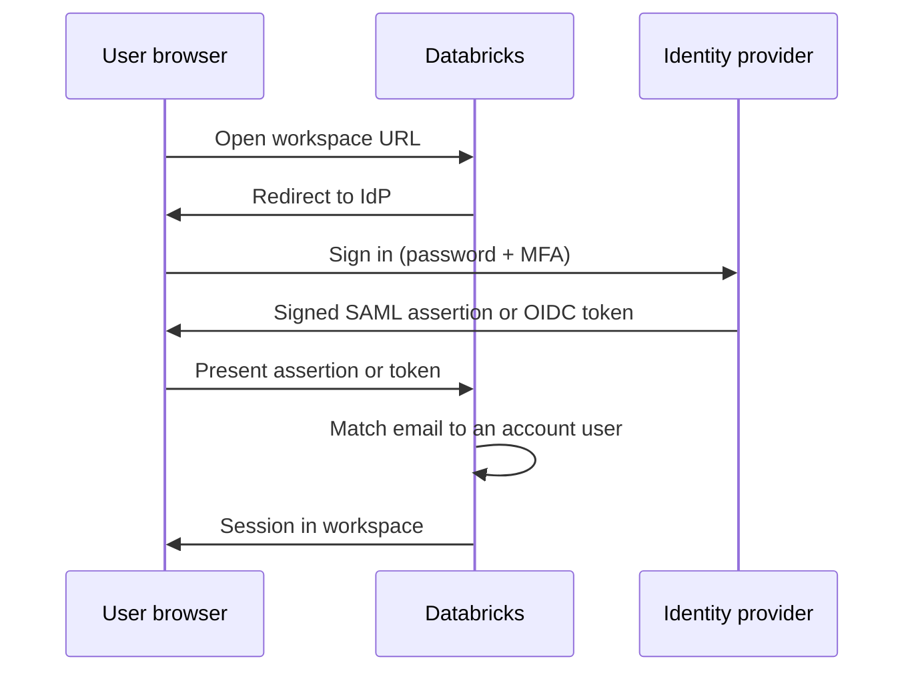

# Single Sign-On

Mastery: `INPUT[inlineSelect(option(new), option(learning), option(solid)):mastery]`

> [!story] Context
> [[SCIM Provisioning]] creates users and groups in the account. Single sign-on (SSO) defines how those users authenticate: through the company identity provider rather than a separate Databricks password.

> [!eli5] Summary
> Single sign-on lets people use their normal work login to access Databricks. Password rules and multi-factor authentication come from the company's identity system, and disabling a work account also removes Databricks access.

## Background

Separate passwords for each tool are a security and support burden: they are reused, forgotten, and retained after employees leave. Company identity providers already enforce password policy, multi-factor authentication (MFA), and device checks. SSO delegates authentication to the identity provider so Databricks inherits those controls.

SSO was originally configured per workspace. **Unified login** replaced per-workspace configuration with one account-level setting.

## Overview

Databricks SSO supports two standard protocols. Your identity provider must support at least one:

| Protocol | What it is | Typical IdPs |
|---|---|---|
| **SAML 2.0** | An older XML-based standard. The IdP sends a signed assertion. | Okta, Entra ID, OneLogin, AWS IAM Identity Center, JumpCloud |
| **OpenID Connect (OIDC)** | A newer layer on [[OAuth]] 2.0. The IdP returns a signed ID token. | Okta, Entra ID, Keycloak, Google |

**Unified login** means one SSO configuration applies to the account console and every workspace. The docs say it is enabled by default for most accounts. Accounts created after 21 June 2023, or that had not configured SSO before 12 December 2024, get it automatically, and it cannot be disabled.

Once SSO is on, all users, including admins, sign in through it. By default the username is the email address. You can use another claim in the IdP if your emails change.

## How it works

Setting it up (AWS and GCP, where you configure it yourself):

1. In the IdP, create a Databricks application. Copy the **Databricks redirect URL** from the console into it, and assign a test user.
2. In the [[Account Console]], open **Security**, then **Identity provider setup**, and choose SAML 2.0 or OIDC.
3. Paste the IdP values: for SAML, the SSO URL, entity ID, and X.509 certificate; for OIDC, the issuer URL, client ID, and client secret.
4. Click **Save**, then **Test SSO**. Only if the test passes, click **Enable SSO**.
5. If the test fails, check the redirect URL, the client ID or secret, the certificate, or a test user who is not assigned to the app in the IdP.

Pair SSO with [[SCIM Provisioning]]. With SSO alone, the person can authenticate but may not exist in the account yet.

## Small-business considerations

> [!smallbiz] Small-business considerations
> - **Azure Databricks with Microsoft 365:** SSO through Entra ID is already enabled. Enable MFA in Entra ID.
> - **Databricks on GCP with Google Workspace:** Google sign-in is available by default. Enable 2-step verification in Google.
> - **Databricks on AWS:** configure SSO with your IdP before inviting users, and keep a second account admin available in case the IdP configuration fails.
>
> SSO has no Databricks charge. Some identity providers charge for SSO applications.

## Cloud differences

> [!azure]- Azure Databricks
> - **Microsoft Entra ID SSO is on by default** for the account console and every workspace. There is no SSO page to configure. MFA comes from Entra ID.
> - **Conditional access** policies in Entra ID can require MFA, a compliant device, or a corporate network. They need the Azure Databricks Premium plan, Entra ID Premium, and the Conditional Access Administrator role. You target the *AzureDatabricks* enterprise application. (The Microsoft page for this sits in an archive path, so check it is current.)
> - Users must sign in with a work account from the Entra ID tenant the account belongs to. See [[Microsoft Entra ID Integration]].

> [!aws]- Databricks on AWS
> - You configure SSO yourself in the account console. Databricks publishes guides for Entra ID, Okta, OneLogin, Keycloak, AWS IAM Identity Center, and JumpCloud.
> - Unified login is on by default for newer accounts. Older accounts that had per-workspace SSO before December 2024 may still have workspace-level settings to clean up.

> [!gcp]- Databricks on Google Cloud
> - **Google Cloud Identity (Google Workspace) SSO is available by default**, and MFA can be enforced there.
> - You can bring another IdP (Okta, Entra ID, OneLogin) over SAML 2.0 or OIDC in the same Identity provider setup tab. Some GCP-hosted guides (OneLogin, Okta) were labelled Public Preview in the docs.
> - If you bring your own IdP, Google ID token authentication for service accounts is no longer available.

## Advanced topics

> [!deepdive]- Advanced topics (301–401)
> - **Emergency access.** Once SSO is on, all users sign in through the IdP. If the IdP certificate expires or the application is deleted, browser sign-in fails for everyone. Plan an emergency path: a second IdP admin, a documented certificate rotation date, and account-level automation that uses an OAuth service principal rather than a browser.
> - **Certificates.** SAML signing certificates expire. Put the expiry date in a calendar and rotate before it, using the IdP's overlap support.
> - **Username claim.** If your company changes email domains, map the username to a stable claim, or users will appear as new identities.
> - **Tool sign-in.** CLIs, SDKs, and BI tools use OAuth user-to-machine (U2M), which also goes through your IdP via the browser. SSO configuration therefore also affects tool sign-in. See [[Authentication - Tokens and OAuth]].
> - **Network context.** SSO answers "who", not "from where". Combine it with [[IP Access Lists]], context-based ingress policies, or private connectivity for "from where".

## Common misconceptions

> [!confusion] SSO does not create users
> SSO checks the identity of someone who tries to log in. It does not add them to groups or workspaces. That is [[SCIM Provisioning]] or automatic identity management.

> [!confusion] "Unified login" is not a separate product
> Unified login is the name for one SSO configuration that covers the account and all workspaces. On most accounts it is enabled and cannot be disabled.

## Recall

Which two protocols does Databricks SSO support?::SAML 2.0 and OpenID Connect (OIDC).
What is unified login?::One SSO configuration that applies to the account console and every workspace.
Which accounts get unified login automatically?::Accounts created after 21 June 2023, or that had not configured SSO before 12 December 2024.
What must you do before clicking Enable SSO?::Save the IdP settings and pass Test SSO.
How does SSO work on Azure Databricks by default?::Microsoft Entra ID SSO is on by default, with nothing to configure in Databricks.
What is the default SSO on Databricks on GCP?::Google Cloud Identity (Google Workspace) sign-in.
What does an Entra ID conditional access policy for Azure Databricks require?::Premium plan, Entra ID Premium, and the Conditional Access Administrator role.
Does SSO add users to groups?::No. SCIM or automatic identity management does that.

## Next steps

> [!path] Learning path
> **Needs first:** [[Identity Provider]], [[Account Console]]
> **Unlocks next:** [[Authentication - Tokens and OAuth]], [[IP Access Lists]]

> [!nextup] Next
> [[Authentication - Tokens and OAuth]] covers authentication for tools, scripts, and automation that do not sign in through a browser.

> [!sources]- Sources (last verified: 2026-10-25)
> - [Configure SSO in Databricks (AWS)](https://docs.databricks.com/aws/en/security/auth/single-sign-on/)
> - [Configure SSO in Databricks (GCP)](https://docs.databricks.com/gcp/en/security/auth/single-sign-on/)
> - [Configure SSO using OIDC (GCP)](https://docs.databricks.com/gcp/en/security/auth/single-sign-on/oidc)
> - [Configure SSO using SAML (GCP)](https://docs.databricks.com/gcp/en/security/auth/single-sign-on/saml)
> - [SSO to Databricks with Microsoft Entra ID (AWS)](https://docs.databricks.com/aws/en/security/auth/single-sign-on/azure-ad)
> - [SSO to Databricks with Okta (AWS)](https://docs.databricks.com/aws/en/security/auth/single-sign-on/okta)
> - [SSO to Databricks with Keycloak (AWS)](https://docs.databricks.com/aws/en/security/auth/single-sign-on/keycloak)
> - [Authentication and access control (GCP)](https://docs.databricks.com/gcp/en/security/auth/)
> - [Authentication and access control (Azure)](https://learn.microsoft.com/en-us/azure/databricks/security/auth/)
> - [Conditional access (Azure, archive)](https://learn.microsoft.com/bs-latn-ba/azure/databricks/archive/azure-admin/conditional-access)
