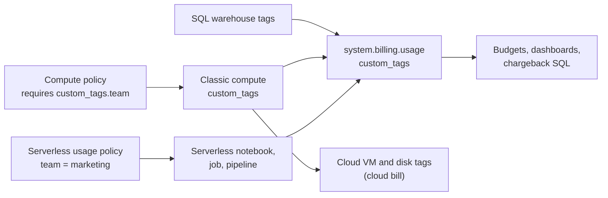

# Tagging for Chargeback

Mastery: `INPUT[inlineSelect(option(new), option(learning), option(solid)):mastery]`

> [!story] Context
> [[Budgets and Usage Dashboards]] can filter and group spend by tag, but only for usage that carries tags. This note covers how tags are attached to classic compute, SQL warehouses, pools, and serverless usage, and how they reach the billing data.

> [!eli5] Summary
> A tag is a label such as `team = marketing` attached to the computing resources a team uses. Every charge for those resources carries the label, so each team's share of the bill can be calculated.

> [!renamed] Renamed
> **Serverless budget policies** are now called **serverless usage policies** in the current AWS and Azure docs. Some GCP and older Azure pages still use the old name. I could not confirm the date of the rename.

## Background

A shared Databricks account serves many teams. Without attribution, the monthly bill is one number, and no team owns it. Chargeback (billing each team for its usage) and showback (reporting usage without billing) both depend on tagging. Tags also appear on cloud provider resources, so they support cost analysis on the cloud bill.

## Overview

| Tag source | Applies to | Set by | Reaches |
|---|---|---|---|
| **Compute tags** (`custom_tags`) | All-purpose and job compute | Compute creator; enforced by [[Compute Policies]] | `system.billing.usage`, cloud VMs and disks |
| **SQL warehouse tags** | SQL warehouses | Warehouse owner | `system.billing.usage`, cloud resources for classic warehouses |
| **Pool tags** | Instance pools | Pool creator | Usage and pool VMs |
| **Workspace tags** | All compute in a workspace | Workspace configuration (cloud-specific) | Cloud resources and usage |
| **Serverless usage policies** | Serverless notebooks, jobs, pipelines, serving endpoints, and apps | Workspace admins create; users select | `custom_tags` in `system.billing.usage` |

### Default tags

Databricks adds default tags to compute it deploys: `Vendor`, `ClusterId`, `ClusterName`, and `Creator` on clusters; `JobId` (and `RunName` on some clouds) on jobs compute; a warehouse identifier on SQL warehouses; `DatabricksInstancePoolId` and `DatabricksInstancePoolCreatorId` on pools.

**Key rules from the docs:**

- Tags apply **going forward only**. Missing tags cannot be added to past usage.
- On AWS and Azure, a custom tag that reuses a default tag key is renamed with an `x_` prefix (for example `x_vendor`). A conflicting tag added **through a compute policy** instead makes the cluster or pool fail with an invalid settings error.
- Serverless usage policies do **not** tag classic compute, and classic tags do not tag serverless usage. You need both mechanisms.
- The legacy DBU usage reports do not include serverless usage or serverless usage policy tags. Use `system.billing.usage`.

### Serverless usage policies

- A policy is an account-level object containing tags. Workspace admins create policies; users with the **Manager** permission can edit them; users with the **User** permission can select them.
- If a user has one policy, it is applied automatically to new serverless resources they create. If they have several, they choose; otherwise the first policy alphabetically applies.
- When a notebook runs as part of a job, the job's policy applies. Pipelines triggered by jobs do not inherit the job's policy, so set the pipeline's policy explicitly.
- Existing notebooks, jobs, and pipelines are not assigned a policy automatically; update each one.
- Tag changes apply only to usage that starts after the change.

## How it works



### Procedure: tag everything with a `team` key

1. Choose a small set of tag keys and allowed values, for example `team`, `project`, and `env`.
2. Require `custom_tags.team` in every [[Compute Policies|compute policy]]:

```json
{
  "custom_tags.team":    { "type": "allowlist", "values": ["analytics", "marketing", "ops"] },
  "custom_tags.env":     { "type": "allowlist", "values": ["dev", "prod"], "defaultValue": "dev" }
}
```

3. Add the same tags to each SQL warehouse.
4. Create one serverless usage policy per team (for example `team = marketing`) and grant the team's group the **User** permission on it.
5. Assign policies to existing serverless jobs, notebooks, and pipelines.

### Cost by tag

```sql
-- List cost by team for the current month, classic and serverless together
SELECT COALESCE(u.custom_tags['team'], 'untagged') AS team,
       SUM(u.usage_quantity * p.pricing.default)    AS list_cost
FROM system.billing.usage u
JOIN system.billing.list_prices p
  ON  u.cloud = p.cloud
  AND u.sku_name = p.sku_name
  AND u.usage_start_time >= p.price_start_time
  AND (u.usage_end_time <= p.price_end_time OR p.price_end_time IS NULL)
WHERE u.usage_date >= date_trunc('MONTH', current_date())
GROUP BY ALL
ORDER BY list_cost DESC;
```

```sql
-- Share of spend that carries no team tag (target: near zero)
SELECT ROUND(100 * SUM(CASE WHEN custom_tags['team'] IS NULL THEN usage_quantity END)
             / SUM(usage_quantity), 1) AS pct_untagged_dbus
FROM system.billing.usage
WHERE usage_date >= current_date() - INTERVAL 30 DAYS;
```

## Small-business considerations

> [!smallbiz] Small-business considerations
> - Two keys are usually enough: `team` (or `client` for agencies) and `env`.
> - Enforce tags through compute policies from the start; tags cannot be added to past usage.
> - If most work runs on serverless, create one serverless usage policy per team before people start creating jobs.
> - Showback (a monthly report per team) is usually sufficient. Formal chargeback is rarely worth the overhead below about 50 people.

## Cloud differences

> [!azure]- Azure Databricks
> - Default and custom tags propagate to Azure VMs and appear in **Azure Cost Management**.
> - Clusters created from a **pool** receive only workspace and pool tags on their VMs; cluster tags are not propagated, to preserve pool start-up time. Put required tags on the pool or workspace.
> - Up to 50 tags per Azure resource; up to 41 custom tags on a pool.
> - Newly added, modified, or deleted **workspace tags** do not propagate to existing compute. Edit the compute and choose **Confirm and restart**.

> [!aws]- Databricks on AWS
> - Default and custom tags propagate to EC2 instances and EBS volumes for AWS cost analysis.
> - Clusters created from a pool inherit only workspace and pool tags on EC2, not cluster tags.
> - Up to 20 tags per workspace resource; up to 43 custom tags on a pool.

> [!gcp]- Databricks on Google Cloud
> - Tags propagate as **labels** on GCE resources (VMs and persistent disks), up to 54 custom tags.
> - Instances from a pool inherit **both** pool and cluster tags. Databricks default tags take precedence over custom tags, and pool tags over cluster tags.

## Advanced topics

> [!deepdive]- Advanced topics (301–401)
> - **Pool-based clusters:** In DBU usage, both cluster and pool tags are recorded even when the cluster comes from a pool. The cloud-resource behavior differs by cloud, as listed above.
> - **Shared compute:** Usage on a shared all-purpose cluster carries that cluster's tags, not the tags of each user's work. For per-job attribution, run jobs on job compute or serverless.
> - **Development-mode pipelines:** Serverless usage policy tag updates are not reflected in new pipeline updates while the pipeline is in development mode, and take up to 24 hours to propagate.
> - **Jobs UI:** Tags inherited from serverless usage policies do not appear in the Jobs list UI.
> - **Governance Hub:** The Cost page shows a tagged-spend percentage and a **View untagged spend** shortcut (Beta as of October 2026).
> - **Billing admins** can manage serverless usage policies without being account admins. See [[Admin Roles]].

## Common misconceptions

> [!confusion] Serverless usage policies do not limit spend
> Despite the former name "budget policies", they attach tags for attribution. Use budgets for alerts and compute settings for limits.

> [!confusion] Cluster tags do not cover serverless
> Serverless usage is tagged only through serverless usage policies.

## Recall

Where do custom tags appear in billing data?::In the `custom_tags` map column of `system.billing.usage`.
What were serverless usage policies previously called?::Serverless budget policies.
Do serverless usage policies tag classic compute?::No.
Can you add tags to past usage?::No. Tags apply going forward only.
What happens on AWS and Azure when a custom tag reuses a default tag key?::It is renamed with an `x_` prefix, unless added through a compute policy, which makes the cluster fail.
On AWS and Azure, which tags reach the VMs of pool-based clusters?::Workspace and pool tags, not cluster tags.
On GCP, how do tags appear on cloud resources?::As labels on GCE VMs and persistent disks.
Who creates serverless usage policies?::Workspace admins; users with the Manager permission can edit them.
When a notebook runs in a job, whose serverless usage policy applies?::The job's.

## Next steps

> [!path] Learning path
> **Needs first:** [[Budgets and Usage Dashboards]], [[Compute Policies]]
> **Unlocks next:** [[Cost Optimization Checklist]], [[Terraform Provider]]

> [!nextup] Next
> [[Cost Optimization Checklist]] lists the settings and practices that reduce spend once it is measured and attributed.

> [!sources]- Sources (last verified: 2026-10-25)
> - [Use tags to attribute and track usage (AWS)](https://docs.databricks.com/aws/en/admin/account-settings/usage-detail-tags)
> - [Use tags to attribute and track usage (Azure)](https://learn.microsoft.com/en-us/azure/databricks/admin/account-settings/usage-detail-tags)
> - [Use tags to attribute and track usage (GCP)](https://docs.databricks.com/gcp/en/admin/account-settings/usage-detail-tags)
> - [Attribute usage with serverless usage policies (AWS)](https://docs.databricks.com/aws/en/admin/usage/budget-policies)
> - [Attribute usage with serverless usage policies (Azure)](https://learn.microsoft.com/en-us/azure/databricks/admin/usage/budget-policies)
> - [Attribute usage with serverless budget policies (GCP)](https://docs.databricks.com/gcp/en/admin/usage/budget-policies)
> - [Pool configuration reference (AWS)](https://docs.databricks.com/aws/en/compute/pools)
> - [Pool configuration reference (Azure)](https://learn.microsoft.com/en-us/azure/databricks/compute/pools)
> - [Billable usage system table reference (Azure)](https://learn.microsoft.com/en-us/azure/databricks/admin/system-tables/billing)
> - [Monitor costs using system tables (AWS)](https://docs.databricks.com/aws/en/admin/usage/system-tables)
> - [Cost overview, Governance Hub (AWS)](https://docs.databricks.com/aws/en/admin/governance-hub/cost)
