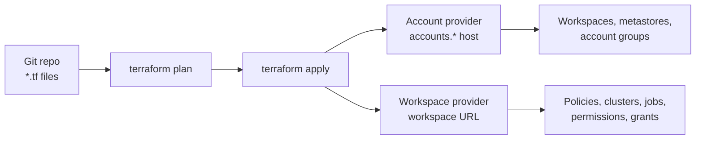

# Terraform Provider

Mastery: `INPUT[inlineSelect(option(new), option(learning), option(solid)):mastery]`

> [!story] Context
> The [[Cost Optimization Checklist]] and the security notes before it describe many settings: groups, policies, IP lists, network configurations, budgets. Configured by hand, they drift between workspaces and cannot be reviewed or rebuilt. The Databricks Terraform provider manages them as code.

> [!eli5] Summary
> Terraform is a tool that builds and updates cloud setups from text files. The Databricks provider teaches Terraform how to create Databricks workspaces, users, permissions, and settings. Because the setup is written down, it can be reviewed, repeated, and rebuilt.

## Background

Manual configuration in the account console and workspace settings has three problems: changes are not reviewed, environments drift apart, and a workspace cannot be recreated reliably after a failure. [[Infrastructure as Code]] solves these by describing the desired state in files kept in [[Git]]. The provider was originally published under the `databrickslabs` namespace and moved to `databricks/databricks`.

## Overview

The **Databricks Terraform provider** (`databricks/databricks` in the Terraform Registry) aims to support all Databricks REST APIs. It manages two kinds of objects:

| Level | Provider configuration | Typical resources |
|---|---|---|
| **Account** | `host` = account console URL, plus `account_id` | `databricks_mws_workspaces` (AWS, GCP), `databricks_mws_credentials`, `databricks_mws_storage_configurations`, `databricks_mws_networks`, `databricks_metastore`, `databricks_metastore_assignment`, account groups and service principals |
| **Workspace** | `host` = workspace URL, no `account_id` | `databricks_cluster_policy`, `databricks_cluster`, `databricks_job`, `databricks_sql_endpoint`, `databricks_permissions`, `databricks_entitlements`, `databricks_secret_scope`, `databricks_grants` |

Rules from the provider docs:

- Do **not** set `account_id` (or `DATABRICKS_ACCOUNT_ID`) on a workspace-level provider; it can cause invalid account configuration errors.
- Some resources work only at one level. For example, `databricks_entitlements` and `databricks_permissions` are workspace-only; `databricks_mws_storage_configurations` is account-only.
- Most Unity Catalog APIs are workspace-level, except metastores, metastore assignments, and storage credentials.
- Account-level operations need an identity with the account admin role.

**Terraform vs Declarative Automation Bundles.** Use Terraform for platform resources (workspaces, networking, identities, policies, permissions). Use [[Declarative Automation Bundles]] for project assets (jobs, pipelines, notebooks, dashboards) that data teams deploy with their code.

## How it works



### Provider configuration with two aliases

```hcl
terraform {
  required_providers {
    databricks = {
      source = "databricks/databricks"
      # Pin a version from the Terraform Registry, for example: version = "~> 1.0"
    }
  }
}

# Account-level: OAuth M2M with an account-admin service principal
provider "databricks" {
  alias         = "account"
  host          = "https://accounts.cloud.databricks.com"   # AWS; see Cloud differences
  account_id    = var.databricks_account_id
  client_id     = var.sp_client_id
  client_secret = var.sp_client_secret
}

# Workspace-level: same service principal, workspace URL, no account_id
provider "databricks" {
  alias         = "workspace"
  host          = var.workspace_url
  client_id     = var.sp_client_id
  client_secret = var.sp_client_secret
}
```

Prefer environment variables or token federation over variables for secrets. See [[Authentication - Tokens and OAuth]].

### Workspace resources: group, policy, permission

```hcl
resource "databricks_group" "analysts" {
  provider     = databricks.workspace
  display_name = "analysts"
}

resource "databricks_cluster_policy" "small" {
  provider = databricks.workspace
  name     = "Small interactive"
  definition = jsonencode({
    "autotermination_minutes" = { type = "fixed", value = 30, hidden = true }
    "num_workers"             = { type = "range", minValue = 0, maxValue = 4 }
    "custom_tags.team"        = { type = "unlimited", isOptional = false }
  })
}

resource "databricks_permissions" "small_policy" {
  provider          = databricks.workspace
  cluster_policy_id = databricks_cluster_policy.small.id
  access_control {
    group_name       = databricks_group.analysts.display_name
    permission_level = "CAN_USE"
  }
}
```

The Databricks workspace-management tutorial follows the same pattern: a cluster policy, a group, a group member, and permissions on the policy.

### Account resources: metastore assignment

```hcl
resource "databricks_metastore_assignment" "prod" {
  provider     = databricks.account
  metastore_id = var.metastore_id
  workspace_id = var.workspace_id
}
```

## Small-business considerations

> [!smallbiz] Small-business considerations
> - A single workspace with a few users can be managed in the console. Adopt Terraform when you have two or more workspaces (for example dev and prod), or when an auditor asks how changes are reviewed.
> - Start with workspace-level resources: groups, compute policies, permissions, secret scopes, and SQL warehouses.
> - Keep state in a remote backend with locking (for example a cloud storage bucket), not on a laptop.
> - Terraform is free to use; there is no Databricks charge for the provider.

## Cloud differences

> [!azure]- Azure Databricks
> - Workspaces are created with the **AzureRM** provider (`azurerm_databricks_workspace`), not with `databricks_mws_workspaces`. The Databricks provider then manages the workspace contents.
> - The provider accepts `azure_workspace_resource_id` (environment variable `DATABRICKS_AZURE_RESOURCE_ID`), the Azure resource ID of the workspace, as an alternative to the workspace URL. It is required for Azure managed identity authentication (`azure_use_msi = true`).
> - Entra ID service principal authentication uses `azure_tenant_id`, `azure_client_id`, and `azure_client_secret`.
> - Account host: `https://accounts.azuredatabricks.net`.

> [!aws]- Databricks on AWS
> - Workspaces are created at the account level with `databricks_mws_credentials` (cross-account IAM role), `databricks_mws_storage_configurations` (S3 bucket), optional `databricks_mws_networks` (customer-managed VPC), and `databricks_mws_workspaces`. The AWS workspace guide recommends separate Terraform modules for workspace creation and workspace management.
> - Data sources that call a workspace fail if the workspace does not exist yet; add `depends_on` on the `databricks_mws_workspaces` resource.
> - Account host: `https://accounts.cloud.databricks.com`.

> [!gcp]- Databricks on Google Cloud
> - Workspaces are created with `databricks_mws_workspaces` at the account level, with a GCP-specific configuration. The provider has a GCP workspace provisioning guide.
> - Some serverless networking objects, such as NCC private endpoint rules, are not available in the provider on GCP and must be created in the account console.
> - Account host: `https://accounts.gcp.databricks.com`.

## Advanced topics

> [!deepdive]- Advanced topics (301–401)
> - **Module boundaries.** Keep account-level resources (workspaces, networking, metastores) and workspace-level resources in separate modules and state files. A workspace module can then be applied repeatedly to many workspaces.
> - **SCIM and Terraform.** If SCIM or automatic identity management owns users and groups, reference them with data sources (`data "databricks_group"`) rather than creating them, so the two systems do not conflict.
> - **Exporter.** The provider includes an experimental resource exporter that generates Terraform code from an existing workspace. It is useful for adopting Terraform on a workspace built by hand and for [[Disaster Recovery]] scripts.
> - **Namespace migration.** Configurations that still use `databrickslabs/databricks` must switch the source, and existing state must be updated with `terraform state replace-provider`.
> - **Drift.** Changes made in the UI to Terraform-managed objects are reverted on the next apply. Restrict admin UI access for managed objects, or import changes back into code.

## Common misconceptions

> [!confusion] One provider block cannot manage everything
> Account-level and workspace-level APIs use different hosts. Configure two aliased provider blocks and set `provider = databricks.<alias>` on each resource.

> [!confusion] Terraform does not replace bundles
> Terraform manages the platform. Bundles deploy data projects (jobs, pipelines, notebooks) with their source code. Most teams use both.

## Recall

What is the Terraform Registry source of the Databricks provider?::`databricks/databricks`.
What distinguishes an account-level provider configuration?::The account console URL as `host` plus `account_id`.
What happens if you set `account_id` on a workspace-level provider?::It can cause invalid account configuration errors.
Which resource creates AWS and GCP workspaces?::`databricks_mws_workspaces` with an account-level provider.
How are Azure Databricks workspaces created with Terraform?::With the AzureRM provider resource `azurerm_databricks_workspace`.
Which resource grants a group permission to use a compute policy?::`databricks_permissions` with `cluster_policy_id` and `permission_level = "CAN_USE"`.
What should Terraform manage, and what should bundles manage?::Terraform: platform resources (workspaces, networking, identities, policies, permissions). Bundles: project assets (jobs, pipelines, notebooks).
What was the provider's original namespace?::`databrickslabs/databricks`.

## Next steps

> [!path] Learning path
> **Needs first:** [[Infrastructure as Code]], [[Account Console]], [[Authentication - Tokens and OAuth]]
> **Unlocks next:** [[Disaster Recovery]], [[CI-CD for Data Pipelines]]

> [!nextup] Next
> [[Disaster Recovery]] covers backups and multi-region strategies, where Terraform-defined infrastructure is the basis for rebuilding a workspace in another region.

> [!sources]- Sources (last verified: 2026-10-25)
> - [Databricks Terraform provider (AWS)](https://docs.databricks.com/aws/en/dev-tools/terraform/)
> - [Databricks Terraform provider (Azure)](https://learn.microsoft.com/en-us/azure/databricks/dev-tools/terraform/)
> - [Manage Databricks workspaces using Terraform (AWS)](https://docs.databricks.com/aws/en/dev-tools/terraform/workspace-management)
> - [Manage Databricks workspaces using Terraform (GCP)](https://docs.databricks.com/gcp/en/dev-tools/terraform/workspace-management)
> - [Databricks Provider documentation (Terraform Registry)](https://registry.terraform.io/providers/Databricks/databricks/latest/docs)
> - [Provisioning AWS Databricks workspace (Terraform Registry)](https://registry.terraform.io/providers/databricks/databricks/latest/docs/guides/aws-workspace)
> - [Provisioning Azure Databricks workspace (Terraform Registry)](https://registry.terraform.io/providers/databricks/databricks/latest/docs/guides/azure-workspace)
> - [Provisioning Databricks workspaces on GCP (Terraform Registry)](https://registry.terraform.io/providers/databricks/databricks/1.14.2/docs/guides/gcp-workspace)
> - [databricks_permissions (Terraform Registry)](https://registry.terraform.io/providers/databricks/databricks/latest/docs/resources/permissions)
> - [databricks_entitlements (Terraform Registry)](https://registry.terraform.io/providers/databricks/databricks/latest/docs/resources/entitlements)
> - [databricks_metastore_assignment (Terraform Registry)](https://registry.terraform.io/providers/databricks/databricks/1.105.0/docs/resources/metastore_assignment)
> - [Experimental resource exporter (Terraform Registry)](https://registry.terraform.io/providers/databricks/databricks/1.56.0/docs/guides/experimental-exporter)
> - [Authenticate with Microsoft Entra service principals (Azure)](https://learn.microsoft.com/en-us/azure/databricks/dev-tools/auth/azure-sp)
