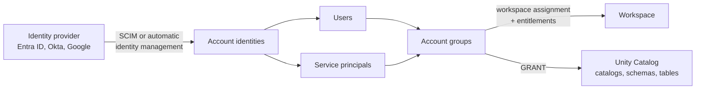

# Users, Groups, and Service Principals

Mastery: `INPUT[inlineSelect(option(new), option(learning), option(solid)):mastery]`

> [!story] Context
> The [[Account Console]] is where identities are managed. This note defines the three identity types and explains why permissions should be granted to groups rather than individuals.

> [!eli5] Summary
> Databricks has three kinds of identity: users (people), service principals (identities for automated jobs and tools), and groups (collections of users and service principals). Granting access to groups keeps permissions correct as people join, move, and leave.

## Background

Granting permissions to individual users does not scale. Each change of role or departure requires finding and moving every grant that person holds. Granting to groups reduces that to a change in group membership.

Automation has a similar problem. A scheduled [[Lakeflow Jobs|job]] that runs as a person stops working when that person leaves, and its actions are attributed to them in the [[Audit Logs|audit log]]. A service principal gives the job its own identity with its own permissions and audit trail.

## Overview

| Identity | What it is | Logs in how | Typical use |
|---|---|---|---|
| **User** | A person, identified by email address (the default username) | Browser with [[Single Sign-On]]; CLI or tools with OAuth | Notebooks, SQL, dashboards |
| **Service principal** | A non-human identity with an application ID | OAuth machine-to-machine, or token federation | Jobs, CI/CD, apps, integrations |
| **Group** | A collection of users, service principals, and other groups | Does not log in | Holds permissions, grants, and workspace assignments |

Since Unity Catalog, identities are defined **at the account**, then assigned to workspaces. There are two kinds of groups:

- **Account groups** are created at the account level (in the console, by SCIM, or by automatic identity management). They can be assigned to any workspace, and they can receive Unity Catalog grants. This is the kind you want.
- **Workspace-local groups** are a legacy kind, shown with a source of *Workspace*. They work only in the one workspace that created them, cannot be assigned to other workspaces, and **cannot be granted access to Unity Catalog data**.

Each workspace also has system groups, `users` and `admins`. As of 2026, Databricks is moving entitlements away from the `users` system group: it copies what that group had to a workspace-local clone group named `users-clone-<TIMESTAMP>`, and asks you to target account groups instead. The Azure docs give the dates: auto-enabled on 27 July 2026 for workspaces that had not opted in or out, and enforced for all workspaces on 14 September 2026.

**Entitlements** are workspace-level switches on an identity or group, such as *Workspace access*, *Databricks SQL access*, and *Allow unrestricted cluster creation*. Permissions on objects (a notebook, a job, a warehouse) and Unity Catalog grants on data sit on top.

## How it works



Example grants for a small team:

```sql
-- Grants go to groups, never to people
GRANT USE CATALOG ON CATALOG analytics TO `analysts`;
GRANT USE SCHEMA, SELECT ON SCHEMA analytics.sales TO `analysts`;

-- The pipeline's service principal can write to one schema only
GRANT USE CATALOG ON CATALOG analytics TO `sp-nightly-etl`;
GRANT USE SCHEMA, MODIFY, SELECT, CREATE TABLE
  ON SCHEMA analytics.sales TO `sp-nightly-etl`;
```

Create the service principal in the account console (User management, then Service principals) or with the `databricks account service-principals` CLI commands, and add it to a group. Then set the job's **Run as** to the service principal, so the job keeps working when people come and go. To do that you need CAN MANAGE or IS OWNER on the job, plus the **Service Principal User** role on that service principal. The service principal authenticates with OAuth, covered in [[Authentication - Tokens and OAuth]].

### Migrating workspace-local groups

If an older workspace still has local groups, the docs give four steps:

1. Turn off workspace-level SCIM, or it will keep recreating local groups.
2. Rename the local group (the docs suggest adding `(workspace)` to the name), so an account group with the original name can be added.
3. Assign the account group to the workspace, set its entitlements, and copy permissions across, using the UCX group migration workflow or the Permissions API.
4. Delete the local group.

## Small-business considerations

> [!smallbiz] Small-business considerations
> 1. Create three to five account groups, such as `admins`, `engineers`, `analysts`, and `finance-readers`.
> 2. Grant every permission and workspace assignment to a group. A new hire then needs only a group membership.
> 3. Create one service principal per production pipeline or integration (for example `sp-nightly-etl`, `sp-powerbi`), so each can be audited and disabled independently.
> 4. Deactivate departing users rather than deleting them.
> 5. Do not build on workspace-local groups. Migrate any that exist.

## Cloud differences

The three identity types and account groups work the same everywhere. Where they come from differs.

> [!azure]- Azure Databricks
> - Users and groups usually come from **Microsoft Entra ID**. **Automatic identity management** is the recommended sync, and it is on by default for accounts created after 1 August 2025. See [[SCIM Provisioning]] and [[Microsoft Entra ID Integration]].
> - Service principals come in two kinds. **Databricks-managed** service principals live only in Azure Databricks and use Databricks OAuth secrets. **Entra ID-managed** service principals live in Entra ID. The docs recommend Databricks-managed with OAuth M2M for most cases, and Entra ID service principals only when one identity must also reach other Azure resources at the same time.
> - [[Managed Identity|Azure managed identities]] can also authenticate to Azure Databricks.

> [!aws]- Databricks on AWS
> - Users and groups come from your identity provider (Okta, Entra ID, AWS IAM Identity Center, and others) through account-level SCIM, or from automatic identity management.
> - Service principals are always Databricks-managed. They are separate from AWS IAM roles: an IAM role lets Databricks reach AWS resources, while a service principal is an identity inside Databricks.

> [!gcp]- Databricks on Google Cloud
> - Users sign in with Google Cloud Identity by default. Groups can be synced by SCIM from an identity provider.
> - Databricks service principals are separate from [[Google Service Accounts]]. A Google service account can authenticate to Databricks with Google ID tokens, but that path is not available when you bring your own identity provider for SSO.

## Advanced topics

> [!deepdive]- Advanced topics (301–401)
> - **Nested groups:** Groups can contain groups. With Entra ID and automatic identity management, membership is resolved transitively, so adding `Marketing-All` to a workspace also admits members of its child groups. Child groups that are not provisioned themselves cannot be referenced by API or Terraform.
> - **Workspace-local service principals:** In workspaces that are not identity-federated, service principals are added to the account automatically.
> - **Owners:** Every Unity Catalog object, job, and dashboard has an owner. Make owners groups or service principals, so ownership does not leave with a person. Changing ownership of objects you do not own needs a metastore admin. See [[Admin Roles]].
> - **Run-as:** Jobs run with the permissions of their *Run as* identity, not the job owner. Setting it to a service principal requires the *Service Principal User* role on that principal. The *Service Principal Manager* role does not include it, so even the creator must assign it to themselves.
> - **Default entitlements:** *Workspace access* and *Databricks SQL access* come by default through the `users` group. *Allow unrestricted cluster creation* is not granted by default.
> - **Clone group retention:** If your SCIM tool deletes workspace groups it does not recognise, configure it to keep the `users-clone-*` group, or principals that depend on it lose their entitlements.

## Common misconceptions

> [!confusion] A service principal is not an IAM role or a Google service account
> Cloud identities (IAM roles, Entra managed identities, Google service accounts) let Databricks reach **cloud resources**. A Databricks service principal is an identity **inside Databricks** that can run jobs and hold grants. Some setups link the two, but they are different things.

> [!confusion] Account groups vs workspace-local groups
> If a group shows source *Workspace*, it is local and legacy. It cannot receive Unity Catalog grants and cannot be used in another workspace. Use account groups.

## Recall

What are the three kinds of Databricks identity?::Users, service principals, and groups.
What is a service principal for?::A non-human identity for jobs, CI/CD, apps, and integrations, so automation does not run as a person.
Can a workspace-local group be granted access to Unity Catalog data?::No. Only account groups can.
How do you recognise a workspace-local group?::Its source is shown as "Workspace".
What is the first step in migrating a workspace-local group?::Disable workspace-level SCIM so it stops recreating local groups.
What does Databricks do with the `users` system group's entitlements in the 2026 migration?::Copies them to a workspace-local clone group named `users-clone-<TIMESTAMP>`.
On Azure, which kind of service principal does Databricks recommend for most cases?::A Databricks-managed service principal using OAuth M2M.
What is the default username format for a Databricks user?::Their email address.

## Next steps

> [!path] Learning path
> **Needs first:** [[Account Console]], [[Accounts and Workspaces]]
> **Unlocks next:** [[SCIM Provisioning]], [[Authentication - Tokens and OAuth]], [[Privileges and Grants]]

> [!nextup] Next
> [[SCIM Provisioning]] covers syncing users and groups automatically from an identity provider.

> [!sources]- Sources (last verified: 2026-10-25)
> - [Manage users, service principals, and groups (AWS)](https://docs.databricks.com/aws/en/admin/users-groups/)
> - [Identity best practices (AWS)](https://docs.databricks.com/aws/en/admin/users-groups/best-practices)
> - [Groups (Azure)](https://learn.microsoft.com/en-us/azure/databricks/admin/users-groups/groups)
> - [Manage workspace-local groups (legacy) (AWS)](https://docs.databricks.com/aws/en/admin/users-groups/workspace-local-groups)
> - [Manage workspace-local groups (legacy) (Azure)](https://learn.microsoft.com/en-us/azure/databricks/admin/users-groups/workspace-local-groups)
> - [Migrate workspace entitlement control (Azure)](https://learn.microsoft.com/en-us/azure/databricks/security/auth/system-group-entitlements-migration)
> - [Migrate workspace entitlement control (GCP)](https://docs.databricks.com/gcp/en/security/auth/system-group-entitlements-migration)
> - [Manage entitlements (AWS)](https://docs.databricks.com/aws/en/security/auth/entitlements)
> - [Roles for managing service principals (AWS)](https://docs.databricks.com/aws/en/security/auth/access-control/service-principal-acl)
> - [Manage identities, permissions, and privileges for Lakeflow Jobs (AWS)](https://docs.databricks.com/aws/en/jobs/privileges)
> - [Automatic identity management (Azure)](https://learn.microsoft.com/en-us/azure/databricks/admin/users-groups/automatic-identity-management/)
> - [Authenticate with Microsoft Entra service principals (Azure)](https://learn.microsoft.com/en-us/azure/databricks/dev-tools/auth/azure-sp)
> - [Set up and use Google Cloud ID authentication (GCP)](https://docs.databricks.com/gcp/en/dev-tools/auth/google-id-auth)
