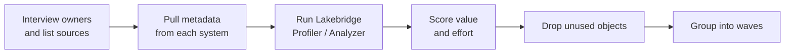

# Assessing Your Current Data Estate

Mastery: `INPUT[inlineSelect(option(new), option(learning), option(solid)):mastery]`

> [!todo] Draft, not yet verified
> This body is an unverified draft. Its facts were checked against the open-source Lakebridge repo, the Terraform provider, and the Databricks SDK, which the vault's source policy does not accept. It must be re-verified against docs.databricks.com, learn.microsoft.com/azure/databricks, or databricks.com before `status: written` is set. Do not answer from it.

> [!story] Previously
> [[Migration Strategy Overview]] split every migration into phases and said the first one decides how well the rest go. You cannot plan waves, estimate effort, or promise a date until you know what you actually have. This note is that first phase.

> [!eli5] In one breath
> Before you move, you write down everything you own, where it is, who uses it, and how heavy it is. Then you can decide what to move first, what to throw away, and how long the move will take.

> [!analogy] Analogy: a home inventory before a move
> - **Rooms** are your source systems (the SQL Server, the Excel folder, the cloud warehouse).
> - **Boxes** are tables and files. Some are heavy (big tables), some fragile (financial data, [[PII]]).
> - **Appliances that need rewiring** are the stored procedures and ETL jobs. They will not just plug in at the new place.
> - **The people who use each room** are your report readers. Their daily routine has to survive the move.
> - **The junk you find in the attic** is the 40% of tables nobody has read in a year. You do not move it.

## Why it exists

An estate that grew over ten years is never what people think it is. Typical surprises:

- A "small" database holds 300 tables, of which 40 are read every day and 200 have not been touched since 2021.
- The real business logic lives in stored procedures and SSIS packages, not in the tables.
- A finance spreadsheet pulls live from a view that nobody on the data team knew existed.
- Licence and hardware costs are spread across four budgets, so the true cost of the current setup is unknown.

An assessment turns these surprises into a plan. It answers four questions: **what exists, what is used, how hard is it to move, and what does it cost today?**

## What it actually is

An assessment produces one artefact: an **inventory**, usually a spreadsheet or a table in Databricks, plus a wave plan derived from it. The inventory has five sections.

| Section | What to record | Where to find it |
|---|---|---|
| **Sources** | Every system holding business data: databases, warehouses, file shares, SaaS apps, spreadsheets | Interviews, network diagrams, licence lists |
| **Data objects** | Tables, views, files: size, row counts, last read, last written, owner, sensitivity | System catalog views, query history |
| **Code** | Stored procedures, ETL packages, scheduled jobs, scripts: count, complexity, dependencies | Source control, job schedulers, the Lakebridge Analyzer |
| **Consumers** | Reports, dashboards, extracts, APIs, and the people who rely on them | BI tool admin pages, query history by user |
| **Costs and SLAs** | Licences, hardware, cloud bills, support contracts, and the freshness people expect ("by 7 a.m.") | Finance, contracts, job run times |

From this you derive two scores per object: **business value** (who uses it, how often) and **migration effort** (size, code complexity, dependencies). High value plus low effort goes in wave 1.

## How it works



### Step 1: pull metadata from the source

Every database can tell you about itself. A few starting queries, run on the **source** system:

```sql
-- SQL Server: table sizes and row counts
SELECT s.name AS schema_name, t.name AS table_name,
       SUM(p.rows) AS row_count
FROM sys.tables t
JOIN sys.schemas s ON t.schema_id = s.schema_id
JOIN sys.partitions p ON t.object_id = p.object_id AND p.index_id IN (0, 1)
GROUP BY s.name, t.name
ORDER BY row_count DESC;

-- SQL Server: how many stored procedures and views do we have?
SELECT type_desc, COUNT(*) FROM sys.objects
WHERE type IN ('P', 'V', 'FN', 'IF', 'TF') GROUP BY type_desc;
```

```sql
-- PostgreSQL: which tables are actually used?
SELECT relname, n_live_tup, seq_scan, idx_scan, last_autoanalyze
FROM pg_stat_user_tables
ORDER BY seq_scan + COALESCE(idx_scan, 0) DESC;
```

```sql
-- Snowflake: who queries what (last 90 days)
SELECT user_name, warehouse_name, COUNT(*) AS queries,
       SUM(total_elapsed_time) / 1000 / 3600 AS hours
FROM snowflake.account_usage.query_history
WHERE start_time > DATEADD(day, -90, CURRENT_TIMESTAMP())
GROUP BY 1, 2 ORDER BY hours DESC;
```

```sql
-- BigQuery: bytes scanned per table over 30 days (one region)
SELECT referenced_table.dataset_id, referenced_table.table_id,
       COUNT(*) AS jobs, SUM(total_bytes_processed) AS bytes
FROM `region-us`.INFORMATION_SCHEMA.JOBS,
     UNNEST(referenced_tables) AS referenced_table
WHERE creation_time > TIMESTAMP_SUB(CURRENT_TIMESTAMP(), INTERVAL 30 DAY)
GROUP BY 1, 2 ORDER BY bytes DESC;
```

### Step 2: run the Lakebridge assessment tools

[[Lakebridge]] has two assessment tools, and its docs recommend running both when you can reach the database:

| | Profiler | Analyzer |
|---|---|---|
| Looks at | A **live** database: data volumes, query patterns, resource use | **Code files** on disk: SQL, ETL exports |
| Output | A dashboard with usage metrics, used for sizing and [[Total Cost of Ownership\|TCO]] | A per-object complexity report (LOW, MEDIUM, HIGH, VERY HIGH) as an Excel file |
| Needs a DB connection | Yes | No |
| Sources (October 2026) | Synapse, Teradata, Snowflake, SQL Server, Oracle, BigQuery, Redshift | About 35 technologies: SQL dialects (SQL Server, Snowflake, Hive, Oracle...), ETL tools (SSIS, Talend, DataStage, Alteryx...), and orchestrators (ADF, Oozie); see [[Lakebridge]] |

```bash
# Install once (needs the Databricks CLI, already logged in)
databricks labs install lakebridge

# Profiler: configure a source connection, then run it
databricks labs lakebridge configure-database-profiler

# Analyzer: point it at a folder of exported SQL or ETL files
databricks labs lakebridge analyze
#   Input path:        ./exported_sql
#   Source technology: MS SQL Server
#   Report file:       ./assessment/analysis.xlsx
```

The Lakebridge FAQ gives a rule of thumb for reading the Analyzer report: LOW and MEDIUM objects usually transpile cleanly; HIGH objects need a review after transpiling; if more than half are VERY HIGH, plan for two or more manual review passes. Split monolithic SQL files first with the SQL Splitter so the report is per object.

### Step 3: score, prune, and group into waves

Add three columns to the inventory and sort:

| Object | Used by | Last read | Effort | Decision |
|---|---|---|---|---|
| `dbo.orders` | 14 reports, finance | today | LOW | Wave 1 |
| `dbo.usp_monthly_close` | finance close | monthly | VERY HIGH | Wave 3, manual review |
| `dbo.orders_backup_2019` | nobody | 2021 | n/a | Archive, do not migrate |
| `\\fileserver\sales\*.xlsx` | sales team | weekly | LOW | Wave 1, see [[Migrating from Excel and Access]] |

> [!smallbiz] For a small business
> You do not need a tool for a small estate. A one-page spreadsheet with one row per table, file, job, and report is enough. Spend one afternoon interviewing the three or four people who build or read reports and ask: "Which numbers would you notice if they were wrong tomorrow?" Those numbers define wave 1. Add a cost line for every licence, server, and support contract you could cancel after the move; that line is the core of your [[Building a Business Case|business case]].

## On each cloud

> [!azure]- Azure Databricks
> Azure-heavy estates usually include SQL Server, Azure SQL, Synapse dedicated SQL pools, Azure Data Factory, and Power BI. The Lakebridge Profiler supports Synapse (including legacy dedicated SQL pools) and SQL Server, and the Analyzer reads ADF and SSIS exports. Check your Azure cost exports for the current spend on each service.

> [!aws]- Databricks on AWS
> AWS estates often mix Redshift, RDS or Aurora databases, Glue jobs, and files in S3. The Profiler supports Redshift. Existing Glue catalogs can be read through [[AWS Glue and Lake Formation Federation|Glue federation]], so list them as sources too.

> [!gcp]- Databricks on Google Cloud
> GCP estates centre on BigQuery and Cloud Storage. The Profiler supports BigQuery, and `INFORMATION_SCHEMA.JOBS` gives you per-table usage directly.

## Going deeper

> [!deepdive]- Expert notes (301–401)
> - **Usage beats size.** Prioritise by query history, not gigabytes. A 2 TB log table read once a quarter is a cheap file export; a 50 MB lookup table joined by every report is wave-1 critical.
> - **Build the dependency graph.** Parse view and procedure definitions (`sys.sql_expression_dependencies` on SQL Server, `pg_depend` on Postgres, `ACCESS_HISTORY` on Snowflake) to find which objects must move together.
> - **Classify sensitivity early.** Tag columns holding [[PII]] in the inventory so that, once in Databricks, you can apply [[Row Filters and Column Masks|masks]] and [[Data Classification|classification]] from day one.
> - **Measure freshness SLAs.** Record when each report needs its data. That decides whether a table needs a continuous change feed or a nightly batch load.
> - **Keep the inventory in Databricks.** Load the inventory spreadsheet as a table and track wave status with a simple dashboard. It becomes your migration control panel.
> - **Profiler status.** The Lakebridge docs mark the Profiler as Experimental as of October 2026. Treat its cost estimates as a starting point, and cross-check against [[How Databricks Pricing Works]].

## Common confusions

> [!confusion] Profiler is not Analyzer
> The **Profiler** connects to a running database and measures workload. The **Analyzer** reads code files and scores how hard they will be to convert. One sizes the move, the other sizes the code work.

> [!confusion] "Everything we have" is not "everything we need"
> The inventory lists everything. The migration scope is only what is used. Pruning unused objects is often the biggest effort saving of the whole project.

## Recall

What four questions does an assessment answer?::What exists, what is used, how hard is it to move, and what does it cost today?
Which Lakebridge tool needs a live database connection?::The Profiler. The Analyzer works on code files on disk.
What output does the Lakebridge Analyzer produce?::A per-object complexity report (LOW, MEDIUM, HIGH, VERY HIGH) saved as an Excel file.
What CLI command installs Lakebridge?::`databricks labs install lakebridge`
Why should you split monolithic SQL files before running the Analyzer?::So the report scores each stored procedure, view, and table separately.
What two scores decide which wave an object goes in?::Business value and migration effort.
What should you do with tables nobody has read in a year?::Archive them; do not migrate them.
Which SQL Server catalog views give table row counts?::`sys.tables` joined to `sys.partitions` (and `sys.schemas`).

## Where next

> [!path] Learning path
> **Needs first:** [[Migration Strategy Overview]], [[Relational Databases]]
> **Unlocks next:** [[Lakebridge]], [[Migration Checklist]], [[Migrating from SQL Server]]

> [!nextup] Up next in the story
> The simplest estate of all is a folder of spreadsheets and an Access database. It is also where many small businesses start. [[Migrating from Excel and Access]] is the gentlest first move.

> [!sources]- Sources (not yet verified under the source policy)
