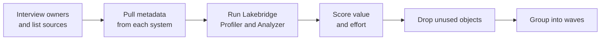

# Assessing Your Current Data Estate

Mastery: `INPUT[inlineSelect(option(new), option(learning), option(solid)):mastery]`

> [!story] Context
> [[Migration Strategy Overview]] divides a migration into phases and identifies assessment as the one the others depend on. Waves, effort estimates, and dates all require an accurate inventory of what exists today. This note covers that phase.

> [!eli5] Summary
> Before moving, you write down everything you have, where it is, who uses it, and how big it is. With that list you can decide what to move first, what to leave behind, and how long the move will take.

> [!analogy]- Analogy: a home inventory before a move
> | Home move | Assessment |
> |---|---|
> | Rooms | Source systems: a SQL Server, an Excel folder, a cloud warehouse |
> | Heavy or fragile boxes | Large tables, and tables with financial data or [[PII]] |
> | Appliances that need rewiring | Stored procedures and ETL jobs |
> | People who use each room | Report readers |
> | Attic junk | Tables nobody has read in a year |

## Background

An estate that grew over many years rarely matches what its owners believe. Common findings:

- A database with hundreds of tables, of which a small fraction is read every day and most have not been touched in years.
- Business logic that lives in stored procedures and SSIS packages rather than in tables.
- A finance spreadsheet that reads from a view the data team did not know about.
- Licence, hardware, and support costs spread across several budgets, so nobody knows the total.

An assessment answers four questions: **what exists, what is used, how hard it is to move, and what it costs today.**

## Overview

An assessment produces one artifact: an **inventory**, usually a spreadsheet or a table in Databricks, and a wave plan derived from it. The inventory has five sections.

| Section | What to record | Where to find it |
|---|---|---|
| **Sources** | Every system holding business data: databases, warehouses, file shares, SaaS apps, spreadsheets | Interviews, network diagrams, licence lists |
| **Data objects** | Tables, views, and files: size, row count, last read, last written, owner, sensitivity | System catalog views, query history |
| **Code** | Stored procedures, ETL packages, scheduled jobs, scripts: count, complexity, dependencies | Source control, schedulers, the Lakebridge Analyzer |
| **Consumers** | Reports, dashboards, extracts, APIs, and the people who rely on them | BI tool admin pages, query history by user |
| **Costs and SLAs** | Licences, hardware, cloud bills, support contracts, and expected freshness ("by 7 a.m.") | Finance, contracts, job run times |

From the inventory, give each object two scores: **business value** (who uses it, how often) and **migration effort** (size, code complexity, dependencies). High value and low effort go in wave 1.

## How it works



### Step 1: pull metadata from each source

Every database exposes catalog views that describe its own objects. Run starting queries like these on the **source** system:

```sql
-- SQL Server: row counts per table
SELECT s.name AS schema_name, t.name AS table_name,
       SUM(p.rows) AS row_count
FROM sys.tables t
JOIN sys.schemas s ON t.schema_id = s.schema_id
JOIN sys.partitions p ON t.object_id = p.object_id AND p.index_id IN (0, 1)
GROUP BY s.name, t.name
ORDER BY row_count DESC;

-- SQL Server: count of procedures, views, and functions
SELECT type_desc, COUNT(*) FROM sys.objects
WHERE type IN ('P', 'V', 'FN', 'IF', 'TF') GROUP BY type_desc;
```

```sql
-- PostgreSQL: which tables are scanned
SELECT relname, n_live_tup, seq_scan, idx_scan
FROM pg_stat_user_tables
ORDER BY seq_scan + COALESCE(idx_scan, 0) DESC;
```

For cloud warehouses, use the query history views: `SNOWFLAKE.ACCOUNT_USAGE.QUERY_HISTORY` on Snowflake, and `INFORMATION_SCHEMA.JOBS` on BigQuery.

### Step 2: run the Lakebridge assessment tools

[[Lakebridge]] has two assessment tools. Its docs recommend running both when you have database access: the Profiler for sizing, the Analyzer for developer planning.

| | Profiler | Analyzer |
|---|---|---|
| Input | A **live** database connection | **Code files** on a local file system |
| Output | Usage metrics stored in a DuckDB `.db` file, used for sizing and [[Total Cost of Ownership\|TCO]] | A per-object complexity report (LOW, MEDIUM, HIGH, VERY HIGH) as an Excel file, optionally JSON |
| Status (October 2026) | Experimental | Available |
| Sources | Azure Synapse, legacy Synapse dedicated SQL pools, Teradata, Snowflake, SQL Server, Oracle, BigQuery, Redshift | About 30 technologies, including SQL Server, Snowflake, Oracle, Teradata, Redshift, BigQuery, Hive, SSIS, Talend, DataStage, Alteryx, ADF, Oozie, and SSRS |

1. Install Lakebridge with an authenticated [[Databricks CLI]]:

   ```bash
   databricks labs install lakebridge
   ```

2. Configure and run the Profiler against a source database. The command prompts for the source technology if you omit `--source-tech`:

   ```bash
   databricks labs lakebridge configure-database-profiler
   databricks labs lakebridge execute-database-profiler
   ```

3. Split monolithic SQL exports into one object per file with the SQL Splitter, so the Analyzer scores each object separately:

   ```bash
   ./sqlsplit -d ./exported_sql -o ./split
   ```

4. Run the Analyzer on the split files:

   ```bash
   databricks labs lakebridge analyze \
     --source-directory ./split \
     --report-file ./assessment/analysis.xlsx \
     --source-tech "MS SQL Server"
   ```

   `MS SQL Server` is the platform name in the Analyzer's supported-dialects list. Settings you omit are prompted for interactively.

The Analyzer's scoring guide says LOW and MEDIUM objects typically transpile cleanly, HIGH objects need review after transpiling, and if more than half of the objects score HIGH or VERY HIGH you should plan at least two manual review passes. The Analyzer also maps dependencies between jobs and objects, which helps decide what must move together.

### Step 3: score, prune, and group into waves

Add value, effort, and decision columns to the inventory and sort:

| Object | Used by | Last read | Effort | Decision |
|---|---|---|---|---|
| `dbo.orders` | 14 reports, finance | today | LOW | Wave 1 |
| `dbo.usp_monthly_close` | finance close | monthly | VERY HIGH | Wave 3, manual review |
| `dbo.orders_backup_2019` | nobody | 2021 | n/a | Archive; do not migrate |
| `\\fileserver\sales\*.xlsx` | sales team | weekly | LOW | Wave 1; see [[Migrating from Excel and Access]] |

## Small-business considerations

> [!smallbiz] Small-business considerations
> A small estate does not need tooling. A one-page spreadsheet with one row per table, file, job, and report is enough.
> 1. Interview the three or four people who build or read reports. Ask which numbers they would notice if they were wrong tomorrow. Those numbers define wave 1.
> 2. Add a cost line for every licence, server, and support contract that could be cancelled after the move. That line is the core of the [[Building a Business Case|business case]].
> 3. Mark every column that holds customer personal data, so it gets restricted access from day one.

## Cloud differences

> [!azure]- Azure Databricks
> Azure estates often include SQL Server, Azure SQL, Synapse dedicated SQL pools, Azure Data Factory, and Power BI. The Lakebridge Profiler supports Synapse and legacy dedicated SQL pools, and the Analyzer reads ADF, SSIS, and SSRS exports.

> [!aws]- Databricks on AWS
> AWS estates often combine Redshift, RDS or Aurora databases, Glue jobs, and files in S3. The Profiler supports Redshift. Existing Glue catalogs can be read through [[Hive Metastore Federation for AWS Glue|Glue federation]], so list them as sources.

> [!gcp]- Databricks on Google Cloud
> GCP estates usually center on BigQuery and Cloud Storage. The Profiler supports BigQuery, and `INFORMATION_SCHEMA.JOBS` provides per-table usage.

## Advanced topics

> [!deepdive]- Advanced topics (301–401)
> - **Prioritize by usage, not size:** A large log table read once a quarter is a cheap file export. A small lookup table joined by every report is wave-1 critical.
> - **Build the dependency graph:** Use the Analyzer's interdependency output, or parse view and procedure definitions on the source, to find objects that must move together.
> - **Classify sensitivity early:** Tag [[PII]] columns in the inventory so that [[Row Filters and Column Masks|masks]] and [[Data Classification|classification]] apply as soon as the data lands.
> - **Record freshness SLAs:** The time each report needs its data decides between a continuous change feed and a nightly batch load.
> - **Keep the inventory in Databricks:** Load the spreadsheet as a table and track wave status on a dashboard.
> - **Treat Profiler estimates as a starting point:** The Profiler is Experimental as of October 2026. Cross-check sizing against [[How Databricks Pricing Works]].

## Common misconceptions

> [!confusion] The Profiler is not the Analyzer
> The **Profiler** connects to a running database and measures workload. The **Analyzer** reads code files and scores conversion difficulty. One sizes the platform; the other sizes the code work.

> [!confusion] "Everything we have" is not "everything we need"
> The inventory lists everything. The migration scope is only what is used. Pruning unused objects is often the largest effort saving in the project.

## Recall

What four questions does an assessment answer?::What exists, what is used, how hard it is to move, and what it costs today.
Which Lakebridge assessment tool needs a live database connection?::The Profiler. The Analyzer works on code files.
What does the Lakebridge Analyzer produce?::A per-object complexity report (LOW, MEDIUM, HIGH, VERY HIGH) as an Excel file, optionally with JSON.
Where does the Lakebridge Profiler store its results?::In a DuckDB `.db` file.
What CLI command installs Lakebridge?::`databricks labs install lakebridge`
Why run the SQL Splitter before the Analyzer?::So the Analyzer scores each procedure, view, and table as a separate object.
Which two scores decide an object's wave?::Business value and migration effort.
What should you do with tables nobody has read in a year?::Archive them instead of migrating them.

## Next steps

> [!path] Learning path
> **Needs first:** [[Migration Strategy Overview]], [[Relational Databases]]
> **Unlocks next:** [[Lakebridge]], [[Migration Checklist]], [[Migrating from SQL Server]]

> [!nextup] Next
> [[Migrating from Excel and Access]] covers the simplest estate: spreadsheets and Access databases moved into governed tables.

> [!sources]- Sources (last verified: 2026-10-25)
> - [Lakebridge: Which tool do I use? (Databricks Labs, GitHub)](https://github.com/databrickslabs/lakebridge/blob/main/docs/lakebridge/docs/choosing_tools.mdx)
> - [Lakebridge Profiler guide (Databricks Labs, GitHub)](https://github.com/databrickslabs/lakebridge/blob/main/docs/lakebridge/docs/assessment/profiler/index.mdx)
> - [Lakebridge Analyzer guide (Databricks Labs, GitHub)](https://github.com/databrickslabs/lakebridge/blob/main/docs/lakebridge/docs/assessment/analyzer/index.mdx)
> - [Lakebridge complexity scoring (Databricks Labs, GitHub)](https://github.com/databrickslabs/lakebridge/blob/main/docs/lakebridge/docs/assessment/analyzer/complexity_scoring.mdx)
> - [Lakebridge SQL Splitter (Databricks Labs, GitHub)](https://github.com/databrickslabs/lakebridge/blob/main/docs/lakebridge/docs/sql_splitter.mdx)
> - [Lakebridge installation (Databricks Labs, GitHub)](https://github.com/databrickslabs/lakebridge/blob/main/docs/lakebridge/docs/installation.mdx)
> - [Migrate data applications to Databricks (AWS)](https://docs.databricks.com/aws/en/migration/)
> - [sys.partitions (Microsoft Learn)](https://learn.microsoft.com/en-us/sql/relational-databases/system-catalog-views/sys-partitions-transact-sql)
> - [sys.objects (Microsoft Learn)](https://learn.microsoft.com/en-us/sql/relational-databases/system-catalog-views/sys-objects-transact-sql)
> - [The cumulative statistics system: pg_stat_all_tables (PostgreSQL)](https://www.postgresql.org/docs/current/monitoring-stats.html)
> - [QUERY_HISTORY view (Snowflake)](https://docs.snowflake.com/en/sql-reference/account-usage/query_history)
> - [INFORMATION_SCHEMA.JOBS view (Google Cloud)](https://cloud.google.com/bigquery/docs/information-schema-jobs)
