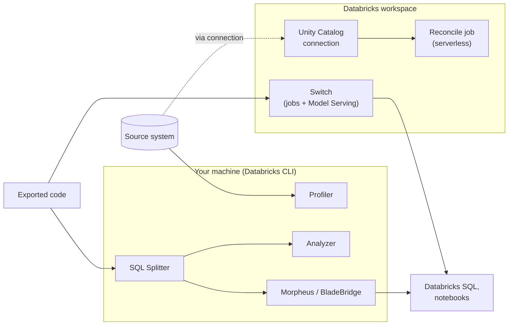

# Lakebridge

Mastery: `INPUT[inlineSelect(option(new), option(learning), option(solid)):mastery]`

> [!story] Context
> [[Migrating ETL Tools]] and the source playbooks before it used Lakebridge for assessment, code conversion, and validation. This note describes the toolkit itself: its components, supported sources, installation, and limits.

> [!eli5] Summary
> Lakebridge is a free set of tools from Databricks for moving off an old data system. It looks at the old system to estimate the work, translates the old system's SQL into Databricks SQL, and checks afterwards that the data in Databricks matches the original.

> [!renamed] Renamed
> Lakebridge grew out of the Databricks Labs project **Remorph**. The Python package is still published as `databricks-labs-remorph`, and installed transpilers live under `.databricks/labs/remorph-transpilers/`. Databricks announced Lakebridge on June 12, 2025, adding technology from **BladeBridge**, a migration company Databricks acquired.

> [!analogy]- Analogy: a translation agency for a company move
> | Translation agency | Lakebridge |
> |---|---|
> | Estimating the size of the job | Profiler (workload) and Analyzer (code) |
> | A certified translator who refuses to guess | Morpheus |
> | A translator with many language pairs | BladeBridge |
> | A translator who works from meaning | Switch (LLM-based, experimental) |
> | Proofreading the result against the original | Reconcile |

## Background

Warehouse migrations spend most of their effort on code: thousands of views, stored procedures, and ETL jobs written in a vendor's dialect. Manual rewriting is slow and error-prone. Databricks' answer is Lakebridge, which its announcement describes as free, open data migration to Databricks SQL, covering profiling, assessment, SQL conversion, validation, and reconciliation.

Lakebridge is a **Databricks Labs** project. The repository states that it is provided as-is, without formal support or SLAs; issues are filed on GitHub.

## Overview

Lakebridge covers three phases:

| Phase | Component | Input | Output |
|---|---|---|---|
| **Assessment** | **Profiler** (Experimental) | Live database connection | Usage and performance metrics in a DuckDB `.db` file; a dashboard for sizing and TCO |
| | **Analyzer** | Exported code files | Per-object complexity report (LOW to VERY HIGH) in Excel, optionally JSON; job inventory and dependencies |
| **Conversion** | **Morpheus** | SQL files | Databricks SQL, with a correctness guarantee |
| | **BladeBridge** | SQL and ETL files | Databricks SQL, SparkSQL or PySpark notebooks, workflow definitions |
| | **Switch** (Experimental) | SQL, code, and other text files | Python or SQL notebooks, Spark Declarative Pipelines, or other text formats |
| **Reconciliation** | **Reconcile** | Source connection plus Databricks tables | Schema, row, and column-level mismatch reports |

Utilities: the **SQL Splitter** splits monolithic SQL files into one object per file, which both the Analyzer and the transpilers work better with.

### Supported sources (October 2026)

| Source | Profiler | Analyzer | Converter | Reconcile |
|---|---|---|---|---|
| SQL Server (`mssql`) | Yes | Yes | Morpheus, BladeBridge, Switch | Yes |
| Azure Synapse (`synapse`) | Yes | Yes | Morpheus, BladeBridge, Switch | Yes |
| Snowflake (`snowflake`) | Yes | Yes | Morpheus (with dbt repointing), Switch | Yes |
| Oracle (`oracle`) | Yes | Yes | BladeBridge, Switch | Yes |
| Teradata (`teradata`) | Yes | Yes | BladeBridge, Switch | Yes (needs a hash UDF for row-level reports) |
| Amazon Redshift (`redshift`) | Listed in Profiler guide | Yes | BladeBridge (experimental), Switch | Yes |
| Google BigQuery | Yes | Yes | None built in | Yes |
| IBM Netezza (`netezza`) | | Yes | BladeBridge, Switch | |
| PostgreSQL, MySQL | | Yes | Switch | |
| SSIS, DataStage | | Yes | BladeBridge | |
| Airflow, Python, Scala, PySpark | | Some | Switch | |
| Hive, Impala, Oozie, Pig, Sqoop, Talend, Alteryx, ADF, SSRS, others | | Yes | | |

### Choosing a transpiler

| | Morpheus | BladeBridge | Switch (Experimental) |
|---|---|---|---|
| Approach | AST-based: ANTLR grammar, intermediate tree, code generation | Configuration- and pattern-based | LLM-based, through [[Model Serving]] |
| Dialects | `mssql`, `snowflake`, `synapse` | Oracle, Teradata, Netezza, SQL Server, Synapse, Redshift, DataStage, SSIS | Built-in prompts for nine SQL dialects plus Python, Scala, Airflow, and PySpark; custom YAML prompts for others |
| Output | Databricks SQL only | Databricks SQL, SparkSQL, PySpark, notebooks, workflow JSON | Notebooks; other text formats |
| Guarantee | No errors or warnings means equivalent results | Deterministic and repeatable | None; review required |
| Cost | Free, runs locally | Free, runs locally | Model token costs ([[Foundation Model APIs]]) |

Lakebridge's guidance: start with Morpheus when the source is SQL Server, Snowflake, or Synapse. Use BladeBridge for ETL platforms and its broader dialect list. Use Switch for complex business logic or unsupported formats.

## How it works



### Install

Requirements for the CLI install:

- A Databricks workspace (any tier, including a trial).
- The [[Databricks CLI]], configured with a personal access token or a service principal.
- Python 3.10.1 to 3.14.x.
- Java 21 or later (for Morpheus).
- Network access to GitHub, Maven Central, and PyPI.

1. Install Lakebridge:

   ```bash
   databricks labs install lakebridge
   databricks labs lakebridge --help
   ```

2. Install the transpilers. The command prompts for source dialect, input and output paths, and target technology:

   ```bash
   databricks labs lakebridge install-transpile
   # Include Switch, the LLM-based transpiler:
   databricks labs lakebridge install-transpile --include-llm-transpiler true
   ```

   Morpheus is fetched from Maven Central, and BladeBridge and Switch from PyPI.

3. Configure Reconcile:

   ```bash
   databricks labs lakebridge configure-reconcile
   ```

A desktop installer for macOS and Windows is available from release v0.14.0. It bundles the Databricks CLI and Python. The latest release in October 2026 is v0.14.1.

### Assess

```bash
databricks labs lakebridge configure-database-profiler
databricks labs lakebridge execute-database-profiler
databricks labs lakebridge analyze --source-directory ./split --report-file ./report.xlsx --source-tech <source>
```

See [[Assessing Your Current Data Estate]].

### Transpile

```bash
databricks labs lakebridge transpile \
  --source-dialect mssql \
  --input-source ./split \
  --output-folder ./converted
```

| Flag | Purpose |
|---|---|
| `--source-dialect` | Source dialect, for example `mssql`, `snowflake`, `synapse`, `oracle`, `redshift`, `ssis` |
| `--input-source` | Local folder of source files |
| `--output-folder` | Local folder for output |
| `--target-technology` | ETL sources only: `SQL`, `SPARKSQL`, or `PYSPARK` |
| `--skip-validation` | Skip validating output against Databricks SQL (default `false`) |
| `--catalog-name`, `--schema-name` | Where validation runs (defaults `remorph` and `transpiler`) |

Morpheus writes a header comment to each output file. Files with errors list each problem with a `[line:column]` position.

### Reconcile

Reconcile compares a source system with Databricks tables:

| Report type | Compares |
|---|---|
| `schema` | Column names and data types |
| `row` | A hash of each row; no join key needed |
| `data` | Row and column values, using join columns |
| `all` | `data` plus `schema` |

Setup:

1. Create a Unity Catalog **connection** to the source ([[Lakehouse Federation]]) and grant access. A foreign catalog is not required.
2. Enable the `remote_query` preview in the workspace.
3. Run `configure-reconcile`. The user needs permission to create SQL warehouses, `USE CONNECTION` on the connection, `USE CATALOG` and `CREATE SCHEMA` on the target catalog, and `CREATE VOLUME` if the schema exists.
4. Edit the generated config file, `<home>/.lakebridge/recon_config_<source>_<connection>_<report_type>.json`, then run the reconcile job.

The job runs on serverless compute by default. A classic cluster must run Databricks Runtime 17.3 or later. See [[Running Old and New in Parallel]].

## Small-business considerations

> [!smallbiz] Small-business considerations
> Lakebridge is free; only Switch incurs model costs, and Reconcile uses workspace compute.
> 1. **Small estates:** skip the Profiler. Run the Analyzer on exported SQL to see which objects are hard.
> 2. **Supported dialect (SQL Server, Snowflake, Synapse):** transpile everything with Morpheus, fix flagged sections by hand.
> 3. **Validation:** use Reconcile for the tables behind your most important reports.
>
> Because it is a Databricks Labs project without SLAs, plan time to troubleshoot installation (Java version, network access to Maven Central and PyPI).

## Cloud differences

> [!azure]- Azure Databricks
> Lakebridge runs the same way. Azure sources with the deepest coverage are SQL Server, Azure SQL, and Synapse, including legacy dedicated SQL pools in the Profiler.

> [!aws]- Databricks on AWS
> Lakebridge runs the same way. Redshift conversion uses BladeBridge and Switch, both experimental for Redshift; Morpheus does not support Redshift.

> [!gcp]- Databricks on Google Cloud
> Lakebridge runs the same way. BigQuery is supported by the Profiler, Analyzer, and Reconcile, but no built-in transpiler.

## Advanced topics

> [!deepdive]- Advanced topics (301–401)
> - **Pluggable transpilers:** Lakebridge talks to transpilers over the Language Server Protocol. Each transpiler sits in its own folder with a `config.yml` that lists its dialects and launch command. Only one transpiler is used at a time. Third-party transpilers can be installed manually.
> - **Morpheus guarantee model:** No errors and no warnings means equivalent results, except that some statistical functions may use different algorithms and row order may differ without `ORDER BY`. A warning means equivalence could not be confirmed; an error means it cannot be guaranteed.
> - **Analyzer thresholds:** Complexity rises with loops, statement counts, `PIVOT`, and XML usage. If more than half of the objects score HIGH or VERY HIGH, plan at least two manual review passes.
> - **Switch limits:** Files over the `token_count_threshold` are skipped as "Not converted". `max_fix_attempts` controls automatic correction. Notebooks over 10 MB cannot be exported, and output paths must start with `/Workspace/`.
> - **Reconcile tuning:** `column_mapping` handles renamed columns, `drop_columns` excludes audit columns, and custom transformations normalize types (the FAQ lists examples for Oracle numbers and Snowflake arrays and timestamps).
> - **Agentic code converter:** Separately from the CLI, Databricks offers an in-workspace agentic code converter (Beta in October 2026). Its docs list T-SQL, Snowflake, Redshift, Oracle, BigQuery, and Teradata as sources and a limit of 300 files per batch. July 2026 release notes call it the Lakebridge Agentic Converter.

## Common misconceptions

> [!confusion] Lakebridge does not move data
> Lakebridge assesses code, converts code, and compares data. Copying data is done with [[Lakeflow Connect]], [[Lakehouse Federation]], or file exports loaded with [[Auto Loader]].

> [!confusion] "Free" does not mean "supported"
> Lakebridge has no license cost, but as a Databricks Labs project it has no formal support SLA. The agentic code converter is a separate workspace feature.

> [!confusion] Switch is not a deterministic transpiler
> Switch uses LLMs, so output can vary between runs and needs review. Morpheus and BladeBridge produce the same output for the same input.

## Recall

What was Lakebridge formerly called?::Remorph, a Databricks Labs project; the package is still `databricks-labs-remorph`.
What command installs Lakebridge?::`databricks labs install lakebridge`
Name Lakebridge's three transpilers.::Morpheus (AST-based), BladeBridge (pattern-based), and Switch (LLM-based, experimental).
Which dialects does Morpheus support?::`mssql`, `snowflake` (including dbt repointing), and `synapse`.
What does Lakebridge Reconcile need to reach the source?::A Unity Catalog connection; a foreign catalog is not required.
What are Reconcile's four report types?::`schema`, `row`, `data`, and `all`.
Which Java version does Morpheus require?::Java 21 or later.
What is the status of the Profiler in October 2026?::Experimental.
When did Databricks announce Lakebridge?::June 12, 2025.

## Next steps

> [!path] Learning path
> **Needs first:** [[Migration Strategy Overview]], [[Databricks CLI]], [[Unity Catalog]]
> **Unlocks next:** [[Running Old and New in Parallel]], [[Migrating BI Reports]], [[Migration Checklist]]

> [!nextup] Next
> [[Migrating BI Reports]] covers moving dashboards and reports: repointing Power BI and Tableau, or rebuilding them as AI/BI dashboards.

> [!sources]- Sources (last verified: 2026-10-25)
> - [Introducing Lakebridge: Free, Open Data Migration to Databricks SQL (Databricks blog)](https://www.databricks.com/blog/introducing-lakebridge-free-open-data-migration-databricks-sql)
> - [Welcoming BladeBridge to Databricks (Databricks blog)](https://www.databricks.com/blog/welcoming-bladebridge-databricks-accelerating-data-warehouse-migrations-lakehouse)
> - [Databricks Lakebridge (product page)](https://www.databricks.com/solutions/migration/lakebridge)
> - [Lakebridge repository (Databricks Labs, GitHub)](https://github.com/databrickslabs/lakebridge)
> - [Lakebridge documentation (databrickslabs.github.io)](https://databrickslabs.github.io/lakebridge/)
> - [Lakebridge overview (GitHub)](https://github.com/databrickslabs/lakebridge/blob/main/docs/lakebridge/docs/overview.mdx)
> - [Lakebridge installation (GitHub)](https://github.com/databrickslabs/lakebridge/blob/main/docs/lakebridge/docs/installation.mdx)
> - [Which tool do I use? (GitHub)](https://github.com/databrickslabs/lakebridge/blob/main/docs/lakebridge/docs/choosing_tools.mdx)
> - [Transpile guide and supported dialects (GitHub)](https://github.com/databrickslabs/lakebridge/blob/main/docs/lakebridge/docs/transpile/index.mdx)
> - [Pluggable transpilers (GitHub)](https://github.com/databrickslabs/lakebridge/blob/main/docs/lakebridge/docs/transpile/pluggable_transpilers/index.mdx)
> - [Morpheus (GitHub)](https://github.com/databrickslabs/lakebridge/blob/main/docs/lakebridge/docs/transpile/pluggable_transpilers/morpheus/index.mdx)
> - [BladeBridge (GitHub)](https://github.com/databrickslabs/lakebridge/blob/main/docs/lakebridge/docs/transpile/pluggable_transpilers/bladebridge/index.mdx)
> - [Switch (GitHub)](https://github.com/databrickslabs/lakebridge/blob/main/docs/lakebridge/docs/transpile/pluggable_transpilers/switch/index.mdx)
> - [Profiler guide (GitHub)](https://github.com/databrickslabs/lakebridge/blob/main/docs/lakebridge/docs/assessment/profiler/index.mdx)
> - [Analyzer guide (GitHub)](https://github.com/databrickslabs/lakebridge/blob/main/docs/lakebridge/docs/assessment/analyzer/index.mdx)
> - [Complexity scoring (GitHub)](https://github.com/databrickslabs/lakebridge/blob/main/docs/lakebridge/docs/assessment/analyzer/complexity_scoring.mdx)
> - [Reconcile guide (GitHub)](https://github.com/databrickslabs/lakebridge/blob/main/docs/lakebridge/docs/reconcile/index.mdx)
> - [SQL Splitter (GitHub)](https://github.com/databrickslabs/lakebridge/blob/main/docs/lakebridge/docs/sql_splitter.mdx)
> - [FAQ (GitHub)](https://github.com/databrickslabs/lakebridge/blob/main/docs/lakebridge/docs/faq.mdx)
> - [Changelog (GitHub)](https://github.com/databrickslabs/lakebridge/blob/main/CHANGELOG.md)
> - [Convert SQL with the agentic code converter (AWS)](https://docs.databricks.com/aws/en/migration/agentic-code-converter)
> - [Convert SQL with the Lakebridge Agentic Converter (AWS)](https://docs.databricks.com/aws/en/migration/lakebridge-agentic-converter)
> - **Note on the former name:** the Remorph lineage is inferred from the repository (the PyPI package `databricks-labs-remorph`, the `remorph-transpilers` folder, and the default validation catalog `remorph`). No official page found in this pass states the rename date.
