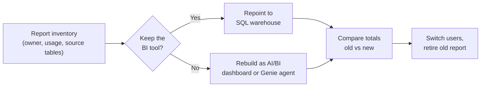

# Migrating BI Reports

Mastery: `INPUT[inlineSelect(option(new), option(learning), option(solid)):mastery]`

> [!story] Context
> [[Lakebridge]] converts the SQL that builds tables. Business users never see that SQL; they see reports and dashboards. A migration is visible to them only when their reports move. This note covers the two options for each report: repoint it to Databricks, or rebuild it natively.

> [!eli5] Summary
> Reports are the screens people look at every day. When the data moves to Databricks, each report either gets plugged into the new data source with as little change as possible, or gets rebuilt as a Databricks dashboard. Either way, the numbers must match the old report before anyone switches.

> [!analogy]- Analogy: moving a TV to a new antenna
> | Television | BI migration |
> |---|---|
> | Keeping the TV and plugging in the new antenna | Repointing Power BI or Tableau to a SQL warehouse |
> | Buying a smart TV with apps built in | Rebuilding as an AI/BI dashboard |
> | Asking the TV a question by voice | A [[Genie Agents]] agent |
> | Checking every channel still comes through | Comparing report totals before switch-over |

## Background

BI tools hold more logic than people expect: calculated measures, filters, row-level security rules, and imported data extracts. A report that "just needs a new connection" may contain its own copy of business definitions. Moving reports therefore has three parts:

1. **Connection:** point the report at a Databricks [[SQL Warehouses|SQL warehouse]].
2. **Logic:** move business definitions out of individual reports where practical, into views or [[Metric Views|metric views]] in Unity Catalog.
3. **Users:** confirm each audience still sees the right data under Unity Catalog permissions.

## Overview

| Option | When to use | Effort |
|---|---|---|
| **Repoint** Power BI or Tableau to Databricks | The BI tool stays; reports are complex or widely used | Low to medium |
| **Rebuild** as an [[AI-BI Dashboards\|AI/BI dashboard]] | Simple reports; reducing BI licences; Databricks-native sharing | Medium |
| **Replace** with a [[Genie Agents]] agent | Ad hoc questions currently answered by many similar reports | Low |
| **Retire** | Nobody has opened the report recently | None |

The Lakebridge Analyzer supports SSRS among its sources, which helps size an SSRS estate. No Lakebridge converter exists for BI reports.

## How it works



### Repoint Power BI

Two ways to connect:

1. **Publish from Databricks:** From the Databricks UI, publish a table or schema to the Power BI service as a semantic model. Publishing uses a SQL warehouse and a Microsoft Entra ID sign-in.
2. **Connect from Power BI:** In Power BI Desktop, use the Azure Databricks or Databricks connector (or [[Partner Connect]]) with the SQL warehouse's **Server hostname** and **HTTP path**. In the Power BI service, the same values configure the data source; machine-to-machine OAuth with a service principal is one authentication option.

Steps for an existing report:

1. Recreate the source tables or views in Unity Catalog with the same column names and types.
2. In Power BI Desktop, change the data source to the Databricks SQL warehouse.
3. Keep **Import** as the default storage mode. Microsoft recommends **DirectQuery** when data changes too often for scheduled refresh, is too large to import, or must stay under source-enforced row-level security.
4. Refresh, compare totals with the old report, and republish.

See [[Connecting Power BI]] and, on Azure, [[Power BI on Azure Databricks]].

### Repoint Tableau

1. In Tableau Desktop, add a connection with the **Databricks** connector, or start from [[Partner Connect]].
2. Enter the SQL warehouse's server hostname and HTTP path. With Unity Catalog, set the default catalog.
3. Authenticate with OAuth (recommended) or a personal access token. The newest OAuth flow needs Databricks ODBC driver 2.8.2 or later.
4. Replace the old data source in each workbook, check calculated fields, and republish.
5. For Tableau Cloud, connect from the workbook; OAuth is enforced when publishing.

See [[Connecting Tableau and Other BI Tools]].

### Rebuild as an AI/BI dashboard

1. Create a dashboard.
2. On the **Data** tab, add datasets: a Unity Catalog table or view, a SQL query, a dashboard-local metric view, or an uploaded file. Dataset queries are read-only.
3. Build visuals and filters on the canvas.
4. Publish. Choose **shared data permissions** (viewers query with the publisher's permissions) or **individual data permissions** (viewers use their own).
5. Share with workspace users and groups, account users, or all account users. Add a refresh schedule and email or Slack subscriptions as needed.

Business users can open published dashboards and Genie agents in [[Genie One]].

### Move business logic into the catalog

Repeated measures, such as revenue or active customers, belong in Unity Catalog rather than in each report:

```sql
CREATE OR REPLACE VIEW analytics.finance.revenue_by_month AS
SELECT date_trunc('MONTH', order_date) AS month,
       region,
       SUM(amount) AS revenue,
       COUNT(DISTINCT customer_id) AS customers
FROM analytics.sales.orders
GROUP BY ALL;
```

[[Metric Views]] go further: a measure is defined once and used by dashboards, Genie, and external BI tools. See [[Semantic Layer]].

## Small-business considerations

> [!smallbiz] Small-business considerations
> A small business usually has 5 to 30 reports.
> 1. List each report with its owner and the last time it was opened. Retire the unused ones.
> 2. Keep Power BI if the team already lives in it; repointing is the fastest path.
> 3. Rebuild simple Excel-based or SSRS reports as AI/BI dashboards.
> 4. Create one Genie agent for the questions that used to generate one-off report requests.
>
> AI/BI dashboards and Genie run on [[SQL Warehouses|SQL warehouses]] and bill as warehouse compute. A [[Serverless Compute|serverless]] warehouse with [[Auto Termination|auto-stop]] bills only while it runs. BI tool licences are billed by the BI vendor.

## Cloud differences

> [!azure]- Azure Databricks
> Power BI is the most common BI tool. Publishing to the Power BI service and the Azure Databricks connector use Microsoft Entra ID; see [[Power BI on Azure Databricks]].

> [!aws]- Databricks on AWS
> Power BI, Tableau, and Amazon Quick Sight connect through the SQL warehouse endpoint. Quick Sight's Databricks data source takes the warehouse hostname and HTTP path. Publishing to the Power BI service is also documented on AWS and requires a Microsoft Entra ID sign-in on the Power BI side.

> [!gcp]- Databricks on Google Cloud
> Tableau steps are the same as on other clouds. Looker connects to a SQL warehouse as a database connection (**Admin > Connections > Add Connection**), using the warehouse's server hostname, port, and HTTP path.

## Advanced topics

> [!deepdive]- Advanced topics (301–401)
> - **DirectQuery and warehouse sizing:** In DirectQuery mode each visual sends one or more queries to the warehouse. Size the warehouse for report concurrency, and use [[Query Performance and Caching|result caching]] and aggregated tables.
> - **Row-level security:** Unity Catalog [[Row Filters and Column Masks]] evaluate at query time for the identity that runs the query. Rules from Power BI roles or Tableau user filters can move into Unity Catalog when viewers query as themselves: individual data permissions on AI/BI dashboards, or single sign-on (SSO) for Power BI DirectQuery reports, which passes each user's Microsoft Entra ID credentials. With shared data permissions, the publisher's permissions apply.
> - **Dataset caching:** AI/BI dashboard datasets under 100 MB and 100,000 rows can be cached.
> - **Embedding and automation:** Published dashboards can be embedded with iframes, and managed through Git, [[Declarative Automation Bundles]], and REST APIs.
> - **Naming:** The docs renamed Genie spaces to **Genie Agents** in 2026, and the business-user Genie experience to **Genie One** on June 9, 2026.

## Common misconceptions

> [!confusion] Repointing is not the same as validating
> A report that refreshes without errors can still show different numbers. Compare totals for the same period on old and new sources before switching users.

> [!confusion] AI/BI dashboards do not replace every BI tool feature
> Dashboards cover common visuals, filters, sharing, and subscriptions. Pixel-perfect paginated reports or complex BI-tool-specific models may be better kept in the existing BI tool, repointed to Databricks.

## Recall

What two values identify a SQL warehouse to Power BI or Tableau?::The server hostname and the HTTP path.
How can you publish Databricks tables to Power BI from Databricks itself?::Publish them to the Power BI service as a semantic model from the Databricks UI, using a SQL warehouse and Microsoft Entra ID sign-in.
Which Tableau authentication method is recommended?::OAuth; a personal access token is also supported.
What is the difference between shared and individual data permissions on a published dashboard?::Shared: viewers query with the publisher's permissions. Individual: viewers query with their own credentials.
Where should repeated business measures live after migration?::In Unity Catalog views or metric views, not in each report.
Which Lakebridge component supports SSRS?::The Analyzer (assessment only; there is no BI report converter).
When does Microsoft recommend DirectQuery rather than Import in Power BI?::When data changes too often for scheduled refresh, is too large to import, or must stay under source-enforced row-level security. Import is the default.

## Next steps

> [!path] Learning path
> **Needs first:** [[BI Tools]], [[SQL Warehouses]], [[Migration Strategy Overview]]
> **Unlocks next:** [[AI-BI Dashboards]], [[Connecting Power BI]], [[Running Old and New in Parallel]]

> [!nextup] Next
> [[Running Old and New in Parallel]] covers how to run both systems side by side, reconcile results, and switch over safely.

> [!sources]- Sources (last verified: 2026-10-25)
> - [Power BI with Databricks (AWS)](https://docs.databricks.com/aws/en/partners/bi/power-bi/)
> - [Publish to the Power BI service from Databricks (AWS)](https://docs.databricks.com/aws/en/partners/bi/power-bi/service)
> - [Publish to the Power BI service from Azure Databricks](https://learn.microsoft.com/en-us/azure/databricks/partners/bi/power-bi/service)
> - [Connect Tableau and Databricks (AWS)](https://docs.databricks.com/aws/en/partners/bi/tableau)
> - [Connect Tableau and Azure Databricks](https://learn.microsoft.com/en-us/azure/databricks/partners/bi/tableau)
> - [Connect Tableau and Databricks (GCP)](https://docs.databricks.com/gcp/en/partners/bi/tableau)
> - [Connect to a SQL warehouse (AWS)](https://docs.databricks.com/aws/en/compute/sql-warehouse/)
> - [Dashboards (AWS)](https://docs.databricks.com/aws/en/dashboards/)
> - [Create and manage dashboard datasets (AWS)](https://docs.databricks.com/aws/en/dashboards/manage/data-modeling/datasets)
> - [Share a dashboard (AWS)](https://docs.databricks.com/aws/en/dashboards/share/share)
> - [Dashboard concepts (Azure Databricks)](https://learn.microsoft.com/en-us/azure/databricks/dashboards/concepts)
> - [Genie Agents (AWS)](https://docs.databricks.com/aws/en/genie-agents)
> - [AI/BI and Genie One release notes 2026 (AWS)](https://docs.databricks.com/aws/en/ai-bi/release-notes/2026)
> - [Lakebridge Analyzer guide (Databricks Labs, GitHub)](https://github.com/databrickslabs/lakebridge/blob/main/docs/lakebridge/docs/assessment/analyzer/index.mdx)
> - [DirectQuery in Power BI (Microsoft Learn)](https://learn.microsoft.com/en-us/power-bi/connect-data/desktop-directquery-about)
> - [Using Databricks in Quick Sight (AWS)](https://docs.aws.amazon.com/quicksight/latest/user/quicksight-databricks.html)
> - [Connect to Looker (GCP)](https://docs.databricks.com/gcp/en/partners/bi/looker)
> - [Row filters and column masks (AWS)](https://docs.databricks.com/aws/en/tables/row-and-column-filters)
