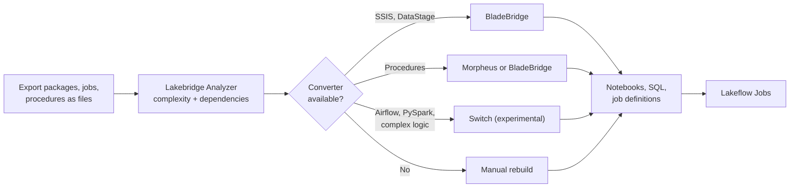

# Migrating ETL Tools

Mastery: `INPUT[inlineSelect(option(new), option(learning), option(solid)):mastery]`

> [!story] Context
> The source-system playbooks, ending with [[Migrating from Hadoop]], moved data and SQL. Most estates also have a separate layer that loads and transforms data on a schedule: SSIS packages, Informatica mappings, Talend or DataStage jobs, Airflow DAGs, and stored procedures. This note covers converting that layer into Databricks pipelines and jobs.

> [!eli5] Summary
> ETL tools are the conveyor belts that move data from one system to another every night and clean it on the way. Moving to Databricks means rebuilding those conveyor belts inside Databricks, either by converting them automatically where a converter exists or by rewriting them.

> [!analogy]- Analogy: replacing a factory's conveyor system
> | Factory | ETL migration |
> |---|---|
> | Conveyor belts between machines | ETL jobs between systems |
> | The plant's master schedule | An orchestrator: SQL Server Agent, Oozie, Airflow, ADF |
> | Machines with custom control code | Script tasks in C#, VB.NET, or Java |
> | New integrated production line | [[Lakeflow Spark Declarative Pipelines]] and [[Lakeflow Jobs]] |
> | A blueprint translator | [[Lakebridge]] BladeBridge and Switch |

## Background

Classic [[ETL vs ELT|ETL]] tools transform data on their own servers before loading it into a warehouse. On Databricks, transformation runs on Databricks compute against Delta tables (ELT), and orchestration runs in [[Lakeflow Jobs]]. A separate ETL server becomes unnecessary.

Databricks' ETL migration guide sets expectations by source:

- **SQL-based ETL** usually needs little refactoring. Most of the work is reconfiguring access to data sources.
- **dbt projects** run with little change through the native dbt integration.
- **Pipelines written in languages other than SQL, Spark, or Hive** may need heavy refactoring.

## Overview

Lakebridge coverage by ETL source, as documented in October 2026:

| Source | Analyzer | Converter | Output |
|---|---|---|---|
| **SSIS** | Yes | BladeBridge | SparkSQL notebooks (experimental) and workflow definitions |
| **IBM DataStage** | Yes | BladeBridge | SparkSQL or PySpark notebooks, workflow JSON |
| **Talend** | Yes | No | Manual rebuild |
| **Informatica** | Not listed | Not listed | Manual rebuild; see [[Lakeflow Designer]] for visual ETL |
| **Alteryx, Ab Initio, Pentaho DI, Oracle Data Integrator, SAS, SPSS** | Yes | No | Manual rebuild |
| **Azure Data Factory** | Yes | No | Rebuild as Lakeflow Jobs, or keep ADF calling Databricks |
| **Airflow DAGs** | No | Switch (experimental) | Lakeflow Jobs YAML plus guidance |
| **PySpark ETL** | Yes | Switch (experimental) | Spark Declarative Pipelines (Python or SQL) |
| **Stored procedures** (T-SQL, Snowflake, Synapse, Oracle, Teradata, Netezza, Redshift) | Yes | Morpheus or BladeBridge, by dialect; Switch | Databricks SQL scripting and stored procedures, or notebooks |

Target components in Databricks:

| Old construct | Databricks target |
|---|---|
| Data flow, mapping, transformation job | A [[Notebooks\|notebook]] or SQL file, or a [[Lakeflow Spark Declarative Pipelines\|declarative pipeline]] |
| Control flow, sequence job, workflow | A [[Lakeflow Jobs\|job]] with task dependencies |
| Stored procedure | `CREATE PROCEDURE` with SQL scripting, called with `CALL` |
| Source and target connections | Unity Catalog connections, [[Lakeflow Connect]], [[Lakehouse Federation]] |
| Parameters and variables | Job parameters, notebook widgets, SQL variables |
| Scheduler (SQL Server Agent, Control-M, cron) | Job triggers and schedules ([[Tasks Triggers and Schedules]]) |

## How it works



### Convert SSIS packages

1. Export packages as `.dtsx` files from Visual Studio or SQL Server Data Tools, the file system, or the SSISDB catalog. Lakebridge supports SQL Server 2012 through 2022 and the Azure Data Factory SSIS Integration Runtime.
2. Run the transpiler:

   ```bash
   databricks labs lakebridge transpile \
     --source-dialect ssis \
     --input-source ./ssis_packages \
     --output-folder ./converted \
     --target-technology sparksql
   ```

   The transpiler scans the input folder recursively for `.dtsx` files. For SSIS, only the `SPARKSQL` target is available.
3. Rewrite unsupported parts by hand. The Lakebridge guide reports 38 of 50 SSIS components covered. Unsupported components include **Script Task** and **Script Component** (C# or VB.NET code), Send Mail, FTP, Web Service, XML, Bulk Insert, and Analysis Services tasks. Script logic must be rewritten in Python.
4. Assemble the converted notebooks into a Lakeflow Job that mirrors the package's control flow.

### Convert DataStage jobs

1. Export jobs as **XML** (DataStage version 8 onwards). DSX files are not supported.
2. Run the transpiler with `--source-dialect datastage` and `--target-technology sparksql` or `pyspark`.
3. Review the mapping: parallel jobs become notebooks, sequence jobs become workflow JSON, shared containers become reusable Python functions, and parameters become notebook widgets.

### Convert stored procedures

Databricks SQL supports stored procedures. `CREATE PROCEDURE` persists a SQL script in Unity Catalog, and `CALL` runs it. Scripting needs Databricks Runtime 16.3 or later, and procedures need Runtime 17.0 or later; both are available on Databricks SQL.

```sql
CREATE OR REPLACE PROCEDURE analytics.etl.load_daily_sales(IN run_date DATE)
LANGUAGE SQL
SQL SECURITY INVOKER
AS BEGIN
  DELETE FROM analytics.sales.daily_sales WHERE sale_date = run_date;
  INSERT INTO analytics.sales.daily_sales
  SELECT sale_date, store_id, SUM(amount) AS revenue
  FROM raw.pos.transactions
  WHERE sale_date = run_date
  GROUP BY sale_date, store_id;
END;

CALL analytics.etl.load_daily_sales(DATE '2026-10-24');
```

`LANGUAGE SQL` and one of `SQL SECURITY INVOKER` or `SQL SECURITY DEFINER` are required. Procedure calls can nest up to 64 levels. The body is checked for syntax when the procedure is created, and for semantics only when it runs.

Morpheus converts T-SQL, Snowflake, and Synapse procedures; BladeBridge covers Oracle, Teradata, Netezza, SQL Server, Synapse, and Redshift. Both target Databricks SQL scripting. Use Switch for procedures with heavy business logic.

### Convert orchestration

| Source orchestrator | Approach |
|---|---|
| SQL Server Agent | Recreate schedules and steps as [[Lakeflow Jobs]] |
| Oozie | Rebuild as Lakeflow Jobs (Analyzer scores Oozie; no converter) |
| Airflow | Switch converts DAGs to Jobs YAML (experimental), or keep Airflow and call Databricks jobs from it |
| Azure Data Factory | Keep ADF as the orchestrator calling Databricks, or move scheduling to Lakeflow Jobs; see [[Azure Data Factory with Databricks]] |

### Rebuild what cannot be converted

For Informatica, Talend, Alteryx, and other visual tools without a converter:

1. Use the Analyzer inventory (where supported) to list every mapping with its sources, targets, transformations, schedules, and dependencies.
2. Rebuild a representative subset first to set patterns: one ingestion, one transformation, one load.
3. Express ingestion with [[Lakeflow Connect]] or [[Auto Loader]], transformations as SQL or a [[Lakeflow Spark Declarative Pipelines|declarative pipeline]], and quality rules as [[Expectations and Data Quality|expectations]].
4. For teams that want a visual tool, evaluate [[Lakeflow Designer]]. Its October 2026 roadmap lists Lakebridge-based migration tooling as upcoming.

## Small-business considerations

> [!smallbiz] Small-business considerations
> A small business typically has a handful of SSIS packages or scheduled SQL scripts.
> 1. List every scheduled job and what it produces. Delete the ones nobody uses.
> 2. Convert SQL-only jobs to SQL files or stored procedures and schedule them in Lakeflow Jobs.
> 3. Convert SSIS packages with BladeBridge, then rewrite any Script Tasks in Python.
> 4. Replace extract steps with Lakeflow Connect or federation, so fewer jobs remain.
>
> Each retired ETL server and licence is a direct saving. Jobs on serverless compute bill only while they run.

## Cloud differences

> [!azure]- Azure Databricks
> SSIS and Azure Data Factory are the most common ETL sources. Lakebridge supports packages running on the ADF SSIS Integration Runtime. Many teams keep ADF for orchestration during the transition and call Databricks jobs from it.

> [!aws]- Databricks on AWS
> AWS Glue Spark jobs are scripts in Python (PySpark) or Scala; Glue also runs Python shell jobs. Switch has built-in prompts for PySpark, Python, and Scala, and Glue catalogs can be federated ([[Hive Metastore Federation for AWS Glue]]). Amazon Managed Workflows for Apache Airflow (MWAA) DAGs can trigger Databricks jobs with the Airflow Databricks provider's `DatabricksRunNowOperator` during the transition.

> [!gcp]- Databricks on Google Cloud
> Typical sources are Dataflow (Apache Beam) pipelines, Spark and Hadoop jobs on Managed Service for Apache Spark (formerly Dataproc), and Airflow DAGs on Managed Service for Apache Airflow (formerly Cloud Composer). Airflow DAGs can trigger Databricks jobs through the Airflow Databricks provider, and Switch can convert DAGs to Jobs YAML.

## Advanced topics

> [!deepdive]- Advanced topics (301–401)
> - **Idempotency.** Old packages often assume they run once. Rewrite loads with `MERGE` or partition overwrite so reruns are safe; see [[Idempotency]] and [[MERGE and Upserts]].
> - **Row-by-row logic.** Cursor loops and Script Components process one row at a time. Rewrite them as set-based SQL or DataFrame operations for performance.
> - **Atomic blocks.** `BEGIN ATOMIC ... END` runs a block as one transaction (Public Preview as of October 2026). Exception handlers are not allowed inside atomic blocks.
> - **Switch internals.** Switch runs as Databricks jobs, calls [[Model Serving]] endpoints through [[Foundation Model APIs]], stores state in Delta tables (default catalog `lakebridge`, schema `switch`), and needs a Unity Catalog volume for input files. Model token costs apply.
> - **BladeBridge customization.** BladeBridge accepts a JSON override file (`--overrides-file`) for naming conventions and custom patterns.
> - **Testing.** Treat converted jobs like new code: add tests ([[Testing Data Pipelines]]) and deploy with [[Declarative Automation Bundles]] and [[CI-CD for Data Pipelines|CI/CD]].

## Common misconceptions

> [!confusion] Converted code is not finished code
> Converters produce a starting point. Script components, unsupported tasks, and environment-specific connections still need manual work, and every converted job needs validation against the old output.

> [!confusion] Lakebridge does not cover every ETL tool
> As of October 2026, Lakebridge converts SSIS and DataStage (BladeBridge) and, experimentally, Airflow and PySpark (Switch). Talend, Informatica, Alteryx, and others need a manual rebuild.

## Recall

Which Lakebridge transpiler converts SSIS packages?::BladeBridge, to SparkSQL notebooks (experimental).
Which SSIS components must be rewritten by hand?::Script Task and Script Component (C# or VB.NET), plus unsupported tasks such as Send Mail, FTP, Web Service, and Analysis Services tasks.
In which format must DataStage jobs be exported for Lakebridge?::XML. DSX is not supported.
What Databricks feature replaces T-SQL stored procedures?::`CREATE PROCEDURE` with SQL scripting, run with `CALL` (Databricks Runtime 17.0 or later, or Databricks SQL).
What does a DataStage sequence job become?::Workflow JSON for a Databricks job.
Which tool can convert Airflow DAGs to Lakeflow Jobs?::Switch, Lakebridge's experimental LLM-based transpiler.
Does Lakebridge convert Informatica or Talend jobs?::No. Talend is supported by the Analyzer only, and Informatica is not listed.
According to Databricks, which ETL pipelines need the most refactoring?::Pipelines written in languages other than SQL, Spark, or Hive.

## Next steps

> [!path] Learning path
> **Needs first:** [[ETL vs ELT]], [[Lakeflow Jobs]], [[Migration Strategy Overview]]
> **Unlocks next:** [[Lakebridge]], [[Lakeflow Spark Declarative Pipelines]], [[Running Old and New in Parallel]]

> [!nextup] Next
> [[Lakebridge]] describes the migration toolkit used throughout this chapter: its Profiler, Analyzer, three transpilers, and Reconcile.

> [!sources]- Sources (last verified: 2026-10-25)
> - [Migrate ETL pipelines to Databricks (AWS)](https://docs.databricks.com/aws/en/migration/etl)
> - [Migrate ETL pipelines to Azure Databricks](https://learn.microsoft.com/en-us/azure/databricks/migration/etl)
> - [SQL scripting (AWS)](https://docs.databricks.com/aws/en/sql/language-manual/sql-ref-scripting)
> - [CREATE PROCEDURE (Azure Databricks)](https://learn.microsoft.com/en-us/azure/databricks/sql/language-manual/sql-ref-syntax-ddl-create-procedure)
> - [CALL (AWS)](https://docs.databricks.com/aws/en/sql/language-manual/sql-ref-syntax-aux-call)
> - [BEGIN END compound statement (GCP)](https://docs.databricks.com/gcp/en/sql/language-manual/control-flow/compound-stmt)
> - [Lakebridge overview and supported sources (Databricks Labs, GitHub)](https://github.com/databrickslabs/lakebridge/blob/main/docs/lakebridge/docs/overview.mdx)
> - [Lakebridge: Microsoft SSIS to Databricks (Databricks Labs, GitHub)](https://github.com/databrickslabs/lakebridge/blob/main/docs/lakebridge/docs/transpile/source_systems/ssis/index.mdx)
> - [Lakebridge: SSIS supported components (Databricks Labs, GitHub)](https://github.com/databrickslabs/lakebridge/blob/main/docs/lakebridge/docs/transpile/source_systems/ssis/supported_components.mdx)
> - [Lakebridge: IBM DataStage to Databricks (Databricks Labs, GitHub)](https://github.com/databrickslabs/lakebridge/blob/main/docs/lakebridge/docs/transpile/source_systems/datastage.mdx)
> - [Lakebridge BladeBridge transpiler (Databricks Labs, GitHub)](https://github.com/databrickslabs/lakebridge/blob/main/docs/lakebridge/docs/transpile/pluggable_transpilers/bladebridge/index.mdx)
> - [Lakebridge Switch transpiler (Databricks Labs, GitHub)](https://github.com/databrickslabs/lakebridge/blob/main/docs/lakebridge/docs/transpile/pluggable_transpilers/switch/index.mdx)
> - [Lakebridge Analyzer guide (Databricks Labs, GitHub)](https://github.com/databrickslabs/lakebridge/blob/main/docs/lakebridge/docs/assessment/analyzer/index.mdx)
> - [Lakebridge FAQ (Databricks Labs, GitHub)](https://github.com/databrickslabs/lakebridge/blob/main/docs/lakebridge/docs/faq.mdx)
> - [CREATE PROCEDURE (AWS)](https://docs.databricks.com/aws/en/sql/language-manual/sql-ref-syntax-ddl-create-procedure)
> - [Configuring job properties for Spark jobs in AWS Glue (AWS)](https://docs.aws.amazon.com/glue/latest/dg/add-job.html)
> - [What is Amazon MWAA? (AWS)](https://docs.aws.amazon.com/mwaa/latest/userguide/what-is-mwaa.html)
> - [DatabricksRunNowOperator (Apache Airflow)](https://airflow.apache.org/docs/apache-airflow-providers-databricks/stable/operators/run_now.html)
> - [Dataflow overview (Google Cloud)](https://cloud.google.com/dataflow/docs/overview)
> - [Managed Service for Apache Spark overview (Google Cloud)](https://cloud.google.com/dataproc/docs/concepts/overview)
> - [Managed Service for Apache Airflow overview (Google Cloud)](https://cloud.google.com/composer/docs/composer-3/composer-overview)
