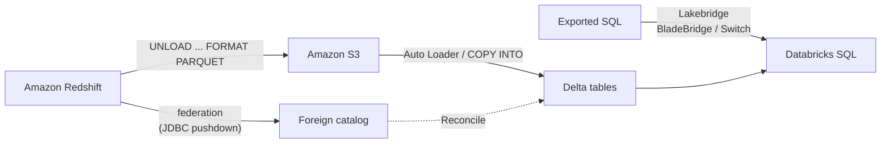

# Migrating from Amazon Redshift

Mastery: `INPUT[inlineSelect(option(new), option(learning), option(solid)):mastery]`

> [!story] Context
> [[Migrating from Snowflake]] covered a cloud warehouse with Iceberg-based coexistence. [[Amazon Redshift]] is the AWS-native warehouse. Its data unloads cleanly to [[Amazon S3]], which Databricks on AWS reads directly, so data movement is simple. Most of the effort is SQL conversion and tuning that was specific to Redshift.

> [!eli5] Summary
> Redshift keeps a company's reporting data inside Amazon's cloud. Moving to Databricks means exporting that data as files to Amazon's storage service, loading the files into Databricks tables, translating the SQL, and checking that the numbers match before switching the reports.

> [!analogy]- Analogy: emptying a storage unit into a shared garage
> | Moving house | Redshift migration |
> |---|---|
> | Emptying the storage unit into the garage | `UNLOAD` to S3 as Parquet |
> | Unpacking into labelled cupboards | Loading Parquet into Delta tables |
> | Rewriting the household rules | Converting Redshift SQL with BladeBridge or Switch |
> | Checking nothing is missing | Lakebridge Reconcile |

## Background

Redshift migrations usually start because the team wants one platform for warehousing, data engineering, and machine learning, or because Redshift-specific tuning (distribution styles, sort keys, `VACUUM`, workload management) consumes too much time. Redshift-specific risks:

- **PostgreSQL-flavored dialect** with Redshift functions (`DATEADD`, `DATEDIFF`, `GETDATE`, `NVL2`) and types (`SUPER`, `HLLSKETCH`, `GEOMETRY`).
- **Physical design in DDL.** `DISTKEY`, `SORTKEY`, and `ENCODE` clauses have no direct equivalent and should be removed rather than translated.
- **Spectrum external tables** that already point at S3 data.

## Overview

| Phase | Redshift-specific work | Tool |
|---|---|---|
| Assess | Analyze exported DDL, views, and procedures; profile the cluster | Lakebridge Analyzer; Lakebridge Profiler (Redshift listed) |
| Coexist | Query Redshift from Databricks | [[Lakehouse Federation]] (`TYPE redshift`) |
| Ingest | `UNLOAD` tables to S3 as Parquet, load into Delta | Redshift `UNLOAD`, then [[Auto Loader]] or [[COPY INTO]] |
| Convert | Translate SQL and procedures | Lakebridge BladeBridge (experimental for Redshift), Switch (experimental), the agentic code converter |
| Validate | Compare schemas, rows, and values | Lakebridge Reconcile (all report types for Redshift) |
| Switch over | Repoint BI tools and jobs | [[Migrating BI Reports]], [[Lakeflow Jobs]] |
| Decommission | Pause or delete the cluster or workgroup, keep a final snapshot | [[Migration Checklist]] |

## How it works



### Phase 1: assess

1. Export DDL, views, stored procedures, and ETL scripts as `.sql` files. Lakebridge's Redshift guide suggests `pg_get_table_def` for table DDL and `pg_views` for view definitions.
2. Run the Analyzer on the files:

```bash
databricks labs lakebridge analyze --source-directory ./redshift_sql --report-file ./assessment/redshift.xlsx
```

The Profiler guide lists Amazon Redshift as a supported source. The supported-sources table on the Lakebridge overview page leaves the Redshift Profiler cell empty, so confirm support in your Lakebridge version.

### Phase 2: coexist with Lakehouse Federation

```sql
CREATE CONNECTION redshift_prod TYPE redshift
OPTIONS (
  host 'analytics.abc123.us-east-1.redshift.amazonaws.com',
  port '5439',
  user secret('migration', 'rs_user'),
  password secret('migration', 'rs_password')
);

CREATE FOREIGN CATALOG redshift_dw
USING CONNECTION redshift_prod
OPTIONS (database 'dw');
```

Requirements and limits:

- Databricks Runtime 13.3 LTS or later in standard or dedicated access mode, or a pro or serverless SQL warehouse 2023.40 or later.
- Filters, projections, limits, joins, aggregates, and common operators push down to Redshift. Join pushdown is generally available and enabled by default for Redshift.
- Parallel reads are supported, so large tables can be fetched by several executors.
- Queries are read-only.
- Redshift Spectrum external tables cannot be federated. Read their S3 files directly instead.
- Tables with case-sensitive identifiers cannot be federated through a Redshift connection.

The older Spark Redshift connector, which staged data through S3 with `COPY` and `UNLOAD`, is retired. Databricks recommends Lakehouse Federation instead.

### Phase 3: ingest with UNLOAD

```sql
-- On Redshift: unload a table to S3 as Parquet, partitioned by date
UNLOAD ('SELECT * FROM sales.orders')
TO 's3://migration-bucket/redshift/orders/'
IAM_ROLE 'arn:aws:iam::123456789012:role/RedshiftUnloadRole'
FORMAT PARQUET
PARTITION BY (order_date);
```

```sql
-- On Databricks: load the files into a Delta table
CREATE TABLE IF NOT EXISTS raw.redshift.orders;
COPY INTO raw.redshift.orders
FROM 's3://migration-bucket/redshift/orders/'
FILEFORMAT = PARQUET
COPY_OPTIONS ('mergeSchema' = 'true');
```

`UNLOAD` behavior to plan for, from the Redshift docs:

- Parquet output is compressed with Snappy per row group. File-level options such as `GZIP`, `DELIMITER`, and `HEADER` cannot be combined with `PARQUET`.
- The default maximum file size is 6.2 GB. `MAXFILESIZE` accepts 5 MB to 6.2 GB.
- `PARTITION BY` writes a partitioned folder layout. Delta tables do not need that layout; prefer [[Liquid Clustering]] on the target.
- `IAM_ROLE` accepts `default`, an ARN, or chained roles.

For continuing changes during the parallel run, re-run `UNLOAD` for recent partitions, or point the upstream pipelines at Databricks as well.

### Phase 4: convert

```bash
databricks labs lakebridge install-transpile     # choose redshift; BladeBridge is installed
databricks labs lakebridge transpile \
  --source-dialect redshift \
  --input-source ./redshift_sql \
  --output-folder ./converted
```

For Redshift, BladeBridge targets Databricks SQL and is marked experimental; Switch targets notebooks and is also experimental. Morpheus does not support Redshift. Lakebridge's Redshift guide documents the mappings, including:

| Redshift | Databricks SQL | Note |
|---|---|---|
| `GETDATE()`, `SYSDATE` | `current_timestamp()` | |
| `DATEADD('day', n, d)` | `date_add(d, n)` | |
| `DATEADD('month', n, d)` | `add_months(d, n)` | |
| `DATE_PART('dow', d)` | `dayofweek(d)` | Check the day numbering |
| `VARCHAR`, `CHAR`, `TEXT`, `NVARCHAR` | `STRING` | |
| `TIMESTAMPTZ` | `TIMESTAMP` | |
| `REAL`, `DOUBLE PRECISION` | `FLOAT` / `DOUBLE` | |
| `IDENTITY` columns | `GENERATED AS IDENTITY` | |
| `SUPER` | `VARIANT` or `STRING` | Not converted automatically; parse manually |
| `HLLSKETCH` | `approx_count_distinct()` | Not converted automatically |
| `GEOMETRY` | Databricks spatial functions | Not converted automatically |
| `DISTKEY`, `SORTKEY`, `ENCODE` | Remove; use [[Liquid Clustering]] | Physical tuning does not carry over |

### Phases 5 to 7: validate, switch over, decommission

1. Run Lakebridge Reconcile with the Redshift Unity Catalog connection. Redshift supports `schema`, `row`, `data`, and `all` reports.
2. Run old and new in parallel ([[Running Old and New in Parallel]]).
3. Repoint BI tools to a [[SQL Warehouses|SQL warehouse]] ([[Migrating BI Reports]]).
4. Take a final Redshift snapshot, then pause and delete the cluster or Serverless workgroup.

## Small-business considerations

> [!smallbiz] Small-business considerations
> A small Redshift deployment is often a single cluster or a Serverless workgroup feeding one BI tool.
> 1. Unload every table once to S3 as Parquet. For small estates this takes hours, not weeks.
> 2. Federate Redshift for validation while you convert the views behind the main reports.
> 3. Switch reports over, then delete the cluster. Keep the final snapshot and the Parquet files as the archive.
>
> Keep the S3 bucket in the same region as Redshift and the Databricks workspace to avoid cross-region transfer charges.

## Cloud differences

> [!aws]- Databricks on AWS
> The most direct path. Redshift unloads to S3, and Unity Catalog reads it through a storage credential backed by an IAM role ([[S3 Access via Unity Catalog]]). Create an external location on the unload bucket, then use Auto Loader or `COPY INTO`. Federation needs network reach from Databricks compute to the Redshift endpoint; see [[Customer-Managed VPC on AWS]] and [[AWS PrivateLink]].

> [!azure]- Azure Databricks
> Federation to Redshift is supported from Azure Databricks. For bulk history, unload to S3 and then copy to ADLS Gen2, or read from S3 through a Unity Catalog storage credential. Cross-cloud transfer incurs AWS [[Egress|egress]] charges, so move history once.

> [!gcp]- Databricks on Google Cloud
> Federation to Redshift is also documented for GCP. As on Azure, bulk history crosses clouds, so plan a one-time copy and account for egress.

## Advanced topics

> [!deepdive]- Advanced topics (301–401)
> - **Spectrum tables.** Spectrum external tables already have data in S3, often as Parquet. Lakehouse Federation cannot query Redshift external data, so register those paths as external tables or convert them to Delta instead.
> - **Late-binding views.** Views created `WITH NO SCHEMA BINDING` do not check their underlying objects until query time, and a view over an external (Spectrum) table must be created this way. Resolve their dependencies during assessment.
> - **Case-sensitive identifiers.** With `enable_case_sensitive_identifier` set to `true`, Redshift preserves the case of double-quoted names. Lakehouse Federation cannot federate Redshift tables with case-sensitive identifiers, so unload those tables instead. Databricks identifiers are case-insensitive, so rename objects whose names differ only by case before you migrate.
> - **Stored procedures.** Redshift procedures use PL/pgSQL syntax. BladeBridge converts them to Databricks SQL scripting; complex ones are candidates for Switch.
> - **Concurrency.** Redshift workload management (WLM) separates workloads into queues. Serverless [[SQL Warehouses|SQL warehouses]] manage queueing with Intelligent Workload Management. Where workloads need different limits, give each its own warehouse with its own maximum cluster count and statement timeout.

## Common misconceptions

> [!confusion] Unloaded Parquet files are not yet Delta tables
> `UNLOAD` writes plain Parquet files. They become governed [[Delta Lake]] tables only after you load them with `COPY INTO` or Auto Loader, or convert them in place.

> [!confusion] Distribution and sort keys do not need translation
> `DISTKEY` and `SORTKEY` are Redshift physical tuning. Drop them, and use [[Liquid Clustering]] on commonly filtered columns if needed.

## Recall

Which Redshift command exports a table to S3 as Parquet?::`UNLOAD ('SELECT ...') TO 's3://...' IAM_ROLE '...' FORMAT PARQUET`.
What is the default maximum file size for Redshift UNLOAD?::6.2 GB; `MAXFILESIZE` accepts 5 MB to 6.2 GB.
What federation connection type is used for Redshift?::`TYPE redshift`.
Name two Redshift objects that Lakehouse Federation cannot read.::Redshift Spectrum external tables, and tables with case-sensitive identifiers.
Which Lakebridge transpilers support Redshift?::BladeBridge (experimental, Databricks SQL) and Switch (experimental, notebooks). Morpheus does not.
What happens to DISTKEY and SORTKEY clauses?::They are removed; use Liquid Clustering instead.
Which Redshift type has no automatic conversion and maps to VARIANT or STRING?::`SUPER`.
What replaced the old Spark Redshift connector?::Lakehouse Federation.

## Next steps

> [!path] Learning path
> **Needs first:** [[Amazon Redshift]], [[Migration Strategy Overview]], [[Amazon S3]]
> **Unlocks next:** [[Lakebridge]], [[Running Old and New in Parallel]], [[Migrating BI Reports]]

> [!nextup] Next
> [[Migrating from Google BigQuery]] covers the Google Cloud warehouse, with a Storage API-based federation connector and exports to Cloud Storage.

> [!sources]- Sources (last verified: 2026-10-25)
> - [Run federated queries on Amazon Redshift (AWS)](https://docs.databricks.com/aws/en/query-federation/redshift)
> - [Run federated queries on Amazon Redshift (Azure Databricks)](https://learn.microsoft.com/en-us/azure/databricks/query-federation/redshift)
> - [Run federated queries on Amazon Redshift (GCP)](https://docs.databricks.com/gcp/en/query-federation/redshift)
> - [Lakehouse Federation performance recommendations (AWS)](https://docs.databricks.com/aws/en/query-federation/performance-recommendations)
> - [Query Amazon Redshift using Databricks (legacy connector, GCP)](https://docs.databricks.com/gcp/en/archive/connectors/amazon-redshift)
> - [UNLOAD (Amazon Redshift docs)](https://docs.aws.amazon.com/redshift/latest/dg/r_UNLOAD.html)
> - [UNLOAD examples (Amazon Redshift docs)](https://docs.aws.amazon.com/redshift/latest/dg/r_UNLOAD_command_examples.html)
> - [Unloading data to Amazon S3 (Amazon Redshift docs)](https://docs.aws.amazon.com/redshift/latest/dg/t_Unloading_tables.html)
> - [COPY INTO reference (AWS)](https://docs.databricks.com/aws/en/sql/language-manual/delta-copy-into)
> - [Lakebridge: Amazon Redshift to Databricks (Databricks Labs, GitHub)](https://github.com/databrickslabs/lakebridge/blob/main/docs/lakebridge/docs/transpile/source_systems/redshift.mdx)
> - [Lakebridge supported dialects (Databricks Labs, GitHub)](https://github.com/databrickslabs/lakebridge/blob/main/docs/lakebridge/docs/transpile/index.mdx)
> - [Lakebridge Profiler guide (Databricks Labs, GitHub)](https://github.com/databrickslabs/lakebridge/blob/main/docs/lakebridge/docs/assessment/profiler/index.mdx)
> - [Lakebridge Reconcile guide (Databricks Labs, GitHub)](https://github.com/databrickslabs/lakebridge/blob/main/docs/lakebridge/docs/reconcile/index.mdx)
> - [Convert SQL with the agentic code converter (AWS)](https://docs.databricks.com/aws/en/migration/agentic-code-converter)
> - [SQL warehouse sizing, scaling, and queuing behavior (AWS)](https://docs.databricks.com/aws/en/compute/sql-warehouse/warehouse-behavior)
> - [Identifiers (AWS)](https://docs.databricks.com/aws/en/sql/language-manual/sql-ref-identifiers)
> - [What is query federation? Limitations (AWS)](https://docs.databricks.com/aws/en/query-federation/database-federation)
> - [CREATE VIEW (Amazon Redshift docs)](https://docs.aws.amazon.com/redshift/latest/dg/r_CREATE_VIEW.html)
> - [enable_case_sensitive_identifier (Amazon Redshift docs)](https://docs.aws.amazon.com/redshift/latest/dg/r_enable_case_sensitive_identifier.html)
> - [Workload management (Amazon Redshift docs)](https://docs.aws.amazon.com/redshift/latest/dg/cm-c-implementing-workload-management.html)
