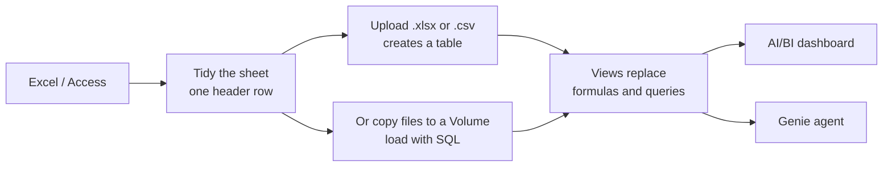

# Migrating from Excel and Access

Mastery: `INPUT[inlineSelect(option(new), option(learning), option(solid)):mastery]`

> [!story] Context
> [[Assessing Your Current Data Estate]] produced an inventory. In many small businesses, that inventory is mostly spreadsheets on a shared drive and one or two Microsoft Access databases. This is the simplest migration in the chapter, and a useful first wave even for companies with larger systems.

> [!eli5] Summary
> Today the business runs on many separate spreadsheet files that people copy, email, and overwrite. Moving to Databricks puts each list (customers, orders, products) in one shared place. Everyone sees the same numbers, nobody overwrites anyone else, and people can ask questions in plain English.

> [!analogy]- Analogy: from personal notebooks to one library
> | Library | Databricks |
> |---|---|
> | Personal notebooks that disagree | Today's Excel files |
> | One official ledger on a library shelf | A table |
> | The library's document drawer | A [[Volumes\|Volume]] for original files |
> | Floor and shelf | [[Catalogs Schemas and Tables\|Catalog and schema]], for example `finance.sales` |
> | A noticeboard that updates itself | An [[AI-BI Dashboards\|AI/BI dashboard]] |
> | A librarian who answers questions | [[Genie Agents]] |

## Background

Spreadsheets work well for starting a business and poorly for running one past a certain size. Common signs (see [[Signs You Have Outgrown Spreadsheets]]):

- Several versions of `Customers_FINAL_v3.xlsx` and no agreement on which is correct.
- Monthly reports that take days of copying and pasting.
- Formulas that break silently when someone inserts a column.
- Files too large to open, or an Access database near its size limit. Microsoft documents a maximum Access database size of 2 GB, minus the space needed for system objects.
- No record of who changed a number, or when.

Tables provide a [[Single Source of Truth|single source of truth]], history, permissions, and dashboards that refresh themselves.

## Overview

Migrating from Excel and Access means moving spreadsheet and Access data into governed [[Unity Catalog]] tables, then rebuilding reports as views, dashboards, and Genie Agents.

Four concepts cover most of the move:

| Spreadsheet world | Databricks | Benefit |
|---|---|---|
| An Excel sheet or an Access table | A **table** in [[Unity Catalog]], such as `finance.sales.orders` | One copy, [[Data Type\|typed]] columns, history ([[Time Travel]]), permissions |
| A folder of files on a shared drive | A **[[Volumes\|Volume]]**, such as `/Volumes/finance/sales/raw_files/` | Governed files that SQL can load |
| A pivot table or chart | An **[[AI-BI Dashboards\|AI/BI dashboard]]** | Refreshes from the table; shared with users and groups |
| Asking the one person who knows the spreadsheet | A **[[Genie Agents\|Genie Agent]]** (formerly Genie space) | Plain-English questions answered with generated SQL |

Access is both a database and an application. Its **tables** become Databricks tables, its **saved queries** become SQL views, and its **forms and reports** are rebuilt, usually as dashboards, or as a small [[Databricks Apps|Databricks App]] if people enter data through forms.

## How it works



### Step 1: create a catalog and schema

If you do not have a workspace yet, start with [[Databricks Free Edition and Trials]]. In the [[SQL Editor]], run:

```sql
CREATE CATALOG IF NOT EXISTS finance;
CREATE SCHEMA  IF NOT EXISTS finance.sales;
```

### Step 2: tidy each sheet

Tables are stricter than spreadsheets:

- **One table per sheet, one header row.** Remove titles, notes, and blank rows above the headers.
- **No merged cells, subtotal rows, or color used as data.** "Red means overdue" becomes a column named `is_overdue`.
- **Simple column names.** `Order Date` becomes `order_date`. Avoid `%`, `#`, and `/`.
- **One kind of value per column.** Dates are dates and amounts are numbers. No "TBC" in a price column.

### Step 3a: upload a file in the UI

The **Create or modify table** page accepts CSV and Excel (`.xls`, `.xlsx`) files, either uploaded from your computer or already stored in a Volume.

1. Open the add-data page in the workspace and choose **Create or modify table**.
2. Upload the file.
3. For Excel files, select the sheet, set the number of header rows, and optionally limit the cell range.
4. Choose the catalog `finance`, the schema `sales`, and the table name `orders`.
5. Check each column type (dates as `DATE`, money as `DECIMAL`) and create the table.

The UI creates one table from the selected sheet. Files uploaded through this page are stored in an internal location that is cleaned up daily, so keep originals that you need in a Volume.

### Step 3b: load recurring files with SQL

When the same file arrives every week, keep the raw files in a [[Volumes|Volume]] and load them with SQL so the process repeats exactly:

```sql
-- A governed folder for raw files
CREATE VOLUME IF NOT EXISTS finance.sales.raw_files;

-- Load a CSV folder into a typed table
CREATE OR REPLACE TABLE finance.sales.orders AS
SELECT
  CAST(order_id   AS BIGINT)        AS order_id,
  CAST(order_date AS DATE)          AS order_date,
  customer_id,
  CAST(amount     AS DECIMAL(12,2)) AS amount
FROM read_files('/Volumes/finance/sales/raw_files/orders/',
                format => 'csv', header => true);

-- Load one sheet and range from an Excel workbook
CREATE OR REPLACE TABLE finance.sales.products AS
SELECT * FROM read_files(
  '/Volumes/finance/sales/raw_files/products.xlsx',
  format => 'excel',
  headerRows => 1,
  dataAddress => 'Products!A1:F500'
);
```

Upload files into the Volume from Catalog Explorer. For files that keep arriving, [[COPY INTO]] loads only new files each time it runs, and [[Auto Loader]] does the same continuously.

### Step 4: convert formulas and Access queries to SQL

| Excel or Access | Databricks SQL |
|---|---|
| `VLOOKUP` / `XLOOKUP` | `JOIN` on the key column |
| `SUMIFS(amount, region, "West")` | `SUM(amount) ... WHERE region = 'West'`, or `GROUP BY region` |
| Pivot table | `GROUP BY`, or a dashboard visual |
| `IF(x > 0, "yes", "no")` / Access `IIf()` | `CASE WHEN x > 0 THEN 'yes' ELSE 'no' END` |
| Access `Nz(x, 0)` | `coalesce(x, 0)` |
| Access `"A" & "B"` | `concat('A', 'B')` or `'A' \|\| 'B'` |
| Access `LIKE "Smi*"` | `LIKE 'Smi%'` |
| Access date literal `#2026-03-01#` | `DATE'2026-03-01'` |

A saved Access query becomes a view:

```sql
CREATE OR REPLACE VIEW finance.sales.monthly_revenue AS
SELECT date_trunc('MONTH', o.order_date) AS month,
       c.region,
       SUM(o.amount) AS revenue
FROM finance.sales.orders o
JOIN finance.sales.customers c ON o.customer_id = c.customer_id
GROUP BY ALL;
```

To get data out of Access, export each table to a text (CSV) file with field names in the first row, then load it as in Step 3. Copy each saved query's SQL text so it can be rewritten as a view.

### Step 5: build a first dashboard

1. Create a new dashboard.
2. On the **Data** tab, add a dataset: select the `monthly_revenue` view from Unity Catalog, or write a SQL query.
3. On the canvas, add a bar chart of `revenue` by `month`, colored by `region`.
4. Add a filter for `region`.
5. Publish. Publishing creates a snapshot that viewers see; later edits stay in the draft until you publish again.
6. Share with users or groups. Choose shared data permissions (viewers use the publisher's permissions) or individual data permissions (viewers use their own).

Business users who only read dashboards can use [[Genie One]].

### Step 6: create a Genie agent

1. Open **Genie Agents** and create a new agent.
2. Add the `orders` and `customers` tables and the `monthly_revenue` view. The data must be in Unity Catalog, and the agent needs a pro or serverless SQL warehouse.
3. Add instructions, such as "Revenue means the sum of `amount`. The fiscal year starts in April." The docs recommend SQL expressions for business metrics and plain text for general guidance.
4. Ask a question, such as "Top 5 customers by revenue last quarter". Genie generates and runs SQL, and you can inspect the SQL it used.

Table and column descriptions in Catalog Explorer improve answer accuracy. Databricks' best-practice guidance is to keep a Genie agent focused on a small number of tables.

## Small-business considerations

> [!smallbiz] Small-business considerations
> A realistic first week for a 10-person business:
> 1. **Day 1:** tidy the three spreadsheets that matter most (customers, orders, products).
> 2. **Day 2:** upload them and check column types.
> 3. **Day 3:** write two views that replace the monthly copy-and-paste report.
> 4. **Day 4:** build one dashboard.
> 5. **Day 5:** create a Genie agent and let the owner ask questions.
>
> **Cost:** small tables cost little to store. Compute is the main cost, measured in [[DBUs]]. A [[SQL Warehouses|serverless SQL warehouse]] with [[Auto Termination|auto-stop]] bills only while it runs. See [[Estimating Costs for a Small Business]].
>
> **What stays in Excel:** one-off analysis is fine in Excel. Connect Excel to Databricks through [[JDBC and ODBC|ODBC]] to read the official tables instead of copying them.

## Cloud differences

> [!azure]- Azure Databricks
> The steps are the same. Many Excel and Access users already use Microsoft 365, so Power BI can connect to the new tables directly; see [[Power BI on Azure Databricks]] and [[Connecting Power BI]]. Users sign in with their Microsoft Entra ID work account.

> [!aws]- Databricks on AWS
> Nothing differs. Upload, Volumes, dashboards, and Genie work the same way.

> [!gcp]- Databricks on Google Cloud
> Nothing differs. For data in Google Sheets, download each sheet as `.xlsx` or `.csv` first.

## Advanced topics

> [!deepdive]- Advanced topics (301–401)
> - **Data entry needs a new home.** Dashboards are read-only. If people entered data through Access forms, give them a small app ([[Databricks Apps]]) backed by a table or an OLTP database (built for day-to-day transactions) such as [[Lakebase]], rather than letting them edit tables directly.
> - **Schema drift in weekly files.** When someone adds a column to next week's file, [[Auto Loader]] can evolve the schema. Decide whether that should fail or be accepted; see [[Schema Enforcement and Evolution]].
> - **Money needs DECIMAL.** Use `DECIMAL(p, s)` for currency, never `DOUBLE`, or totals drift by fractions of a cent.
> - **Keep the raw files.** Original files in a Volume provide an audit trail and allow a table rebuild if a load goes wrong.
> - **Relationships.** Access enforces relationships. Databricks lets you declare [[Primary and Foreign Keys|primary and foreign keys]] as informational constraints that are not enforced. Declare them anyway: they help Genie and BI tools understand joins.

## Common misconceptions

> [!confusion] Uploading a file is not linking to it
> An uploaded file becomes a copy in a table. Editing the original Excel file afterwards does not change the table. Re-upload it, or use a Volume and [[COPY INTO]] for recurring files.

> [!confusion] A Volume is not a table
> A [[Volumes|Volume]] stores files as they are. A table stores rows and columns that SQL can query. Files usually live in a Volume and are loaded into tables.

## Recall

What does an Excel sheet become in Databricks?::A table in Unity Catalog, addressed as `catalog.schema.table`.
What is a Volume?::A governed folder in Unity Catalog for files, with paths like `/Volumes/catalog/schema/volume/`.
Which SQL replaces VLOOKUP?::A `JOIN` on the key column.
Which `read_files` option reads Excel files?::`format => 'excel'`, with `headerRows` and `dataAddress` to pick the sheet and range.
What does a saved Access query become?::A SQL view.
What replaces Access `Nz(x, 0)`?::`coalesce(x, 0)`
Which data type should you use for money?::`DECIMAL`, never `DOUBLE`.
What is the maximum size of an Access database?::2 GB, minus the space needed for system objects.
What were Genie spaces renamed to in 2026?::Genie Agents.

## Next steps

> [!path] Learning path
> **Needs first:** [[Spreadsheets]], [[What Is Data]], [[SQL]]
> **Unlocks next:** [[AI-BI Dashboards]], [[Genie Agents]], [[Volumes]]

> [!nextup] Next
> [[Migrating from SQL Server]] covers the most common next source: querying SQL Server in place, then replicating it with Lakeflow Connect.

> [!sources]- Sources (last verified: 2026-10-25)
> - [Read and stream Excel files (AWS)](https://docs.databricks.com/aws/en/query/formats/excel)
> - [Create or modify a table using file upload (Azure Databricks)](https://learn.microsoft.com/en-us/azure/databricks/ingestion/create-or-modify-table)
> - [Work with files in Unity Catalog volumes (AWS)](https://docs.databricks.com/aws/en/ingestion/file-upload/upload-data)
> - [read_files table-valued function (AWS)](https://docs.databricks.com/aws/en/sql/language-manual/functions/read_files)
> - [Create a dashboard (AWS)](https://docs.databricks.com/aws/en/dashboards/tutorials/create-dashboard)
> - [Create and manage dashboard datasets (AWS)](https://docs.databricks.com/aws/en/dashboards/manage/data-modeling/datasets)
> - [Share a dashboard (AWS)](https://docs.databricks.com/aws/en/dashboards/share/share)
> - [Create and manage a Genie Agent (AWS)](https://docs.databricks.com/aws/en/genie-agents/set-up)
> - [Curate an effective Genie space (GCP)](https://docs.databricks.com/gcp/en/genie/best-practices)
> - [AI/BI and Genie One release notes 2026 (AWS)](https://docs.databricks.com/aws/en/ai-bi/release-notes/2026)
> - [Access specifications (Microsoft Support)](https://support.microsoft.com/en-us/access/access-specifications)
> - **Unconfirmed:** the exact menu labels for reaching the upload page, the Access export menu path, and the `GROUP BY ALL` and `DATE'...'` literal syntax were not re-checked in this pass. The release notes give conflicting dates for the Genie Agents rename (entries use the new name from January 2026, and a July 9, 2026 entry announces it).
