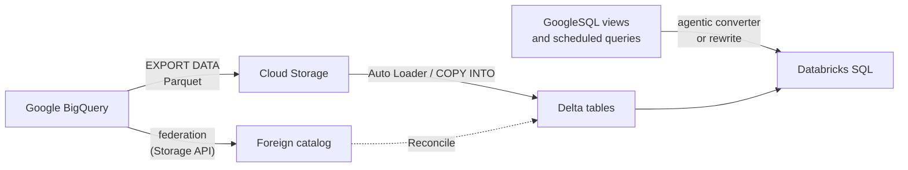

# Migrating from Google BigQuery

Mastery: `INPUT[inlineSelect(option(new), option(learning), option(solid)):mastery]`

> [!story] Context
> [[Migrating from Amazon Redshift]] covered the AWS warehouse. [[Google BigQuery]] is Google Cloud's serverless warehouse. Its federation connector reads through the BigQuery Storage API instead of JDBC, and its data exports to [[Google Cloud Storage]]. Lakebridge's deterministic transpilers do not cover BigQuery SQL, so code conversion uses the agentic code converter or manual rewriting.

> [!eli5] Summary
> BigQuery stores a company's reporting data inside Google's cloud. Moving to Databricks means reading that data from Databricks first, then exporting it as files and loading it into Databricks tables. The SQL that builds reports is rewritten, and the results are compared before reports switch over.

> [!analogy]- Analogy: a library moving to a new building
> | Library move | BigQuery migration |
> |---|---|
> | Borrowing books through an inter-library loan | Query federation through the Storage API |
> | Boxing the collection for the move | `EXPORT DATA` to Cloud Storage as Parquet |
> | Shelving in the new building | Loading Parquet into Delta tables |
> | Translating the catalog cards | Converting GoogleSQL to Databricks SQL |
> | Counting books in both buildings | Lakebridge Reconcile |

## Background

BigQuery bills by bytes scanned or by reserved slots, and separates storage from compute. Teams move to Databricks to consolidate warehousing with data engineering and AI, or to run on another cloud. BigQuery-specific risks:

- **Nested and repeated fields** (`STRUCT`, `ARRAY`) are common and must keep their shape.
- **GoogleSQL functions and syntax**, such as `SAFE_CAST`, `DATE_TRUNC(d, MONTH)`, and backtick-quoted `project.dataset.table` names.
- **Types without equivalents**, such as `BIGNUMERIC`, `TIME`, and `RANGE`.
- **Scheduled queries and Dataform or dbt projects** that build tables.

## Overview

| Phase | BigQuery-specific work | Tool |
|---|---|---|
| Assess | Profile usage; analyze exported SQL | Lakebridge Profiler and Analyzer (both support BigQuery) |
| Coexist | Query BigQuery from Databricks | [[Lakehouse Federation]] (Storage API), or `remote_query` |
| Ingest | Export tables to Cloud Storage as Parquet, load into Delta | `EXPORT DATA`, then [[Auto Loader]] or [[COPY INTO]] |
| Convert | Translate GoogleSQL views, scheduled queries, and models | The agentic code converter (Beta, lists BigQuery), manual rewrite |
| Validate | Compare schemas, rows, and values | Lakebridge Reconcile (BigQuery added in v0.14.1) |
| Switch over | Repoint BI tools and jobs | [[Migrating BI Reports]] |
| Decommission | Delete datasets, cancel reservations | [[Migration Checklist]] |

## How it works



### Phase 1: assess

1. Export view definitions and scheduled query SQL to `.sql` files.
2. Run the Analyzer and the Profiler:

```bash
databricks labs lakebridge analyze --source-directory ./bigquery_sql --report-file ./assessment/bigquery.xlsx
databricks labs lakebridge configure-database-profiler
databricks labs lakebridge execute-database-profiler
```

3. Query BigQuery's `INFORMATION_SCHEMA.JOBS` view for per-table usage over recent weeks.

### Phase 2: coexist with Lakehouse Federation

1. Create a Google service account for Databricks and grant it **BigQuery User** and **BigQuery Data Viewer**.
2. Create a JSON key for the service account and store it as a [[Secrets Management|secret]].
3. Create the connection and foreign catalog in Catalog Explorer or SQL. The connection uses the service account key JSON.

Requirements and behavior:

- Databricks Runtime 16.1 or later in standard or dedicated access mode, or a pro or serverless SQL warehouse.
- The connector reads through the **BigQuery Storage API**, not JDBC. Large scans read data directly; joins and aggregates can be materialized in BigQuery first.
- Network rules must allow the BigQuery REST API, the Google authentication endpoints, and the Storage API endpoint. The **Test connection** button does not exercise the Storage API, so it can succeed while queries fail.
- Join pushdown is generally available and enabled by default for BigQuery.

To run BigQuery-dialect SQL without a foreign catalog, use the `remote_query` table function (Databricks Runtime 18.3 or later on clusters).

Google Cloud Lakehouse (formerly BigLake) Iceberg tables use a separate catalog federation connection type, documented for Databricks on GCP.

### Phase 3: ingest with EXPORT DATA

```sql
-- On BigQuery: export a table to Cloud Storage as Parquet
EXPORT DATA OPTIONS (
  uri = 'gs://migration-bucket/bigquery/orders/*.parquet',
  format = 'PARQUET',
  compression = 'SNAPPY',
  overwrite = true
) AS
SELECT * FROM `my-project.sales.orders`;
```

```sql
-- On Databricks: load the files into Delta
CREATE TABLE IF NOT EXISTS raw.bigquery.orders;
COPY INTO raw.bigquery.orders
FROM 'gs://migration-bucket/bigquery/orders/'
FILEFORMAT = PARQUET
COPY_OPTIONS ('mergeSchema' = 'true');
```

Export behavior to plan for, from the BigQuery docs:

- Parquet supports nested and repeated fields; CSV does not.
- Parquet exports can use `SNAPPY`, `GZIP`, or `ZSTD` compression.
- The number and size of output files are not guaranteed. The `uri` needs a `*` wildcard.
- `DATETIME` values exported to Parquet need conversion to load back into the same schema. Check the resulting Databricks type.
- The exporting identity needs read access on the dataset and object-create access on the bucket.

### Phase 4: convert

Lakebridge's deterministic transpilers (Morpheus and BladeBridge) and Switch's built-in prompts do not list BigQuery as of October 2026. Options:

1. **The agentic code converter**, an in-workspace converter in Beta that lists BigQuery among its sources. A workspace admin enables it on the **Previews** page.
2. **Manual rewrite**, guided by the Analyzer's complexity scores.
3. **Switch with a custom prompt**, since Switch accepts custom YAML prompts for unsupported sources.

Common differences:

| BigQuery (GoogleSQL) | Databricks SQL | Note |
|---|---|---|
| `` `project.dataset.table` `` | `catalog.schema.table` | Map projects or datasets to catalogs and schemas |
| `SAFE_CAST(x AS INT64)` | `try_cast(x AS BIGINT)` | |
| `INT64`, `FLOAT64` | `BIGINT`, `DOUBLE` | |
| `NUMERIC` | `DECIMAL(38, 9)` | Check precision and scale |
| `BIGNUMERIC`, `TIME`, `RANGE` | No direct equivalent | Reconcile cannot compare these exactly |
| `STRUCT`, `ARRAY` | `STRUCT`, `ARRAY` | |
| `UNNEST(arr)` | `explode(arr)` | |
| `SELECT * EXCEPT (col)` | `SELECT * EXCEPT (col)` | Supported |
| `QUALIFY` | `QUALIFY` | Supported |
| `DATE_TRUNC(d, MONTH)` | `date_trunc('MONTH', d)` | Argument order differs |
| Scheduled queries | [[Lakeflow Jobs]] with SQL tasks | |

### Phases 5 to 7: validate, switch over, decommission

1. Run Lakebridge Reconcile with the BigQuery connection. `schema` reports log a warning for columns whose types cannot be compared exactly, such as `BIGNUMERIC`, `TIME`, `RANGE`, and nested `JSON`.
2. Run old and new in parallel ([[Running Old and New in Parallel]]).
3. Repoint Looker, Looker Studio, or other BI tools to a [[SQL Warehouses|SQL warehouse]] ([[Migrating BI Reports]]).
4. Delete datasets after the retention period, and cancel slot reservations or commitments.

## Small-business considerations

> [!smallbiz] Small-business considerations
> A small BigQuery estate is often a few datasets fed by Google Analytics exports or SaaS connectors.
> 1. Federate BigQuery to build new dashboards on Databricks right away.
> 2. Export each table once to Cloud Storage as Parquet and load it into Delta.
> 3. Repoint the upstream feeds (for example, a [[Lakeflow Connect]] connector for Google Analytics) to Databricks.
>
> Federated queries and exports both consume BigQuery resources, billed by BigQuery's own model. Keep the parallel period short.

## Cloud differences

> [!gcp]- Databricks on Google Cloud
> The most direct path. Export to a GCS bucket in the same region as the workspace, and read it through a Unity Catalog storage credential, which uses a Databricks-generated Google service account ([[GCS Access via Unity Catalog]]). Google Cloud Lakehouse catalog federation is documented for GCP.

> [!aws]- Databricks on AWS
> BigQuery federation is supported from AWS. Bulk history crosses clouds: export to GCS, then copy to S3, or read GCS directly with a storage credential. Plan for Google Cloud [[Egress|egress]] charges.

> [!azure]- Azure Databricks
> BigQuery federation is supported from Azure Databricks. As on AWS, bulk history crosses clouds, so move it once and account for egress.

## Advanced topics

> [!deepdive]- Advanced topics (301–401)
> - **Storage API versus materialization.** Simple scans stream directly through the Storage API. Queries with joins or aggregates may be materialized in BigQuery first, which uses BigQuery compute and a temporary table.
> - **Partitioned and clustered tables.** BigQuery partitioning and clustering do not carry over. Use [[Liquid Clustering]] on the Delta target.
> - **Nested data.** Keep `STRUCT` and `ARRAY` columns as Databricks complex types rather than flattening them during migration. Flatten in the silver layer if needed.
> - **Reconcile type gaps.** For BigQuery types that Reconcile cannot compare exactly, add custom transformations in the reconcile config or drop those columns from the comparison and check them separately.
> - **Ordering.** `EXPORT DATA` guarantees row order only with `ORDER BY`. Validation should never depend on file order.

## Common misconceptions

> [!confusion] The BigQuery connector is not JDBC
> Unlike most federation connectors, the BigQuery connector uses the Storage API. Network rules that allow only the REST endpoint pass the connection test and then fail on queries.

> [!confusion] Lakebridge does not transpile BigQuery SQL deterministically
> Lakebridge assesses and reconciles BigQuery, but Morpheus and BladeBridge do not convert GoogleSQL. Use the agentic code converter or rewrite manually.

## Recall

Which API does the BigQuery federation connector read through?::The BigQuery Storage API, not JDBC.
What runtime does BigQuery federation require?::Databricks Runtime 16.1 or later, or a pro or serverless SQL warehouse.
Which roles does the federation service account need in BigQuery?::BigQuery User and BigQuery Data Viewer.
Why can the Test connection button succeed while queries fail?::It does not test the Storage API endpoint, which data reads need.
Which BigQuery statement exports query results to Cloud Storage as Parquet?::`EXPORT DATA OPTIONS (uri = 'gs://.../*.parquet', format = 'PARQUET') AS SELECT ...`
Which BigQuery types can Lakebridge Reconcile not compare exactly?::Types without Databricks equivalents, such as `BIGNUMERIC`, `TIME`, `RANGE`, and nested `JSON`.
What replaces `SAFE_CAST`?::`try_cast`.
How can you run BigQuery-dialect SQL from Databricks without a foreign catalog?::With the `remote_query` table function.

## Next steps

> [!path] Learning path
> **Needs first:** [[Google BigQuery]], [[Migration Strategy Overview]], [[Lakehouse Federation]]
> **Unlocks next:** [[Running Old and New in Parallel]], [[Migrating BI Reports]], [[BigQuery Integration]]

> [!nextup] Next
> [[Migrating from Hadoop]] covers the oldest source in the chapter: HDFS data, Hive tables, and Spark jobs on an on-premises cluster.

> [!sources]- Sources (last verified: 2026-10-25)
> - [Run federated queries on Google BigQuery (AWS)](https://docs.databricks.com/aws/en/query-federation/bigquery)
> - [Run federated queries on Google BigQuery (Azure Databricks)](https://learn.microsoft.com/en-us/azure/databricks/query-federation/bigquery)
> - [Run federated queries on Google BigQuery (GCP)](https://docs.databricks.com/gcp/en/query-federation/bigquery)
> - [Query external databases using the remote_query function (GCP)](https://docs.databricks.com/gcp/en/query-federation/remote-queries)
> - [Enable Google Cloud Lakehouse catalog federation (GCP)](https://docs.databricks.com/gcp/en/query-federation/google-cloud-lakehouse)
> - [Lakehouse Federation performance recommendations (Azure Databricks)](https://learn.microsoft.com/en-us/azure/databricks/query-federation/performance-recommendations)
> - [Export statements in GoogleSQL (BigQuery docs)](https://docs.cloud.google.com/bigquery/docs/reference/standard-sql/export-statements)
> - [Export table data to Cloud Storage (BigQuery docs)](https://docs.cloud.google.com/bigquery/docs/exporting-data)
> - [COPY INTO reference (AWS)](https://docs.databricks.com/aws/en/sql/language-manual/delta-copy-into)
> - [try_cast function (AWS)](https://docs.databricks.com/aws/en/sql/language-manual/functions/try_cast)
> - [Star clause (AWS)](https://docs.databricks.com/aws/en/sql/language-manual/sql-ref-syntax-qry-star)
> - [QUALIFY clause (Azure Databricks)](https://learn.microsoft.com/en-us/azure/databricks/sql/language-manual/sql-ref-syntax-qry-select-qualify)
> - [Convert SQL with the agentic code converter (GCP)](https://docs.databricks.com/gcp/en/migration/agentic-code-converter)
> - [Lakebridge overview and supported sources (Databricks Labs, GitHub)](https://github.com/databrickslabs/lakebridge/blob/main/docs/lakebridge/docs/overview.mdx)
> - [Lakebridge Reconcile guide (Databricks Labs, GitHub)](https://github.com/databrickslabs/lakebridge/blob/main/docs/lakebridge/docs/reconcile/index.mdx)
> - [Lakebridge changelog (Databricks Labs, GitHub)](https://github.com/databrickslabs/lakebridge/blob/main/CHANGELOG.md)
> - **Unconfirmed:** the GoogleSQL to Databricks type mappings (`NUMERIC` precision, `INT64`, `FLOAT64`), the `DATE_TRUNC` and `UNNEST` rows, and the materialization details in Advanced topics were not re-checked in this pass.
