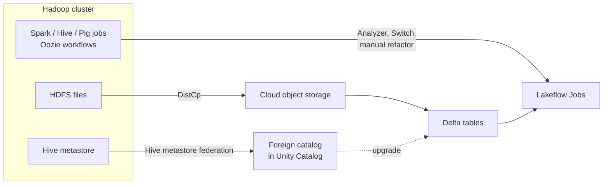

# Migrating from Hadoop

Mastery: `INPUT[inlineSelect(option(new), option(learning), option(solid)):mastery]`

> [!story] Context
> [[Migrating from Google BigQuery]] completed the cloud warehouses. The oldest source in the chapter is an on-premises [[Apache Hadoop]] cluster, often a [[Cloudera and Hortonworks|Cloudera or Hortonworks]] distribution. [[The Pain of Hadoop]] described why teams leave it: coupled storage and compute, heavy operations, and many separate projects to keep in sync. This note covers moving its data, tables, jobs, and security model.

> [!eli5] Summary
> A Hadoop cluster is a room full of company-owned servers that store files and run data jobs. Moving to Databricks means copying the files to cloud storage, re-registering the tables, rerunning the jobs on Databricks compute, and then switching the servers off.

> [!analogy]- Analogy: closing a private warehouse
> | Private warehouse | Hadoop migration |
> |---|---|
> | Shelves you own and maintain | [[HDFS]] on cluster disks |
> | A rented warehouse with unlimited shelves | Cloud [[Object Storage\|object storage]] |
> | The inventory card index | The [[Hive Metastore]] |
> | Forklift schedules | [[YARN]] queues and Oozie workflows |
> | The trucks that move pallets | DistCp, or a physical transfer device |

## Background

Hadoop bundled storage (HDFS), resource management (YARN), batch processing ([[MapReduce]], later [[Apache Spark]]), SQL ([[Apache Hive]], Impala), and scheduling (Oozie) on one cluster. Hardware refreshes, version upgrades, and staffing make it expensive to keep running.

A Databricks blog post on Hadoop migration lists five areas to plan: **administration, data migration, data processing, security and governance, and the SQL and BI layer.** Databricks' migration docs state that most Hive and Spark workloads run with minimal refactoring.

## Overview

> [!bridge]- In Databricks today
> | Hadoop component | Databricks equivalent |
> |---|---|
> | [[HDFS]] | Cloud object storage governed by [[Unity Catalog]] ([[Volumes]], tables) |
> | [[YARN]] | Databricks-managed compute: [[Jobs Compute\|job compute]], [[Serverless Compute\|serverless]], [[SQL Warehouses\|SQL warehouses]] |
> | [[MapReduce]] | [[Apache Spark]] |
> | [[Apache Hive]] and Impala | [[Databricks SQL]] on [[Photon]] |
> | [[Hive Metastore]] | [[Unity Catalog]]; external metastores can be federated during the move |
> | Oozie | [[Lakeflow Jobs]] |
> | Sqoop | [[Lakeflow Connect]] or [[Lakehouse Federation]] |
> | [[Apache HBase]] | No direct equivalent. Use [[Lakebase]] or a cloud NoSQL service (Azure Cosmos DB, Amazon DynamoDB or Keyspaces) for low-latency serving |
> | Ranger or Sentry policies | [[Privileges and Grants\|Unity Catalog grants]], [[Row Filters and Column Masks]] |
> | ORC and Parquet files on HDFS | [[Delta Lake]] tables |

| Workstream | Work | Tool |
|---|---|---|
| **Data** | Copy HDFS directories to object storage, convert to Delta | DistCp, cloud transfer services, `CONVERT TO DELTA` |
| **Metadata** | Register Hive tables in Unity Catalog | Hive metastore federation, then upgrade ([[Hive Metastore Migration to Unity Catalog]]) |
| **Processing** | Move Spark, Hive, and Pig jobs | Databricks Runtime; Lakebridge Analyzer and Switch |
| **Orchestration** | Replace Oozie workflows and cron jobs | [[Lakeflow Jobs]] |
| **Security** | Replace Kerberos, Ranger, or Sentry | Unity Catalog, workspace identity |

## How it works



### Phase 1: assess

1. List HDFS directories with size and last-access time, Hive databases and tables, and every scheduled job.
2. Export job code (HiveQL, Pig, Spark, Sqoop scripts, Oozie XML) to a folder.
3. Run the Lakebridge Analyzer. Its supported sources include Hive, Cloudera Impala, Oozie, Pig, Sqoop, PySpark, and Scala.

```bash
databricks labs lakebridge analyze --source-directory ./hadoop_code --report-file ./assessment/hadoop.xlsx
```

Look for hard-coded `hdfs://` paths, shell scripts on edge nodes, and Kerberos keytabs. These are the usual blockers.

### Phase 2: coexist through the metastore

Hive metastore federation registers an external Hive metastore as a **foreign catalog** in Unity Catalog. Tables whose files are in cloud storage become visible in Databricks under Unity Catalog governance, with no copy. Databricks' upgrade guide recommends federation as a first step before upgrading tables to Unity Catalog. See [[Hive Metastore Migration to Unity Catalog]].

This works once data sits in object storage that Databricks can reach. Data still on on-premises HDFS must be copied first.

### Phase 3: move the data

1. **Copy HDFS to object storage with DistCp:** Apache Hadoop's DistCp runs the copy as a distributed job on the existing cluster:

   ```bash
   # Initial copy from HDFS to S3 (S3A connector)
   hadoop distcp hdfs://namenode:8020/warehouse/sales s3a://migration-bucket/warehouse/sales

   # Incremental re-runs copy only changed files
   hadoop distcp -update hdfs://namenode:8020/warehouse/sales s3a://migration-bucket/warehouse/sales
   ```

   Use `abfss://` for ADLS Gen2 and `gs://` for Google Cloud Storage, with the matching Hadoop connector.

2. **For very large estates or slow links**, use a cloud transfer service or device. Microsoft documents migrating on-premises HDFS to Azure Storage with Azure Data Box.

3. **Convert Parquet directories to Delta in place:** `CONVERT TO DELTA` creates a transaction log over existing Parquet files without rewriting them:

   ```sql
   CONVERT TO DELTA parquet.`s3://migration-bucket/warehouse/sales/orders`
   PARTITIONED BY (order_date DATE);
   ```

   For a path, `PARTITIONED BY` is required when the data is partitioned. For a metastore table name, the partition specification is read from the metastore.

   ORC and text-format tables need a rewrite, for example `CREATE TABLE ... AS SELECT` from the old table.

### Phase 4: move the processing

| Hadoop workload | Change needed |
|---|---|
| Spark jobs | Usually minimal: replace `hdfs://` paths with Unity Catalog tables or Volume paths, update library versions, remove YARN-specific settings |
| HiveQL | Change DDL from `STORED AS` to `USING`, update SerDes to native formats, reinstall or rewrite Hive UDFs, adjust partition layouts |
| Impala SQL | Rewrite as Databricks SQL; Analyzer scores complexity |
| Pig | Rewrite in Spark SQL or PySpark; Analyzer only, no converter |
| Sqoop imports | Replace with [[Lakeflow Connect]] or federation |
| Oozie workflows | Rebuild as [[Lakeflow Jobs]]; Analyzer only, no converter |
| MapReduce Java jobs | Rewrite in Spark |

Lakebridge's Switch transpiler (experimental) has built-in prompts for Python, Scala, PySpark ETL, and Airflow DAGs, which help with job code. It has no built-in prompts for HiveQL, Pig, or Oozie as of October 2026.

### Phase 5: replace security

1. Recreate users and groups at the Databricks account, synced from your [[Identity Provider|identity provider]].
2. Translate Ranger or Sentry policies into Unity Catalog [[Privileges and Grants|grants]] and [[Row Filters and Column Masks|row filters and column masks]].
3. Remove Kerberos dependencies from job code. Connections to external systems use Unity Catalog connections or [[Secrets Management|secrets]].

### Phases 6 to 8: validate, switch over, decommission

1. Compare row counts and key aggregates between Hive and Delta tables. Federated Hive tables make side-by-side SQL simple.
2. Run old and new jobs in parallel ([[Running Old and New in Parallel]]).
3. Stop Oozie coordinators, make HDFS read-only, keep it for the agreed retention period, then retire the hardware.

## Small-business considerations

> [!smallbiz] Small-business considerations
> Few small businesses run Hadoop, but some inherited a small cluster or a managed Hadoop service.
> 1. If the data volume is modest, copy it once with DistCp and skip coexistence.
> 2. Convert Parquet tables with `CONVERT TO DELTA`, and rewrite the rest.
> 3. Rebuild the few scheduled jobs as Lakeflow Jobs on serverless compute, so there is no cluster to manage.
>
> The savings come from retiring hardware, support contracts, and operations time. Add those lines to the [[Building a Business Case|business case]].

## Cloud differences

> [!azure]- Azure Databricks
> Target ADLS Gen2 (`abfss://`), governed through an [[ADLS and Access Connectors|Access Connector]]. Microsoft documents Azure Data Box for offline transfer of large HDFS estates, and Azure Data Factory has an HDFS connector for copy activities.

> [!aws]- Databricks on AWS
> Target S3 through a Unity Catalog storage credential ([[S3 Access via Unity Catalog]]). AWS Prescriptive Guidance documents DistCp from on-premises HDFS to S3 over [[AWS PrivateLink]]. Amazon EMR's S3DistCp is an AWS-optimized variant for teams leaving EMR. Existing Glue catalogs can be federated ([[Hive Metastore Federation for AWS Glue]]).

> [!gcp]- Databricks on Google Cloud
> Target Cloud Storage (`gs://`) through [[GCS Access via Unity Catalog]]. Install the open-source Cloud Storage connector on the on-premises Hadoop cluster so that DistCp can write to `gs://` paths; Google documents this setup for moving on-premises HDFS data to Cloud Storage.

## Advanced topics

> [!deepdive]- Advanced topics (301–401)
> - **DistCp tuning:** Use `-update` for incremental passes, and add `-numListstatusThreads` to speed up listing large trees. If the S3A etag-as-checksum setting is enabled, DistCp between HDFS and S3 needs `-skipcrccheck`.
> - **Dual ingestion during transition:** Databricks' Hadoop guidance suggests feeding new data to both platforms during the parallel period, so the cloud copy stays current while history is backfilled.
> - **Small files:** HDFS directories often hold many small files. After conversion, run `OPTIMIZE` (see [[OPTIMIZE and VACUUM]]) to compact them.
> - **Partitioning:** Hive-style partitioning on high-cardinality columns hurts Delta performance. Replace it with [[Liquid Clustering]] where possible.
> - **YARN chargeback:** YARN queues often doubled as cost allocation. Rebuild it explicitly with [[Tagging for Chargeback|tags]] and [[Compute Policies|compute policies]].
> - **HBase:** HBase serves low-latency key lookups. Delta tables are not a key-value store, and Databricks does not provide an HBase-like storage service. Databricks' Hadoop migration guidance maps HBase to a cloud NoSQL service such as Azure Cosmos DB or Amazon DynamoDB or Keyspaces. [[Lakebase]], a managed Postgres database, can serve Unity Catalog tables to applications at low latency.

## Common misconceptions

> [!confusion] Spark on Hadoop is not the same as Spark on Databricks
> The Spark APIs are the same, but jobs often depend on HDFS paths, YARN settings, Hive SerDes, and edge-node scripts. Those dependencies, not Spark code, are the migration work.

> [!confusion] Copying HDFS files does not create tables
> DistCp copies files. Tables appear only after they are registered in Unity Catalog, converted with `CONVERT TO DELTA`, or rewritten.

## Recall

Which Apache tool copies HDFS directories to object storage as a distributed job?::DistCp (`hadoop distcp`).
Which DistCp flag copies only changed files on re-runs?::`-update`.
Which command turns a Parquet directory into a Delta table without rewriting the data?::`CONVERT TO DELTA`.
What replaces Oozie workflows?::Lakeflow Jobs.
What does Hive's `STORED AS` become in Databricks DDL?::`USING`, for example `USING DELTA`.
Which Lakehouse Federation feature exposes an external Hive metastore in Unity Catalog?::Hive metastore federation, as a foreign catalog.
What are the five planning areas in Databricks' Hadoop migration guidance?::Administration, data migration, data processing, security and governance, and the SQL and BI layer.
Which Hadoop sources can the Lakebridge Analyzer score?::Hive, Cloudera Impala, Oozie, Pig, Sqoop, PySpark, and Scala.

## Next steps

> [!path] Learning path
> **Needs first:** [[Apache Hadoop]], [[HDFS]], [[Apache Hive]], [[Migration Strategy Overview]]
> **Unlocks next:** [[Hive Metastore Migration to Unity Catalog]], [[Migrating ETL Tools]], [[Running Old and New in Parallel]]

> [!nextup] Next
> [[Migrating ETL Tools]] covers the jobs that feed warehouses and clusters: SSIS, Informatica, Talend, DataStage, and stored procedures.

> [!sources]- Sources (last verified: 2026-10-25)
> - [Migrate data applications to Databricks (AWS)](https://docs.databricks.com/aws/en/migration/)
> - [Migrate ETL pipelines to Azure Databricks](https://learn.microsoft.com/en-us/azure/databricks/migration/etl)
> - [Migrate ETL pipelines to Databricks (AWS)](https://docs.databricks.com/aws/en/migration/etl)
> - [Hive metastore federation concepts (AWS)](https://docs.databricks.com/aws/en/query-federation/hms-federation-concepts)
> - [Upgrade a Databricks workspace to Unity Catalog (AWS)](https://docs.databricks.com/aws/en/data-governance/unity-catalog/upgrade/)
> - [CONVERT TO DELTA (AWS)](https://docs.databricks.com/aws/en/sql/language-manual/delta-convert-to-delta)
> - [5 Key Steps to Successfully Migrate From Hadoop to the Lakehouse Architecture (Databricks blog)](https://www.databricks.com/blog/2021/08/06/5-key-steps-to-successfully-migrate-from-hadoop-to-the-lakehouse-architecture.html)
> - [Migrate from Hadoop to Databricks (Databricks)](https://www.databricks.com/solutions/migration/hadoop)
> - [Apache Hadoop Distributed Copy (DistCp)](https://hadoop.apache.org/docs/current/hadoop-distcp/DistCp.html)
> - [Apache Hadoop Amazon Web Services support (S3A)](https://hadoop.apache.org/docs/current/hadoop-aws/tools/hadoop-aws/index.html)
> - [Migrate on-premises Hadoop data to Amazon S3 using DistCp with AWS PrivateLink (AWS Prescriptive Guidance)](https://docs.aws.amazon.com/prescriptive-guidance/latest/patterns/migrate-data-from-an-on-premises-hadoop-environment-to-amazon-s3-using-distcp-with-aws-privatelink-for-amazon-s3.html)
> - [S3DistCp (Amazon EMR)](https://docs.aws.amazon.com/emr/latest/ReleaseGuide/UsingEMR_s3distcp.html)
> - [Migrate from on-premises HDFS store to Azure Storage with Azure Data Box (Microsoft Learn)](https://learn.microsoft.com/en-us/azure/storage/blobs/data-lake-storage-migrate-on-premises-hdfs-cluster)
> - [Copy data from HDFS (Azure Data Factory)](https://learn.microsoft.com/en-us/azure/data-factory/connector-hdfs)
> - [Lakebridge Analyzer guide (Databricks Labs, GitHub)](https://github.com/databrickslabs/lakebridge/blob/main/docs/lakebridge/docs/assessment/analyzer/index.mdx)
> - [Lakebridge Switch transpiler (Databricks Labs, GitHub)](https://github.com/databrickslabs/lakebridge/blob/main/docs/lakebridge/docs/transpile/pluggable_transpilers/switch/index.mdx)
> - [Cloud Storage connector (Google Cloud)](https://cloud.google.com/dataproc/docs/concepts/connectors/cloud-storage)
> - [Lakebase Postgres (AWS)](https://docs.databricks.com/aws/en/oltp/)
> - [Unity Catalog privileges reference (AWS)](https://docs.databricks.com/aws/en/data-governance/unity-catalog/manage-privileges/privileges)
> - [Row filters and column masks (AWS)](https://docs.databricks.com/aws/en/tables/row-and-column-filters)
