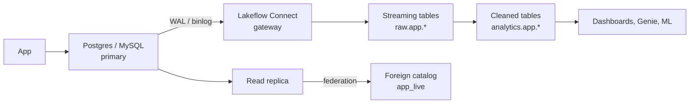

# Migrating from Postgres and MySQL

Mastery: `INPUT[inlineSelect(option(new), option(learning), option(solid)):mastery]`

> [!todo] Draft, not yet verified
> This body is an unverified draft. Its facts were checked against the open-source Lakebridge repo, the Terraform provider, and the Databricks SDK, which the vault's source policy does not accept. It must be re-verified against docs.databricks.com, learn.microsoft.com/azure/databricks, or databricks.com before `status: written` is set. Do not answer from it.

> [!story] Previously
> [[Migrating from SQL Server]] showed the pattern: federate first, replicate changes with [[Lakeflow Connect]], convert the code with [[Lakebridge]]. Many younger companies never bought SQL Server. Their app runs on PostgreSQL or MySQL, often a managed service such as Amazon RDS, Aurora, Azure Database, or Cloud SQL, and the analysts query it directly. Here the rule is simple: **do not hurt the app.**

> [!eli5] In one breath
> Your app's database is the kitchen of a busy restaurant. Running big reports on it is like doing the yearly stock-take in the middle of dinner service. The fix is to send a copy of every order to a back office (Databricks) as it happens, and do all the counting there.

> [!analogy] Analogy: the kitchen and the back office
> - **The Postgres or MySQL primary** is the kitchen. It must stay fast.
> - **A read replica** is a second kitchen copy you are allowed to look at without getting in the way.
> - **The write-ahead log (Postgres) or binlog (MySQL)** is the order ticket rail: every change is written there first, in order.
> - **[[Lakeflow Connect]]** reads that ticket rail and carries copies to the back office.
> - **[[Lakehouse Federation]]** is walking into the kitchen to ask a question. Fine for a quick one, not during the rush.

## Why it exists

Postgres and MySQL are excellent [[OLTP vs OLAP|OLTP]] databases and poor analytics engines at scale. The typical pain:

- A dashboard's `GROUP BY` over two years of orders takes minutes and spikes CPU for the app's users.
- Analysts get a read replica, which helps until replica lag makes reports inconsistent.
- Product data lives in Postgres, billing in MySQL, and marketing in SaaS tools, with no place to join them.
- JSON columns, soft deletes, and multi-tenant schemas make every report query long and fragile.

Unlike a warehouse migration, you are usually **not** replacing the database. The app keeps its database. You are moving the *analytics* out.

## What it actually is

| Option | How it works | Best for | Load on the app DB |
|---|---|---|---|
| **Federation** | `CREATE CONNECTION ... TYPE postgresql` (or `mysql`), then a foreign catalog; queries run live | Exploration, small lookups, validation | Every query hits the DB; point it at a replica |
| **Scheduled copy over federation** | A [[Lakeflow Jobs\|job]] runs `CREATE OR REPLACE TABLE ... AS SELECT` nightly | Small tables, daily freshness | One read per night |
| **[[Lakeflow Connect]] managed CDC** | Reads the Postgres WAL or MySQL binlog continuously into [[Streaming Tables\|streaming tables]] | Production, near-real-time, large tables | Low: reads the log, not the tables |
| **Partner or open-source CDC** | [[Fivetran and ELT Tools\|Fivetran]], Debezium into [[Apache Kafka\|Kafka]], then [[Structured Streaming]] | When you already run these | Low |

The Databricks APIs list `POSTGRESQL` and `MYSQL` both as federation connection types and as managed-ingestion source types. The SDK also lists `MANAGED_POSTGRESQL`, which relates to Databricks' own Postgres service, [[Lakebase]].

> [!warning] Release status
> The PostgreSQL and MySQL managed-ingestion connectors arrived after the SQL Server connector. This vault could not confirm on 2026-10-25 whether each is GA or still in Preview on your cloud. Check the connector page before you depend on it.

## How it works



### Step 1: federate a replica for quick wins

```sql
CREATE CONNECTION app_pg TYPE postgresql
OPTIONS (
  host 'app-replica.cluster-ro-abc.eu-west-1.rds.amazonaws.com',
  port '5432',
  user secret('app', 'pg_user'),
  password secret('app', 'pg_password')
);

CREATE FOREIGN CATALOG app_live
USING CONNECTION app_pg
OPTIONS (database 'appdb');

SELECT plan, count(*) FROM app_live.public.subscriptions
WHERE status = 'active' GROUP BY plan;
```

For MySQL, use `TYPE mysql` and port `3306`. MySQL has no separate database level above schemas, so the foreign catalog maps MySQL databases to Unity Catalog schemas.

### Step 2: prepare the source for change capture

Log-based CDC needs settings on the source. These are standard Postgres and MySQL settings, so check your managed service's parameter group docs too:

```sql
-- PostgreSQL: logical replication
-- (postgresql.conf or RDS parameter group: wal_level = logical, then restart)
SHOW wal_level;                          -- must return 'logical'
CREATE ROLE databricks_cdc WITH LOGIN REPLICATION PASSWORD '...';
GRANT SELECT ON ALL TABLES IN SCHEMA public TO databricks_cdc;
CREATE PUBLICATION databricks_pub FOR TABLE public.orders, public.customers;
ALTER TABLE public.orders REPLICA IDENTITY FULL;   -- only if no primary key
```

```sql
-- MySQL: row-based binary log
-- (my.cnf or parameter group: binlog_format=ROW, binlog_row_image=FULL)
SHOW VARIABLES LIKE 'binlog_format';     -- must be ROW
CREATE USER 'databricks_cdc'@'%' IDENTIFIED BY '...';
GRANT SELECT, REPLICATION SLAVE, REPLICATION CLIENT ON *.* TO 'databricks_cdc'@'%';
```

The connector's own setup page lists the exact privileges and settings it needs. Follow it over these generic examples.

### Step 3: create the ingestion pipeline

The pipeline definition looks the same as for SQL Server (see [[Migrating from SQL Server]]): a connection, an optional gateway, and a list of `objects` with `source_schema`, `source_table`, `destination_catalog`, and `destination_schema`. The output is a set of streaming tables, one per source table, kept up to date with inserts, updates, and deletes.

### Step 4: model for analytics

Raw replicated tables mirror the app's design, which is rarely what reports need. Build a cleaned layer on top (see [[Medallion Architecture]]):

```sql
CREATE OR REPLACE MATERIALIZED VIEW analytics.app.active_subscriptions AS
SELECT s.id, s.account_id, a.company_name, s.plan,
       s.created_at::DATE           AS start_date,
       s.metadata:billing.cycle::STRING AS billing_cycle   -- JSON path on a VARIANT/STRING
FROM raw.app.subscriptions s
JOIN raw.app.accounts a ON a.id = s.account_id
WHERE s.deleted_at IS NULL;
```

### Dialect gotchas

[[Lakebridge]] covers Postgres and MySQL only with the experimental, LLM-based Switch transpiler (and the Analyzer). App databases usually have little stored code, so most of the work is rewriting report queries by hand:

| Postgres / MySQL | Databricks SQL | Note |
|---|---|---|
| `SERIAL`, `AUTO_INCREMENT` | `BIGINT GENERATED ALWAYS AS IDENTITY` | Usually you keep the source's IDs instead |
| `JSONB` (PG), `JSON` (MySQL) | `VARIANT` or `STRING` | Query with `col:path` syntax; parse with `parse_json` |
| `col::date` | `col::date` or `CAST(col AS DATE)` | `::` casts work in Databricks too |
| `ILIKE` | `ILIKE` | Supported |
| `TEXT[]` arrays, `unnest()` | `ARRAY<STRING>`, `explode()` | |
| `string_agg(x, ',')` / `GROUP_CONCAT(x)` | `array_join(collect_list(x), ',')` | |
| `NOW()`, `CURRENT_DATE` | `current_timestamp()`, `current_date()` | |
| `timestamptz` | `TIMESTAMP` | Databricks `TIMESTAMP` is an instant, shown in the session time zone |
| `timestamp` (no tz), MySQL `DATETIME` | `TIMESTAMP_NTZ` | |
| MySQL `0000-00-00` dates | `NULL` | Clean these up during ingestion |
| MySQL `TINYINT(1)` as boolean | `BOOLEAN` | |
| MySQL case-insensitive default collation | Case-sensitive by default | Same trap as SQL Server |
| Partial and expression indexes | [[Liquid Clustering]] on filter columns | No indexes in Delta |

> [!smallbiz] For a small business
> A typical SaaS or e-commerce company has one Postgres or MySQL database behind the app. Start by federating a **read replica** (most managed services create one in a few clicks) so analysts stop querying the primary that day. When dashboards need fresher data or the replica struggles, switch the 10–20 important tables to managed CDC. Keep your application on its database. If you are also thinking of moving the app's database itself, look at [[Lakebase]], Databricks' managed Postgres, but treat that as a separate project.

## On each cloud

> [!azure]- Azure Databricks
> Azure Database for PostgreSQL and Azure Database for MySQL (flexible server) are the usual sources. Set `wal_level` or `binlog_format` in the server parameters blade. Reach them over private endpoints ([[Azure Private Link]]) from both classic and serverless compute.

> [!aws]- Databricks on AWS
> Amazon RDS and Aurora (PostgreSQL and MySQL editions) are the most common sources. Logical replication on RDS PostgreSQL is enabled with the `rds.logical_replication` parameter in a custom parameter group, which needs a reboot. Use the reader endpoint for federation.

> [!gcp]- Databricks on Google Cloud
> Cloud SQL for PostgreSQL and MySQL. Logical decoding on Cloud SQL Postgres is enabled with the `cloudsql.logical_decoding` flag. Connect through [[Private Service Connect]] or a peered VPC.

## Going deeper

> [!deepdive]- Expert notes (301–401)
> - **Replication slots can fill the disk.** A Postgres logical replication slot keeps WAL until the consumer reads it. If the ingestion gateway stops for days, WAL piles up on the primary and can fill the disk. Monitor `pg_replication_slots` and alert on lag.
> - **Failover.** On many managed Postgres services, logical replication slots do not survive a failover to a standby. Plan a re-sync or full refresh after failovers.
> - **Binlog retention.** MySQL purges binlogs by time (`binlog_expire_logs_seconds`, or `binlog retention hours` on RDS). Keep enough retention to cover gateway downtime.
> - **Soft deletes vs hard deletes.** CDC captures hard deletes as delete events. If the app soft-deletes (`deleted_at`), filter in the cleaned layer.
> - **Multi-tenant schemas.** Apps with one schema per customer can produce hundreds of identical tables. Ingest them into one table with a tenant column, or use schema-level `objects` and union them in a view.
> - **Federation pushdown.** Filters, projections, limits, and many aggregates push down to Postgres and MySQL. Joins between a foreign table and a Delta table run in Databricks, which pulls the foreign rows over the network.

## Common confusions

> [!confusion] A read replica is not a migration
> Pointing reports at a replica relieves the primary but keeps analytics on an OLTP engine. It is a good first step, and federation over it is a good second, but scale and history still call for ingestion into [[Delta Lake]].

> [!confusion] Lakebase is not a CDC tool
> [[Lakebase]] is a Postgres database run by Databricks for applications. Lakeflow Connect is how you copy data *from* a Postgres database into the lakehouse.

## Recall

What is the first rule when migrating app-database analytics?::Do not hurt the app: keep heavy queries off the primary.
Which Postgres setting does log-based CDC require?::`wal_level = logical` (logical replication), plus a publication and a replication role.
Which MySQL setting does log-based CDC require?::Row-based binary logging: `binlog_format = ROW` (and `binlog_row_image = FULL`).
What federation connection types cover these databases?::`postgresql` and `mysql`.
What does JSONB usually become in Databricks?::`VARIANT` (or `STRING`), queried with `col:path` syntax.
What risk does a stalled Postgres replication slot create?::WAL keeps piling up on the primary and can fill its disk.
Which Lakebridge transpiler handles Postgres and MySQL SQL?::Only Switch, the experimental LLM-based transpiler.
What should you point federation at instead of the primary?::A read replica or reader endpoint.

## Where next

> [!path] Learning path
> **Needs first:** [[Relational Databases]], [[OLTP vs OLAP]], [[Migration Strategy Overview]]
> **Unlocks next:** [[Lakeflow Connect]], [[Change Data Capture]], [[Running Old and New in Parallel]]

> [!nextup] Up next in the story
> Databases are one kind of source. The bigger migrations come from other cloud warehouses, and the most common one is Snowflake, where open table formats change the rules: [[Migrating from Snowflake]].

> [!sources]- Sources (not yet verified under the source policy)
> - [Lakehouse Federation: supported data sources](https://docs.databricks.com/query-federation/index.html#supported-data-sources)
> - Postgres and MySQL replication settings are standard features of those databases; confirm the exact privileges on the Lakeflow Connect connector page for your cloud.
