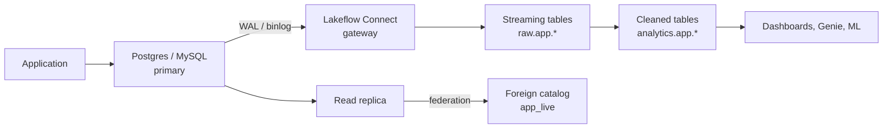

# Migrating from Postgres and MySQL

Mastery: `INPUT[inlineSelect(option(new), option(learning), option(solid)):mastery]`

> [!story] Context
> [[Migrating from SQL Server]] established the pattern: federate first, replicate changes with [[Lakeflow Connect]], and convert code with [[Lakebridge]]. Many companies run their application on PostgreSQL or MySQL instead, often as a managed service such as Amazon RDS, Aurora, Azure Database, or Cloud SQL, and analysts query it directly. The governing rule for this migration is to keep analytics load off the application database.

> [!eli5] Summary
> The application's database is a busy restaurant kitchen. Running large reports on it is like counting stock during dinner service. The fix is to send a copy of every order to a back office (Databricks) as it happens, and do the counting there.

> [!analogy]- Analogy: the kitchen and the back office
> | Restaurant | Postgres or MySQL migration |
> |---|---|
> | The kitchen, which must stay fast | The primary database |
> | A second copy of the order board | A read replica |
> | The ticket rail where every order is written first | The [[Write-Ahead Log\|write-ahead log]] (Postgres) or binary log (MySQL) |
> | A runner who copies tickets to the back office | [[Lakeflow Connect]] |
> | Walking into the kitchen to ask a question | [[Lakehouse Federation]] |

## Background

PostgreSQL and MySQL are strong [[OLTP vs OLAP|OLTP]] databases and weak analytics engines at scale. Typical problems:

- A dashboard's `GROUP BY` over two years of orders spikes CPU for application users.
- A read replica helps until replica lag makes reports inconsistent.
- Product data lives in Postgres, billing in MySQL, and marketing in SaaS tools, with no place to join them.
- JSON columns, soft deletes, and per-tenant schemas make report queries long and fragile.

Unlike a warehouse migration, the database usually stays. The application keeps its database, and the *analytics* move.

## Overview

| Option | How it works | Best for | Load on the application database |
|---|---|---|---|
| **Federation** | `CREATE CONNECTION ... TYPE postgresql` (or `mysql`), then a foreign catalog; queries run live | Exploration, small lookups, validation | Every query; point it at a replica |
| **Scheduled copy over federation** | A [[Lakeflow Jobs\|job]] runs `CREATE OR REPLACE TABLE ... AS SELECT` nightly | Small tables, daily freshness | One read per run |
| **[[Lakeflow Connect]] managed connector** | Reads the Postgres WAL or MySQL binlog continuously into [[Streaming Tables\|streaming tables]] | Near-real-time, large tables | Low: reads the log, not the tables |
| **Partner or open-source CDC** | [[Fivetran and ELT Tools\|Fivetran]], or Debezium into [[Apache Kafka\|Kafka]], then [[Structured Streaming]] | Teams already running these | Low |

> [!warning] Release status
> As of October 2026, the Lakeflow Connect PostgreSQL and MySQL connectors are in **Public Preview**. The MySQL setup page says to contact your Databricks account team to request access. Check each connector page for your cloud before production use.

## How it works



### Step 1: federate a read replica

```sql
CREATE CONNECTION app_pg TYPE postgresql
OPTIONS (
  host 'app-replica.example.internal',
  port '5432',
  user secret('app', 'pg_user'),
  password secret('app', 'pg_password')
);

CREATE FOREIGN CATALOG app_live
USING CONNECTION app_pg
OPTIONS (database 'appdb');

SELECT plan, count(*) AS active
FROM app_live.public.subscriptions
WHERE status = 'active'
GROUP BY plan;
```

For MySQL, use `TYPE mysql` and port `3306`.

### Step 2: prepare the source for change capture

**PostgreSQL** (version 13 or later):

1. Set `wal_level` to `logical`. On a managed service, set it through the server's parameters, then restart.
2. Create a replication user with the privileges listed on the connector's source-setup page.
3. Create a publication for the tables to ingest, and a replication slot per database, as the setup page describes.
4. Connect the connector to the **primary**. Logical replication is not supported on read replicas or standby instances.

```sql
SHOW wal_level;   -- must return 'logical'
CREATE PUBLICATION databricks_pub FOR TABLE public.orders, public.customers;
```

The connector uses logical replication with the `pgoutput` plugin.

**MySQL**:

1. Enable binary logging with `binlog_format=ROW` and `binlog_row_image=FULL`.
2. Keep binlogs long enough to cover gateway downtime. Databricks recommends 7 days.
3. Create a user with the replication privileges listed on the connector's setup page.

```sql
SHOW VARIABLES LIKE 'binlog_format';      -- must be ROW
SHOW VARIABLES LIKE 'binlog_row_image';   -- must be FULL
```

The MySQL connector uses binlog file-and-position tracking, not GTID-based replication. Read replicas are supported for RDS for MySQL, Azure Database for MySQL, and MySQL on EC2, but not Aurora MySQL replicas, which must use the writer endpoint.

### Step 3: create the ingestion pipeline

Create the connection, gateway, and pipeline from the **Data ingestion** page, or in a [[Declarative Automation Bundles|bundle]]. The structure matches the SQL Server connector (see [[Migrating from SQL Server]]): a continuous gateway reads the log, and a scheduled pipeline writes one streaming table per source table, including inserts, updates, and deletes.

### Step 4: model for analytics

Replicated tables mirror the application's design. Build a cleaned layer on top (see [[Medallion Architecture]]):

```sql
CREATE OR REPLACE MATERIALIZED VIEW analytics.app.active_subscriptions AS
SELECT s.id, s.account_id, a.company_name, s.plan,
       CAST(s.created_at AS DATE)                         AS start_date,
       parse_json(s.metadata):billing.cycle::STRING       AS billing_cycle
FROM raw.app.subscriptions s
JOIN raw.app.accounts a ON a.id = s.account_id
WHERE s.deleted_at IS NULL;
```

### Dialect differences

[[Lakebridge]] converts PostgreSQL and MySQL SQL only with **Switch**, its experimental LLM-based transpiler; the Analyzer also scores both. Application databases usually hold little stored code, so most of the work is rewriting report queries:

| Postgres / MySQL | Databricks SQL | Note |
|---|---|---|
| `SERIAL`, `AUTO_INCREMENT` | `BIGINT GENERATED BY DEFAULT AS IDENTITY` | `BY DEFAULT` accepts the existing source IDs on load; `ALWAYS` rejects explicit values |
| `JSONB` (Postgres), `JSON` (MySQL) | `VARIANT` or `STRING` | Query with the `:` path operator; create VARIANT with `parse_json` |
| `TEXT[]`, `unnest()` | `ARRAY<STRING>`, `explode()` | |
| `string_agg(x, ',')`, `GROUP_CONCAT(x)` | `array_join(collect_list(x), ',')` | |
| `NOW()` | `current_timestamp()` | |
| `timestamptz` | `TIMESTAMP` | An instant, displayed in the session time zone |
| `timestamp` (no time zone), MySQL `DATETIME` | `TIMESTAMP_NTZ` | |
| MySQL `0000-00-00` dates | `NULL` | Clean during ingestion |
| MySQL `TINYINT(1)` used as boolean | `BOOLEAN` | |
| MySQL case-insensitive default collations | Case-sensitive `UTF8_BINARY` by default | Use `UTF8_LCASE` where needed |
| Indexes | [[Liquid Clustering]] on filter columns | Delta tables have no [[B-Tree\|B-tree]] indexes |

## Small-business considerations

> [!smallbiz] Small-business considerations
> A typical SaaS or e-commerce company has one Postgres or MySQL database behind its application.
> 1. Federate a **read replica** so analysts stop querying the primary.
> 2. When dashboards need fresher data or the replica struggles, move the 10–20 important tables to the managed connector (Public Preview as of October 2026) or a partner tool.
> 3. Keep the application on its database. Moving the application database itself, for example to [[Lakebase]], is a separate project.

## Cloud differences

> [!azure]- Azure Databricks
> Azure Database for PostgreSQL and Azure Database for MySQL (flexible server) are the usual sources. Set `wal_level` to `logical` (PostgreSQL) or `binlog_format` to `ROW` (MySQL) in **Server parameters**. Reach the servers over private endpoints ([[Azure Private Link]]) from classic and serverless compute.

> [!aws]- Databricks on AWS
> Amazon RDS and Aurora (PostgreSQL and MySQL) are the most common sources. Set `rds.logical_replication` to `1` (PostgreSQL) or the binlog parameters (MySQL) in a custom DB parameter group (RDS) or DB cluster parameter group (Aurora); default groups cannot be modified. Use a reader endpoint for federation. The MySQL connector does not ingest from Aurora MySQL read replicas, so point it at the writer endpoint.

> [!gcp]- Databricks on Google Cloud
> Cloud SQL for PostgreSQL and MySQL are the usual sources. Set the `cloudsql.logical_decoding` flag (PostgreSQL) or `binlog_format` to `ROW` (MySQL) through database flags, and connect through [[Private Service Connect]] or a peered VPC.

## Advanced topics

> [!deepdive]- Advanced topics (301–401)
> - **WAL bloat:** A Postgres replication slot retains WAL until the consumer reads it. Databricks says the gateway must run continuously to prevent WAL bloat. Monitor `pg_replication_slots`.
> - **Orphaned slots:** Deleting an ingestion pipeline does not drop its replication slot. Drop it manually, or WAL keeps accumulating.
> - **Binlog purges:** If MySQL purges a binlog before the gateway reads it, every table in the pipeline needs a full refresh.
> - **Soft deletes vs hard deletes:** Log-based capture records hard deletes. If the application soft-deletes (`deleted_at`), filter in the cleaned layer.
> - **Per-tenant schemas:** Applications with one schema per customer produce many identical tables. Union them into one table with a tenant column.
> - **Federation pushdown:** Filters, projections, limits, offsets, aggregates, and sorting with a limit push down to PostgreSQL and MySQL; window functions do not. Joins between foreign tables in the same source push down on Databricks Runtime 17.2 and above and SQL warehouses (Public Preview, enabled on the **Previews** page). A join between a foreign table and a Delta table runs in Databricks. Run `EXPLAIN FORMATTED` to see the SQL sent to the source.

## Common misconceptions

> [!confusion] A read replica is not a migration
> Pointing reports at a replica relieves the primary but keeps analytics on an OLTP engine. Federation over the replica is a good second step. Scale and history still require ingestion into [[Delta Lake]].

> [!confusion] Lakebase is not a CDC tool
> [[Lakebase]] is a Postgres database operated by Databricks for applications. Lakeflow Connect copies data *from* a Postgres database into the lakehouse.

## Recall

What is the first rule when migrating app-database analytics?::Keep heavy analytics queries off the application's primary database.
Which Postgres setting does the Lakeflow Connect connector require?::`wal_level = logical`, plus a publication and a replication slot per database.
Which MySQL settings does the connector require?::`binlog_format=ROW` and `binlog_row_image=FULL`.
Can the Postgres connector read from a read replica?::No. Logical replication is not supported on read replicas or standbys.
What is the minimum PostgreSQL version for Lakeflow Connect?::PostgreSQL 13.
What binlog retention does Databricks recommend for MySQL?::7 days.
What must you do after deleting a Postgres ingestion pipeline?::Drop its replication slot manually.
Which Lakebridge transpiler handles Postgres and MySQL SQL?::Only Switch, the experimental LLM-based transpiler.
What was the release status of these connectors in October 2026?::Public Preview.

## Next steps

> [!path] Learning path
> **Needs first:** [[Relational Databases]], [[OLTP vs OLAP]], [[Migration Strategy Overview]]
> **Unlocks next:** [[Lakeflow Connect]], [[Change Data Capture]], [[Running Old and New in Parallel]]

> [!nextup] Next
> [[Migrating from Snowflake]] covers the first cloud-warehouse migration, where open table formats allow a period of shared data.

> [!sources]- Sources (last verified: 2026-10-25)
> - [Configure PostgreSQL for ingestion into Databricks (AWS)](https://docs.databricks.com/aws/en/ingestion/lakeflow-connect/postgresql-source-setup)
> - [PostgreSQL connector FAQs (AWS)](https://docs.databricks.com/aws/en/ingestion/lakeflow-connect/postgresql-faq)
> - [Ingest data from PostgreSQL (Azure Databricks)](https://learn.microsoft.com/en-us/azure/databricks/ingestion/lakeflow-connect/postgresql-pipeline)
> - [Configure MySQL for ingestion into Databricks (AWS)](https://docs.databricks.com/aws/en/ingestion/lakeflow-connect/mysql-source-setup)
> - [MySQL connector FAQ (GCP)](https://docs.databricks.com/gcp/en/ingestion/lakeflow-connect/mysql-faq)
> - [MySQL connector limitations (AWS)](https://docs.databricks.com/aws/en/ingestion/lakeflow-connect/mysql-limits)
> - [Connect to external databases and catalogs (Azure Databricks)](https://learn.microsoft.com/en-us/azure/databricks/query-federation/)
> - [VARIANT type (AWS)](https://docs.databricks.com/aws/en/sql/language-manual/data-types/variant-type)
> - [parse_json function (AWS)](https://docs.databricks.com/aws/en/sql/language-manual/functions/parse_json)
> - [Collation (AWS)](https://docs.databricks.com/aws/en/sql/language-manual/sql-ref-collation)
> - [Lakebridge supported dialects (Databricks Labs, GitHub)](https://github.com/databrickslabs/lakebridge/blob/main/docs/lakebridge/docs/transpile/index.mdx)
> - [Run federated queries on PostgreSQL (AWS)](https://docs.databricks.com/aws/en/query-federation/postgresql)
> - [Run federated queries on MySQL (AWS)](https://docs.databricks.com/aws/en/query-federation/mysql)
> - [Configure Amazon RDS and Aurora MySQL for ingestion (AWS)](https://docs.databricks.com/aws/en/ingestion/lakeflow-connect/mysql-aws-rds-config)
> - [Configure Azure Database for MySQL for ingestion (AWS)](https://docs.databricks.com/aws/en/ingestion/lakeflow-connect/mysql-azure-config)
> - [Configure Cloud SQL for MySQL for ingestion (AWS)](https://docs.databricks.com/aws/en/ingestion/lakeflow-connect/mysql-gcp-config)
> - [CREATE TABLE: identity columns (AWS)](https://docs.databricks.com/aws/en/sql/language-manual/sql-ref-syntax-ddl-create-table-using)
> - [array_join function (AWS)](https://docs.databricks.com/aws/en/sql/language-manual/functions/array_join)
> - [collect_list function (AWS)](https://docs.databricks.com/aws/en/sql/language-manual/functions/collect_list)
> - [explode function (AWS)](https://docs.databricks.com/aws/en/sql/language-manual/functions/explode)
> - [TIMESTAMP type (AWS)](https://docs.databricks.com/aws/en/sql/language-manual/data-types/timestamp-type)
> - [TIMESTAMP_NTZ type (AWS)](https://docs.databricks.com/aws/en/sql/language-manual/data-types/timestamp-ntz-type)
> - [Logical decoding in Azure Database for PostgreSQL (Microsoft Learn)](https://learn.microsoft.com/en-us/azure/postgresql/flexible-server/concepts-logical)
> - [Configure logical replication and decoding (Cloud SQL for PostgreSQL)](https://cloud.google.com/sql/docs/postgres/replication/configure-logical-replication)
> - [Numeric type syntax: BOOL and TINYINT(1) (MySQL 8.4 manual)](https://dev.mysql.com/doc/refman/8.4/en/numeric-type-syntax.html)
> - [Date and time data types: zero values (MySQL 8.4 manual)](https://dev.mysql.com/doc/refman/8.4/en/date-and-time-types.html)
> - [Server character set and collation (MySQL 8.4 manual)](https://dev.mysql.com/doc/refman/8.4/en/charset-server.html)
