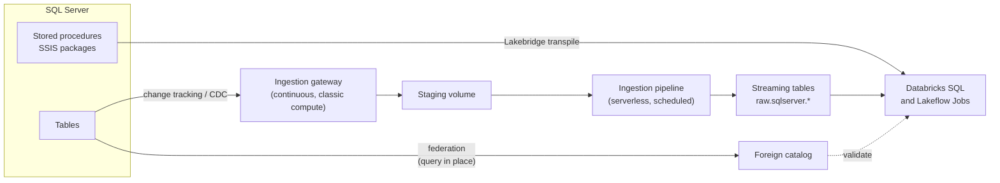

# Migrating from SQL Server

Mastery: `INPUT[inlineSelect(option(new), option(learning), option(solid)):mastery]`

> [!story] Context
> [[Migrating from Excel and Access]] moved files into tables. The next source for many small and medium businesses is Microsoft SQL Server: an on-premises server, a cloud VM, or Azure SQL. It holds application data, T-SQL stored procedures, SSIS packages, and SSRS reports. This is the most common migration in the chapter.

> [!eli5] Summary
> SQL Server is the shop's till: it records every sale all day. Reports that run on the same till slow it down. The move keeps the till for selling, while a copy of every sale flows into Databricks within minutes. Reports, dashboards, and AI run on the copy.

> [!analogy]- Analogy: a branch office and head office
> | Branch office | SQL Server migration |
> |---|---|
> | The branch ledger, still in daily use | SQL Server |
> | A phone line to read the ledger without copying it | [[Lakehouse Federation]] |
> | A courier who copies each new page as it is written | [[Lakeflow Connect]] (the ingestion gateway sits next to the branch) |
> | A translator for the branch's handwritten procedures | [[Lakebridge]] (T-SQL to Databricks SQL) |

## Background

SQL Server is a strong [[OLTP vs OLAP|OLTP]] database. Problems start when it is also the analytics platform:

- Reports and month-end queries compete with the application for CPU and locks.
- Storage and compute scale together, so more history means a larger server.
- Business logic sits in stored procedures and SSIS packages that few people understand.
- Machine learning and AI on the data require exporting it elsewhere.

The usual end state: **SQL Server remains the application database, and analytics move to Databricks.** Companies that used SQL Server as a warehouse can retire it entirely.

## Overview

A SQL Server migration has three streams of work that run in parallel:

| Stream | What moves | Databricks tool |
|---|---|---|
| **Data** | Tables: one initial snapshot, then continuous changes | [[Lakeflow Connect]] SQL Server connector, or federation plus `CREATE TABLE AS` for small tables |
| **Code** | Views, stored procedures, functions, SQL Server Agent jobs, SSIS packages | [[Lakebridge]] (Morpheus or BladeBridge for T-SQL, BladeBridge for SSIS), [[Lakeflow Jobs]] |
| **Consumers** | SSRS and Power BI reports, Excel extracts | [[Migrating BI Reports]], [[AI-BI Dashboards]] |

Lakebridge covers SQL Server in every phase: Profiler, Analyzer, converter, and Reconcile. Its `mssql` dialect covers SQL Server, Azure SQL Database, Azure SQL Managed Instance, and Amazon RDS for SQL Server.

## How it works



### Phase 1: assess

1. Export every procedure, view, and function as `.sql` files, for example with the **Generate and Publish Scripts Wizard** in SQL Server Management Studio.
2. Split the export into one object per file with the Lakebridge SQL Splitter.
3. Run the Analyzer on the split files and the Profiler against the live server:

```bash
databricks labs install lakebridge
./sqlsplit -d ./ssms_export -o ./split
databricks labs lakebridge analyze --source-directory ./split --report-file ./assessment/sqlserver.xlsx
databricks labs lakebridge configure-database-profiler
databricks labs lakebridge execute-database-profiler
```

The SQL Server profiler can extract from multiple databases in one run (Lakebridge v0.14.1).

### Phase 2: coexist with Lakehouse Federation

Store the credentials in a [[Secrets Management|secret scope]], then register SQL Server in [[Unity Catalog]]:

```sql
CREATE CONNECTION sqlserver_prod TYPE sqlserver
OPTIONS (
  host 'sql01.corp.example.com',
  port '1433',
  user secret('migration', 'sql_user'),
  password secret('migration', 'sql_password')
);

CREATE FOREIGN CATALOG sqlserver_sales
USING CONNECTION sqlserver_prod
OPTIONS (database 'Sales');

GRANT USE CATALOG ON CATALOG sqlserver_sales TO `analysts`;
GRANT USE SCHEMA, SELECT ON SCHEMA sqlserver_sales.dbo TO `analysts`;

-- Join old and new in one query
SELECT r.region_name, SUM(o.amount) AS revenue
FROM sqlserver_sales.dbo.orders o
JOIN analytics.ref.regions r ON o.region_id = r.region_id
GROUP BY r.region_name;
```

Federation pushes filters and other operations down to SQL Server, but the server still does the work.

### Phase 3: ingest with Lakeflow Connect

The managed SQL Server connector has two parts:

- An **ingestion gateway**: a continuous pipeline on classic compute that reads snapshots and changes and stages them in a Unity Catalog [[Volumes|volume]].
- An **ingestion pipeline**: a non-continuous pipeline on [[Serverless Compute|serverless compute]], triggered by a scheduled job, that applies staged changes to [[Streaming Tables|streaming tables]].

Prepare the source first:

1. **Choose a change method per table:** Databricks recommends **change tracking** for every table with a primary key, because it puts less load on the source, and **CDC** for tables without one. If both are enabled on a table, the connector uses change tracking.
2. **Check versions:** Change tracking needs SQL Server 2012 or later. CDC needs SQL Server 2012 SP1 CU3 or later, and Enterprise Edition for versions before SQL Server 2016.
3. **Run the utility objects script:** Databricks provides a script that installs setup procedures such as `dbo.lakeflowSetupChangeTracking` and `dbo.lakeflowSetupChangeDataCapture`. They enable tracking, create support objects, and grant the ingestion user its permissions. The user who runs the CDC setup must be a member of `db_owner`.
4. **Set retention:** Set the change tracking or CDC retention to the longest time the gateway might be down. After that, a full refresh is required.
5. **Use the primary:** Change tracking and CDC are not supported on read replicas or secondary instances.

For reference, enabling change tracking manually uses standard T-SQL:

```sql
-- On SQL Server
ALTER DATABASE Sales SET CHANGE_TRACKING = ON
  (CHANGE_RETENTION = 3 DAYS, AUTO_CLEANUP = ON);
ALTER TABLE dbo.orders ENABLE CHANGE_TRACKING;
```

Then create the connection, gateway, and pipeline from the workspace's **Data ingestion** page (SQL Server tile), or as code in a [[Declarative Automation Bundles|bundle]]. Choose source tables, whole schemas, or all tables, and a destination catalog and schema.

**Alternatives:** for a few small tables, a nightly job running `CREATE OR REPLACE TABLE raw.sqlserver.x AS SELECT * FROM sqlserver_sales.dbo.x` over federation is enough. [[Fivetran and ELT Tools|Partner tools]] and [[Azure Data Factory with Databricks|Azure Data Factory]] also work.

### Phase 4: convert T-SQL

```bash
databricks labs lakebridge install-transpile     # choose mssql
databricks labs lakebridge transpile \
  --source-dialect mssql \
  --input-source ./split \
  --output-folder ./converted
```

Lakebridge's guidance is to start with **Morpheus** for SQL Server. A file that Morpheus transpiles with no errors and no warnings is guaranteed to produce equivalent results. Each output file starts with a header comment; failed files list each problem with its `[line:column]` position. Fix errors by hand, and test sections flagged with warnings against source data.

Stored procedures convert to Databricks SQL scripting and `CREATE PROCEDURE`. SQL scripting (`BEGIN ... END`) needs Databricks Runtime 16.3 or later, and stored procedures need Runtime 17.0 or later; both run on Databricks SQL.

Common T-SQL differences:

| T-SQL | Databricks SQL | Note |
|---|---|---|
| `SELECT TOP 10 ...` | `SELECT ... LIMIT 10` | |
| `GETDATE()`, `SYSDATETIME()` | `current_timestamp()` | |
| `ISNULL(a, b)` | `coalesce(a, b)` or `nvl(a, b)` | |
| `'a' + 'b'` | `concat('a', 'b')` or `'a' \|\| 'b'` | |
| `CONVERT(VARCHAR, d, 112)` | `date_format(d, 'yyyyMMdd')` | No style codes |
| `NVARCHAR(100)`, `VARCHAR(MAX)` | `STRING` | |
| `DATETIME`, `DATETIME2` | `TIMESTAMP_NTZ` | Neither stores a time zone |
| `BIT` | `BOOLEAN` | |
| `IDENTITY(1,1)` | `BIGINT GENERATED BY DEFAULT AS IDENTITY` | `BY DEFAULT` accepts the existing source IDs on load; `ALWAYS` rejects explicit values |
| `#temp` tables | Temporary views, CTEs, or a scratch schema | |
| `WITH (NOLOCK)` | Remove it | Delta readers see a consistent snapshot of the table |
| Case-insensitive `=` (default [[Collation\|collation]]) | Case-sensitive (`UTF8_BINARY`) by default | Use a `UTF8_LCASE` collation or `lower()` |
| Clustered index | [[Liquid Clustering]] (`CLUSTER BY`) | Delta tables have no B-tree indexes |

SQL Server Agent jobs become [[Lakeflow Jobs]]. SSIS packages are covered in [[Migrating ETL Tools]].

### Phases 5 to 7: validate, switch over, decommission

1. Run Lakebridge Reconcile against the same Unity Catalog connection. SQL Server supports all report types: `schema`, `row`, `data`, and `all`.
2. Follow [[Running Old and New in Parallel]] for the parallel run.
3. Repoint reports with [[Migrating BI Reports]].
4. Disable the SQL Server Agent jobs and SSIS packages, and remove reporting replicas.

## Small-business considerations

> [!smallbiz] Small-business considerations
> A typical setup is one SQL Server running an accounting or ERP application, plus a few reports. You usually do **not** need to replace SQL Server itself.
> 1. Federate it on day one and build new dashboards on Databricks.
> 2. Replicate the 10–30 tables that reports need with Lakeflow Connect.
> 3. Check with the application vendor before enabling change tracking or CDC. Some vendors restrict changes to their database.
>
> The gateway runs continuously on classic compute, so it has a steady cost. If daily freshness is enough, compare it with a scheduled federated copy. See [[How Databricks Pricing Works]].

## Cloud differences

> [!azure]- Azure Databricks
> - SQL Server estates are most common on Azure. Azure SQL Database and Managed Instance use the same `sqlserver` connection type and `mssql` Lakebridge dialect.
> - On-premises servers need network reach from the gateway's compute, usually ExpressRoute or a site-to-site VPN into the workspace VNet ([[VNet Injection]]). Azure SQL can be reached through a private endpoint ([[Azure Private Link]]).
> - Federated queries and the ingestion pipeline can run on serverless compute, so [[Serverless Network Security|serverless network rules]] must also allow the database.
> - Power BI stays and is repointed to Databricks; see [[Power BI on Azure Databricks]].

> [!aws]- Databricks on AWS
> RDS for SQL Server and SQL Server on EC2 are covered by the `mssql` dialect. Place the database and classic compute in reachable VPCs ([[Customer-Managed VPC on AWS]]), or use [[AWS PrivateLink]].

> [!gcp]- Databricks on Google Cloud
> Cloud SQL for SQL Server follows the same steps. Network reach goes through a [[Customer-Managed VPC on Google Cloud|customer-managed VPC]] or [[Private Service Connect]].

## Advanced topics

> [!deepdive]- Advanced topics (301–401)
> - **Change tracking vs CDC:** Change tracking records that a row changed, and the connector reads the current row. CDC records every change from the transaction log and uses more log space.
> - **Retention and outages:** The gateway must run continuously so it reads changes before the source cleans them up. An outage longer than retention forces a full refresh.
> - **Snapshot, then stream:** The pipeline takes an initial snapshot of each table, then switches to changes. Large tables can take hours to snapshot, so start them in a quiet window.
> - **Upgrading the utility script:** Re-running the setup script and procedures keeps tracking enabled; pipelines resume from their last checkpoint without a full refresh.
> - **Collation:** SQL Server's default collation is case-insensitive. Databricks defaults to `UTF8_BINARY`. `UTF8_LCASE` gives case-insensitive comparison but stays accent-sensitive. Collations can be set per expression, column, table, schema, catalog, or session (`SET COLLATION`).
> - **Row-by-row procedures:** Cursor loops translate but run slowly. Rewrite them as set-based SQL or `MERGE` (see [[MERGE and Upserts]]). For complex procedures, the experimental Switch transpiler produces notebooks.
> - **Synapse:** Azure Synapse dedicated SQL pools use the `synapse` dialect, which Morpheus and BladeBridge both support.

## Common misconceptions

> [!confusion] Federation is not replication
> A foreign catalog reads SQL Server live on every query. Nothing is copied. If SQL Server is down, the query fails. [[Lakeflow Connect]] keeps a copy.

> [!confusion] You do not have to replace SQL Server
> Moving *analytics* off SQL Server is different from replacing the *application database*. Most businesses keep SQL Server for the application.

## Recall

What connection type federates SQL Server?::`TYPE sqlserver` in `CREATE CONNECTION`, followed by `CREATE FOREIGN CATALOG ... OPTIONS (database '...')`.
What are the two parts of the Lakeflow Connect SQL Server connector?::A continuous ingestion gateway on classic compute that stages changes, and a scheduled serverless ingestion pipeline that applies them to streaming tables.
When does Databricks recommend change tracking over CDC?::For every table that has a primary key; CDC is for tables without one.
Can the SQL Server connector read from a read replica?::No. Change tracking and CDC are not supported on read replicas or secondary instances.
What happens if the gateway is down longer than the retention period?::A full refresh is required.
Which Lakebridge transpiler is recommended first for SQL Server?::Morpheus, with the `mssql` dialect.
What does `SELECT TOP 10` become?::`SELECT ... LIMIT 10`
What is Databricks' default string collation?::`UTF8_BINARY`, which is case-sensitive.
What replaces SQL Server Agent jobs?::Lakeflow Jobs.

## Next steps

> [!path] Learning path
> **Needs first:** [[Migration Strategy Overview]], [[Relational Databases]], [[Unity Catalog]]
> **Unlocks next:** [[Lakeflow Connect]], [[Lakebridge]], [[Migrating ETL Tools]], [[Running Old and New in Parallel]]

> [!nextup] Next
> [[Migrating from Postgres and MySQL]] applies the same pattern to open-source application databases, with different change feeds and SQL.

> [!sources]- Sources (last verified: 2026-10-25)
> - [Run federated queries on Microsoft SQL Server (Azure Databricks)](https://learn.microsoft.com/en-us/azure/databricks/query-federation/sql-server)
> - [What is query federation? (AWS)](https://docs.databricks.com/aws/en/query-federation/database-federation)
> - [Configure Microsoft SQL Server for ingestion into Databricks (AWS)](https://docs.databricks.com/aws/en/ingestion/lakeflow-connect/sql-server-source-setup)
> - [Configure Microsoft SQL Server for ingestion (Azure Databricks)](https://learn.microsoft.com/en-us/azure/databricks/ingestion/lakeflow-connect/sql-server-source-setup)
> - [Prepare SQL Server for ingestion using the utility objects script (AWS)](https://docs.databricks.com/aws/en/ingestion/lakeflow-connect/sql-server-utility)
> - [SQL Server utility objects script reference (Azure Databricks)](https://learn.microsoft.com/en-us/azure/databricks/ingestion/lakeflow-connect/sql-server-utility-reference)
> - [Enable change tracking in Microsoft SQL Server (AWS)](https://docs.databricks.com/aws/en/ingestion/lakeflow-connect/sql-server-ct)
> - [Enable built-in CDC in Microsoft SQL Server (Azure Databricks)](https://learn.microsoft.com/en-us/azure/databricks/ingestion/lakeflow-connect/sql-server-cdc)
> - [Ingest data from SQL Server (Azure Databricks)](https://learn.microsoft.com/en-us/azure/databricks/ingestion/lakeflow-connect/sql-server-pipeline)
> - [Collation (AWS)](https://docs.databricks.com/aws/en/sql/language-manual/sql-ref-collation)
> - [SQL scripting (AWS)](https://docs.databricks.com/aws/en/sql/language-manual/sql-ref-scripting)
> - [CREATE PROCEDURE (Azure Databricks)](https://learn.microsoft.com/en-us/azure/databricks/sql/language-manual/sql-ref-syntax-ddl-create-procedure)
> - [Lakebridge transpile guide and supported dialects (Databricks Labs, GitHub)](https://github.com/databrickslabs/lakebridge/blob/main/docs/lakebridge/docs/transpile/index.mdx)
> - [Morpheus transpiler (Databricks Labs, GitHub)](https://github.com/databrickslabs/lakebridge/blob/main/docs/lakebridge/docs/transpile/pluggable_transpilers/morpheus/index.mdx)
> - [Lakebridge Reconcile guide (Databricks Labs, GitHub)](https://github.com/databrickslabs/lakebridge/blob/main/docs/lakebridge/docs/reconcile/index.mdx)
> - [Lakebridge changelog (Databricks Labs, GitHub)](https://github.com/databrickslabs/lakebridge/blob/main/CHANGELOG.md)
> - [LIMIT clause (AWS)](https://docs.databricks.com/aws/en/sql/language-manual/sql-ref-syntax-qry-select-limit)
> - [current_timestamp function (AWS)](https://docs.databricks.com/aws/en/sql/language-manual/functions/current_timestamp)
> - [coalesce function (AWS)](https://docs.databricks.com/aws/en/sql/language-manual/functions/coalesce)
> - [nvl function (AWS)](https://docs.databricks.com/aws/en/sql/language-manual/functions/nvl)
> - [concat function (AWS)](https://docs.databricks.com/aws/en/sql/language-manual/functions/concat)
> - [|| (pipe pipe sign) operator (AWS)](https://docs.databricks.com/aws/en/sql/language-manual/functions/pipepipesign)
> - [date_format function (AWS)](https://docs.databricks.com/aws/en/sql/language-manual/functions/date_format)
> - [Datetime patterns (AWS)](https://docs.databricks.com/aws/en/sql/language-manual/sql-ref-datetime-pattern)
> - [TIMESTAMP_NTZ type (AWS)](https://docs.databricks.com/aws/en/sql/language-manual/data-types/timestamp-ntz-type)
> - [CREATE TABLE: identity columns (AWS)](https://docs.databricks.com/aws/en/sql/language-manual/sql-ref-syntax-ddl-create-table-using)
> - [Isolation levels and write conflicts (AWS)](https://docs.databricks.com/aws/en/optimizations/isolation-level)
> - [Run federated queries on Microsoft SQL Server (AWS)](https://docs.databricks.com/aws/en/query-federation/sql-server)
> - [CAST and CONVERT: date styles (Microsoft Learn)](https://learn.microsoft.com/en-us/sql/t-sql/functions/cast-and-convert-transact-sql)
> - [datetime2 (Microsoft Learn)](https://learn.microsoft.com/en-us/sql/t-sql/data-types/datetime2-transact-sql)
> - [Generate scripts in SQL Server Management Studio (Microsoft Learn)](https://learn.microsoft.com/en-us/sql/ssms/scripting/generate-scripts-sql-server-management-studio)
