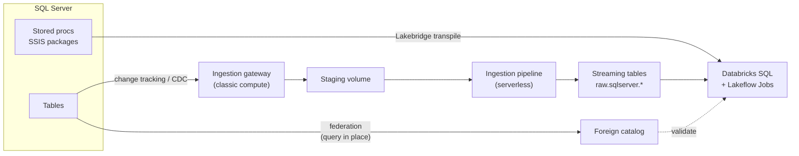

# Migrating from SQL Server

Mastery: `INPUT[inlineSelect(option(new), option(learning), option(solid)):mastery]`

> [!todo] Draft, not yet verified
> This body is an unverified draft. Its facts were checked against the open-source Lakebridge repo, the Terraform provider, and the Databricks SDK, which the vault's source policy does not accept. It must be re-verified against docs.databricks.com, learn.microsoft.com/azure/databricks, or databricks.com before `status: written` is set. Do not answer from it.

> [!story] Previously
> [[Migrating from Excel and Access]] moved files into tables. The next rung up for most small and medium businesses is Microsoft SQL Server: an on-premises box under a desk, a VM in the cloud, or Azure SQL. It holds the app's data, a pile of T-SQL stored procedures, SSIS packages, and SSRS reports. This is the most common migration in the chapter.

> [!eli5] In one breath
> Your SQL Server is the shop's busy till: it records every sale, all day. Reports run against the same till and slow it down. Moving to Databricks means keeping the till for selling, while a copy of every sale flows into Databricks within minutes, where the reports, dashboards, and AI live.

> [!analogy] Analogy: a branch office getting a live mirror
> - **SQL Server** is the branch office ledger. The staff keep writing in it.
> - **[[Lakehouse Federation]]** is a phone line: from head office you can read the branch ledger without copying it, but every question costs the branch a little time.
> - **[[Lakeflow Connect]]** is a courier who photocopies each new page as it is written and delivers it to head office. The *gateway* is the courier living next to the branch.
> - **[[Lakebridge]]** is the translator who rewrites the branch's handwritten procedures (T-SQL) in head office's language (Databricks SQL).

## Why it exists

SQL Server is an excellent [[OLTP vs OLAP|OLTP]] database. It becomes a problem when it is also the analytics platform:

- Reports and month-end queries compete with the application for CPU and locks.
- Storage and compute scale together, so more history means a bigger, pricier server.
- Licences are per core, and Enterprise features (partitioning at scale, columnstore, Always On) cost more.
- Business logic is trapped in hundreds of stored procedures and SSIS packages that only one person understands.
- Machine learning and AI on that data means exporting it somewhere else anyway.

The usual end state is: **SQL Server stays as the application database (or moves to a managed service), and all analytics move to Databricks.** Some companies later retire the warehouse-style SQL Server entirely.

## What it actually is

A SQL Server migration has three streams of work that run in parallel:

| Stream | What moves | Databricks tool |
|---|---|---|
| **Data** | Tables: a one-time history load, then continuous changes | [[Lakeflow Connect]] SQL Server connector, or federation plus `CREATE TABLE AS` for small tables |
| **Code** | Views, stored procedures, functions, SQL Agent jobs, SSIS packages | [[Lakebridge]] (Morpheus transpiler for T-SQL, BladeBridge for SSIS), [[Lakeflow Jobs]] |
| **Consumers** | SSRS and Power BI reports, Excel extracts | [[Migrating BI Reports]], [[AI-BI Dashboards]] |

The Lakebridge docs list SQL Server as fully covered: Profiler, Analyzer, converter, and Reconcile. The `mssql` dialect covers SQL Server, Azure SQL Database, Azure SQL Managed Instance, and Amazon RDS for SQL Server. Lakebridge's own *Getting Started* guide uses SQL Server as its worked example and recommends the Morpheus transpiler for it.

## How it works



### Phase 1: assess

Export every procedure, view, and function as `.sql` files (in SSMS: **Tasks → Generate Scripts**), split them, and run the Analyzer:

```bash
databricks labs install lakebridge
./sqlsplit -d ./ssms_export -o ./split           # optional SQL Splitter
databricks labs lakebridge analyze               # source technology: MS SQL Server
databricks labs lakebridge configure-database-profiler   # live workload profile
```

### Phase 2: coexist with Lakehouse Federation

Store the credentials as a secret, then register SQL Server in [[Unity Catalog]]:

```sql
CREATE CONNECTION sqlserver_prod TYPE sqlserver
OPTIONS (
  host 'sql01.corp.example.com',
  port '1433',
  user secret('migration', 'sql_user'),
  password secret('migration', 'sql_password')
);

CREATE FOREIGN CATALOG sqlserver_sales
USING CONNECTION sqlserver_prod
OPTIONS (database 'Sales');

GRANT USE CATALOG, USE SCHEMA, SELECT ON CATALOG sqlserver_sales TO `analysts`;

-- Join old and new in one query
SELECT c.region, SUM(o.amount) AS revenue
FROM sqlserver_sales.dbo.orders o
JOIN analytics.ref.regions c ON o.region_id = c.region_id
GROUP BY c.region;
```

Federation pushes filters and simple aggregates down to SQL Server, but the server still does the work. Point it at a read replica or Always On secondary if one exists.

### Phase 3: ingest with Lakeflow Connect

The managed SQL Server connector has two parts:

- An **ingestion gateway**: a pipeline that runs continuously on classic compute close to the database, reads changes, and writes them to a staging location in Unity Catalog.
- An **ingestion pipeline**: runs on [[Serverless Compute|serverless compute]] on a schedule, applies the staged changes to [[Streaming Tables|streaming tables]] in your target schema.

First enable change capture on the source. Either **change tracking** (lighter, for tables with primary keys) or **CDC** (for tables without them):

```sql
-- On SQL Server (T-SQL)
ALTER DATABASE Sales SET CHANGE_TRACKING = ON
  (CHANGE_RETENTION = 3 DAYS, AUTO_CLEANUP = ON);
ALTER TABLE dbo.orders ENABLE CHANGE_TRACKING;

-- Or, for tables without a primary key, CDC
EXEC sys.sp_cdc_enable_db;
EXEC sys.sp_cdc_enable_table @source_schema = 'dbo', @source_name = 'audit_log',
     @role_name = NULL;
```

Then create the gateway and pipeline, in the UI (the workspace's data ingestion page, which has a SQL Server tile) or as code with [[Declarative Automation Bundles]]. The field names below come from the Databricks pipelines API:

```yaml
# resources/sqlserver_ingest.yml
resources:
  pipelines:
    sqlserver_gateway:
      name: sqlserver-gateway
      gateway_definition:
        connection_name: sqlserver_prod
        gateway_storage_catalog: raw
        gateway_storage_schema: sqlserver_staging
        gateway_storage_name: sqlserver_gateway

    sqlserver_ingest:
      name: sqlserver-ingest
      ingestion_definition:
        ingestion_gateway_id: ${resources.pipelines.sqlserver_gateway.id}
        objects:
          - schema:                       # every table in dbo
              source_catalog: Sales
              source_schema: dbo
              destination_catalog: raw
              destination_schema: sqlserver
          - table:                        # one table, with history kept
              source_catalog: Sales
              source_schema: dbo
              source_table: customers
              destination_catalog: raw
              destination_schema: sqlserver
              table_configuration:
                scd_type: SCD_TYPE_2
```

```bash
databricks bundle deploy -t prod
databricks bundle run sqlserver_ingest -t prod
```

`scd_type` accepts `SCD_TYPE_1` (keep latest), `SCD_TYPE_2` (keep history, see [[Slowly Changing Dimensions]]), or `APPEND_ONLY`.

> [!warning] Release status
> This vault could not re-check the SQL Server connector's release stage (GA or Public Preview) on each cloud on 2026-10-25. Check the connector page in the docs for your cloud before planning production use.

**Alternatives:** for a handful of small tables, a nightly `CREATE OR REPLACE TABLE raw.sqlserver.x AS SELECT * FROM sqlserver_sales.dbo.x` over federation is enough. Partner tools ([[Fivetran and ELT Tools]]) and [[Azure Data Factory with Databricks|Azure Data Factory]] also work.

### Phase 4: convert T-SQL

```bash
databricks labs lakebridge install-transpile     # pick mssql and Morpheus
databricks labs lakebridge transpile \
  --source-dialect mssql \
  --input-source ./split \
  --output-folder ./converted
```

Morpheus either produces code it guarantees equivalent, or flags it. Search the output for `FIXME` comments and fix those by hand. The T-SQL differences you will meet most:

| T-SQL | Databricks SQL | Note |
|---|---|---|
| `SELECT TOP 10 ...` | `SELECT ... LIMIT 10` | |
| `GETDATE()`, `SYSDATETIME()` | `current_timestamp()` | |
| `ISNULL(a, b)` | `coalesce(a, b)` or `nvl(a, b)` | |
| `'a' + 'b'` | `concat('a', 'b')` or `'a' \|\| 'b'` | `+` on strings is numeric addition in Databricks |
| `DATEADD(day, 7, d)` | `dateadd(DAY, 7, d)` or `d + INTERVAL 7 DAYS` | |
| `CONVERT(VARCHAR, d, 112)` | `date_format(d, 'yyyyMMdd')` | Style codes do not exist |
| `NVARCHAR(100)`, `VARCHAR(MAX)` | `STRING` | |
| `DATETIME`, `DATETIME2` | `TIMESTAMP` or `TIMESTAMP_NTZ` | `DATETIME` has no time zone; `TIMESTAMP_NTZ` matches it |
| `MONEY`, `BIT` | `DECIMAL(19,4)`, `BOOLEAN` | |
| `IDENTITY(1,1)` | `BIGINT GENERATED ALWAYS AS IDENTITY` | Values may have gaps |
| `#temp` tables | Temporary views, CTEs, or a scratch schema | |
| `WITH (NOLOCK)` | Remove it | Delta reads are snapshot-isolated; no dirty reads needed |
| `@@ROWCOUNT`, `TRY...CATCH` | SQL scripting blocks and handlers, or a Python task | Lakebridge targets Databricks SQL scripting and stored procedures |
| Case-insensitive `=` (default collation) | Case-sensitive by default | Use `lower()` or a case-insensitive collation; this is the most common silent mismatch |
| Clustered index | [[Liquid Clustering]] (`CLUSTER BY`) | No indexes in Delta |

SQL Agent jobs become [[Lakeflow Jobs]]; SSIS packages are covered in [[Migrating ETL Tools]].

### Phase 5–7: validate, switch over, decommission

Run Lakebridge Reconcile against the same Unity Catalog connection (SQL Server supports all report types: `schema`, `row`, `data`, `all`), then follow [[Running Old and New in Parallel]]. Repoint reports with [[Migrating BI Reports]]. Finally disable the SQL Agent jobs and SSIS packages, and drop the reporting replicas.

> [!smallbiz] For a small business
> A common small-business setup is one SQL Server running the accounting or ERP app, plus a few reports. You probably do **not** need to replace SQL Server itself. Federate it on day one, build new dashboards on Databricks, then replicate the 10–30 tables reports need with Lakeflow Connect. The gateway runs continuously on classic compute, so it has a steady cost; if hourly or daily freshness is fine, ask whether a scheduled federated copy is cheaper. Keep your app vendor in the loop: some forbid enabling CDC on their database.

## On each cloud

> [!azure]- Azure Databricks
> - The natural home for SQL Server estates. Azure SQL Database and Managed Instance are covered by the same `mssql` dialect and `sqlserver` connection type.
> - On-premises servers need network reach from the gateway's compute: an ExpressRoute or site-to-site VPN into the workspace's VNet ([[VNet Injection]]). Azure SQL can be reached through a private endpoint ([[Azure Private Link]]).
> - Federated queries and the ingestion pipeline run on serverless compute, so serverless network rules (see [[Serverless Network Security]]) must also allow the database.
> - Power BI stays, repointed to Databricks; see [[Power BI on Azure Databricks]].

> [!aws]- Databricks on AWS
> RDS for SQL Server and SQL Server on EC2 are both supported by the `mssql` dialect. Put the database and the classic compute in reachable VPCs ([[Customer-Managed VPC on AWS]]), or use [[AWS PrivateLink]].

> [!gcp]- Databricks on Google Cloud
> Cloud SQL for SQL Server works the same way. Network reach goes through a [[Customer-Managed VPC on Google Cloud|customer-managed VPC]] or [[Private Service Connect]].

## Going deeper

> [!deepdive]- Expert notes (301–401)
> - **Change tracking vs CDC.** Change tracking records *that* a row changed (the connector then reads the current row); CDC records every change from the transaction log. CDC needs SQL Server Agent running and more log space. Set retention longer than your longest expected gateway outage, or you will need a full refresh.
> - **Snapshot then stream.** The pipeline takes an initial snapshot of each table, then switches to changes. Large tables can take hours to snapshot; start them in a quiet window.
> - **Schema changes.** New columns are usually picked up; renames and type changes can force a full refresh of that table. Freeze schemas during a wave.
> - **Primary keys.** Tables without a primary key cannot be merged reliably. Set `primary_keys` in `table_configuration`, or use CDC plus `APPEND_ONLY`.
> - **Collation.** SQL Server's default collation is case-insensitive and accent-insensitive. `WHERE name = 'smith'` matches `Smith` there but not in Databricks by default. Audit join keys and filters on text columns.
> - **Procedures with loops.** Row-by-row cursors translate, but run slowly. Rewrite them as set-based SQL or a `MERGE` (see [[MERGE and Upserts]]). Lakebridge's LLM-based Switch transpiler (experimental) can turn complex procedures into notebooks.
> - **Synapse.** Azure Synapse dedicated SQL pools use the `synapse` dialect, which Morpheus and BladeBridge both cover.

## Common confusions

> [!confusion] Federation is not replication
> A foreign catalog reads SQL Server live, every time. Nothing is copied. If SQL Server is down, the query fails. [[Lakeflow Connect]] makes a copy that survives.

> [!confusion] You do not have to replace SQL Server
> Migrating *analytics* off SQL Server is different from replacing the *application database*. Most businesses keep SQL Server for the app.

## Recall

What connection type do you use to federate SQL Server?::`TYPE sqlserver` in `CREATE CONNECTION`, then `CREATE FOREIGN CATALOG ... OPTIONS (database '...')`.
What are the two parts of the Lakeflow Connect SQL Server connector?::An ingestion gateway (classic compute, reads changes into staging) and an ingestion pipeline (serverless, applies them to streaming tables).
What must you enable on SQL Server before managed ingestion?::Change tracking (tables with primary keys) or CDC (tables without).
Which Lakebridge transpiler is recommended for SQL Server?::Morpheus, using the `mssql` dialect.
What does `SELECT TOP 10` become?::`SELECT ... LIMIT 10`
Why is text comparison a common silent mismatch?::SQL Server's default collation is case-insensitive; Databricks compares strings case-sensitively by default.
What replaces SQL Server Agent jobs?::Lakeflow Jobs.
What does `scd_type: SCD_TYPE_2` do in an ingestion pipeline?::Keeps the history of changes for each row instead of only the latest version.
What happens to `WITH (NOLOCK)` hints?::Remove them; Delta reads are snapshot-isolated.

## Where next

> [!path] Learning path
> **Needs first:** [[Migration Strategy Overview]], [[Relational Databases]], [[Unity Catalog]]
> **Unlocks next:** [[Lakeflow Connect]], [[Lakebridge]], [[Migrating ETL Tools]], [[Running Old and New in Parallel]]

> [!nextup] Up next in the story
> Many companies run their app on open-source databases instead. The pattern is the same, but the change feed and the SQL are different: [[Migrating from Postgres and MySQL]].

> [!sources]- Sources (not yet verified under the source policy)
> - [Lakehouse Federation: supported data sources](https://docs.databricks.com/query-federation/index.html#supported-data-sources)
> - [Create a connection (Databricks, AWS)](https://docs.databricks.com/aws/en/query-federation/remote-queries#create-a-connection)
> - [Pipelines API: ingestion_definition (Databricks)](https://docs.databricks.com/api/workspace/pipelines/create#ingestion_definition-source_configurations)
