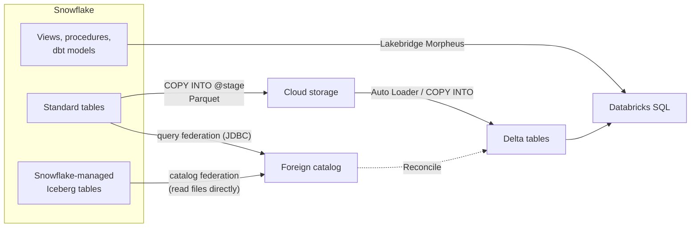

# Migrating from Snowflake

Mastery: `INPUT[inlineSelect(option(new), option(learning), option(solid)):mastery]`

> [!story] Context
> [[Migrating from Postgres and MySQL]] moved analytics off application databases. A cloud warehouse migration differs: the source is already an analytics platform with its own SQL dialect, compute meter, and stored logic. [[Snowflake]] is the most common source. Open table formats such as [[Apache Iceberg]] let both platforms read the same data during the transition.

> [!eli5] Summary
> Snowflake and Databricks both store business data and run reports on it. Moving from one to the other means copying the data, translating the SQL that builds the reports, and checking that the numbers match. Shared file formats let both systems read the same tables for a while, so the move happens in steps.

> [!analogy]- Analogy: two warehouses with a shared loading dock
> | Shared loading dock | Snowflake migration |
> |---|---|
> | Reading the other warehouse's inventory by phone | Query federation over JDBC |
> | Both warehouses reading the same shelf | Catalog federation of Snowflake-managed Iceberg tables |
> | Moving pallets | Unloading to Parquet in object storage |
> | Translating the pick lists | Lakebridge Morpheus transpiler |
> | A joint stock count | Lakebridge Reconcile |

## Background

Teams move from Snowflake to Databricks for consolidation (one platform for warehousing, data engineering, and AI), for open storage in formats they control, or to reduce cost. The migration risks are specific:

- **Dialect.** Snowflake SQL, stored procedures (JavaScript, Snowflake Scripting), and functions such as `FLATTEN` and `IFF` need translation.
- **Semi-structured data.** `VARIANT` columns and their path syntax must keep their meaning.
- **Time zones.** `TIMESTAMP_TZ` and `TIMESTAMP_LTZ` behave differently from Databricks types and cannot be unloaded directly to Parquet.
- **Many consumers.** Snowflake estates often have dbt projects, BI dashboards, and data shares pointing at them.

## Overview

| Phase | Snowflake-specific work | Tool |
|---|---|---|
| Assess | Profile warehouses and query history; analyze exported SQL | Lakebridge Profiler and Analyzer (both support Snowflake) |
| Coexist | Query Snowflake tables from Databricks; read Snowflake-managed Iceberg tables in place | [[Lakehouse Federation]]: query federation and catalog federation |
| Ingest | Unload history to Parquet in cloud storage, load into Delta | `COPY INTO <location>`, then [[Auto Loader]] or [[COPY INTO]] |
| Convert | Translate DDL, views, procedures, and dbt models | Lakebridge Morpheus (`snowflake` dialect, including dbt repointing), the agentic code converter |
| Validate | Compare schemas, rows, and values | Lakebridge Reconcile (all report types for Snowflake) |
| Switch over | Repoint BI, dbt, and downstream consumers | [[Migrating BI Reports]], [[dbt on Databricks]] |
| Decommission | Suspend warehouses, drop or archive databases, end the contract | [[Migration Checklist]] |

## How it works



### Phase 1: assess

1. Export DDL, views, and procedures to `.sql` files, and collect dbt projects.
2. Run the Analyzer on the files and the Profiler against the Snowflake account:

```bash
databricks labs lakebridge analyze --source-directory ./snowflake_sql --report-file ./assessment/snowflake.xlsx
databricks labs lakebridge configure-database-profiler
databricks labs lakebridge execute-database-profiler
```

### Phase 2: coexist with Lakehouse Federation

There are two federation modes for Snowflake:

| | Query federation | Catalog federation |
|---|---|---|
| Reads | Any Snowflake table, through JDBC pushdown | Snowflake-managed Iceberg tables, directly from object storage |
| Compute | Snowflake runs the pushed-down query | Databricks compute only |
| Requirements | Databricks Runtime 13.3 LTS or later; pro or serverless SQL warehouse 2023.40 or later | Runtime 16.4 LTS or later; pro or serverless SQL warehouse 2025.16 or later; a storage credential and external location for the Iceberg paths |
| Fallback | | Non-Iceberg tables, or tables that cannot be read directly, use query federation |

Query federation setup:

```sql
CREATE CONNECTION snowflake_prod TYPE snowflake
OPTIONS (
  host 'myaccount.snowflakecomputing.com',
  port '443',
  sfWarehouse 'MIGRATION_WH',
  user secret('migration', 'sf_user'),
  password secret('migration', 'sf_password')
);

CREATE FOREIGN CATALOG snowflake_sales
USING CONNECTION snowflake_prod
OPTIONS (database 'SALES');
```

Supported authentication methods include Snowflake OAuth, Microsoft Entra ID, Okta, access tokens, PEM private keys, and username and password. If schemas or tables do not appear, the Snowflake role behind the connection usually lacks `USAGE` on the database and schemas or `SELECT` on the tables. Join pushdown is generally available and enabled by default for Snowflake.

The reverse direction also works. Unity Catalog exposes an Iceberg REST Catalog API, and Snowflake is a listed client. A Snowflake catalog integration pointed at Unity Catalog lets Snowflake read tables that have already moved, so remaining Snowflake workloads keep working while consumers move.

### Phase 3: ingest

For tables not reachable through catalog federation, unload them to Parquet in your cloud storage:

```sql
-- On Snowflake: unload a table to an external stage as Parquet
COPY INTO @migration_stage/orders/
FROM (SELECT * FROM sales.public.orders)
FILE_FORMAT = (TYPE = PARQUET)
HEADER = TRUE;
```

Then load the files into Delta:

```sql
-- On Databricks
CREATE TABLE IF NOT EXISTS raw.snowflake.orders;
COPY INTO raw.snowflake.orders
FROM 's3://migration-bucket/orders/'
FILEFORMAT = PARQUET
COPY_OPTIONS ('mergeSchema' = 'true');
```

Unload behavior to plan for, from Snowflake's docs:

- Parquet files keep column names.
- Unloading `TIMESTAMP_TZ` or `TIMESTAMP_LTZ` columns to Parquet produces an error. Convert them in the `SELECT` first.
- `VARIANT` columns unload as JSON strings by default. Parse them with `parse_json` into a Databricks `VARIANT` column.
- `MAX_FILE_SIZE` defaults to 16 MB for unloads; raise it for large tables.
- A running virtual warehouse is required, so unloads use Snowflake credits.

For small tables, `CREATE TABLE ... AS SELECT` over query federation is simpler.

### Phase 4: convert

```bash
databricks labs lakebridge install-transpile     # choose snowflake; Morpheus is installed
databricks labs lakebridge transpile \
  --source-dialect snowflake \
  --input-source ./snowflake_sql \
  --output-folder ./converted
```

Morpheus supports the `snowflake` dialect, including dbt repointing, and gives a correctness guarantee for files that transpile with no errors or warnings. For Snowflake procedures that Morpheus cannot convert, Switch (experimental) produces notebooks.

Common differences:

| Snowflake | Databricks SQL | Note |
|---|---|---|
| `database.schema.table` | `catalog.schema.table` | Map each Snowflake database to a catalog |
| Virtual warehouse | [[SQL Warehouses\|SQL warehouse]] | Size by concurrency and latency, not by T-shirt parity |
| `VARIANT` with `col:path` | `VARIANT` with `col:path` | Path elements are case-sensitive in Databricks |
| `QUALIFY` | `QUALIFY` | Supported |
| `TRY_CAST` | `try_cast` | Supported |
| `TIMESTAMP_NTZ` | `TIMESTAMP_NTZ` | |
| `TIMESTAMP_LTZ`, `TIMESTAMP_TZ` | `TIMESTAMP` | Databricks `TIMESTAMP` is an instant shown in the session time zone; offsets are not stored |
| Unquoted identifiers folded to uppercase | Identifiers are case-insensitive | Quoted mixed-case Snowflake names need review |
| Streams and tasks | [[Change Data Feed]], [[Lakeflow Spark Declarative Pipelines]], [[Lakeflow Jobs]] | Redesign, not one-to-one |
| Secure data sharing | [[OpenSharing]] | |

### Phases 5 to 7: validate, switch over, decommission

1. Run Lakebridge Reconcile with the Snowflake connection. Snowflake supports `schema`, `row`, `data`, and `all` reports. The Lakebridge FAQ lists custom transformations for Snowflake arrays and `timestamp_ntz` comparisons.
2. Run old and new in parallel; see [[Running Old and New in Parallel]].
3. Repoint dbt with the `dbt-databricks` adapter ([[dbt on Databricks]]) and BI tools with [[Migrating BI Reports]].
4. Suspend Snowflake warehouses first, keep storage read-only for an agreed period, then drop it.

## Small-business considerations

> [!smallbiz] Small-business considerations
> A small Snowflake account usually has one or two databases, a dbt project, and a BI tool.
> 1. Federate Snowflake and build new work on Databricks immediately.
> 2. Move dbt first: once the dbt project runs against Databricks, most tables rebuild themselves from raw data, and only raw tables need unloading.
> 3. Unload raw history once, then point ingestion (for example [[Lakeflow Connect]] or a partner tool) at Databricks instead of Snowflake.
>
> During the parallel run you pay both meters: Snowflake credits for federated queries and unloads, and [[DBUs]] on Databricks. Keep the window short. See [[How Databricks Pricing Works]].

## Cloud differences

> [!azure]- Azure Databricks
> Unload to an ADLS Gen2 container through a Snowflake external stage, then load from `abfss://` paths governed by [[ADLS and Access Connectors|an Access Connector]]. Federation can authenticate with Microsoft Entra ID. Serverless compute cannot use legacy account-key access to storage, so make sure Iceberg table paths are reachable through a Unity Catalog storage credential.

> [!aws]- Databricks on AWS
> Unload to S3 through an external stage or a storage integration, then load from `s3://` paths through a Unity Catalog storage credential ([[S3 Access via Unity Catalog]]). Keep the bucket in the same region as both platforms to avoid [[Egress|egress]] charges.

> [!gcp]- Databricks on Google Cloud
> Snowflake can unload to Google Cloud Storage. Load from `gs://` paths governed by [[GCS Access via Unity Catalog]].

## Advanced topics

> [!deepdive]- Advanced topics (301–401)
> - **Iceberg-first coexistence.** Converting important Snowflake tables to Snowflake-managed Iceberg tables lets Databricks read them in place through catalog federation, with no copy. The foreign catalog's authorized paths limit what Databricks may read.
> - **Reverse coexistence.** After a table moves, expose it to Snowflake through the Unity Catalog Iceberg REST Catalog (with credential vending) so remaining Snowflake jobs can read it. External engines cannot read Unity Catalog views, and tables with row filters or column masks need supported client versions.
> - **Timestamp semantics.** Decide per column whether a Snowflake `TIMESTAMP_LTZ` represents an instant (`TIMESTAMP`) or a wall-clock value (`TIMESTAMP_NTZ`). This is the most common source of off-by-hours reconciliation errors.
> - **Warehouse sizing.** Do not map Snowflake warehouse sizes to SQL warehouse sizes directly. Benchmark the top queries from the Profiler's output on serverless SQL warehouses.
> - **Agentic code converter.** The in-workspace converter (Beta, October 2026) lists Snowflake as a source and targets Databricks SQL or, in a separate Beta, DataFrame notebooks.

## Common misconceptions

> [!confusion] Catalog federation does not cover every Snowflake table
> Only Snowflake-managed Iceberg tables are read directly from storage. Standard Snowflake tables always go through query federation, which uses Snowflake compute.

> [!confusion] "Both support VARIANT" does not mean identical behavior
> Both platforms have a `VARIANT` type and `:` path syntax, but unloaded `VARIANT` data arrives as JSON strings, and Databricks path matching is case-sensitive. Test semi-structured queries explicitly.

## Recall

What are the two Lakehouse Federation modes for Snowflake?::Query federation (JDBC pushdown, any table) and catalog federation (direct reads of Snowflake-managed Iceberg tables).
What runtime does Snowflake catalog federation require?::Databricks Runtime 16.4 LTS or later, or a pro or serverless SQL warehouse 2025.16 or later.
Which Snowflake command unloads a table to Parquet files?::`COPY INTO <location>` with `FILE_FORMAT = (TYPE = PARQUET)`.
Which Snowflake timestamp types fail when unloaded to Parquet?::`TIMESTAMP_TZ` and `TIMESTAMP_LTZ`.
How do VARIANT columns arrive in unloaded Parquet files by default?::As JSON strings.
Which Lakebridge transpiler supports Snowflake, including dbt repointing?::Morpheus.
How can Snowflake keep reading tables after they move to Databricks?::Through the Unity Catalog Iceberg REST Catalog API, using a Snowflake catalog integration.
What does a Snowflake database map to in Unity Catalog?::A catalog.

## Next steps

> [!path] Learning path
> **Needs first:** [[Snowflake]], [[Migration Strategy Overview]], [[Lakehouse Federation]]
> **Unlocks next:** [[Lakebridge]], [[Running Old and New in Parallel]], [[Migrating BI Reports]]

> [!nextup] Next
> [[Migrating from Amazon Redshift]] applies the same phases to Redshift, with S3 unloads and BladeBridge for SQL conversion.

> [!sources]- Sources (last verified: 2026-10-25)
> - [Run federated queries on Snowflake (AWS)](https://docs.databricks.com/aws/en/query-federation/snowflake)
> - [Run federated queries on Snowflake with Microsoft Entra ID (AWS)](https://docs.databricks.com/aws/en/query-federation/snowflake-entra)
> - [Enable Snowflake catalog federation (AWS)](https://docs.databricks.com/aws/en/query-federation/snowflake-catalog-federation)
> - [What is catalog federation? (Azure Databricks)](https://learn.microsoft.com/en-us/azure/databricks/query-federation/catalog-federation)
> - [Work with foreign tables (AWS)](https://docs.databricks.com/aws/en/tables/foreign)
> - [Access Databricks tables from Apache Iceberg clients (AWS)](https://docs.databricks.com/aws/en/external-access/iceberg)
> - [Access Azure Databricks tables from Apache Iceberg clients](https://learn.microsoft.com/en-us/azure/databricks/external-access/iceberg)
> - [Configure a catalog integration for Iceberg REST catalogs (Snowflake docs)](https://docs.snowflake.com/en/user-guide/tables-iceberg-configure-catalog-integration-rest)
> - [COPY INTO location (Snowflake docs)](https://docs.snowflake.com/en/sql-reference/sql/copy-into-location)
> - [Unload into Amazon S3 (Snowflake docs)](https://docs.snowflake.com/en/user-guide/data-unload-s3)
> - [Unload into Google Cloud Storage (Snowflake docs)](https://docs.snowflake.com/en/user-guide/data-unload-gcs)
> - [Lakehouse Federation performance recommendations (AWS)](https://docs.databricks.com/aws/en/query-federation/performance-recommendations)
> - [COPY INTO reference (AWS)](https://docs.databricks.com/aws/en/sql/language-manual/delta-copy-into)
> - [QUALIFY clause (Azure Databricks)](https://learn.microsoft.com/en-us/azure/databricks/sql/language-manual/sql-ref-syntax-qry-select-qualify)
> - [try_cast function (AWS)](https://docs.databricks.com/aws/en/sql/language-manual/functions/try_cast)
> - [Query variant data (AWS)](https://docs.databricks.com/aws/en/semi-structured/variant)
> - [Convert SQL with the agentic code converter (AWS)](https://docs.databricks.com/aws/en/migration/agentic-code-converter)
> - [Morpheus transpiler (Databricks Labs, GitHub)](https://github.com/databrickslabs/lakebridge/blob/main/docs/lakebridge/docs/transpile/pluggable_transpilers/morpheus/index.mdx)
> - [Lakebridge Reconcile guide (Databricks Labs, GitHub)](https://github.com/databrickslabs/lakebridge/blob/main/docs/lakebridge/docs/reconcile/index.mdx)
> - [Lakebridge FAQ (Databricks Labs, GitHub)](https://github.com/databrickslabs/lakebridge/blob/main/docs/lakebridge/docs/faq.mdx)
> - **Unconfirmed:** the exact `CREATE CONNECTION ... TYPE snowflake` option names (`sfWarehouse` and others; check the federation page for your authentication method), the `HEADER = TRUE` unload option, the identifier case-folding row, and the streams-and-tasks mapping were not re-checked in this pass.
