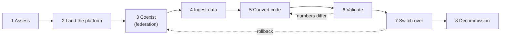

# Migration Strategy Overview

Mastery: `INPUT[inlineSelect(option(new), option(learning), option(solid)):mastery]`

> [!story] Context
> The [[Chapter 15 - Migrating to Databricks|chapter overview]] assumes a business has chosen Databricks as its destination. Its data, reports, and scheduled jobs still run on another system. This note describes the sequence of phases that moves them in small, reversible steps.

> [!eli5] Summary
> Moving data to Databricks works like moving to a new office. You list what you own, prepare the new space, and work from both places for a while. You move a few boxes at a time, check that nothing broke, and give back the old keys only when everything has arrived.

> [!analogy]- Analogy: moving a shop to a new building
> | Moving a shop | Migration phase |
> |---|---|
> | Counting every shelf before hiring movers | Assess |
> | Wiring and shelving the new building | Land the platform: workspace, [[Unity Catalog]], storage |
> | A corridor between the old and new buildings | Coexist with [[Lakehouse Federation]] |
> | Moving trucks | Ingest with [[Lakeflow Connect]] or [[Auto Loader]] |
> | Relabelling products for the new till | Convert code with [[Lakebridge]] |
> | Counting stock in both shops | Validate |
> | Changing the address on the website | Switch over ([[Cutover]]) |
> | Handing back the old lease | Decommission |

## Background

Migrations usually fail for organizational reasons, not technical ones:

- **Incomplete inventory.** A report depends on a table that nobody listed, so it was never moved.
- **Single big-bang switch-over.** Everything moves in one weekend, and there is no way back when the numbers disagree on Monday.
- **Copied code instead of converted code.** SQL written for one engine runs on another with different rules for dates, [[Null|nulls]], or text comparison, and totals drift.
- **No decommission date.** The last few jobs never move, so the company pays for two platforms indefinitely.

A phase plan with an exit gate on each phase addresses all four. The phases are the same for a folder of spreadsheets and for a ten-year-old data warehouse. Only the tools change.

Databricks' own guidance frames warehouse migration as consolidation rather than removal of the warehouse function. Its migration docs state that most warehouse queries and dashboards run with minimal refactoring (code rewriting) once the initial data migration and governance setup are complete.

## Overview

A migration strategy is the plan for moving a business's data, code, and reports to Databricks. It consists of two decisions and a phase plan.

**Decision 1: how much to change during the move**

| Approach | Description | Suitable when | Risk |
|---|---|---|---|
| [[Lift and Shift\|Lift and shift]] | Move tables and code with as few changes as possible | Fixed deadlines, contract end dates, large estates | Old design problems move with the data |
| Re-platform | Move, and adopt Databricks basics on the way: [[Delta Lake]] tables, [[Unity Catalog]] grants, [[Lakeflow Jobs]] | Most small and medium businesses | Low, when code is converted with tooling |
| Re-architect | Redesign into a [[Medallion Architecture\|medallion]] layout, streaming, or new data models | The old design is the main problem | Slowest; scope grows easily |

A common pattern is to re-platform most workloads and re-architect only the few pipelines that cause the most problems.

**Decision 2: the order of work**

Move in **waves**. A wave is a group of tables, the jobs that load them, and the reports that read them, small enough to validate in one or two weeks. Order waves by value and risk. Start with a useful but non-critical workload, such as a sales dashboard rather than payroll.

## How it works



| # | Phase | Work | Main tools | Exit gate |
|---|---|---|---|---|
| 1 | **Assess** | Inventory sources, tables, jobs, reports, users, and current costs | [[Assessing Your Current Data Estate]], Lakebridge Profiler and Analyzer | A written wave plan with owners |
| 2 | **Land the platform** | Create the workspace, catalogs, groups, storage, and networking | [[Your First 30 Days on Databricks]], per-cloud setup notes | A user can sign in and query a test table |
| 3 | **Coexist** | Query the old system from Databricks without copying data | [[Lakehouse Federation]] | Analysts can join old and new data in one query |
| 4 | **Ingest** | Copy history once, then keep changes flowing | [[Lakeflow Connect]], [[Auto Loader]], [[COPY INTO]], [[Fivetran and ELT Tools\|partner tools]] | Tables land on schedule with expected row counts |
| 5 | **Convert code** | Translate SQL, stored procedures (saved database code), and [[ETL vs ELT\|ETL]] jobs | [[Lakebridge]] transpilers, the agentic code converter | Converted code runs without errors |
| 6 | **Validate** | Compare old and new outputs | Lakebridge Reconcile, SQL `EXCEPT` checks | Agreed tolerance met for every table in the wave |
| 7 | **Switch over** | Point reports and users at Databricks; freeze the old path | [[Migrating BI Reports]], [[Cutover]] plan | Business sign-off after a parallel run |
| 8 | **Decommission** | Stop old jobs, archive, cancel licences | [[Migration Checklist]] | The old system is read-only, then removed |

### Coexist before copying

[[Lakehouse Federation]] registers the old database as a **foreign catalog** in Unity Catalog. Users query it from Databricks with standard SQL, under Unity Catalog permissions, before any data has moved. New reports can start immediately, and the live source is available for validation later.

```sql
-- Admin setup: a connection and a foreign catalog
CREATE CONNECTION legacy_sql TYPE sqlserver
OPTIONS (
  host 'sql01.example.internal',
  port '1433',
  user secret('migration', 'sql_user'),
  password secret('migration', 'sql_password')
);

CREATE FOREIGN CATALOG legacy_sales
USING CONNECTION legacy_sql
OPTIONS (database 'Sales');

-- Users with access query the old system in place
SELECT count(*) AS orders_2026
FROM legacy_sales.dbo.orders
WHERE order_date >= '2026-01-01';
```

Federated queries are read-only. The source still does the work for each query.

### Convert with tooling

Databricks provides two code conversion paths:

- **[[Lakebridge]]**, a free Databricks Labs toolkit with deterministic (rule-based) transpilers, which translate code automatically (Morpheus, BladeBridge), and an experimental [[LLM]]-based transpiler (Switch). It runs from the [[Databricks CLI]].
- **The agentic code converter**, an in-workspace converter in Beta as of October 2026. Its docs list T-SQL, Snowflake, Redshift, Oracle, BigQuery, and Teradata SQL as sources. A workspace admin enables it on the **Previews** page.

### Validate with numbers

A converted query is not complete until it matches the old system on row counts, sums of key measures, and a row-level comparison. See [[Running Old and New in Parallel]].

## Small-business considerations

> [!smallbiz] Small-business considerations
> A realistic plan for a 10–50 person company with one data person:
> 1. **Weeks 1–2:** inventory in one spreadsheet; create the workspace and three catalogs (`raw`, `analytics`, `sandbox`).
> 2. **Weeks 3–4:** federate the main database so the first [[AI-BI Dashboards|dashboard]] can be built on Databricks.
> 3. **Month 2:** ingest the five to ten tables that matter, convert the views and stored procedures behind the key reports, and run old and new in parallel.
> 4. **Month 3:** switch reports over one at a time and turn off the old scheduled jobs.
>
> Defer re-architecture until the move is complete. The main cost risk is double running: for a period you pay for both systems, so keep the parallel window short and scheduled. See [[Estimating Costs for a Small Business]].

## Cloud differences

> [!azure]- Azure Databricks
> The phases are the same. Azure-specific work falls in phase 2: networking ([[VNet Injection]], [[Azure Private Link]]) and identity through [[Microsoft Entra ID Integration|Microsoft Entra ID]]. SQL Server, Azure SQL, and Synapse are the most common sources, so [[Migrating from SQL Server]] is usually the first playbook to read.

> [!aws]- Databricks on AWS
> Phase 2 covers a [[Cross-Account IAM Role|cross-account role]], an S3 bucket, and often a [[Customer-Managed VPC on AWS|customer-managed VPC]] with [[AWS PrivateLink]]. Redshift and RDS are common sources; see [[Migrating from Amazon Redshift]] and [[Migrating from Postgres and MySQL]].

> [!gcp]- Databricks on Google Cloud
> Phase 2 covers [[Google Service Accounts|service accounts]], a GCS bucket, and optionally [[Private Service Connect]]. BigQuery is the usual source; see [[Migrating from Google BigQuery]].

## Advanced topics

> [!deepdive]- Advanced topics (301–401)
> - **Two-speed ingestion.** Large tables usually need a one-time bulk history load (files exported to object storage) plus a continuous change feed ([[Change Data Capture]]). Define the hand-over point precisely so no rows are lost or duplicated between the two.
> - **Federation is a bridge.** Federated queries push filters and other operations down to the source where possible, but heavy workloads still load the old system and cross the network. Use federation for exploration, validation, and low-volume reports, then ingest.
> - **Freeze source schemas per wave.** Ask source owners not to change table definitions while a wave is in validation. Each schema change restarts reconciliation.
> - **Dependencies decide wave order.** A small lookup table read by thirty reports belongs in wave 1. The Lakebridge Analyzer reports cross-object dependencies.
> - **Governance first.** Map old roles to [[Users Groups and Service Principals|groups]] and [[Privileges and Grants|grants]] in phase 2. Recreating permissions after cutover is where accidental exposure happens.
> - **Rollback is a plan.** Keep the old system runnable until sign-off, and document who repoints reports back if numbers break.

## Common misconceptions

> [!confusion] "Migration" is not "copying the data"
> Copying tables is usually the smallest part of the work. Converting the code that builds them, validating results, and moving reports and users take most of the effort.

> [!confusion] Federation does not move data
> [[Lakehouse Federation]] queries another system in place. Nothing is copied into [[Delta Lake]]. An ingestion step is still required before the old system can be turned off.

> [!confusion] Lakebridge does not move data
> [[Lakebridge]] assesses, converts code, and reconciles results. Data moves through ingestion tools such as [[Lakeflow Connect]], or file exports loaded with [[Auto Loader]].

## Recall

What are the eight migration phases in this vault?::Assess, land the platform, coexist, ingest, convert code, validate, switch over, decommission.
What is a migration wave?::A group of tables, the jobs that load them, and the reports that read them, small enough to move and validate together in one or two weeks.
Which feature queries the old database in place during coexistence?::Lakehouse Federation, through a connection and a foreign catalog in Unity Catalog.
What are the three approaches to how much you change during a move?::Lift and shift, re-platform, and re-architect.
Which approach suits most small and medium businesses?::Re-platform: move with little redesign, but adopt Delta tables, Unity Catalog, and Lakeflow Jobs on the way.
What does Lakebridge do, and what does it not do?::It assesses, converts code, and reconciles data. It does not copy the data.
What is the agentic code converter's status in October 2026?::Beta; a workspace admin enables it on the Previews page.
Why keep the old system runnable until sign-off?::To allow rollback if the parallel run shows mismatched numbers.

## Next steps

> [!path] Learning path
> **Needs first:** [[What Databricks Is in Plain English]], [[The Lakehouse Idea]], [[Unity Catalog]]
> **Unlocks next:** [[Assessing Your Current Data Estate]], [[Running Old and New in Parallel]], [[Migration Checklist]]

> [!nextup] Next
> [[Assessing Your Current Data Estate]] covers the first phase: building the inventory that every later phase depends on.

> [!sources]- Sources (last verified: 2026-10-25)
> - [Migrate data applications to Databricks (AWS)](https://docs.databricks.com/aws/en/migration/)
> - [Migrate data applications to Azure Databricks](https://learn.microsoft.com/en-us/azure/databricks/migration/)
> - [Migrate your data warehouse to the Databricks lakehouse (Azure Databricks)](https://learn.microsoft.com/en-us/azure/databricks/migration/warehouse-to-lakehouse)
> - [Migrate your data warehouse to the Databricks lakehouse (GCP)](https://docs.databricks.com/gcp/en/migration/warehouse-to-lakehouse)
> - [Convert SQL with the agentic code converter (AWS)](https://docs.databricks.com/aws/en/migration/agentic-code-converter)
> - [What is query federation? (AWS)](https://docs.databricks.com/aws/en/query-federation/database-federation)
> - [Connect to external databases and catalogs (Azure Databricks)](https://learn.microsoft.com/en-us/azure/databricks/query-federation/)
> - [Introducing Lakebridge: Free, Open Data Migration to Databricks SQL (Databricks blog)](https://www.databricks.com/blog/introducing-lakebridge-free-open-data-migration-databricks-sql)
> - [Lakebridge overview (Databricks Labs, GitHub)](https://github.com/databrickslabs/lakebridge/blob/main/docs/lakebridge/docs/overview.mdx)
