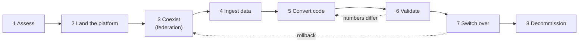

# Migration Strategy Overview

Mastery: `INPUT[inlineSelect(option(new), option(learning), option(solid)):mastery]`

> [!todo] Draft, not yet verified
> This body is an unverified draft. Its facts were checked against the open-source Lakebridge repo, the Terraform provider, and the Databricks SDK, which the vault's source policy does not accept. It must be re-verified against docs.databricks.com, learn.microsoft.com/azure/databricks, or databricks.com before `status: written` is set. Do not answer from it.

> [!story] Previously
> The [[Chapter 15 - Migrating to Databricks|chapter opener]] left us with a business that has decided Databricks is the destination. The data, the reports, and the nightly jobs still live somewhere else. Moving them is not one big jump. It is a sequence of small, reversible steps, and this note lays out that sequence.

> [!eli5] In one breath
> Moving your data to Databricks is like moving house. First you list what you own. Then you get the new place ready, and for a while you live in both. You carry boxes over a few at a time, check nothing broke on the way, and only hand back the old keys when you are sure you have everything.

> [!analogy] Analogy: moving a shop to a new building
> - **The inventory walk-through** is the *assess* phase. You count what is on every shelf before you hire movers.
> - **Getting the new building wired and shelved** is landing the platform: a workspace, [[Unity Catalog]], and storage.
> - **Running both shops for a month** is *coexistence*. Customers can still buy from the old one while the new one fills up. [[Lakehouse Federation]] is the corridor between the two buildings.
> - **The moving trucks** are ingestion tools such as [[Lakeflow Connect]] and [[Auto Loader]].
> - **Re-labelling every product for the new till system** is code conversion, with [[Lakebridge]] as the label printer.
> - **Counting stock in both shops** is validation.
> - **Changing the address on the website** is the [[Cutover|cutover]], and **handing back the old lease** is decommissioning.

## Why it exists

Most failed migrations fail for the same few reasons, and none of them is technical:

- **Nobody knew what was there.** A report everyone relies on turns out to read a forgotten table that nobody moved.
- **Everything moved at once.** A "big bang" weekend switch-over left no way back when numbers did not match on Monday.
- **Code was copied, not converted.** SQL written for one engine ran on another with subtly different rules for dates, nulls, or text comparison, and the totals drifted.
- **The old system never got switched off.** The company paid for two platforms for a year because the last 5% of jobs never moved.

A clear set of phases, with a gate at the end of each one, fixes all four. The phases below are the same whether you are moving a folder of spreadsheets or a ten-year-old data warehouse. Only the tools change.

## What it actually is

A migration strategy is two decisions plus a phase plan.

**Decision 1: how much do you change on the way?**

| Approach | What it means | Good when | Risk |
|---|---|---|---|
| [[Lift and Shift\|Lift and shift]] | Move tables and code as close to unchanged as possible | Deadlines, contract end dates, large estates | You bring old design problems with you |
| Re-platform | Move, but adopt Databricks basics on the way: [[Delta Lake]] tables, [[Unity Catalog]] grants, [[Lakeflow Jobs]] | Most small and medium businesses | Small, if you convert code with tooling |
| Re-architect | Redesign into a [[Medallion Architecture\|medallion]] layout, streaming, new models | The old design is the real problem | Slowest; scope creep |

Most teams re-platform the bulk and re-architect only the two or three pipelines that hurt most.

**Decision 2: in what order?**

Move in **waves**, not all at once. A wave is a group of tables, the jobs that load them, and the reports that read them, small enough to validate in a week or two. Order waves by value and risk: start with something useful but not mission-critical (a sales dashboard, not payroll).

**The phase plan** is the rest of this note.

## How it works



| # | Phase | What you do | Main tools | Gate to the next phase |
|---|---|---|---|---|
| 1 | **Assess** | Inventory sources, tables, jobs, reports, users, and current costs | [[Assessing Your Current Data Estate]], Lakebridge Profiler and Analyzer | A written list of waves with owners |
| 2 | **Land the platform** | Create the workspace, [[Unity Catalog]] catalogs, groups, storage, networking | [[Your First 30 Days on Databricks]], cloud setup notes | A user can log in and query a test table |
| 3 | **Coexist** | Query the old system from Databricks without copying data | [[Lakehouse Federation]] | Analysts can join old and new data in one query |
| 4 | **Ingest** | Copy data in, once (history) and then continuously (changes) | [[Lakeflow Connect]], [[Auto Loader]], [[COPY INTO]], [[Fivetran and ELT Tools\|partner tools]] | Tables land on schedule with expected row counts |
| 5 | **Convert code** | Translate SQL, stored procedures, and ETL jobs | [[Lakebridge]] transpilers, [[Databricks Assistant]] | Converted code runs without errors |
| 6 | **Validate** | Compare old and new outputs row by row | Lakebridge Reconcile, SQL `EXCEPT` checks | Agreed tolerance met for every table in the wave |
| 7 | **Switch over** | Point reports and users at Databricks; freeze the old path | [[Migrating BI Reports]], [[Cutover]] plan | Business sign-off after a parallel run |
| 8 | **Decommission** | Stop old jobs, archive, cancel licences | [[Migration Checklist]] | The old system is read-only, then gone |

Two phases deserve extra attention:

**Coexist before you copy.** [[Lakehouse Federation]] registers the old database as a *foreign catalog* in Unity Catalog. People can then query it from Databricks with normal SQL, under Unity Catalog permissions, while nothing has moved yet. That buys time, lets you build new reports immediately, and gives you a live "old" side for validation later.

```sql
-- One-time setup by an admin: a connection and a foreign catalog
CREATE CONNECTION legacy_sql TYPE sqlserver
OPTIONS (
  host 'sql01.example.internal',
  port '1433',
  user secret('migration', 'sql_user'),
  password secret('migration', 'sql_password')
);

CREATE FOREIGN CATALOG legacy_sales
USING CONNECTION legacy_sql
OPTIONS (database 'Sales');

-- Now anyone with access can read the old system in place
SELECT count(*) AS orders_2026
FROM legacy_sales.dbo.orders
WHERE order_date >= '2026-01-01';
```

**Validate with numbers, not eyeballs.** A converted query that "looks right" is not done until it matches the old system on row counts, sums of key measures, and a row-level difference check. See [[Running Old and New in Parallel]].

> [!smallbiz] For a small business
> For a 10–50 person company with one data person, a realistic plan is:
> - **Week 1–2:** inventory (one spreadsheet is enough), create the workspace, set up three catalogs (`raw`, `analytics`, `sandbox`).
> - **Week 3–4:** federate the main database so the first [[AI-BI Dashboards|dashboard]] can be built on Databricks straight away.
> - **Month 2:** ingest the five to ten tables that matter, convert the handful of views and stored procedures behind the key reports, and run old and new side by side.
> - **Month 3:** switch reports over one at a time and switch off the old nightly jobs.
>
> Skip re-architecting anything until the move is done. The cost to watch is double running: for a month or two you pay for both systems, so keep the parallel window short and planned. See [[Estimating Costs for a Small Business]].

## On each cloud

> [!azure]- Azure Databricks
> The phases are the same. Azure-specific work sits in phase 2: networking ([[VNet Injection]], [[Azure Private Link]]) and identity through [[Microsoft Entra ID Integration|Microsoft Entra ID]]. SQL Server, Azure SQL, and Synapse sources are the most common starting points, so [[Migrating from SQL Server]] is usually the first playbook to read.

> [!aws]- Databricks on AWS
> Phase 2 means a [[Cross-Account IAM Role|cross-account role]], an S3 bucket, and often a [[Customer-Managed VPC on AWS|customer-managed VPC]] with [[AWS PrivateLink]]. Redshift and RDS sources dominate; see [[Migrating from Amazon Redshift]] and [[Migrating from Postgres and MySQL]].

> [!gcp]- Databricks on Google Cloud
> Phase 2 means [[Google Service Accounts|service accounts]], a GCS bucket, and optionally [[Private Service Connect]]. BigQuery is the usual source; see [[Migrating from Google BigQuery]].

## Going deeper

> [!deepdive]- Expert notes (301–401)
> - **Two-speed ingestion.** Large tables usually need a one-time bulk *history* load (files exported to object storage) plus a continuous *change* feed ([[Change Data Capture]]). Plan the hand-over point carefully so no rows are lost or doubled between the two.
> - **Federation is a bridge, not a destination.** Federated queries push work down to the source where they can, but heavy joins still pull data across the network and load the old system. Use federation for exploration, validation, and low-volume reports, then ingest.
> - **Freeze the source schema per wave.** Ask source owners not to change table definitions while a wave is being validated, or every schema change restarts the reconciliation.
> - **Dependencies decide wave order more than size does.** A small lookup table read by thirty reports belongs in wave 1. The Lakebridge Analyzer and the source system's own dependency views help you find these.
> - **Governance first, not last.** Recreating permissions after cutover is where data leaks happen. Map old roles to [[Users Groups and Service Principals|groups]] and [[Privileges and Grants|grants]] during phase 2.
> - **Rollback is a plan, not a hope.** Keep the old system writable (or at least runnable) until the business signs off, and write down exactly who flips reports back if numbers break.

## Common confusions

> [!confusion] "Migration" is not "copying the data"
> Copying tables is often the easiest 20% of the work. Converting the code that builds them, validating results, and moving the reports and people are the other 80%.

> [!confusion] Federation does not move data
> [[Lakehouse Federation]] lets Databricks *query* another system in place. Nothing is copied into [[Delta Lake]]. You still need an ingestion step before you can switch the old system off.

> [!confusion] Lakebridge does not move data either
> [[Lakebridge]] assesses, converts code, and reconciles results. The data itself moves through ingestion tools such as [[Lakeflow Connect]] or file exports plus [[Auto Loader]].

## Recall

What are the eight phases of a migration in this vault?::Assess, land the platform, coexist, ingest, convert code, validate, switch over, decommission.
What is a migration wave?::A group of tables, the jobs that load them, and the reports that read them, small enough to move and validate together in a week or two.
Which Databricks feature lets you query the old database in place during coexistence?::Lakehouse Federation, through a connection and a foreign catalog in Unity Catalog.
What are the three approaches to how much you change during a move?::Lift and shift, re-platform, and re-architect.
Which approach suits most small and medium businesses?::Re-platform: move with minimal redesign but adopt Delta tables, Unity Catalog, and Lakeflow Jobs on the way.
What does Lakebridge do, and what does it not do?::It assesses, converts code, and reconciles data. It does not copy the data itself.
Why keep the old system runnable until sign-off?::So you can roll back if the parallel run shows numbers that do not match.
What should go in the first wave?::Something useful but not mission-critical, plus small shared tables that many reports depend on.

## Where next

> [!path] Learning path
> **Needs first:** [[What Databricks Is in Plain English]], [[The Lakehouse Idea]], [[Unity Catalog]]
> **Unlocks next:** [[Assessing Your Current Data Estate]], [[Running Old and New in Parallel]], [[Migration Checklist]]

> [!nextup] Up next in the story
> Every phase depends on the first one. Before you can plan waves, you need an honest list of what you have. That is [[Assessing Your Current Data Estate]].

> [!sources]- Sources (not yet verified under the source policy)
> - [Lakehouse Federation: supported data sources (Databricks)](https://docs.databricks.com/query-federation/index.html#supported-data-sources)
> - [Create a connection (Databricks, AWS)](https://docs.databricks.com/aws/en/query-federation/remote-queries#create-a-connection)
