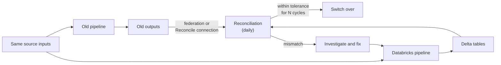

# Running Old and New in Parallel

Mastery: `INPUT[inlineSelect(option(new), option(learning), option(solid)):mastery]`

> [!story] Context
> [[Migrating BI Reports]] connected reports to Databricks. Before users switch, both systems run side by side on the same inputs, and their outputs are compared. This note describes how to run that parallel period, reconcile the results, and switch over with a rollback plan.

> [!eli5] Summary
> For a few weeks, the old system and Databricks both do the same work every day. Each morning you compare their answers. When they agree for long enough, everyone switches to Databricks, and the old system is kept ready for a short time in case something goes wrong.

> [!analogy]- Analogy: two cashiers counting the same till
> | Two cashiers | Parallel run |
> |---|---|
> | Both count the same day's takings | Old and new pipelines process the same inputs |
> | Comparing totals at closing | Daily reconciliation |
> | Explaining every difference | Mismatch investigation |
> | Switching to the new cashier | [[Cutover]] |
> | Keeping the old cashier on call for a week | Rollback window |

## Background

A converted pipeline can run without errors and still produce different numbers. Common causes:

- Text comparisons that were case-insensitive on the source and case-sensitive on Databricks.
- Time zone handling in timestamp conversions.
- Rounding from `FLOAT` instead of `DECIMAL`.
- `NULL` handling in joins and aggregates.
- Late-arriving data that one system loaded and the other did not yet.

A parallel run finds these before users do. It also builds trust: business owners sign off on numbers they have watched match for several cycles.

## Overview

| Check | Question | Tool |
|---|---|---|
| **Schema** | Same columns and compatible types? | Lakebridge Reconcile `schema` report |
| **Row counts** | Same number of rows per table, per partition or day? | SQL `COUNT(*)` over federation and Delta |
| **Aggregates** | Same totals for key measures (revenue, quantity)? | SQL `SUM` and `GROUP BY` comparisons |
| **Row hashes** | Same rows, without a join key? | Lakebridge Reconcile `row` report |
| **Column values** | Same values per key, per column? | Lakebridge Reconcile `data` report |
| **Reports** | Same numbers on the screens people use? | Side-by-side report review |

Agree on **tolerances** before the run starts. For example: row counts must match exactly, money totals must match to the cent, and floating-point metrics may differ by a stated relative amount.

## How it works



### Step 1: set up the comparison path

The old system's outputs must be readable from Databricks:

- **[[Lakehouse Federation]]:** create a connection and foreign catalog to the old system, so SQL can join old and new tables directly.
- **Lakebridge Reconcile:** needs only a Unity Catalog connection to the source; a foreign catalog is not required. The `remote_query` preview must be enabled in the workspace.

### Step 2: compare with SQL

Quick checks with federation, run daily as a [[Lakeflow Jobs|job]]:

```sql
-- Row counts and totals per day, old vs new
WITH old AS (
  SELECT order_date, COUNT(*) AS n, SUM(amount) AS total
  FROM legacy_sales.dbo.orders
  WHERE order_date >= current_date() - INTERVAL 7 DAYS
  GROUP BY order_date
),
new AS (
  SELECT order_date, COUNT(*) AS n, SUM(amount) AS total
  FROM analytics.sales.orders
  WHERE order_date >= current_date() - INTERVAL 7 DAYS
  GROUP BY order_date
)
SELECT coalesce(o.order_date, n.order_date) AS order_date,
       o.n AS old_rows, n.n AS new_rows,
       o.total AS old_total, n.total AS new_total
FROM old o FULL OUTER JOIN new n ON o.order_date = n.order_date
WHERE o.n IS DISTINCT FROM n.n OR o.total IS DISTINCT FROM n.total;
```

```sql
-- Rows in the legacy table that are missing from the new one.
-- Swap the two queries to find rows that exist only in the new table.
SELECT * FROM legacy_sales.dbo.customers
EXCEPT
SELECT * FROM analytics.crm.customers;
```

Store the results in a reconciliation table so trends are visible on a dashboard.

### Step 3: run Lakebridge Reconcile

1. Run `databricks labs lakebridge configure-reconcile`. It creates the workspace resources and can generate a starting config by discovering source tables.
2. Review the config file in `<home>/.lakebridge/`. Set join columns for `data` reports, `column_mapping` for renamed columns, and `drop_columns` for audit columns such as load timestamps.
3. Add custom transformations where types differ, for example normalizing timestamps to epoch seconds on both sides.
4. Run the reconcile job. It runs on serverless compute by default.
5. Review mismatches at schema, row, and column level, fix the pipeline, and rerun.

Reconcile supports Oracle, Snowflake, SQL Server, Redshift, Teradata, BigQuery, and Databricks as sources.

### Step 4: decide the switch-over

Define the exit criteria in writing before the run starts:

1. All tables in the wave within tolerance for an agreed number of consecutive cycles (for example, two weeks of daily runs, or two month-end closes for finance).
2. Report owners have compared their key screens and signed off.
3. Freshness [[SLA|SLAs]] met by the Databricks pipelines for the same period.
4. A rollback owner and procedure are documented.

### Step 5: switch over and keep a rollback window

1. Announce the [[Cutover|cutover]] date and freeze changes to old pipelines.
2. Repoint reports and downstream consumers to Databricks.
3. Stop writes from the old pipelines, but keep the old system runnable and readable.
4. Keep the rollback window open for an agreed period. Rolling back means repointing reports to the old system and restarting its jobs.
5. Close the window, then decommission (see [[Migration Checklist]]).

## Small-business considerations

> [!smallbiz] Small-business considerations
> A small business can run a short, focused parallel period:
> 1. Pick the five numbers the owner checks most (daily sales, open invoices, stock on hand).
> 2. Compare them every morning for two to four weeks with one SQL query over federation.
> 3. Include at least one month-end if finance reports are in scope.
> 4. Switch over on a quiet day, not before a month-end.
>
> Both systems cost money during the parallel run, so set an end date at the start. See [[Estimating Costs for a Small Business]].

## Cloud differences

> [!azure]- Azure Databricks
> Nothing differs in the method. Reconcile and federation work the same way; network access from serverless compute to the source must be allowed ([[Serverless Network Security]]).

> [!aws]- Databricks on AWS
> Nothing differs in the method. Make sure serverless and classic compute can reach the source through your VPC configuration.

> [!gcp]- Databricks on Google Cloud
> Nothing differs in the method. For BigQuery, Reconcile cannot compare some types exactly; see [[Migrating from Google BigQuery]].

## Advanced topics

> [!deepdive]- Advanced topics (301–401)
> - **Moving targets:** Both systems are often live. Compare closed periods (yesterday, last month) rather than "now", or snapshot both sides at the same cutoff.
> - **Ordering and statistics:** Lakebridge's Morpheus notes that row order may differ without `ORDER BY`, and some statistical functions use different algorithms. Exclude ordering from comparisons and set tolerances for statistical measures.
> - **Hash-based checks without keys:** The Reconcile `row` report hashes each row, so it works on tables without a primary key. Teradata needs a user-installed hash UDF.
> - **Classic compute:** To run Reconcile on a classic cluster, set `job_overrides.existing_cluster_id` in `reconcile.yml`. The cluster must run Databricks Runtime 17.3 or later.
> - **Ongoing quality:** After cutover, keep [[Expectations and Data Quality|expectations]] and [[Data Quality Monitoring]] on the migrated tables so regressions surface without a comparison system.
> - **Federation load:** Daily comparison queries load the old system. Run them off-peak and limit them to recent partitions.

## Common misconceptions

> [!confusion] "No errors" is not "same results"
> A pipeline that runs successfully can still produce different numbers. Only a comparison of outputs proves equivalence.

> [!confusion] A parallel run is not open-ended
> Without an end date and written exit criteria, parallel runs continue indefinitely and double costs. Set both before starting.

## Recall

What are Lakebridge Reconcile's four report types?::`schema`, `row`, `data`, and `all`.
What does Lakebridge Reconcile need to read the source?::A Unity Catalog connection; no foreign catalog is required.
Which Reconcile report works on tables without a primary key?::The `row` report, which compares row hashes.
On which compute does the reconcile job run by default?::Serverless compute.
Name three common causes of mismatches after conversion.::Case-sensitive text comparison, time zone handling, and rounding from floating-point types.
What should be written down before a parallel run starts?::Tolerances, exit criteria, an end date, and a rollback owner and procedure.
Why compare closed periods instead of current data?::Both systems are live, so comparing "now" picks up timing differences rather than real errors.

## Next steps

> [!path] Learning path
> **Needs first:** [[Migration Strategy Overview]], [[Lakehouse Federation]], [[Lakebridge]]
> **Unlocks next:** [[Migration Checklist]], [[Cutover]], [[Data Quality Monitoring]]

> [!nextup] Next
> [[Migration Checklist]] collects every phase of this chapter into one start-to-finish checklist.

> [!sources]- Sources (last verified: 2026-10-25)
> - [Lakebridge Reconcile guide (Databricks Labs, GitHub)](https://github.com/databrickslabs/lakebridge/blob/main/docs/lakebridge/docs/reconcile/index.mdx)
> - [Lakebridge installation: configure Reconcile (Databricks Labs, GitHub)](https://github.com/databrickslabs/lakebridge/blob/main/docs/lakebridge/docs/installation.mdx)
> - [Lakebridge FAQ (Databricks Labs, GitHub)](https://github.com/databrickslabs/lakebridge/blob/main/docs/lakebridge/docs/faq.mdx)
> - [Morpheus correctness model (Databricks Labs, GitHub)](https://github.com/databrickslabs/lakebridge/blob/main/docs/lakebridge/docs/transpile/pluggable_transpilers/morpheus/index.mdx)
> - [What is query federation? (AWS)](https://docs.databricks.com/aws/en/query-federation/database-federation)
> - [Query external databases using the remote_query function (GCP)](https://docs.databricks.com/gcp/en/query-federation/remote-queries)
> - [Migrate your data warehouse to the Databricks lakehouse (Azure Databricks)](https://learn.microsoft.com/en-us/azure/databricks/migration/warehouse-to-lakehouse)
> - [Collation (AWS)](https://docs.databricks.com/aws/en/sql/language-manual/sql-ref-collation)
> - [is distinct operator (AWS)](https://docs.databricks.com/aws/en/sql/language-manual/functions/isdistinct)
> - [Set operators: UNION, INTERSECT, EXCEPT (AWS)](https://docs.databricks.com/aws/en/sql/language-manual/sql-ref-syntax-qry-select-setops)
