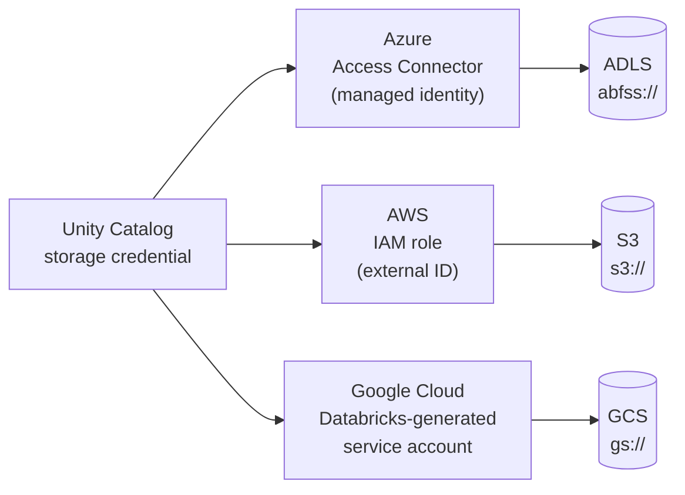

# Cloud Comparison - Azure vs AWS vs GCP

This page puts the same Databricks concept side by side on Azure, AWS, and Google Cloud. Each cell links to the note that covers it on that cloud.

> [!eli5] What this page is
> Databricks works the same way on all three big cloud companies: Microsoft, Amazon, and Google. What changes is the plumbing underneath, such as how you pay, how people sign in, and where the files are kept. This page lines those differences up in one table so you can compare them.

## What is the same on every cloud

The following work the same way on all three clouds. Learn them once.

- **The platform:** workspaces, [[Notebooks]], [[Lakeflow Jobs]], [[SQL Warehouses]], and [[Serverless Compute]]. See [[Accounts and Workspaces]].
- **The architecture:** a Databricks-run [[Control Plane and Compute Plane|control plane]], plus a classic compute plane in your cloud account and a serverless compute plane in the Databricks account.
- **Governance:** [[Unity Catalog]], [[Privileges and Grants]], and [[System Tables]].
- **Storage access model:** a [[Storage Credentials and External Locations|storage credential]] wraps a cloud identity, and an external location pairs it with a path. Only the identity type changes per cloud.
- **Serverless network controls:** network connectivity configurations (NCCs) on all three clouds. See [[Serverless Network Security]].
- **Plan tiers:** Standard tier workspaces on AWS and Google Cloud moved to Premium on October 1, 2025. On Azure, new workspaces use Premium from April 1, 2026, and remaining Standard workspaces were scheduled for automatic upgrade on October 1, 2026. See [[How Databricks Pricing Works]].

## Side by side

| Concept | Azure Databricks | Databricks on AWS | Databricks on Google Cloud |
|---|---|---|---|
| **Signup and billing** | A first-party Microsoft service, billed by Microsoft on the Azure invoice. Databricks commit units (DBCU) can be prepurchased for 1 or 3 years. [[First-Party Microsoft Service\|First-party service]], [[Azure Billing and Commit Units\|Azure billing]] | Buy directly from Databricks (express setup, or with an existing AWS account) or pay as you go through AWS Marketplace. Classic compute VMs and S3 appear on your AWS bill. [[AWS Marketplace and Billing\|AWS billing]] | Subscribe through Google Cloud Marketplace, linked to a billing account. Charges appear on the Google Cloud bill. [[Google Cloud Marketplace and Billing\|Google Cloud billing]] |
| **Workspace creation** | An Azure resource (`Microsoft.Databricks/workspaces`) created in the Azure portal, Azure CLI, Bicep, ARM, or Terraform. Classic workspaces create a locked [[Managed Resource Group\|managed resource group]]. [[Creating an Azure Databricks Workspace\|Create a workspace]] | Created from the account console (`https://accounts.cloud.databricks.com`): serverless, or classic with a [[Cross-Account IAM Role\|cross-account IAM role]] and a [[Workspace Storage Bucket\|workspace bucket]]. Serverless workspaces are GA since January 29, 2026. [[Account Setup on AWS\|AWS setup]] | Created from the account console (`https://accounts.gcp.databricks.com`) after the Marketplace subscription, choosing a project and region: serverless, or classic with two GCS buckets in your project. [[Account Setup on Google Cloud\|Google Cloud setup]] |
| **Identity** | Microsoft Entra ID is built in. Entra ID SSO is on by default. Automatic identity management syncs users, groups, and service principals, on by default for accounts created after August 1, 2025. [[Microsoft Entra ID Integration\|Entra ID]] | Configure SSO yourself in the account console (Entra ID, Okta, OneLogin, AWS IAM Identity Center, and others), and sync users with account-level [[SCIM Provisioning\|SCIM]]. [[Single Sign-On\|SSO]] | Google Cloud Identity SSO is available by default. Bring another IdP over SAML 2.0 or OIDC, and sync with SCIM. [[Google Service Accounts\|Service accounts]] act for compute. [[Single Sign-On\|SSO]] |
| **Storage** | [[Azure Data Lake Storage]] (Blob Storage with hierarchical namespace), addressed as `abfss://` | [[Amazon S3]], addressed as `s3://` | [[Google Cloud Storage]], addressed as `gs://` |
| **Storage credential mechanism** | An **Access Connector for Azure Databricks** with a system-assigned or user-assigned managed identity, granted a role such as *Storage Blob Data Contributor*. [[ADLS and Access Connectors\|Access connectors]] | An **IAM role ARN** whose trust policy lets Unity Catalog assume it with an external ID. Since January 20, 2025, the role must be self-assuming. Replaces [[Instance Profiles\|instance profiles]]. [[S3 Access via Unity Catalog\|S3 access]] | A **Google service account that Databricks generates** for the credential, granted roles on the bucket. [[GCS Access via Unity Catalog\|GCS access]] |
| **Network isolation (classic compute)** | [[VNet Injection]] deploys clusters into your VNet with two dedicated, delegated subnets. [[Secure Cluster Connectivity]] (No Public IP) is the default in the portal. | A [[Customer-Managed VPC on AWS\|customer-managed VPC]] registered as a network configuration with at least two subnets and a security group. | A [[Customer-Managed VPC on Google Cloud\|customer-managed VPC]] (standalone or Shared VPC) with one subnet in the workspace region, recommended for new workspaces. |
| **Private connectivity** | [[Azure Private Link]] for front-end (inbound) and back-end (classic) paths. Requires the Premium plan; classic back-end also requires VNet injection and SCC. | [[AWS PrivateLink]] for inbound and classic back-end, using VPC interface endpoints. Requires the Enterprise plan and a customer-managed VPC. | [[Private Service Connect]] (PSC) for front-end and classic back-end. Requires the Enterprise plan and a customer-managed VPC. Public access stays allowed until you block it. |
| **Secrets** | Databricks-backed scopes, or [[Azure Key Vault Secret Scopes\|Azure Key Vault-backed scopes]] (read-only from Databricks). Key Vault can also back Unity Catalog external secrets. | Databricks-backed scopes only. AWS Secrets Manager can back Unity Catalog external secrets. [[Secrets Management]] | Databricks-backed scopes only. The vault found no Google Secret Manager-backed scope type. [[Secrets Management]] |
| **Encryption keys (CMK)** | Azure Key Vault or Managed HSM, for managed services, managed disks, and DBFS root. Premium plan. [[Customer-Managed Keys on Azure\|CMK on Azure]] | AWS KMS, for managed services and workspace storage (plus optional EBS volumes). Enterprise tier. [[Customer-Managed Keys on AWS\|CMK on AWS]] | Google Cloud KMS, for managed services and the two workspace GCS buckets. Enterprise tier, added only at workspace creation. [[Customer-Managed Keys on Google Cloud\|CMK on Google Cloud]] |
| **Logging** | **Diagnostic logs** delivered with Azure diagnostic settings to Log Analytics, a storage account, or Event Hubs, configured per workspace. [[Azure Monitor and Diagnostic Logs\|Azure Monitor]] | Audit log delivery writes JSON files to an S3 bucket you own, configured at the account level. [[Audit Logs]] | Audit log delivery writes JSON files to a GCS bucket you own, configured at the account level. [[Audit Logs]] |
| **BI integration** | Power BI with the **Azure Databricks** connector, Entra ID SSO, publishing from Unity Catalog, and the ADBC driver (GA October 15, 2026). Fabric mirroring is a separate path. [[Power BI on Azure Databricks\|Power BI on Azure]], [[Microsoft Fabric and OneLake vs Databricks\|Fabric]] | The **Databricks** connector for Power BI, with OAuth, a service principal, or a token. Tableau and other tools connect through SQL warehouses. [[Connecting Power BI\|Power BI]], [[Connecting Tableau and Other BI Tools\|Tableau and others]] | The same **Databricks** Power BI connector as AWS. BigQuery is reachable through federation and the Spark connector. [[BigQuery Integration\|BigQuery]], [[Connecting Tableau and Other BI Tools\|Tableau and others]] |
| **Government clouds** | Databricks has announced a partnership with Microsoft to bring its platform to Azure Government. Volumes and Partner Connect are not available in Azure Government regions. [[Databricks on AWS GovCloud\|See the comparison in the GovCloud note]] | [[Databricks on AWS GovCloud]]: a separate environment in `us-gov-west-1` with FedRAMP High and DoD IL5, `.cloud.databricks.us` URLs, and the compliance security profile on every workspace. | No government environment for Databricks on Google Cloud is documented. [[Databricks on Google Cloud Overview\|Google Cloud overview]] |

## Where the differences come from

Most rows differ for one of three reasons:

1. **How Databricks is sold.** Azure Databricks is a first-party Microsoft service, so Microsoft handles billing and identity. On AWS and Google Cloud, Databricks runs the service and you connect it to your cloud account.
2. **Each cloud's identity system.** Managed identities on Azure, IAM roles on AWS, and service accounts on Google Cloud are three ways of answering "who is this program?" Databricks uses whichever one the cloud provides.
3. **Each cloud's network primitives.** VNets and Private Link, VPCs and PrivateLink, and VPCs and Private Service Connect solve the same problem with different names, limits, and plan requirements.

## Plan requirements for security features

| Feature | Azure | AWS | Google Cloud |
|---|---|---|---|
| Customer-managed keys | Premium | Enterprise | Enterprise |
| Private connectivity for classic compute | Premium | Enterprise | Enterprise |
| [[Compliance Security Profile]] | Premium plus the Enhanced Security and Compliance add-on | Not stated in the vault; check the note | Not stated in the vault; check the note |

> [!confusion] Same idea, different names
> | Idea | Azure | AWS | Google Cloud |
> |---|---|---|---|
> | Your own network | VNet injection | Customer-managed VPC | Customer-managed VPC |
> | Private path | Private Link | PrivateLink | Private Service Connect |
> | Identity for storage | Managed identity (Access Connector) | IAM role | Service account |
> | Key service | Key Vault or Managed HSM | KMS | Cloud KMS |
> | Audit logs | Diagnostic logs | Audit log delivery | Audit log delivery |
>
> See [[VPC and VNet]], [[Managed Identity]], and [[IAM]] for the general terms.

## Next steps

- To choose a cloud for a new deployment, read [[Choosing a Cloud for Databricks]].
- For one cloud end to end, follow [[Path - Azure Deep Dive]], [[Path - AWS Deep Dive]], or [[Path - Google Cloud Deep Dive]].
- For the cloud-neutral version of each topic, read [[Network Security Overview]], [[Encryption]], and [[Secrets Management]].

> [!sources]- Sources (last verified: 2026-10-25)
> Every cell restates a fact from the linked note. These are the official sources those notes cite.
> - [High-level architecture (Azure Databricks)](https://learn.microsoft.com/en-us/azure/databricks/getting-started/high-level-architecture)
> - [High-level architecture (AWS)](https://docs.databricks.com/aws/en/getting-started/high-level-architecture)
> - [High-level architecture (GCP)](https://docs.databricks.com/gcp/en/getting-started/high-level-architecture)
> - [End of life for Standard tier workspaces (Azure Databricks)](https://learn.microsoft.com/en-us/azure/databricks/admin/account-settings/standard-tier)
> - [Optimize Azure Databricks costs with a prepurchase (Microsoft Learn)](https://learn.microsoft.com/en-us/azure/cost-management-billing/reservations/prepay-databricks-reserved-capacity)
> - [Manage your subscription and billing (AWS)](https://docs.databricks.com/aws/en/admin/account-settings/account)
> - [Manage your subscription (GCP)](https://docs.databricks.com/gcp/en/admin/account-settings/account)
> - [Deploy a workspace using the Azure portal](https://learn.microsoft.com/en-us/azure/databricks/admin/workspace/create-workspace)
> - [Create a serverless workspace (AWS)](https://docs.databricks.com/aws/en/admin/workspace/serverless-workspaces)
> - [Create a classic workspace (GCP)](https://docs.databricks.com/gcp/en/admin/workspace/create-workspace)
> - [Start a Databricks free trial on Google Cloud](https://docs.databricks.com/gcp/en/admin/account-settings-gcp/create-subscription)
> - [Automatic identity management (Azure Databricks)](https://learn.microsoft.com/en-us/azure/databricks/admin/users-groups/automatic-identity-management/)
> - [Configure SSO in Databricks (AWS)](https://docs.databricks.com/aws/en/security/auth/single-sign-on/)
> - [Configure SSO in Databricks (GCP)](https://docs.databricks.com/gcp/en/security/auth/single-sign-on/)
> - [Sync users and groups from your identity provider using SCIM (AWS)](https://docs.databricks.com/aws/en/admin/users-groups/scim/)
> - [Use Azure managed identities in Unity Catalog to access storage](https://learn.microsoft.com/en-us/azure/databricks/connect/unity-catalog/cloud-storage/azure-managed-identities)
> - [Create a storage credential and external location for S3 (AWS)](https://docs.databricks.com/aws/en/connect/unity-catalog/cloud-storage/s3/s3-external-location-manual)
> - [Connect to a GCS external location (GCP)](https://docs.databricks.com/gcp/en/connect/unity-catalog/cloud-storage/external-locations-gcs#storage-credential)
> - [Deploy Azure Databricks in your Azure virtual network (VNet injection)](https://learn.microsoft.com/en-us/azure/databricks/security/network/classic/vnet-inject)
> - [Enable secure cluster connectivity (Azure Databricks)](https://learn.microsoft.com/en-us/azure/databricks/security/network/classic/secure-cluster-connectivity)
> - [Configure a customer-managed VPC (AWS)](https://docs.databricks.com/aws/en/security/network/classic/customer-managed-vpc)
> - [Configure a customer-managed VPC (GCP)](https://docs.databricks.com/gcp/en/security/network/classic/customer-managed-vpc)
> - [Private Link concepts (Azure Databricks)](https://learn.microsoft.com/en-us/azure/databricks/security/network/concepts/privatelink-concepts)
> - [Configure classic private connectivity to Databricks (AWS)](https://docs.databricks.com/aws/en/security/network/classic/privatelink)
> - [Enable Private Service Connect for your workspace (GCP)](https://docs.databricks.com/gcp/en/security/network/classic/private-service-connect)
> - [Secret management (Azure)](https://learn.microsoft.com/en-us/azure/databricks/security/secrets/)
> - [Secret management (AWS)](https://docs.databricks.com/aws/en/security/secrets/)
> - [Customer-managed keys for encryption (Azure)](https://learn.microsoft.com/en-us/azure/databricks/security/keys/customer-managed-keys)
> - [Customer-managed keys for encryption (AWS)](https://docs.databricks.com/aws/en/security/keys/customer-managed-keys)
> - [Customer-managed keys for encryption (GCP)](https://docs.databricks.com/gcp/en/security/keys/customer-managed-keys)
> - [Configure diagnostic log delivery (Azure Databricks)](https://learn.microsoft.com/en-us/azure/databricks/admin/account-settings/audit-log-delivery)
> - [Configure audit log delivery (AWS)](https://docs.databricks.com/aws/en/admin/account-settings/audit-log-delivery)
> - [Power BI with Azure Databricks](https://learn.microsoft.com/en-us/azure/databricks/partners/bi/power-bi/)
> - [Configure ADBC or ODBC driver for Power BI (Azure Databricks)](https://learn.microsoft.com/en-us/azure/databricks/partners/bi/power-bi/adbc)
> - [Power BI with Databricks (AWS)](https://docs.databricks.com/aws/en/partners/bi/power-bi/)
> - [Power BI with Databricks (GCP)](https://docs.databricks.com/gcp/en/partners/bi/power-bi/)
> - [Run federated queries on Google BigQuery (GCP)](https://docs.databricks.com/gcp/en/query-federation/bigquery)
> - [Databricks on AWS GovCloud](https://docs.databricks.com/aws/en/security/privacy/gov-cloud)
> - [Databricks Partners with Microsoft to bring its platform to Azure Government (Databricks blog)](https://www.databricks.com/blog/databricks-partners-microsoft-bring-our-data-intelligence-platform-azure-government)
> - [Compliance security profile (Azure)](https://learn.microsoft.com/en-us/azure/databricks/security/privacy/security-profile)
