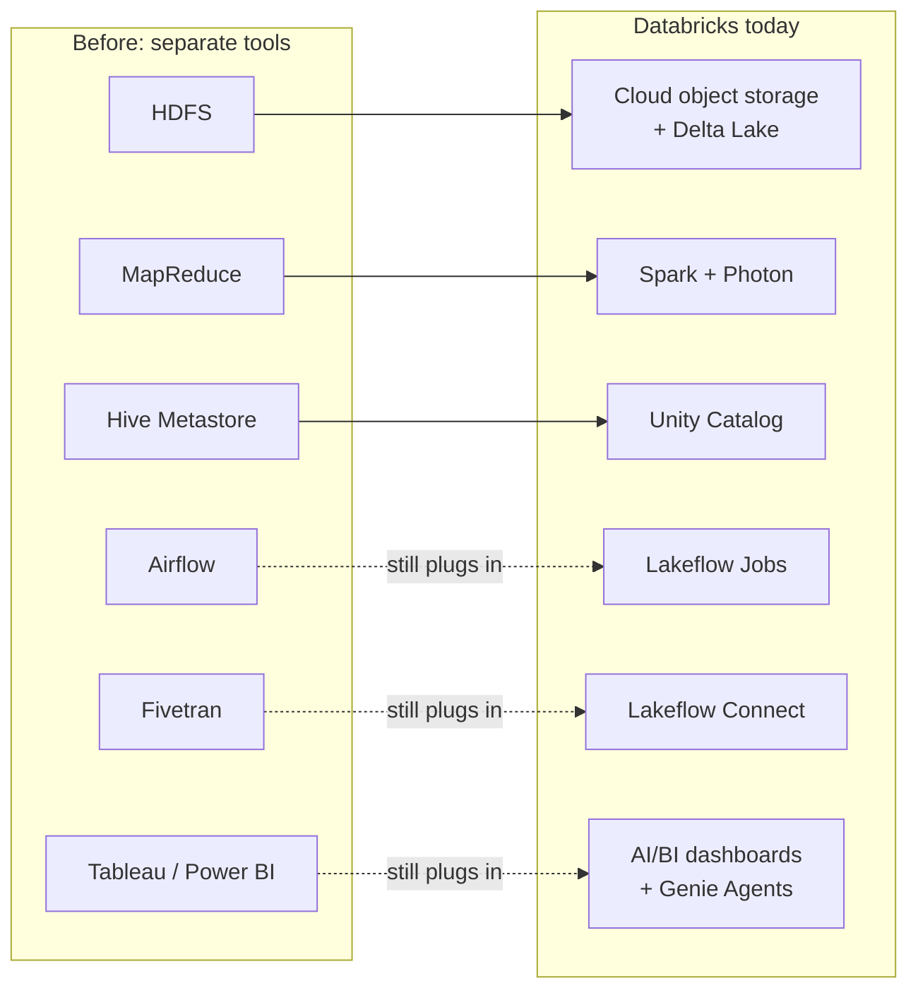

# Open Source vs Databricks - Who Replaced What

This page maps each open-source or legacy tool in the story to the Databricks feature that does its job today, and states whether the old tool still connects to Databricks.

> [!eli5] What this page is
> Before Databricks, a company needed many separate tools: one to store files, one to run jobs, one to schedule them, one for reports. This page lists each old tool, the part of Databricks that does the same job now, and whether you can keep using the old tool alongside Databricks.

## How to read the tables

| Column | Meaning |
|---|---|
| **Old tool** | The open-source project, product, or practice, linked to its history note. |
| **Job it did** | The problem it solved, in one line. |
| **Databricks today** | The feature that does that job on Databricks, linked to its note. |
| **Still plugs in?** | **Yes**: a documented integration exists. **Built in**: Databricks uses the tool itself. **No**: you migrate off it. |

"Replaced" does not always mean "removed". Several tools in this list, such as [[Apache Parquet]], [[Apache Spark]], and [[Delta Lake]], run inside Databricks. Others, such as [[Apache Kafka]] and [[dbt]], are partners rather than competitors.

Solid arrows mean the old tool is retired on Databricks. Dashed arrows mean the old tool still connects.

## The Hadoop stack

These tools came from [[Chapter 02 - The Big Data Era]]. The Databricks migration documentation states that most Hive workloads run with minimal refactoring, and that ETL written in other languages may need substantial refactoring.

| Old tool | Job it did | Databricks today | Still plugs in? |
|---|---|---|---|
| [[MapReduce]] | Batch processing across a cluster, writing to disk after every step | [[Apache Spark]] and [[Photon]], planned by the [[Catalyst Optimizer]] | **No.** Databricks does not run MapReduce jobs. Rewrite them as Spark SQL or [[PySpark]]. |
| [[HDFS]] | Distributed file storage on the cluster's own disks | Cloud [[Object Storage\|object storage]] ([[Amazon S3]], [[Azure Data Lake Storage]], [[Google Cloud Storage]]) holding [[Delta Lake]] tables and Unity Catalog [[Volumes]] | **No.** Data moves to object storage. Access is granted through [[Storage Credentials and External Locations]], not HDFS permissions. |
| [[YARN]] | Sharing a fixed pool of machines between jobs | The [[Control Plane and Compute Plane\|control plane]] provisions VMs per cluster, or you use [[Serverless Compute]]; limits come from [[Compute Policies]] | **No.** Databricks does not use YARN. |
| [[Apache Hive]] (SQL engine) | SQL over files in HDFS | [[Spark SQL]] and [[Databricks SQL]] on Photon | **Migrate.** HiveQL runs with minimal changes, such as `STORED AS` becoming `USING` and Hive SerDes becoming native formats. |
| [[Hive Metastore]] | The catalog of table names, schemas, and locations | [[Unity Catalog]] | **Yes.** The legacy `hive_metastore` catalog remains in many workspaces, and Hive metastore federation exposes a Hive metastore as a foreign catalog (read and write for a workspace's internal metastore, read-only for external ones). See [[Hive Metastore Migration to Unity Catalog]]. |
| AWS Glue Data Catalog | A Hive-compatible metastore on AWS | Unity Catalog | **Yes**, read-only, through [[Hive Metastore Federation for AWS Glue]]. |
| [[Apache HBase]] | Low-latency key-based reads and writes | No direct equivalent. Use [[Lakebase]] for application reads and writes, or [[Delta Lake]] with [[MERGE and Upserts\|MERGE]] for analytics | **No.** |
| Apache Oozie | Scheduling Hadoop job chains | [[Lakeflow Jobs]] | **No.** |
| Apache Sqoop and Apache Flume | Moving data from databases and logs into HDFS | [[Lakeflow Connect]] and [[Auto Loader]] | **No.** |
| [[Cloudera and Hortonworks]] distributions | A tested bundle of Hadoop projects that you install and run | [[Databricks Runtime]] versions, the workspace, and the [[Account Console]], run as a managed service | **Migrate.** See [[Migrating from Hadoop]] and [[Lakebridge]]. |
| [[Apache ORC]] | Columnar file format built for Hive | [[Delta Lake]], the recommended native format | **Yes.** Databricks reads and writes ORC with `read_files`, `spark.read.format("orc")`, and [[COPY INTO]]. |
| [[Apache Parquet]] | Columnar file format for any Hadoop engine | Parquet is the data-file format inside [[Delta Lake]] | **Built in.** Databricks also reads and writes plain Parquet files. |

## Spark and the engine

| Old tool | Job it did | Databricks today | Still plugs in? |
|---|---|---|---|
| Self-managed [[Apache Spark]] | Distributed processing on clusters you build and patch | [[Databricks Runtime]] (Spark plus tested libraries), [[Photon]], and [[Serverless Compute]] | **Built in.** Every Databricks cluster runs Spark. Databricks Runtime 18 LTS is built on Spark 4.1 and Runtime 19 on Spark 4.2. Photon exists only in Databricks. |
| [[MLlib]] | Distributed machine learning on Spark | MLlib, included in Databricks Runtime, with runs tracked in [[MLflow]] and models in [[Models in Unity Catalog]] | **Built in.** |
| Open-source [[MLflow]] | Tracking experiments and packaging models | Managed MLflow on Databricks | **Built in.** Managed and open-source MLflow are not identical; some GenAI evaluation features appeared first in managed MLflow. |
| Jupyter notebooks | Interactive code, results, and notes in one document | Databricks [[Notebooks]], created as `.ipynb` files by default since December 20, 2024 | **Yes.** Local IDEs connect through [[Databricks Connect]]. |
| pandas on one machine | In-memory tables in Python | The pandas API on Spark (`pyspark.pandas`), or plain pandas on the driver | **Built in.** See [[Python for Data]]. |

## The modern data stack

These tools came from [[Chapter 04 - The Modern Data Stack]]. Most of them still connect to Databricks.

| Old tool | Job it did | Databricks today | Still plugs in? |
|---|---|---|---|
| [[Apache Airflow]] | Scheduling multi-step workflows as Python DAGs | [[Lakeflow Jobs]] with [[Tasks Triggers and Schedules\|schedules and triggers]], defined as code with [[Declarative Automation Bundles]] | **Yes.** The Airflow Databricks provider runs jobs with `DatabricksRunNowOperator` and `DatabricksSubmitRunOperator`. |
| [[Apache Kafka]] | Moving event streams between systems | Not replaced. [[Structured Streaming on Databricks\|Structured Streaming]] and [[Streaming Tables]] read and write Kafka | **Yes.** Kafka stays the transport. Kafka Streams apps that only transform and route data can often be rewritten as Structured Streaming jobs. |
| [[dbt]] | SQL transformations declared as models, run in dependency order | [[Lakeflow Spark Declarative Pipelines]] with [[Materialized Views]], [[Streaming Tables]], and [[Expectations and Data Quality\|expectations]] | **Yes.** Use the `dbt-databricks` adapter, the dbt task or dbt platform task in Lakeflow Jobs, or [[Partner Connect]]. See [[dbt on Databricks]]. |
| [[Fivetran and ELT Tools\|Fivetran and other ELT tools]] | Managed connectors from SaaS apps and databases | [[Lakeflow Connect]] managed connectors; [[Auto Loader]] and [[COPY INTO]] for files | **Yes.** Fivetran is available through Partner Connect or as a manually configured destination. |
| [[Azure Data Factory with Databricks\|Azure Data Factory]] | Copy pipelines and orchestration on Azure | Lakeflow Jobs and Lakeflow Connect | **Yes.** The ADF Databricks Job activity runs an existing Lakeflow job. |
| [[BI Tools\|Tableau, Power BI, Looker]] | Dashboards and reports | [[AI-BI Dashboards]], [[Genie Agents]] for plain-English questions, and [[Metric Views]] for shared metric definitions | **Yes.** BI tools connect through [[SQL Warehouses]]. See [[Connecting Power BI]] and [[Connecting Tableau and Other BI Tools]]. |
| [[Spreadsheets]] and Excel | The master copy of the data and the pivot-table report | A [[Delta Lake]] table in [[Unity Catalog]], with AI/BI dashboards or Genie Agents for reporting | **Yes.** The built-in Excel reader (`read_files` with `format => 'excel'`) works on Databricks Runtime 17.1 and above. See [[Migrating from Excel and Access]]. |
| [[Data Lakes]] plus a separate [[Data Warehouses\|data warehouse]] | Two copies of the data, for ML and for BI ([[The Two-Tier Architecture Problem]]) | One lakehouse: [[Delta Lake]] tables governed by Unity Catalog ([[The Lakehouse Idea]]) | **Not applicable.** This is the architecture the lakehouse replaces. |

## Warehouses and databases

| Old tool | Job it did | Databricks today | Still plugs in? |
|---|---|---|---|
| [[Snowflake]] | Cloud data warehouse | [[Databricks SQL]] on [[SQL Warehouses]] over Delta or Iceberg tables. Data sharing maps to [[OpenSharing]], and the marketplace to [[Databricks Marketplace]] | **Yes.** [[Lakehouse Federation]] supports query federation (pushdown over JDBC) and catalog federation (reads Snowflake-managed Iceberg tables directly). See [[Migrating from Snowflake]]. |
| [[Amazon Redshift]] | Cloud data warehouse on AWS | Databricks SQL over Delta tables in your own S3 bucket | **Yes**, through query federation. See [[Migrating from Amazon Redshift]]. |
| [[Google BigQuery]] | Serverless data warehouse on Google Cloud | Databricks SQL on serverless SQL warehouses; partitioning and clustering map to [[Liquid Clustering]] | **Yes**, through query federation and the Spark BigQuery connector. See [[BigQuery Integration]]. |
| PostgreSQL and MySQL ([[Relational Databases]]) | Application databases (OLTP) | [[Lakebase]], a managed Postgres database, GA since January 22, 2026 | **Yes.** Lakehouse Federation queries them in place, and the Lakeflow Connect PostgreSQL and MySQL connectors are in Public Preview as of October 2026. See [[Migrating from Postgres and MySQL]]. |
| SQL Server | Application database and on-premises warehouse | Databricks SQL for analytics, Lakebase for OLTP | **Yes.** Lakeflow Connect has a managed SQL Server connector, and Lakehouse Federation queries it. See [[Migrating from SQL Server]]. |

## Open table formats

| Format | Job it does | On Databricks | Still plugs in? |
|---|---|---|---|
| [[Delta Lake]] | ACID transactions and time travel on Parquet files | The default table format | **Built in.** Open source and hosted by the [[Linux Foundation]]. |
| [[Apache Iceberg]] | The same job, with broad engine support | Unity Catalog managed and foreign Iceberg tables, and [[Delta UniForm]] for Iceberg reads of Delta tables | **Yes.** Managed Iceberg tables are GA as of October 2026. |
| [[Apache Hudi]] | Cheap upserts and incremental reads | Delta `MERGE` with [[Deletion Vectors]] and the [[Change Data Feed]] | **No.** Hudi is not a Unity Catalog table type on any cloud. |

## AI tooling

| Old practice | Job it did | Databricks today | Still plugs in? |
|---|---|---|---|
| A separate vector database | Finding documents by meaning for [[Retrieval-Augmented Generation\|RAG]] | [[AI Search]], with indexes synced from Delta tables and governed by Unity Catalog | **Not covered** in the vault. Before AI Search, teams copied chunks out of the lakehouse into a vector database and managed separate permissions. |
| Calling external LLM providers directly | Using hosted models from outside vendors | [[Unity Gateway]] model provider services, with permissions, rate limits, and usage logging | **Yes**, through Unity Gateway. External model endpoints on Model Serving are now a legacy approach. |

> [!confusion] Databricks is built on open source, not a replacement for all of it
> Spark, Delta Lake, MLflow, and Unity Catalog are open-source projects that Databricks created and runs as managed services. Parquet and Iceberg are formats Databricks reads and writes. What Databricks replaces is mostly the operational layer: the clusters, schedulers, catalogs, and glue code you used to run yourself.

## Next steps

- See when each tool appeared in [[Timeline of Data Engineering]].
- Plan a move off one of these tools with [[Migration Strategy Overview]] and [[Lakebridge]].
- Check current product names in [[Databricks Product Names and Renames]].

> [!sources]- Sources (last verified: 2026-10-25)
> Every row restates a fact from the linked note. These are the official sources those notes cite.
> - [Migrate data applications to Databricks (AWS)](https://docs.databricks.com/aws/en/migration/)
> - [Migrate ETL pipelines to Azure Databricks](https://learn.microsoft.com/en-us/azure/databricks/migration/etl)
> - [Hive metastore federation concepts (AWS)](https://docs.databricks.com/aws/en/query-federation/hms-federation-concepts)
> - [Enable Hive metastore federation for AWS Glue metastores (AWS)](https://docs.databricks.com/aws/en/query-federation/hms-federation-glue)
> - [Read and write ORC files (AWS)](https://docs.databricks.com/aws/en/query/formats/orc)
> - [Read and write Parquet files (AWS)](https://docs.databricks.com/aws/en/query/formats/parquet)
> - [What is Delta Lake in Databricks? (AWS)](https://docs.databricks.com/aws/en/delta)
> - [What is Photon? (Azure Databricks)](https://learn.microsoft.com/en-us/azure/databricks/compute/photon)
> - [Databricks Runtime release notes versions and compatibility (AWS)](https://docs.databricks.com/aws/en/release-notes/runtime/)
> - [MLflow on Databricks (AWS)](https://docs.databricks.com/aws/en/mlflow/)
> - [Manage Databricks notebook format (AWS)](https://docs.databricks.com/aws/en/notebooks/notebook-format)
> - [Pandas API on Spark (AWS)](https://docs.databricks.com/aws/en/pandas/pandas-on-spark)
> - [Orchestrate Lakeflow Jobs with Apache Airflow (AWS)](https://docs.databricks.com/aws/en/jobs/how-to/use-airflow-with-jobs)
> - [Connect to Apache Kafka (AWS)](https://docs.databricks.com/aws/en/connect/streaming/kafka/)
> - [dbt platform task for jobs (AWS)](https://docs.databricks.com/aws/en/jobs/tasks/dbt-platform)
> - [Connect to dbt Core (Azure Databricks)](https://learn.microsoft.com/en-us/azure/databricks/partners/prep/dbt)
> - [Connect to Fivetran (AWS)](https://docs.databricks.com/aws/en/partners/ingestion/fivetran)
> - [What is Lakeflow Connect? (AWS)](https://docs.databricks.com/aws/en/ingestion/overview)
> - [Transform data with Databricks Job (Azure Data Factory)](https://learn.microsoft.com/en-us/azure/data-factory/transform-data-databricks-job)
> - [Business intelligence tools (AWS)](https://docs.databricks.com/aws/en/ai-bi/tools)
> - [Power BI with Databricks (AWS)](https://docs.databricks.com/aws/en/partners/bi/power-bi/)
> - [Read and stream Excel files (AWS)](https://docs.databricks.com/aws/en/query/formats/excel)
> - [Connect to external databases and catalogs (AWS)](https://docs.databricks.com/aws/en/query-federation/)
> - [What is query federation? (AWS)](https://docs.databricks.com/aws/en/query-federation/database-federation)
> - [Run federated queries on Google BigQuery (AWS)](https://docs.databricks.com/aws/en/query-federation/bigquery)
> - [Configure PostgreSQL for ingestion into Databricks (AWS)](https://docs.databricks.com/aws/en/ingestion/lakeflow-connect/postgresql-source-setup)
> - [Databricks Lakebase is now Generally Available (Databricks blog)](https://www.databricks.com/blog/databricks-lakebase-generally-available)
> - [What is Apache Iceberg in Databricks? (AWS)](https://docs.databricks.com/aws/en/iceberg/)
> - [Unity Catalog managed tables for Delta Lake and Apache Iceberg (AWS)](https://docs.databricks.com/aws/en/tables/managed)
> - [Databricks AI Search (AWS)](https://docs.databricks.com/aws/en/ai-search/ai-search)
> - [Unity Gateway (AWS)](https://docs.databricks.com/aws/en/unity-gateway/)
