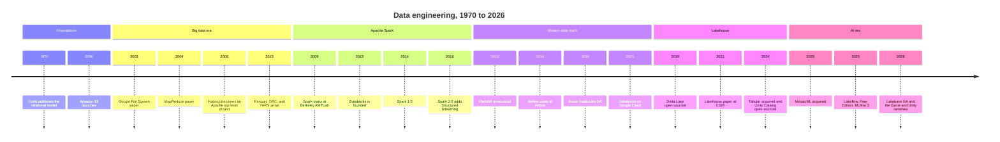

# Timeline of Data Engineering

This page lists the dated milestones in the vault, from the relational model in 1970 to the platform as of October 2026. Each entry links to the note that explains it and cites the note's sources.

> [!eli5] What this page is
> A list of important dates, oldest first. Each date points to the page that tells that part of the story. Reading top to bottom shows why each new tool appeared: the older tool could no longer keep up.

## How to read this page

- Eras follow the chapter order of the vault: [[Chapter 01 - Foundations|01]] to [[Chapter 05 - The Lakehouse|05]] cover the history before Databricks, and [[Chapter 06 - The Databricks Platform|06]] onward cover the platform.
- Eras overlap. Spark (2009) started before Hadoop's YARN shipped (2013), and the cloud warehouses arrived during the Hadoop years.
- A date appears here only if a written note in the vault states it. Where a note gives only a year or a month, this page does the same.
- Product names in the 2025 and 2026 rows change often. Check [[Databricks Product Names and Renames]] before you use a name.

## Overview

## Era 1: Foundations (1970 to 2006)

Data lives in tables, people query it with SQL, and a business runs on one database server. See [[Chapter 01 - Foundations]].

| Date | Milestone | Note |
|---|---|---|
| June 1970 | E. F. Codd publishes the relational model in Communications of the ACM. Tables relate through shared values, and users no longer need to know how data is laid out on disk. | [[Relational Databases]] |
| 2000 | Roy Fielding's doctoral dissertation describes the REST architectural style that most web APIs follow. | [[APIs]] |
| 2001 | The volume, velocity, and variety framing is generally attributed to analyst Doug Laney in a META Group research note. | [[The Three Vs of Big Data]] |
| October 2005 | RFC 4180 documents the common CSV format and registers the `text/csv` media type. It is informational, not a standard. | [[CSV and JSON]] |
| March 14, 2006 | AWS launches Amazon Simple Storage Service (S3), the service whose API other object stores follow. | [[Amazon S3]] |

## Era 2: The big data era (2003 to 2019)

Data outgrows a single machine, and the industry moves to clusters of commodity servers. See [[Chapter 02 - The Big Data Era]].

| Date | Milestone | Note |
|---|---|---|
| 2003 | Google publishes *The Google File System* at SOSP. | [[Google File System and MapReduce Papers]] |
| 2004 | Google publishes *MapReduce: Simplified Data Processing on Large Clusters* at OSDI. | [[MapReduce]] |
| January 2008 | Hadoop becomes an Apache top-level project, moving out from under Apache Lucene. | [[Apache Hadoop]] |
| 2008 onward | HBase is added as a Hadoop subproject and later becomes a top-level project. | [[Apache HBase]] |
| 2009 | The VLDB paper *Hive: A Warehousing Solution Over a Map-Reduce Framework* (Facebook) describes Hive and its metastore. | [[Apache Hive]], [[Hive Metastore]] |
| January 2013 | ORC files are created to speed up Apache Hive and reduce storage size in Hadoop. | [[Apache ORC]] |
| March 2013 | Twitter and Cloudera announce Parquet as a joint open-source columnar format. Parquet 1.0 follows in July 2013. | [[Apache Parquet]] |
| October 15, 2013 | YARN becomes generally available in Hadoop 2.2.0, which also adds HDFS high availability and federation. | [[YARN]], [[HDFS]] |
| April 2015 | ORC becomes an Apache top-level project. | [[Apache ORC]] |
| October 3, 2018 | Cloudera and Hortonworks announce an all-stock merger. It completes in January 2019 under the Cloudera name. | [[Cloudera and Hortonworks]] |
| 2025 | Microsoft retires HDInsight on AKS (January 31) and HDInsight 4.0 and 5.0 (March), which prompts migrations of managed Hadoop workloads. | [[The Pain of Hadoop]] |

## Era 3: Apache Spark (2009 to 2026)

Spark keeps intermediate data in memory and replaces disk-bound MapReduce. Its creators found Databricks. See [[Chapter 03 - Apache Spark]].

| Date | Milestone | Note |
|---|---|---|
| 2009 | Spark starts as a research project in the UC Berkeley AMPLab, led by Matei Zaharia. | [[AMPLab and the Birth of Spark]] |
| Early 2010 | Spark is released as open source. | [[AMPLab and the Birth of Spark]] |
| 2012 | The RDD paper appears at USENIX NSDI 2012 and wins Best Paper. | [[RDDs]] |
| June 2013 | Spark enters the Apache Incubator under the Apache 2.0 license. | [[AMPLab and the Birth of Spark]] |
| 2013 | Seven people from the AMPLab found Databricks in San Francisco to run Spark as a managed cloud service. | [[The Founding of Databricks]] |
| February 2014 | Spark graduates to an Apache top-level project. | [[Apache Spark]] |
| May 2014 | Apache Spark 1.0 is released. | [[AMPLab and the Birth of Spark]] |
| 2014 | The first Databricks product, "Databricks Cloud", offers hosted notebooks attached to Spark clusters on AWS. | [[The Founding of Databricks]], [[Notebooks]] |
| April 2015 | Databricks announces Project Tungsten to make Spark more efficient on CPU and memory. | [[Tungsten]] |
| 2015 | The SIGMOD paper *Spark SQL: Relational Data Processing in Spark* describes DataFrames and the Catalyst optimizer. | [[Spark SQL]], [[Catalyst Optimizer]] |
| 2016 | Spark 2.0 introduces Structured Streaming and whole-stage code generation. The RDD-based MLlib API enters maintenance mode. | [[Structured Streaming]], [[MLlib]] |
| 2016 | Ali Ghodsi becomes CEO of Databricks. | [[The Founding of Databricks]] |
| 2020 | Spark 3.0 introduces Adaptive Query Execution. | [[Adaptive Query Execution]] |
| December 16, 2025 | Spark 4.1.0 is released, adding Spark Declarative Pipelines and a real-time mode for Structured Streaming. | [[Apache Spark]] |
| July 14, 2026 | Spark 4.2.0 is released. Databricks Runtime 19, built on it, is GA on July 23, 2026. | [[Apache Spark]], [[Databricks Runtime]] |

## Era 4: The modern data stack (2010 to 2021)

Companies move to the cloud and run a data lake beside a cloud warehouse, with separate tools for ingestion, transformation, orchestration, and BI. See [[Chapter 04 - The Modern Data Stack]].

| Date | Milestone | Note |
|---|---|---|
| July 2011 | Kafka, created at LinkedIn, enters the Apache Incubator. It becomes a top-level project in October 2012. | [[Apache Kafka]] |
| November 2012 | AWS announces Amazon Redshift as a limited preview at re:Invent. It is generally available in February 2013. | [[Amazon Redshift]] |
| October 2014 | Maxime Beauchemin starts Airflow at Airbnb. It is announced publicly in June 2015, enters the Apache Incubator in March 2016, and becomes a top-level project in January 2019. | [[Apache Airflow]] |
| Around 2016 | dbt is created at the analytics consultancy that became dbt Labs. | [[dbt]] |
| November 2017 | Databricks announces Azure Databricks as a "first party" Microsoft service built with Microsoft. | [[First-Party Microsoft Service]] |
| March 22, 2018 | Azure Databricks becomes generally available. | [[Azure Databricks Overview]] |
| August 2019 | Databricks introduces DBU prepurchase for Azure Databricks. | [[Azure Billing and Commit Units]] |
| December 2020 | Amazon S3 delivers strong read-after-write consistency for all writes and listings. | [[Amazon S3]] |
| February 2021 | Databricks launches on Google Cloud, its third cloud. | [[Databricks on Google Cloud Overview]] |
| 2022 | Databricks introduces a pay-as-you-go offering in AWS Marketplace. | [[AWS Marketplace and Billing]] |

## Era 5: The lakehouse (2016 to 2026)

Open table formats add transactions to files in object storage, so one copy of the data can serve both BI and machine learning. See [[Chapter 05 - The Lakehouse]].

| Date | Milestone | Note |
|---|---|---|
| 2016 | Uber develops Hudi. It is open-sourced in 2017 and becomes an Apache top-level project on June 4, 2020. | [[Apache Hudi]] |
| June 5, 2018 | Databricks announces MLflow as an open-source alpha with Tracking, Projects, and Models. MLflow joins the Linux Foundation in 2020. | [[MLflow]] |
| 2019 | Databricks open-sources Delta Lake under the Apache 2.0 license. The Linux Foundation hosts the project from October 2019. | [[Delta Lake]] |
| January 2021 | Armbrust, Ghodsi, Xin, and Zaharia publish the lakehouse paper at CIDR 2021, naming the pattern. | [[The Lakehouse Paper]] |
| 2021 | Databricks introduces Delta Live Tables (DLT) for declarative pipelines. | [[Lakeflow Spark Declarative Pipelines]] |
| June 2022 | With Delta Lake 2.0, Databricks commits to open-sourcing all Delta Lake APIs and features. | [[Delta Lake]] |
| July 2022 | Photon, the C++ query engine, is announced as generally available. | [[Photon]] |
| June 2024 | Databricks acquires Tabular, founded by Apache Iceberg's original creators, with format compatibility as the stated goal. | [[Apache Iceberg]], [[Delta UniForm]] |
| June 2024 | Databricks open-sources Unity Catalog under Apache 2.0. The project is hosted by LF AI and Data. | [[Unity Catalog]] |
| November 11, 2024 | Predictive optimization is enabled by default for accounts created on or after this date. | [[OPTIMIZE and VACUUM]] |
| December 2024 | Apache Hudi 1.0 is announced. | [[Apache Hudi]] |
| 2026 | Databricks makes Iceberg v3 features generally available. By October 2026, Unity Catalog managed Iceberg tables are also GA. | [[Apache Iceberg]], [[Open Table Formats]] |
| September 2026 | Automatic change data feed, computed from row tracking, is generally available. | [[Change Data Feed]] |

## Era 6: Data intelligence and AI (2023 to 2025)

Databricks adds large language models, governed AI, and business-user tools on top of the lakehouse. See [[Chapter 06 - The Databricks Platform]] to [[Chapter 10 - AI and ML]].

| Date | Milestone | Note |
|---|---|---|
| June 2023 | Databricks signs a definitive agreement to acquire MosaicML. The acquisition completes on July 19, 2023. | [[MosaicML and Open Models]] |
| July 11, 2023 | Microsoft announces the rename of Azure Active Directory to Microsoft Entra ID, with rollout from August 15, 2023. | [[Microsoft Entra ID Integration]] |
| Late 2023 | Databricks introduces the name Data Intelligence Platform. | [[The Data Intelligence Platform]] |
| November 9, 2023 | Unity Catalog is enabled automatically for new Azure Databricks workspaces created after this date. | [[Metastore]], [[Azure Databricks Overview]] |
| March 2024 | Databricks releases DBRX, an open mixture-of-experts LLM. | [[MosaicML and Open Models]] |
| April 2024 | Lakeview dashboards, now AI/BI dashboards, become generally available. | [[AI-BI Dashboards]] |
| April 30, 2024 | Databricks on AWS GovCloud receives a FedRAMP High agency ATO. DoD IL5 provisional authorization follows in November 2024. | [[Databricks on AWS GovCloud]] |
| December 20, 2024 | New notebooks are created as `.ipynb` files by default. | [[Notebooks]] |
| March 2025 | Kafka 4.0 is released, the first major release that runs entirely without ZooKeeper. | [[Apache Kafka]] |
| April 10, 2025 | Official support for legacy Databricks SQL dashboards ends. | [[AI-BI Dashboards]] |
| June 2025 | DLT becomes Lakeflow Declarative Pipelines. Databricks donates the declarative pipeline framework to Apache Spark. | [[Lakeflow Spark Declarative Pipelines]], [[Lakeflow]] |
| June 2025 | MLflow 3 is released, adding tracing and evaluation for GenAI apps. | [[MLflow]], [[Agent Evaluation and Tracing]] |
| June 2025 | Databricks introduces Agent Bricks and announces Lakeflow Designer. | [[Agent Bricks]], [[Lakeflow Designer]] |
| June 11, 2025 | Databricks Free Edition is announced at Data + AI Summit and replaces Community Edition. | [[Databricks Free Edition and Trials]] |
| June 12, 2025 | Databricks announces Lakebridge for migrations, adding technology from BladeBridge. | [[Lakebridge]] |
| August 1, 2025 | Automatic identity management is on by default for new Azure Databricks accounts after this date. | [[Microsoft Entra ID Integration]], [[SCIM Provisioning]] |
| August 14, 2025 | The new SQL editor is generally available. | [[SQL Editor]] |
| October 1, 2025 | Standard tier workspaces on AWS and Google Cloud move to Premium. | [[How Databricks Pricing Works]] |
| October 13, 2025 | Fivetran and dbt Labs announce a merger. | [[dbt]], [[Fivetran and ELT Tools]] |
| November 2025 | Lakeflow Declarative Pipelines becomes Lakeflow Spark Declarative Pipelines. | [[Lakeflow Spark Declarative Pipelines]] |

## Era 7: 2026, consolidation and renames

Databricks makes Lakebase generally available, moves AI products under Unity Catalog, and renames many products. See [[Databricks Product Names and Renames]] for every name change.

| Date | Milestone | Note |
|---|---|---|
| January 22, 2026 | Lakebase Postgres becomes generally available, with autoscaling, scale-to-zero, and branching. | [[Lakebase]] |
| January 29, 2026 | Serverless workspaces become generally available on AWS. | [[Account Setup on AWS]], [[Databricks on AWS Overview]] |
| March 11, 2026 | Databricks Assistant is renamed Genie Code. | [[Genie Code]] |
| March 16, 2026 | Databricks Asset Bundles are renamed Declarative Automation Bundles. | [[Declarative Automation Bundles]] |
| March 2026 | AI Runtime, which includes serverless GPU compute, enters preview. | [[AI Runtime]] |
| April 1, 2026 | New Azure Databricks workspaces must use the Premium tier. | [[Azure Databricks Overview]] |
| April 2026 | Databricks One is renamed Genie. | [[Genie One]] |
| April 15, 2026 | Databricks announces that AI Gateway is now Unity Gateway, part of Unity Catalog. | [[Unity Gateway]] |
| June 1, 2026 | Vector Search is renamed Databricks AI Search. Fivetran and dbt Labs complete their merger. | [[AI Search]], [[Fivetran and ELT Tools]] |
| June 10, 2026 | Delta Sharing is renamed OpenSharing and hosted by the Linux Foundation. | [[OpenSharing]] |
| June 2026 | Genie is renamed Genie One. | [[Genie One]] |
| July 2, 2026 | Genie Agents are generally available. On July 8, 2026, Genie spaces are renamed Genie Agents. | [[Genie Agents]] |
| July 2026 | Lakebase Provisioned instances are upgraded to Autoscaling. | [[Lakebase]] |
| August 4, 2026 | Unity Gateway becomes generally available. | [[Unity Gateway]] |
| September 3, 2026 | Serverless environment version 6 is released with Python 3.12.3 and Databricks Connect 19. | [[Serverless Compute]] |
| September 30, 2026 | The Agent Bricks Supervisor API reaches end of life. | [[Agent Bricks]] |
| October 1, 2026 | Remaining Azure Standard tier workspaces are scheduled for automatic upgrade to Premium. | [[Azure Databricks Overview]] |
| October 12, 2026 | Knowledge Assistant and Supervisor Agent become legacy. Agent Bricks refocuses on code-first agents with the Agent Bricks CLI and Agent Runtime. | [[Agent Bricks]], [[Mosaic AI Agent Framework]] |
| October 15, 2026 | The ADBC driver for Power BI on Azure Databricks is generally available. | [[Power BI on Azure Databricks]] |

> [!confusion] A product's announcement date, preview date, and GA date differ
> Databricks often announces a product at Data + AI Summit in June, releases it to Public Preview later, and makes it generally available months after that. Lakeflow Designer, for example, was announced in June 2025 and reached Public Preview in April 2026. This page uses the event the note describes. Check the note before you plan around a status.

## Next steps

- Read the story in order from [[start_here]].
- See which Databricks feature took over each tool in [[Open Source vs Databricks - Who Replaced What]].
- Check the current name of any product in [[Databricks Product Names and Renames]].

> [!sources]- Sources (last verified: 2026-10-25)
> Every row restates a fact from the linked note. These are the primary sources those notes cite.
> - [E. F. Codd, "A Relational Model of Data for Large Shared Data Banks", Communications of the ACM, June 1970 (PDF)](https://web.eecs.umich.edu/~michjc/eecs584/Papers/codd_1970.pdf)
> - [The Google File System (SOSP 2003 proceedings copy)](https://www.cs.rochester.edu/meetings/sosp2003/papers/p125-ghemawat.pdf)
> - [MapReduce: Simplified Data Processing on Large Clusters (OSDI 2004), Google Research](https://research.google/pubs/pub62/?hl=es)
> - [Hadoop tour, ApacheCon Europe 2008 (Tom White, Apache wiki)](https://cwiki-test.apache.org/confluence/download/attachments/120729986/ApacheConEU2008HadoopTourTomWhite.pdf?api=v2)
> - [Release 2.2.0 available (Apache Hadoop)](https://hadoop.apache.org/release/2.2.0.html)
> - [Hive: A Warehousing Solution Over a Map-Reduce Framework (VLDB 2009)](https://www.vldb.org/pvldb/vol2/vldb09-938.pdf)
> - [Announcing Parquet 1.0: columnar storage for Hadoop (Twitter Engineering)](https://blog.twitter.com/2013/announcing-parquet-10-columnar-storage-for-hadoop)
> - [ORC becomes an Apache Top Level Project (Apache ORC)](https://orc.apache.org/news/2015/04/22/orc-as-tlp/)
> - [Cloudera and Hortonworks merger announcement (SEC Form 425, Exhibit 99.1)](https://www.sec.gov/Archives/edgar/data/0001610532/000162828018012255/cldr8-k10318ex991.htm)
> - [Apache Spark history](https://spark.apache.org/history.html)
> - [The ASF announces Apache Spark v1.0](https://news.apache.org/foundation/entry/the_apache_software_foundation_announces57)
> - [Spark SQL: Relational Data Processing in Spark (SIGMOD 2015)](https://people.csail.mit.edu/matei/papers/2015/sigmod_spark_sql.pdf)
> - [Spark Release 4.1.0](https://spark.apache.org/releases/spark-release-4.1.0.html)
> - [Spark Release 4.2.0](https://spark.apache.org/releases/spark-release-4-2-0.html)
> - [Kafka incubation status (Apache Incubator)](https://incubator.apache.org/projects/kafka.html)
> - [Apache Kafka 4.0.0 release announcement (kafka.apache.org)](https://kafka.apache.org/blog/2025/03/18/apache-kafka-4.0.0-release-announcement/)
> - [Airflow project history (airflow.apache.org)](https://airflow.apache.org/docs/apache-airflow/1.10.14/project.html)
> - [Amazon Redshift: ten years of continuous reinvention (Amazon Science)](https://amazon.science/latest-news/amazon-redshift-ten-years-of-continuous-reinvention)
> - [Amazon S3 now delivers strong read-after-write consistency (AWS, December 2020)](https://aws.amazon.com/about-aws/whats-new/2020/12/amazon-s3-now-delivers-strong-read-after-write-consistency-automatically-for-all-applications/)
> - [Introducing Azure Databricks (Databricks blog, November 2017)](https://www.databricks.com/blog/2017/11/15/introducing-azure-databricks.html)
> - [Announcing the launch of Databricks on Google Cloud (Databricks blog, 2021)](https://www.databricks.com/blog/2021/02/17/announcing-the-launch-of-databricks-on-google-cloud.html)
> - [Introducing MLflow (Databricks blog, 2018)](https://www.databricks.com/blog/2018/06/05/introducing-mlflow-an-open-source-machine-learning-platform.html)
> - [Delta Lake now hosted by the Linux Foundation (Databricks blog, October 2019)](https://www.databricks.com/blog/2019/10/16/delta-lake-now-hosted-by-the-linux-foundation-to-become-the-open-standard-for-data-lakes.html)
> - [Delta Lake 2.0: open-sourcing all of Delta Lake (Databricks blog)](https://www.databricks.com/blog/2022/06/30/open-sourcing-all-of-delta-lake.html)
> - [Lakehouse paper (PDF, Databricks)](https://www.databricks.com/wp-content/uploads/2020/12/cidr_lakehouse.pdf)
> - [July 2022 platform release notes](https://docs.databricks.com/release-notes/product/2022/july.html)
> - [Databricks agrees to acquire Tabular (press release)](https://www.databricks.com/company/newsroom/press-releases/databricks-agrees-acquire-tabular-company-founded-original-creators)
> - [Announcing Apache Hudi 1.0 (hudi.apache.org)](https://hudi.apache.org/blog/2024/12/16/announcing-hudi-1-0-0/)
> - [Databricks completes acquisition of MosaicML (press release)](https://www.databricks.com/company/newsroom/press-releases/databricks-completes-acquisition-mosaicml)
> - [Databricks launches Free Edition (press release, June 2025)](https://www.databricks.com/company/newsroom/press-releases/databricks-launches-free-edition-and-announces-100-million)
> - [Introducing Lakebridge (Databricks blog)](https://www.databricks.com/blog/introducing-lakebridge-free-open-data-migration-databricks-sql)
> - [What happened to Delta Live Tables (DLT)? (AWS)](https://docs.databricks.com/aws/en/ldp/concepts/where-is-dlt)
> - [Databricks donates Declarative Pipelines to Apache Spark (press release)](https://www.databricks.com/company/newsroom/press-releases/databricks-donates-declarative-pipelines-apache-sparktm-open-source)
> - [Databricks Lakebase is now Generally Available (Databricks blog)](https://www.databricks.com/blog/databricks-lakebase-generally-available)
> - [January 2026 release notes (AWS)](https://docs.databricks.com/aws/en/release-notes/product/2026/january)
> - [March 2026 release notes (AWS)](https://docs.databricks.com/aws/en/release-notes/product/2026/march)
> - [June 2026 release notes (AWS)](https://docs.databricks.com/aws/en/release-notes/product/2026/june)
> - [July 2026 release notes (AWS)](https://docs.databricks.com/aws/en/release-notes/product/2026/july)
> - [October 2026 release notes (AWS)](https://docs.databricks.com/aws/en/release-notes/product/2026/october)
> - [End of life for Standard tier workspaces (Azure Databricks)](https://learn.microsoft.com/en-us/azure/databricks/admin/account-settings/standard-tier)
> - [Unity Gateway release notes (AWS)](https://docs.databricks.com/aws/en/release-notes/unity-gateway/)
> - [Databricks announces OpenSharing (press release, June 2026)](https://www.databricks.com/company/newsroom/press-releases/databricks-announces-opensharing)
> - [Fivetran + dbt Labs complete merger (dbt Labs)](https://www.getdbt.com/blog/fivetran-dbt-labs-complete-merger-to-create-the-data-infrastructure-for-trusted-ai-agents)
