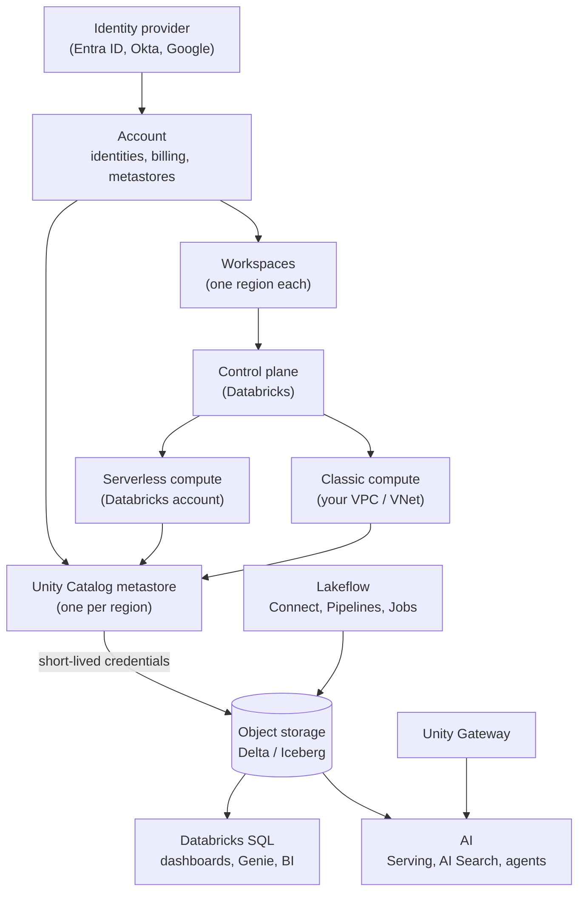

# Databricks Primer for Agents

This page is a dense briefing on the current Databricks platform (October 2026), compiled only from written notes in this vault, with a wiki link after each fact so an agent can drill into the source note.

## 1. How to use this primer

- Load this page first, then drill in with `python3 scripts/brain.py context "<question>"`, `note "<Title>"`, `resolve "<old name>"`, or `cloud "<Title>"` (add `--json` for machine output).
- Follow the navigation and editing rules in `AGENTS.md`; treat a linked note's `last_verified` date and its `[!sources]` callout as the authority, not this summary.
- Re-check anything in [[#9. Status watchlist]] against official docs before relying on it, because Databricks renames and promotes features often ([[Databricks Product Names and Renames]]).

## 2. Current names

Use the left column in all output. Translate anything in the middle column. API paths, CLI commands, and packages often keep old wording (see the second table).

| Current name | Old names to translate | Since |
|---|---|---|
| Genie Code | Databricks Assistant, Databricks AI Assistant | March 11, 2026 ([[Genie Code]]) |
| Declarative Automation Bundles | Databricks Asset Bundles (DABs) | March 16, 2026 ([[Declarative Automation Bundles]]) |
| Genie One | Databricks One, then Genie | Genie: April 2026; Genie One: June 2026 ([[Genie One]]) |
| Genie Agents | Genie spaces, AI/BI Genie | July 2026 ([[Genie Agents]]) |
| Unity Gateway | AI Gateway, Mosaic AI Gateway; interim Unity AI Gateway | Announced April 15, 2026; GA August 4, 2026 ([[Unity Gateway]]) |
| Databricks AI Search | Mosaic AI Vector Search, Databricks Vector Search | June 1, 2026 ([[AI Search]]) |
| OpenSharing | Delta Sharing | Announced June 10, 2026 ([[OpenSharing]]) |
| AI Runtime | Serverless GPU compute | Public Preview from March 19, 2026; rename date not published ([[AI Runtime]]) |
| Lakeflow Spark Declarative Pipelines (short: Lakeflow pipelines) | Delta Live Tables (DLT), then Lakeflow Declarative Pipelines | June 2025, then November 2025 ([[Lakeflow Spark Declarative Pipelines]]) |
| AUTO CDC (`AUTO CDC INTO`, `create_auto_cdc_flow()`) | APPLY CHANGES (`APPLY CHANGES INTO`, `apply_changes()`) | June 11, 2025 ([[Change Data Capture]]) |
| Lakeflow Jobs | Databricks Workflows, Databricks Jobs | June 11, 2025 ([[Lakeflow Jobs]]) |
| AI/BI dashboards (UI: Dashboards) | Lakeview dashboards | April 18, 2024 ([[AI-BI Dashboards]]) |
| Databricks Data + AI Platform | Data Intelligence Platform, Lakehouse Platform | Date not published ([[The Data Intelligence Platform]]) |
| Data quality monitoring (data profiling, anomaly detection) | Lakehouse Monitoring | Date not published ([[Data Quality Monitoring]]) |
| MLflow 3 GenAI evaluation, production monitoring | Mosaic AI Agent Evaluation; Lakehouse Monitoring for GenAI | MLflow 3 GA on Databricks June 10, 2025 ([[Agent Evaluation and Tracing]]) |
| Supervisor Agent (now legacy) | Multi-Agent Supervisor | February 5, 2026 ([[Agent Bricks]]) |
| Databricks Free Edition | Community Edition (replaced, retired 2025) | June 11, 2025 ([[Databricks Free Edition and Trials]]) |
| Lakebridge | Remorph (Labs project) | June 12, 2025 ([[Lakebridge]]) |
| Compute policies | Cluster policies | Date not published ([[Compute Policies]]) |
| Serverless usage policies | Budget policies, serverless budget policies | Date not published ([[Tagging for Chargeback]]) |
| Git folders | Repos, Databricks Repos | March 21, 2024 ([[Git Folders and Workspace Files]]) |
| SQL warehouses | SQL endpoints | June 23, 2022 ([[SQL Warehouses]]) |
| Compute plane | Data plane | Date not published ([[Control Plane and Compute Plane]]) |
| Standard / Dedicated access mode | Shared / Single user (API values `USER_ISOLATION` / `SINGLE_USER` unchanged) | Date not published ([[Compute Types]]) |
| Disk cache | Delta cache, DBIO cache | Date not published ([[Query Performance and Caching]]) |
| pandas API on Spark (`pyspark.pandas`) | Koalas | Spark 3.2.0, October 13, 2021 ([[Pandas API on Spark]]) |
| Models in Unity Catalog (aliases) | Workspace Model Registry (stages) | GA October 17, 2023 ([[Models in Unity Catalog]]) |
| Agent Runtime with `DurableAgentServer` | MLflow AgentServer, LongRunningAgentServer, agents on Model Serving (legacy) | October 2026 ([[Mosaic AI Agent Framework]]) |
| Unity Gateway model provider services | External model endpoints on Model Serving (legacy) | July 17, 2026 ([[Unity Gateway]]) |
| Databricks CLI 0.205+ (now 1.x) | Legacy CLI 0.18 and below | GA May 21, 2026 ([[Databricks CLI]]) |
| Microsoft Entra ID | Azure Active Directory, Azure AD, AAD | 2023 ([[Microsoft Entra ID Integration]]) |
| Azure Data Lake Storage | ADLS Gen2 | Date not published ([[Azure Data Lake Storage]]) |
| dbt platform | dbt Cloud | May 28, 2025 ([[dbt on Databricks]]) |

Where old names survive ([[Databricks Product Names and Renames]]):

| Product | Old wording still in use |
|---|---|
| Bundles | `databricks bundle`, `databricks.yml` |
| Pipelines | `import dlt` still runs; new code uses `from pyspark import pipelines as dp` |
| Jobs | `jobs` resource in bundles and API; system tables moved from `workflow` to `lakeflow` schema |
| Git folders | `/api/2.0/repos`, `databricks repos` |
| Dashboards | `/api/2.0/lakeview/dashboards` |
| AI Search | SQL `vector_search()`, `/vector-search/` URLs, REST path; Python SDK is `AISearchClient` |
| Unity Gateway | `ai-gateway` in doc URLs and the base URL `/ai-gateway/mlflow/v1` |
| Compute policies | Terraform `databricks_cluster_policy` |
| Lakebridge | `databricks-labs-remorph` package |
| UniForm | Table properties still say `universalFormat` ([[Delta UniForm]]) |

The three Genie products are distinct: Genie Code writes code for builders, Genie Agents answer business questions over curated data, Genie One is the business-user home ([[Genie One]]).

## 3. Platform map

| Layer | One line | Source |
|---|---|---|
| Account | Owns identities, Unity Catalog metastores, billing, network and encryption configs, workspace creation; one per company per cloud | [[Accounts and Workspaces]] |
| Workspace | One region; holds notebooks, Git folders, compute, jobs, pipelines, warehouses, dashboards, secrets; data is not stored in it | [[Accounts and Workspaces]] |
| Control plane | Databricks-run web app, scheduler, APIs, Unity Catalog service; does not process data | [[Control Plane and Compute Plane]] |
| Unity Catalog | Account-level governance: one metastore per region, `catalog.schema.object`, grants, lineage, audit, sharing | [[Unity Catalog]], [[Metastore]] |
| Compute | Serverless (Databricks account) or classic (your cloud account): all-purpose, jobs, SQL warehouses, Model Serving, Apps, Lakebase | [[Compute Types]] |
| Storage | Your object storage (S3, ADLS, GCS) or Databricks-managed default storage; Delta Lake by default, managed Iceberg supported | [[Delta Lake]], [[Serverless Workspaces and Default Storage]] |
| Lakeflow | Connect (ingest), Spark Declarative Pipelines (transform), Jobs (orchestrate), Designer (no-code) | [[Lakeflow]] |
| SQL and BI | Databricks SQL, SQL warehouses, AI/BI dashboards, Genie Agents, metric views, alerts, Power BI and other BI tools | [[Databricks SQL]] |
| Apps and OLTP | Databricks Apps (serverless web apps) and Lakebase (managed Postgres) | [[Databricks Apps]], [[Lakebase]] |
| AI | MLflow, Models in UC, Model Serving, Foundation Model APIs, Unity Gateway, AI Search, Agent Bricks, managed MCP, AI Functions | [[Chapter 10 - AI and ML]] |



Sources for the diagram: [[Accounts and Workspaces]], [[Control Plane and Compute Plane]], [[Unity Catalog]], [[Lakeflow]].

## 4. Decision guides

### Which compute

Databricks guidance: use serverless wherever available, classic only when serverless lacks something ([[Compute Types]]).

| Workload | Default choice | Switch when | Source |
|---|---|---|---|
| Notebook exploration | Serverless notebooks | Need R, Scala notebooks, RDDs, GPUs, init scripts, Maven, VPC peering, or your network: all-purpose (classic) | [[Serverless Compute]], [[All-Purpose Compute]] |
| Scheduled job or pipeline | Serverless jobs/pipelines; standard performance mode for batch that tolerates 4 to 6 minute start | Init scripts, specific VM type, GPUs, private network, or long steady spot work: jobs compute | [[Serverless Compute]], [[Jobs Compute]] |
| SQL, dashboards, BI | Serverless SQL warehouse | Serverless unavailable in region or compute must sit in your VPC: pro warehouse | [[SQL Warehouses]] |
| Deep learning, fine-tuning | AI Runtime (serverless GPU, A10/H100) | Specific instance type or classic features: classic GPU cluster on DBR ML | [[AI Runtime]] |
| Production jobs on all-purpose | Never: higher rate, shared, unstable | Development only (`existing_cluster_id`) | [[Jobs Compute]] |

Access mode on classic compute ([[Compute Types]], [[Lakeguard]]):

| Mode | API value | Use |
|---|---|---|
| Standard (recommended) | `USER_ISOLATION` | Multi-user, Lakeguard-isolated; Python, SQL, Scala; no RDDs, no `sc`/`sparkContext` |
| Dedicated | `SINGLE_USER` | One user or one group; R, RDD APIs, ML on GPUs; fine-grained controls delegated to serverless |
| Auto (default) | `DATA_SECURITY_MODE_AUTO` | Picks Standard unless ML runtime, GPU, or runtime below 14.3, then Dedicated |
| No isolation shared, credential passthrough | | Legacy; not Unity Catalog compatible |

- Size controls single-query speed; cluster count controls concurrency on a warehouse ([[SQL Warehouses]]).
- Set `data_security_mode` explicitly on job clusters; otherwise the workspace default for jobs applies ([[Jobs Compute]]).
- Serverless always enforces Unity Catalog; code that bypasses UC must change first ([[Lakeguard]]).

### How to ingest

| Source | Use | Notes | Source |
|---|---|---|---|
| SaaS app with a GA managed connector (Salesforce, Workday Reports, ServiceNow, GA4 raw, SharePoint) | Lakeflow Connect | Writes streaming tables; UC connection holds credentials | [[Lakeflow Connect]] |
| SQL Server, MySQL, Postgres, Oracle | Lakeflow Connect database connector (CDC via ingestion gateway on classic compute, or integrated CDC for SQL Server and MySQL) | Gateway runs continuously and bills while idle | [[Lakeflow Connect]] |
| Database with a reliable cursor column | Query-based connector (GA May 2026) | Misses updates that do not change the cursor | [[Lakeflow Connect]] |
| Files landing in storage or a volume, at scale | Auto Loader (`cloudFiles`) or `STREAM read_files` in a streaming table | Exactly-once via checkpoint; schema evolution; prefer file events | [[Auto Loader]] |
| Files, thousands, analyst-run SQL | `COPY INTO` | Idempotent per file; does not deduplicate rows | [[COPY INTO]] |
| Kafka, Kinesis, Event Hubs, Pub/Sub | Streaming table (`read_kafka`, `read_kinesis`, `read_pubsub`) or Structured Streaming | Event Hubs through the Kafka connector | [[Streaming Tables]], [[Structured Streaming on Databricks]] |
| Database queried occasionally, or day-one access | Lakehouse Federation (foreign catalog) | Read-only; every query hits the source | [[Lakehouse Federation]] |
| Other Databricks account | OpenSharing (D2D) | Better than federating over JDBC | [[OpenSharing]] |
| One-off CSV or Excel | **New > Add or upload data** > Create or modify a table | Upload location is cleaned daily; keep originals in a volume | [[Migrating from Excel and Access]] |
| No connector (for example QuickBooks) | Scheduled export to a volume plus Auto Loader, or a Partner Connect tool | | [[Lakeflow Connect]] |

- Connect copies on a schedule; Federation queries live ([[Lakeflow Connect]]). Partner Connect is third-party setup, not Lakeflow Connect ([[Lakeflow Connect]]).
- A file arrival trigger only starts a job; Auto Loader does the exactly-once load ([[Tasks Triggers and Schedules]]).

### How to transform and orchestrate

| Need | Use | Source |
|---|---|---|
| Declare bronze to gold tables, incremental, retries, lineage, quality | Lakeflow Spark Declarative Pipelines (SQL first) | [[Lakeflow Spark Declarative Pipelines]] |
| Append-only ingestion layers | Streaming tables | [[Streaming Tables]] |
| Joins and aggregates that reflect source changes | Materialized views (incremental only on serverless) | [[Materialized Views]] |
| Apply CDC or SCD type 1/2 | AUTO CDC flow (pipelines only, not open-source SDP) | [[Change Data Capture]] |
| Schedule, chain, branch, loop any task type | Lakeflow Jobs (a pipeline task runs a pipeline update) | [[Lakeflow Jobs]], [[Tasks Triggers and Schedules]] |
| Existing dbt project | dbt task in a job; SQL runs on a SQL warehouse or all-purpose compute, never job compute | [[dbt on Databricks]] |
| No-code analyst prep | Lakeflow Designer (GA June 16, 2026) | [[Lakeflow Designer]] |
| Cross-system orchestration (many non-Databricks systems) | Airflow or ADF on top, Lakeflow Jobs inside | [[Lakeflow Jobs]] |
| Deploy as code across dev and prod | Declarative Automation Bundles; Terraform for platform resources | [[Declarative Automation Bundles]] |

- Common split: pipelines for bronze and silver, dbt for gold business models ([[dbt on Databricks]]).
- Jobs are procedural, pipelines are declarative; most production setups use a job that runs pipelines ([[Lakeflow]]).
- Run production jobs as a service principal (`run_as`) ([[Users Groups and Service Principals]]).

### Table design

| Decision | Default | Exception | Source |
|---|---|---|---|
| Managed or external | Managed (Delta or Iceberg); UC picks path, predictive optimization applies, `UNDROP` works | External only when another system writes by path, or during migration; convert later with `ALTER TABLE ... SET MANAGED` | [[Managed vs External Tables]] |
| Layout | `CLUSTER BY AUTO` on every new managed table | Explicit `CLUSTER BY (cols)` for stable known filters; partitioning only on legacy tables (`REPLACE PARTITIONED BY WITH CLUSTER BY AUTO`) | [[Liquid Clustering]] |
| Maintenance | Predictive optimization (OPTIMIZE, VACUUM, ANALYZE on serverless); remove scheduled maintenance jobs for covered tables | External tables need manual `OPTIMIZE`/`VACUUM` | [[Predictive Optimization]], [[OPTIMIZE and VACUUM]] |
| Format | Delta | Managed Iceberg when external engines must write; UniForm (Iceberg reads) when Databricks is the only writer | [[Apache Iceberg]], [[Delta UniForm]] |
| Deletion vectors | Workspace default | Disable for tables read by clients without DV support; `IcebergCompatV2` cannot coexist with DVs (use Iceberg v3) | [[Deletion Vectors]] |
| Semi-structured data | `VARIANT` (GA July 22, 2026) | | [[VARIANT Data Type]] |
| Managed storage location | Per catalog (`MANAGED LOCATION`); schema overrides catalog overrides metastore | Leave metastore-level storage unset | [[Metastore]], [[Managed vs External Tables]] |
| MV source tables | Enable deletion vectors, row tracking, change data feed | | [[Materialized Views]] |

### Governance

| Need | Use | Source |
|---|---|---|
| Who can read or write | `GRANT`/`REVOKE` to groups; need `USE CATALOG` + `USE SCHEMA` + data privilege | [[Privileges and Grants]] |
| Discovery without data | `BROWSE` on catalogs to `account users` | [[Privileges and Grants]] |
| Delegate admin of a schema without ownership | `MANAGE` | [[Privileges and Grants]] |
| One-off row or column rule on a table | Row filter / column mask UDF via `ALTER TABLE` | [[Row Filters and Column Masks]] |
| Same rule across many tables, not overridable by owners | ABAC policy on catalog or schema, driven by governed tags | [[Attribute-Based Access Control]] |
| Controlled tag values and assignment | Governed tags (GA); `ASSIGN` permission | [[Governed Tags]] |
| Find and tag PII automatically | Data Classification (GA) | [[Data Classification]] |
| Raw file access | `READ FILES` on an external location; bypasses filters, grant narrowly | [[Storage Credentials and External Locations]] |
| Restrict a catalog to certain workspaces | Workspace-catalog binding | [[Unity Catalog]] |
| External engines | `EXTERNAL USE SCHEMA` (Public Preview) plus Iceberg REST catalog | [[Managed vs External Tables]] |
| Credentials for code | Secret scopes, or Unity Catalog secrets | [[Secrets Management]] |
| Non-storage cloud services | Service credentials | [[Service Credentials]] |

- Grant on storage credentials only `CREATE EXTERNAL LOCATION`; grant everything else on external locations ([[Storage Credentials and External Locations]]).
- Views run as the owner, so readers need no grant on base tables ([[Privileges and Grants]]).
- No classic `DENY`; ABAC DENY policies are Beta ([[Privileges and Grants]]).

### Serving and AI

| Need | Use | Source |
|---|---|---|
| Real-time predictions from your model | Model Serving custom endpoint from a UC model; batch scoring belongs in a job or `ai_query` | [[Model Serving]] |
| Hosted LLMs, prototyping, batch | Foundation Model APIs pay-per-token (`databricks-*` endpoints) | [[Foundation Model APIs]] |
| Guaranteed LLM throughput | Provisioned throughput (model units) | [[Foundation Model APIs]] |
| External providers (OpenAI, Anthropic, Bedrock, Azure AI Foundry) | Unity Gateway model provider services | [[Unity Gateway]] |
| Rate limits, guardrails, logging, spend for all model and MCP calls | Unity Gateway (GA August 4, 2026) | [[Unity Gateway]] |
| LLM over table rows in SQL | Task-specific AI Functions first, `ai_query` otherwise | [[AI Functions in SQL]] |
| Semantic retrieval for RAG | AI Search Delta Sync index (Standard endpoint for low latency) | [[AI Search]], [[Retrieval-Augmented Generation]] |
| No-code data Q&A agent | Genie Agents | [[Agent Bricks]] |
| Code-first agent | Agent Bricks CLI (Beta) deploying to Agent Runtime on Databricks Apps | [[Agent Bricks]] |
| Agent tools over governed data | Managed MCP servers; prefer `system.ai` MCPs through Unity Gateway | [[Managed MCP Servers]] |
| Evaluate and trace | MLflow 3 `mlflow.genai.evaluate`, LLM judges, Review App | [[Agent Evaluation and Tracing]] |
| Model registry | Models in UC with aliases (`@Champion`) | [[Models in Unity Catalog]] |
| Online features | Feature Views (Public Preview) and Lakebase-backed online stores | [[Feature Engineering and Feature Store]] |
| App state, forms | Lakebase Postgres; synced tables for lookups | [[Lakebase]] |

### BI

| Need | Use | Source |
|---|---|---|
| Native dashboards, no BI license | AI/BI dashboards on a SQL warehouse; shared or individual data permissions | [[AI-BI Dashboards]] |
| Plain-English questions | Genie Agents over 5 to 10 gold tables or metric views | [[Genie Agents]] |
| Business-user home | Genie One with Consumer access entitlement | [[Genie One]] |
| One KPI definition for every tool | Metric views (`MEASURE()`) | [[Metric Views]] |
| Existing Power BI | Databricks / Azure Databricks connector, DirectQuery on a small serverless warehouse; ADBC driver | [[Connecting Power BI]] |
| Per-viewer security in Power BI | DirectQuery with SSO enabled in data source credentials | [[Power BI on Azure Databricks]] |
| Generate semantic model | Publish to Power BI from Catalog Explorer (Premium, PPU, or Fabric capacity, XMLA Read Write) | [[Connecting Power BI]] |
| Tableau, Looker, Sigma, Excel | JDBC/ODBC to SQL warehouses | [[Connecting Tableau and Other BI Tools]] |
| Threshold notification | SQL alerts (GA May 14, 2026) | [[SQL Alerts]] |

### Cloud choice

| If | Then | Source |
|---|---|---|
| Already paying a cloud provider | Use that cloud | [[Choosing a Cloud for Databricks]] |
| Microsoft 365, Power BI, SQL Server | Azure Databricks (first-party, one Azure invoice, Entra ID built in) | [[Choosing a Cloud for Databricks]], [[Azure Databricks Overview]] |
| Google Workspace, BigQuery, GA4 | Databricks on Google Cloud | [[Choosing a Cloud for Databricks]] |
| Apps on AWS, or no preference | Databricks on AWS; express setup needs only an email | [[Databricks on AWS Overview]] |
| Credits or spend commitment exist | Use that cloud (AWS Marketplace can draw down EDP) | [[Choosing a Cloud for Databricks]] |
| US public sector, FedRAMP High, IL5 | Databricks on AWS GovCloud | [[Databricks on AWS GovCloud]] |
| Still unclear | Run the same trial on two clouds | [[Choosing a Cloud for Databricks]] |

Keep storage, workspaces, and the metastore in the same region to avoid egress ([[Cost Optimization Checklist]]).

## 5. Defaults and limits worth knowing

### Runtimes and versions

| Item | Value | Source |
|---|---|---|
| DBR 19 | Spark 4.2.0, GA July 23, 2026, end of support not set | [[Databricks Runtime]] |
| DBR 18 LTS | Spark 4.1.0, JDK 21 default, end of support June 10, 2029 | [[Databricks Runtime]] |
| DBR 17.3 / 16.4 / 15.4 / 14.3 LTS | End of support Oct 22, 2028 / May 9, 2028 / Aug 19, 2027 / Feb 1, 2027 | [[Databricks Runtime]] |
| LTS support | Three years | [[Databricks Runtime]] |
| Scala | 2.13 only from DBR 17; rebuild 2.12 JARs | [[Databricks Runtime]] |
| Serverless environment versions | v4 Aug 13, 2025; v5 Feb 25, 2026 (DB Connect 18); v6 Sep 3, 2026 (Python 3.12.3, DB Connect 19); each supported 3 years | [[Serverless Compute]] |
| Databricks Connect | DBR 13.3 LTS+; 18.0 to 19.0 need Python 3.12 for clusters; match client to cluster major.minor | [[Databricks Connect]] |
| Legacy features off by default | Accounts after Dec 18/19, 2025: no DBFS root/mounts, no Hive metastore, no no-isolation clusters, no DBR below 13.3 LTS | [[DBFS]] |
| AutoML | Removed in DBR 18.0 ML; still in 16.4 LTS ML | [[AutoML]] |

### Feature minimums

| Feature | Minimum | Source |
|---|---|---|
| Volumes (`CREATE VOLUME`), query federation, libraries from volumes | DBR 13.3 LTS | [[Volumes]], [[Lakehouse Federation]], [[Libraries and Environments]] |
| UniForm writes / enable on existing table | 14.3 LTS / 15.4 LTS | [[Delta UniForm]] |
| Row-level concurrency (unpartitioned + DVs) | 14.3 LTS | [[MERGE and Upserts]] |
| Fine-grained access on dedicated compute | 15.4 LTS (read); 16.3 (writes); 16.4 for ABAC; serverless enabled; ports 8443 to 8451 open | [[Lakeguard]] |
| `CLUSTER BY AUTO` | 15.4 LTS managed Delta; 18.0 managed Iceberg v3 | [[Liquid Clustering]] |
| `ai_query` | 15.4 LTS (18.2 recommended); `failOnError` 15.3 | [[AI Functions in SQL]] |
| `vector_search()` SQL | 15.3 | [[AI Search]] |
| Managed Iceberg | 16.4 LTS or serverless | [[Apache Iceberg]] |
| Metric views | 16.4; materialization and snowflake joins 17.3; one-to-many 18.1; parameterized 18.2 | [[Metric Views]] |
| SQL scripting / stored procedures | 16.3 / 17.0 | [[SQL Scripting and Stored Procedures]] |
| `CREATE GOVERNED TAG` | 18.1 | [[Governed Tags]] |
| Predictive optimization | Premium, supported region, DBR 12.2 LTS or SQL warehouses | [[Predictive Optimization]] |
| Real-time mode (direct) | Classic compute, DBR 16.4 LTS; `update` output mode only | [[Structured Streaming on Databricks]] |

### Compute and SQL defaults

| Item | Value | Source |
|---|---|---|
| Serverless performance optimized vs standard | Seconds vs about 4 to 6 minutes; standard up to 70% lower, same SKU; standard not for notebooks, continuous pipelines, SQL tasks | [[How Databricks Pricing Works]], [[Serverless Compute]] |
| Warehouse auto stop default | Serverless 10 min (UI min 5); pro/classic 45 min (UI min 10) | [[SQL Warehouses]] |
| Warehouse start | Serverless 2 to 6 s; pro/classic about 4 min | [[SQL Warehouses]] |
| Warehouse sizes | 2X-Small to 4X-Large (5X-Large status conflicting) | [[SQL Warehouses]] |
| Warehouse type default | UI creates serverless; API creates classic unless `enable_serverless_compute: true` and `warehouse_type: PRO` | [[SQL Warehouses]] |
| Photon default | On for SQL warehouses and serverless; not supported on GPU instances | [[Photon]], [[AI Runtime]] |
| Auto-termination range | 10 to 10,000 min; `0` disables (forbid in policies) | [[Cost Optimization Checklist]] |
| Unrestricted cluster creation | Not granted by default | [[Compute Policies]] |
| Pipeline fast-start from editor | Reuses cluster 2 hours, retries off | [[Lakeflow Spark Declarative Pipelines]] |
| New pipelines | Serverless by default; serverless requires Advanced edition | [[Lakeflow Spark Declarative Pipelines]] |
| Apps compute | Medium (default) 2 vCPU, 6 GB, 0.5 DBU/h; Large 1 DBU/h; XLarge 3 DBU/h | [[Databricks Apps]] |
| Model Serving sizes | Small 4, Medium 8 to 16, Large 16 to 64 concurrency; `GPU_XLARGE` no scale to zero | [[Model Serving]] |

### Data and storage defaults

| Item | Value | Source |
|---|---|---|
| `DROP TABLE` on managed | Files kept 7 days, `UNDROP` works | [[Managed vs External Tables]] |
| `SET MANAGED` conversion | Old files kept 14 days for rollback | [[Managed vs External Tables]] |
| Default storage drop recovery | 7 days, purge within 48 h; configurable 0 h or 7 to 30 days (Public Preview) | [[Serverless Workspaces and Default Storage]] |
| `VACUUM` retention | 7 days default; predictive optimization never below 7; Iceberg fixed 7; log retention 30 days | [[OPTIMIZE and VACUUM]] |
| `VACUUM DRY RUN` | Lists up to 1,000 files | [[OPTIMIZE and VACUUM]] |
| Time travel beyond retention | Blocked in DBR 18.0+ | [[OPTIMIZE and VACUUM]] |
| Predictive optimization default | On for accounts created on or after Nov 11, 2024; rollout to existing accounts documented to finish by August 2026 | [[Predictive Optimization]] |
| PO operations history | Updates within about 2 h; billing up to 24 h; 180-day retention | [[Predictive Optimization]] |
| Auto Loader inference sample | 50 GB or 1,000 files; JSON/CSV columns are strings unless `inferColumnTypes` | [[Auto Loader]] |
| Auto Loader `maxFilesPerTrigger` | Default 1,000; dynamic in DBR 18.0+ | [[Auto Loader]] |
| Auto Loader file events | Run each stream at least every 7 days | [[Auto Loader]] |
| `TRIGGER ON UPDATE` | At most once per minute by default; max 10 upstream sources | [[Streaming Tables]] |
| `pipelines.reset.allowed` | Default `true`; set `false` to block full refresh | [[Streaming Tables]] |
| AUTO CDC tombstone retention | 2 days | [[Change Data Capture]] |
| Ingestion gateway staging | Purged after 30 days | [[Lakeflow Connect]] |
| Dashboard cache | Up to 24 h; up to 100 subscribers per schedule | [[AI-BI Dashboards]] |

### Jobs, identity, and governance limits

| Item | Value | Source |
|---|---|---|
| `max_concurrent_runs` | Default 1; queued runs wait up to 48 h (queue default for UI jobs since April 15, 2024) | [[Lakeflow Jobs]] |
| For-each | Concurrency 1 to 100 (UI default 1); inputs up to 5,000 characters | [[Tasks Triggers and Schedules]] |
| Table update trigger timing | Both settings 60 s or more | [[Tasks Triggers and Schedules]] |
| Retries | Default none for most configs; serverless auto-optimizes | [[Tasks Triggers and Schedules]] |
| dbt task | Up to 10 commands | [[dbt on Databricks]] |
| PAT | Default max lifetime 730 days; unused 90 days auto-revoked | [[Authentication - Tokens and OAuth]] |
| OAuth access token | About 1 hour; SP holds up to 5 secrets, each up to 2 years | [[Authentication - Tokens and OAuth]] |
| Secret scopes | 100 per workspace, 1,000 secrets per scope, 128 KB per value | [[Secrets Management]] |
| Governed tags | 1,000 per account, 500 values per tag, 50 tags per object, 1,000 column tags per table, 256 chars | [[Governed Tags]] |
| Model aliases | Up to 10 per model | [[Models in Unity Catalog]] |
| Genie Agent | Up to 50 data sources, 500 benchmarks | [[Genie Agents]] |
| System tables | Most 365 days free retention; billing global, most others regional | [[System Tables]] |
| Budgets | Up to 1,000 per account; alert only, never stop | [[Budgets and Usage Dashboards]] |
| Workspaces per account (Enterprise) | 2,000 serverless, 1,000 classic | [[Serverless Workspaces and Default Storage]] |
| Clean Rooms | Up to ten organizations | [[Clean Rooms]] |
| `users` group entitlements | Moved to `users-clone-<TIMESTAMP>`; enforced September 14, 2026 (Azure docs) | [[Users Groups and Service Principals]] |

### Network, serving, and AI limits

| Item | Value | Source |
|---|---|---|
| NCC | Regional; up to 50 workspaces | [[Serverless Network Security]] |
| NCCs per region | 20 on GCP; [[Serverless Compute]] gives 20 per region on AWS | [[Serverless Network Security]], [[Serverless Compute]] |
| AWS NCC endpoints | 30 S3 private endpoints and 100 VPC resources per region | [[Serverless Network Security]] |
| Network policy | 2,500 allowed destinations; changes in 10 min, mode switches up to 24 h | [[Serverless Network Security]] |
| FMAPI pay-per-token (Enterprise, many partner models) | 1,000,000 ITPM, 100,000 OTPM, 360,000 QPH | [[Foundation Model APIs]] |
| AI Search Standard / Storage-optimized | About 20 to 50 ms, up to about 320M vectors / 300 to 500 ms, up to about 1B vectors, triggered sync only | [[AI Search]] |
| Lakebase | Postgres 16, 17, 18 (17 default); 500 branches; autoscaling up to 64 CU; about 150 rows/s per CU sync | [[Lakebase]] |
| Agent Runtime | Scales 1 to 5 instances | [[Agent Bricks]] |
| MLflow production monitoring | Up to 20 scorers per experiment | [[Agent Evaluation and Tracing]] |
| Free trial | 14 days; serverless capped at 50 DBU/h; one SQL warehouse; assets deleted 60 days after expiry | [[Databricks Free Edition and Trials]] |
| Free Edition | Serverless only; one 2X-Small warehouse; 5 concurrent job tasks; 3 apps; non-commercial | [[Databricks Free Edition and Trials]] |

## 6. Cloud differences

| Concept | Azure Databricks | Databricks on AWS | Databricks on Google Cloud |
|---|---|---|---|
| Sold and billed | First-party Microsoft service on the Azure invoice; DBCU prepurchase 1 or 3 years | Direct from Databricks or AWS Marketplace; EC2, EBS, S3 on AWS bill | Google Cloud Marketplace on the Google Cloud bill |
| Account console | `accounts.azuredatabricks.net` | `accounts.cloud.databricks.com` (GovCloud `.us`) | `accounts.gcp.databricks.com` |
| Workspace URL | `adb-<id>.<n>.azuredatabricks.net` | `<name>.cloud.databricks.com` | `<id>.<n>.gcp.databricks.com` |
| Identity | Entra ID built in; automatic identity management on by default for accounts after Aug 1, 2025; Databricks-managed or Entra SPs | Your IdP via SSO and account SCIM; SPs always Databricks-managed | Google Cloud Identity SSO by default; other IdP via SAML/OIDC + SCIM; Google ID tokens for service accounts |
| Storage | ADLS, `abfss://` | S3, `s3://` | GCS, `gs://` |
| Storage credential | Access Connector managed identity (for example Storage Blob Data Contributor) | Self-assuming IAM role ARN with external ID (self-assuming since Jan 20, 2025) | Databricks-generated Google service account |
| Classic network isolation | VNet injection, two delegated subnets; SCC (No Public IP) default | Customer-managed VPC, at least two subnets | Customer-managed VPC (standalone or Shared VPC), recommended for new workspaces |
| Private connectivity | Azure Private Link (Premium; back-end needs VNet injection and SCC) | AWS PrivateLink (Enterprise, customer-managed VPC) | Private Service Connect (Enterprise, customer-managed VPC); public access allowed until blocked |
| Serverless private access | NCC private endpoints, stable subnet IDs, `AzureDatabricksServerless` tag | NCC endpoints to S3 and VPC endpoint services | NCC PSC only to your own ILB-fronted resources; GCS and BigQuery via Private Google Access |
| Network policy tier | Premium | Enterprise | Premium (Apps networking page) |
| Customer-managed keys | Key Vault or Managed HSM: managed services, managed disks, DBFS root; Premium; irreversible once on | KMS: managed services, workspace storage plus optional EBS; Enterprise | Cloud KMS: managed services, workspace buckets; Enterprise; classic only at creation; Public Preview |
| Secrets | Databricks-backed or Key Vault-backed scopes (read-only) | Databricks-backed; Secrets Manager for UC external secrets | Databricks-backed only |
| Audit delivery | Diagnostic settings per workspace to Log Analytics, Storage, Event Hubs | JSON to your S3, account level | JSON to your GCS, account level |
| Compliance profile | Premium + Enhanced Security and Compliance add-on; needs VNet encryption (enforced Feb 1, 2027) | Enterprise + add-on; enforces Nitro | Enterprise + add-on |
| Spot attributes | `azure_attributes` (`SPOT_WITH_FALLBACK_AZURE`) | `aws_attributes` (`SPOT_WITH_FALLBACK`, `first_on_demand`) | `gcp_attributes` (`PREEMPTIBLE_WITH_FALLBACK_GCP`) |
| Catalog federation extras | OneLake | AWS Glue | Google catalog source (check name) |
| Tier change | New workspaces Premium from April 1, 2026; Standard auto-upgrade from Oct 1, 2026 | Standard moved to Premium Oct 1, 2025 | Standard moved to Premium Oct 1, 2025 |
| Government | Azure Government partnership announced; no volumes or Partner Connect there | GovCloud `us-gov-west-1`, FedRAMP High, IL5; Unity Gateway not supported | None documented |

Sources: [[Cloud Comparison - Azure vs AWS vs GCP]], [[Accounts and Workspaces]], [[Encryption]], [[Serverless Network Security]], [[Network Security Overview]], [[Compliance Security Profile]], [[Secrets Management]], [[Audit Logs]], [[Compute Policies]], [[Lakehouse Federation]], [[Users Groups and Service Principals]], [[Unity Gateway]].

- Azure Contributor or Owner role holders become workspace admins on **Launch Workspace**; treat those roles as admin-equivalent ([[Admin Roles]]).
- The first Azure account admin must be an Entra ID Global Administrator ([[Admin Roles]]).
- Microsoft plans to deprecate classic workspaces on a Databricks-managed VNet and to require SCC ([[Azure Databricks Overview]]); Google Cloud plans to deprecate Databricks-managed VPC for classic workspaces ([[Databricks on Google Cloud Overview]]).
- Azure Premium corresponds to Enterprise on AWS and Google Cloud ([[Azure Databricks Overview]]).

## 7. Snippets agents reach for

### Authenticate the CLI (OAuth U2M)

```bash
databricks auth login --host https://<workspace-url> --profile dev
databricks auth login --host <account-console-url> --account-id <account-id>
databricks auth profiles     # list profiles and validity
databricks auth describe     # who am I, which method
```

Source: [[Databricks CLI]]. For automation set `DATABRICKS_HOST`, `DATABRICKS_CLIENT_ID`, `DATABRICKS_CLIENT_SECRET` (OAuth M2M), or use GitHub OIDC federation with `DATABRICKS_AUTH_TYPE: github-oidc` ([[Authentication - Tokens and OAuth]]).

### Catalog, schema, grants

```sql
CREATE CATALOG IF NOT EXISTS sales;
CREATE SCHEMA  IF NOT EXISTS sales.orders;
GRANT BROWSE ON CATALOG sales TO `account users`;
GRANT USE CATALOG ON CATALOG sales TO `analysts`;
GRANT USE SCHEMA, SELECT ON SCHEMA sales.orders TO `analysts`;
GRANT USE SCHEMA, SELECT, MODIFY, CREATE TABLE ON SCHEMA sales.orders TO `svc-ingest`;
ALTER SCHEMA sales.orders OWNER TO `data-platform`;
SHOW GRANTS ON SCHEMA sales.orders;
```

Sources: [[Unity Catalog]], [[Privileges and Grants]].

### Volume and file query

```sql
CREATE VOLUME IF NOT EXISTS raw.shop.landing;
SELECT * FROM read_files('/Volumes/raw/shop/landing/2026-10-24/', format => 'csv', header => true);
```

Source: [[Volumes]].

### Column mask and ABAC policy

```sql
CREATE OR REPLACE FUNCTION gov.policies.mask_email(email STRING)
RETURNS STRING
RETURN CASE WHEN is_account_group_member('support') THEN email
            ELSE concat('***@', split_part(email, '@', 2)) END;
ALTER TABLE prod.sales.orders ALTER COLUMN customer_email SET MASK gov.policies.mask_email;

CREATE POLICY mask_emails ON CATALOG prod
COLUMN MASK gov.policies.mask_email
TO `account users` EXCEPT `support`
FOR TABLES
MATCH COLUMNS has_tag_value('pii', 'email') AS email_col
ON COLUMN email_col;
```

Sources: [[Row Filters and Column Masks]], [[Attribute-Based Access Control]].

### Auto Loader (Python, run as nightly batch)

```python
base = "/Volumes/shop/bronze/landing"
(spark.readStream.format("cloudFiles")
    .option("cloudFiles.format", "csv")
    .option("header", "true")
    .option("cloudFiles.schemaLocation", f"{base}/_schemas/qb_invoices")
    .option("cloudFiles.inferColumnTypes", "true")
    .load(f"{base}/quickbooks/")
  .writeStream
    .option("checkpointLocation", f"{base}/_checkpoints/qb_invoices")
    .trigger(availableNow=True)
    .toTable("shop.bronze.qb_invoices"))
```

Source: [[Auto Loader]].

### Declarative pipeline (SQL)

```sql
CREATE OR REFRESH STREAMING TABLE orders_raw
AS SELECT *, _metadata.file_path AS source_file
FROM STREAM read_files('/Volumes/shop/bronze/landing/shopify/orders/', format => 'json');

CREATE OR REFRESH STREAMING TABLE orders_clean (
  CONSTRAINT valid_id EXPECT (order_id IS NOT NULL) ON VIOLATION DROP ROW
) AS SELECT CAST(id AS BIGINT) AS order_id,
            CAST(total_price AS DECIMAL(12,2)) AS total, financial_status
FROM STREAM(orders_raw);

CREATE OR REFRESH MATERIALIZED VIEW daily_sales AS
SELECT DATE(ordered_at) AS day, SUM(total) AS revenue
FROM orders_clean WHERE financial_status = 'paid' GROUP BY DATE(ordered_at);
```

Python uses `from pyspark import pipelines as dp` with `@dp.table`, `@dp.materialized_view`, `@dp.expect_or_drop` ([[Lakeflow Spark Declarative Pipelines]]).

### AUTO CDC (SQL, in a pipeline)

```sql
CREATE OR REFRESH STREAMING TABLE customers;
CREATE FLOW customers_apply AS AUTO CDC INTO customers
FROM STREAM(customers_cdc)
KEYS (customer_id)
APPLY AS DELETE WHEN operation = 'DELETE'
SEQUENCE BY updated_at
COLUMNS * EXCEPT (operation, _rescued_data)
STORED AS SCD TYPE 1;
```

Source: [[Change Data Capture]].

### MERGE with dedup

```sql
MERGE INTO shop.sales.customers AS t
USING (
  SELECT * FROM shop.staging.customer_updates
  QUALIFY row_number() OVER (PARTITION BY customer_id ORDER BY updated_at DESC) = 1
) AS s
ON t.customer_id = s.customer_id
WHEN MATCHED THEN UPDATE SET *
WHEN NOT MATCHED THEN INSERT *;
```

Source: [[MERGE and Upserts]].

### Table layout and maintenance

```sql
CREATE TABLE shop.sales.orders (order_id BIGINT, ordered_at TIMESTAMP, total DECIMAL(10,2))
CLUSTER BY AUTO;
ALTER CATALOG shop ENABLE PREDICTIVE OPTIMIZATION;
ALTER TABLE finance.landing.bank_exports_delta SET MANAGED;
```

Sources: [[Liquid Clustering]], [[Predictive Optimization]], [[Managed vs External Tables]].

### System billing query (list price, last 30 days)

```sql
SELECT u.workspace_id, u.billing_origin_product,
       SUM(u.usage_quantity)                     AS dbus,
       SUM(u.usage_quantity * p.pricing.default) AS list_cost
FROM system.billing.usage u
JOIN system.billing.list_prices p
  ON  u.sku_name = p.sku_name
  AND u.usage_end_time >= p.price_start_time
  AND (p.price_end_time IS NULL OR u.usage_end_time < p.price_end_time)
WHERE u.usage_date >= current_date() - INTERVAL 30 DAYS
GROUP BY ALL
ORDER BY list_cost DESC;
```

Source: [[System Tables]]. Some examples use `pricing.effective_list.default`; check your schema ([[Budgets and Usage Dashboards]]). Failed jobs: `system.lakeflow.job_run_timeline WHERE result_state = 'FAILED'` ([[Lakeflow Jobs]]).

### Bundles

```yaml
# databricks.yml
bundle:
  name: sales_reporting
include:
  - resources/*.yml
targets:
  dev:
    mode: development
    default: true
    workspace:
      host: https://<dev-workspace-url>
  prod:
    mode: production
    workspace:
      host: https://<prod-workspace-url>
```

```bash
databricks bundle init
databricks bundle validate
databricks bundle plan
databricks bundle deploy -t prod
databricks bundle run -t prod nightly_sales
```

Source: [[Declarative Automation Bundles]]. A notebook task without a cluster block runs on serverless ([[Serverless Compute]]). `bundle.engine` accepts only `direct` in CLI 1.20.0+.

### Databricks Connect on serverless

```python
from databricks.connect import DatabricksSession
spark = DatabricksSession.builder.serverless().getOrCreate()
spark.read.table("samples.nyctaxi.trips").groupBy("pickup_zip").count().show(5)
```

Profile alternative: `serverless_compute_id = auto` in `~/.databrickscfg`. Install a matching client, for example `pip install "databricks-connect==19.0.*"` ([[Databricks Connect]]).

### AI Functions

```sql
SELECT review_id,
       ai_classify(review_text, ARRAY('product quality', 'service', 'price', 'other')) AS topic,
       ai_query('databricks-<model-name>',
                CONCAT('Rate urgency low, medium, or high: ', review_text),
                failOnError => false) AS urgency
FROM shop.feedback.reviews
LIMIT 100;
```

Source: [[AI Functions in SQL]]. Store results in a table instead of recomputing per dashboard load.

### Model service via Unity Gateway (OpenAI client)

```python
import os
from openai import OpenAI
client = OpenAI(api_key=os.environ["DATABRICKS_TOKEN"],
                base_url="https://<workspace-url>/ai-gateway/mlflow/v1")
client.chat.completions.create(model="system.ai.<model-name>",
                               messages=[{"role": "user", "content": "Hello"}])
```

Source: [[Unity Gateway]]. The older pattern is `base_url=".../serving-endpoints"` with a `databricks-*` endpoint ([[Foundation Model APIs]]).

## 8. Gotchas and misconceptions

1. `USE CATALOG` and `USE SCHEMA` give no data access; `SELECT` alone is not enough either, all three are needed ([[Privileges and Grants]]).
2. Workspace admin is not data admin, and cloud admin is not Databricks admin ([[Privileges and Grants]], [[Admin Roles]]).
3. One metastore per region, not per workspace; separate dev and prod with catalogs or bindings ([[Metastore]]).
4. Enabling Unity Catalog does not migrate `hive_metastore` tables; `SYNC` registers, `CLONE` copies ([[Hive Metastore Migration to Unity Catalog]]).
5. "External" tables are fully governed; dropping one frees no storage ([[Managed vs External Tables]]).
6. `READ FILES` on an external location bypasses row filters and masks ([[Storage Credentials and External Locations]]).
7. Governed tags do not mask anything by themselves; column tags do not inherit from the table ([[Governed Tags]], [[Attribute-Based Access Control]]).
8. Workspace-local groups cannot receive Unity Catalog grants ([[Users Groups and Service Principals]]).
9. A Databricks service principal is not an IAM role or a Google service account ([[Users Groups and Service Principals]]).
10. Serverless does not move your data out of your storage; only processing location changes ([[Control Plane and Compute Plane]]).
11. VNet injection, customer-managed VPCs, and classic private links do not cover serverless; use NCCs and network policies, and an NCC alone does not restrict egress ([[Serverless Network Security]]).
12. Private Link does not by itself block public access ([[Network Security Overview]]).
13. A SQL warehouse stores no data; size speeds queries, cluster count adds concurrency ([[SQL Warehouses]]).
14. A pipeline is not a job, and you cannot write to a pipeline's tables from outside ([[Lakeflow Spark Declarative Pipelines]]).
15. Streaming tables do not see source updates or deletes; use AUTO CDC or a materialized view ([[Streaming Tables]]).
16. Materialized views refresh incrementally only on serverless; classic always recomputes ([[Materialized Views]]).
17. COPY INTO is idempotent per file, not deduplicated per row; modified files are skipped ([[COPY INTO]]).
18. `OPTIMIZE` does not reduce storage until `VACUUM`; `VACUUM` does not delete rows ([[OPTIMIZE and VACUUM]]).
19. Predictive optimization covers only UC managed tables ([[Predictive Optimization]]).
20. Budgets alert, never stop; serverless usage policies tag, never limit; cluster tags do not cover serverless ([[Budgets and Usage Dashboards]], [[Tagging for Chargeback]]).
21. System-table and budget costs are list price and exclude classic VM charges, so they will not match the invoice ([[Budgets and Usage Dashboards]], [[Cost Management Basics]]).
22. Publishing a dashboard or Power BI model does not enable per-viewer security; choose individual data permissions or enable SSO ([[AI-BI Dashboards]], [[Power BI on Azure Databricks]]).
23. Agent Bricks is no longer the no-code option (Genie Agents is); legacy agent offerings keep running ([[Agent Bricks]], [[Mosaic AI Agent Framework]]).
24. `[REDACTED]` is not a security boundary; anyone on a cluster with a secret in its config can read it ([[Secrets Management]]).
25. The compliance security profile does not make you compliant and is effectively permanent ([[Compliance Security Profile]]).

## 9. Status watchlist

Re-check each item before relying on it. Status is as recorded in the linked note, October 2026.

### Preview, Beta, or unconfirmed

| Item | Status | Source |
|---|---|---|
| Serverless usage policies | Public Preview | [[Serverless Compute]] |
| AI Runtime, `databricks.air` SDK; `serverless_gpu` args stop in GPU env v7 | Public Preview | [[AI Runtime]] |
| Agent Bricks CLI | Beta (some pages say experimental) | [[Agent Bricks]] |
| Managed MCP servers | Public Preview; Genie One MCP GA; legacy `/api/2.0/mcp/genie` sunset October 31, 2026; MCP Services Beta | [[Managed MCP Servers]] |
| Unity Gateway sensitive data detection, spend controls, ABAC grant policies, Smart Routing, MCP jailbreak screening | Beta | [[Unity Gateway]] |
| ABAC DENY and metastore-level policies; GRANT policies on some securables | Beta | [[Attribute-Based Access Control]] |
| `EXTERNAL USE SCHEMA` | Public Preview | [[Privileges and Grants]] |
| Unity Catalog metric views (core) | Public Preview since May 29, 2025; no GA found | [[Metric Views]] |
| Power BI task in Lakeflow Jobs; Power BI support for metric views | Public Preview; changed several times in 2026 | [[Connecting Power BI]] |
| Real-time mode (direct and in pipelines) | Public Preview | [[Structured Streaming on Databricks]] |
| Shopify, Workday HCM, Oracle, GA aggregated connectors | Beta | [[Lakeflow Connect]] |
| PostgreSQL connector; MySQL connector | Public Preview; MySQL page vs release notes conflict | [[Lakeflow Connect]] |
| Context-based ingress | GA vs Public Preview conflict across pages | [[Network Security Overview]] |
| Serverless egress IP ranges file (replaces stable IPs deprecated May 25, 2026) | Public Preview | [[Serverless Network Security]] |
| Governance Hub Cost page; usage dashboard v2; configurable system table retention | Beta / Preview / Beta | [[Cost Management Basics]], [[Budgets and Usage Dashboards]], [[System Tables]] |
| PO operations history table | Public Preview | [[Predictive Optimization]] |
| Genie Agent mode Flash; Genie One account-only users | Beta | [[Genie Agents]], [[Genie One]] |
| MLflow production monitoring | Beta | [[Agent Evaluation and Tracing]] |
| AI Search full-text index | Beta | [[AI Search]] |
| Feature Views | Public Preview | [[Feature Engineering and Feature Store]] |
| Lakebase on Google Cloud; LTAP direct writes | Beta | [[Lakebase]] |
| CMK on Google Cloud | Public Preview | [[Encryption]] |
| Bundle `deployment migrate`; Terraform engine removal timing | Public Preview; pages conflict | [[Declarative Automation Bundles]] |
| Clean Rooms shared output | Public Preview | [[Clean Rooms]] |
| Data Classification custom classifiers, view scanning | Beta | [[Data Classification]] |
| Serverless forecasting | Public Preview | [[AutoML]] |
| Auto Loader `addNewColumnsWithTypeWidening` | Public Preview | [[Auto Loader]] |
| AUTO CDC bitemporal; query-based hard-delete tracking | Beta | [[Change Data Capture]], [[Lakeflow Connect]] |
| `VACUUM LITE`; 5X-Large warehouse | Status conflicts across pages | [[OPTIMIZE and VACUUM]], [[SQL Warehouses]] |
| Lakebridge agentic code converter | Beta | [[Lakebridge]] |
| Default storage recovery period setting | Public Preview | [[Serverless Workspaces and Default Storage]] |
| Unity Catalog secrets release stage | Not confirmed per cloud | [[Secrets Management]] |
| Genie Code as a job task or terminal CLI | Not confirmed in docs | [[Genie Code]] |
| Free Edition | Launched Public Preview June 2025 | [[Databricks Free Edition and Trials]] |

### Recently changed (2026)

| Change | Date | Source |
|---|---|---|
| Lakebase GA | January 22, 2026 | [[Lakebase]] |
| Serverless workspaces GA | January 29/30, 2026 | [[Serverless Workspaces and Default Storage]] |
| Genie Agents API GA | April 9, 2026 | [[Genie Agents]] |
| SQL alerts GA; Databricks CLI GA; query-based connectors GA; pipeline sinks GA | May 2026 | [[SQL Alerts]], [[Databricks CLI]], [[Lakeflow Connect]], [[Lakeflow Spark Declarative Pipelines]] |
| `ai_extract` GA; Lakeflow Designer GA | June 11 and June 16, 2026 | [[Agent Bricks]], [[Lakeflow Designer]] |
| Genie Agent mode GA; DBR 19 GA; VARIANT GA | July 2, July 23, July 22, 2026 | [[Genie Agents]], [[Databricks Runtime]], [[VARIANT Data Type]] |
| Genie Code pay-as-you-go with per-user allowance (Azure docs) | From July 8, 2026 | [[Genie Code]] |
| Unity Gateway GA; SharePoint connector GA | August 2026 | [[Unity Gateway]], [[Lakeflow Connect]] |
| Serverless env v6; metric view sharing GA; Supervisor API end of life; Apps on by default for compliance workspaces | September 2026 | [[Serverless Compute]], [[Metric Views]], [[Agent Bricks]], [[Databricks Apps]] |
| Knowledge Assistant and Supervisor Agent legacy | October 12, 2026 | [[Agent Bricks]] |
| ADBC driver GA for Power BI | October 15, 2026 | [[Connecting Power BI]] |
| Azure Standard tier auto-upgrade begins | October 1, 2026 | [[How Databricks Pricing Works]] |
| DeepSeek V4 Pro pay-per-token retirement | October 30, 2026 | [[Foundation Model APIs]] |
| Genie One and Genie Agents user billing paused | Through January 31, 2027 | [[Genie Agents]] |
| Azure VNet encryption enforcement for compliance profile | February 1, 2027 | [[Compliance Security Profile]] |
| Legacy dashboards inaccessible | Since January 12, 2026 | [[AI-BI Dashboards]] |

## 10. Small-business defaults

Recommended starting setup for a 5 to 50 person company, from the chapter 00 and path notes.

### Decide

- Confirm fit first: stay on the app's own reports, Power BI alone, Postgres, or DuckDB if they cover current needs; Databricks fits when someone can own the platform weekly and several sources, Python, ML, or AI are needed ([[When Databricks Is Not the Right Fit]]).
- Compare on measured trial usage, not per-unit list prices, because units differ across vendors ([[Databricks vs Alternatives for Small Teams]]).
- Choose the cloud already in use; with no cloud, start with AWS express setup and a serverless workspace ([[Choosing a Cloud for Databricks]]).
- Learn in Free Edition (non-commercial); decide in the 14-day trial with a de-identified sample ([[Databricks Free Edition and Trials]]).

### Set up

| Area | Default | Source |
|---|---|---|
| Workspace | One account, one serverless workspace; separate dev and prod with catalogs | [[Accounts and Workspaces]], [[Serverless Workspaces and Default Storage]] |
| Catalogs | A few by purpose (`raw`, `analytics`, `sandbox`) or medallion schemas `bronze`, `silver`, `gold` | [[Unity Catalog]], [[Your First 30 Days on Databricks]] |
| Groups | Three to five account groups (`admins`, `engineers`, `analysts`, `viewers`); grants only to groups | [[Users Groups and Service Principals]], [[Privileges and Grants]] |
| Admins | Account admin held by two people; a `platform-admins` group for workspace and metastore admin; bookkeeper as billing admin | [[Admin Roles]] |
| Business users | Consumer access entitlement only, Genie One home, mobile app for owners | [[Genie One]] |
| Automation identity | One service principal per pipeline or integration; jobs `run_as` it | [[Users Groups and Service Principals]] |
| Auth | `databricks auth login` for people; OAuth M2M for tools; GitHub federation for CI; PAT lifetime 90 days or less or disabled | [[Authentication - Tokens and OAuth]] |
| Compute | Serverless notebooks, serverless jobs (standard mode for nightly batch), one small serverless SQL warehouse (2X-Small or X-Small, max 1 to 2 clusters, auto stop 10 min or less) | [[Compute Types]], [[SQL Warehouses]] |
| Classic, if any | One shared policy-governed cluster, 30-minute auto-termination, size cap, required `team` tag; restrict Personal Compute | [[Compute Policies]], [[All-Purpose Compute]] |
| Tables | Managed tables, `CLUSTER BY AUTO`, predictive optimization on | [[Managed vs External Tables]], [[Liquid Clustering]] |
| Files | One managed volume per source as the agreed drop location | [[Volumes]] |
| Network | Level 0 or 1: SSO with MFA, SCC default, serverless; IP lists only if all users are on known networks | [[Network Security Overview]] |
| Encryption and compliance | Default encryption; CMK and compliance profile only when a contract or regulator requires | [[Encryption]], [[Compliance Security Profile]] |
| Secrets | One scope per environment; `READ` to the job's service principal | [[Secrets Management]] |
| PII | Governed tag `pii` plus one ABAC mask on the main catalog, Data Classification on | [[Governed Tags]], [[Attribute-Based Access Control]] |

### Build (first 30 days)

1. Week 0: pick the report that costs the most manual hours, list its sources, record the hours baseline ([[Your First 30 Days on Databricks]]).
2. Week 1: groups, catalogs, budget alert, auto-stop checks, one uploaded file queried ([[Your First 30 Days on Databricks]]).
3. Week 2: Lakeflow Connect where a GA connector exists, otherwise exports to a volume with COPY INTO or Auto Loader; silver tables; one serverless job; code in a Git folder ([[Your First 30 Days on Databricks]]).
4. Week 3: gold tables, metric views, an AI/BI dashboard, a Genie Agent with five example queries, shared to `viewers`; keep working Power BI reports and repoint them ([[Your First 30 Days on Databricks]], [[Genie Agents]], [[Connecting Power BI]]).
5. Week 4: expectations, parallel run against the old report, one SQL alert, measured cost from `system.billing.usage`, recorded go or no-go ([[Your First 30 Days on Databricks]]).

Keep scope to one report and at most three sources; defer ML, streaming, private networking, and full migration ([[Your First 30 Days on Databricks]]).

### Control cost

- Two budgets on day one (account and busiest team), alerts to a shared mailbox ([[Budgets and Usage Dashboards]]).
- Import the usage dashboard; review weekly for the first month ([[Cost Management Basics]]).
- Tag with two keys, `team` and `env`, via compute policies and one serverless usage policy per team; showback is usually enough below about 50 people ([[Tagging for Chargeback]]).
- Estimate as DBUs per hour times hours times runs, plus storage and egress, plus a 20 to 30% buffer; correct with one trial week of measured DBUs; SQL warehouse hours are usually the largest line ([[Estimating Costs for a Small Business]]).
- Checks 1, 2, 3, 9, and 12 of the checklist (auto-termination, serverless, job compute, warehouse auto-stop, spend review) deliver most savings ([[Cost Optimization Checklist]]).
- Never state prices; link the official pricing pages and explain the meter ([[How Databricks Pricing Works]]).

### Defer until needed

ABAC beyond one mask, clean rooms, multi-region metastores ([[Unity Catalog]]); NCCs and restricted network policies ([[Serverless Network Security]]); bundles until more than one environment or a handful of jobs ([[Declarative Automation Bundles]]); Databricks Connect ([[Databricks Connect]]); GPUs ([[AI Runtime]]); always-on streaming ([[Structured Streaming on Databricks]]); Agent Bricks until a developer is available, using Genie Agents first ([[Agent Bricks]]).
