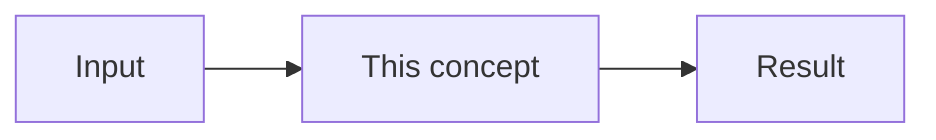

# {{title}}

Mastery: `INPUT[inlineSelect(option(new), option(learning), option(solid)):mastery]`

> [!story] Context
> One or two sentences connecting this note to the `prev` note: the limitation or requirement that this concept addresses.

> [!eli5] Summary
> Two or three sentences, without jargon: what this is and why it matters.

> [!analogy]- Analogy (optional)
> Include only when it clarifies. Map each part of the analogy to the real component.

## Background

The problem this addresses and what existed before it.

## Overview

The definition and its key capabilities. Quote official docs where exact wording matters. Use a table for capabilities or options.

## How it works

Describe the components and the flow between them. Include minimal, runnable code or SQL.

## Small-business considerations

> [!smallbiz] Small-business considerations
> Guidance for a 5–50 person company with one data person: when to adopt, when to defer, and the cost drivers.

> [!bridge]- In Databricks today
> Only for pre-Databricks tools (Hadoop, Kafka, Airflow, dbt...). Where does this job live in Databricks now, and does the old tool still plug in?

## Cloud differences

> [!azure]- Azure Databricks
> Azure-specific names, services, and setup.

> [!aws]- Databricks on AWS
> AWS-specific names, services, and setup.

> [!gcp]- Databricks on Google Cloud
> GCP-specific names, services, and setup.

## Advanced topics

> [!deepdive]- Advanced topics (301–401)
> Internals, limits, edge cases, performance tuning, and design trade-offs.

## Common misconceptions

> [!confusion] "X" is not "Y"
> The misconception, followed by the correct statement.

## Recall

Flashcards for the Spaced Repetition plugin. Keep them outside callouts so the plugin parses them.

Question::Answer

## Next steps

> [!path] Learning path
> **Needs first:** [[ ]]
> **Unlocks next:** [[ ]]

> [!nextup] Next
> One sentence introducing the `next` note and how it builds on this one.

> [!sources]- Sources (last verified: YYYY-MM-DD)
> - Official doc link
