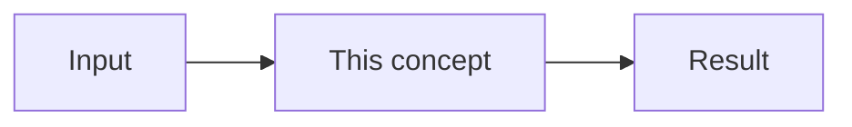

# {{title}}

Mastery: `INPUT[inlineSelect(option(new), option(learning), option(solid)):mastery]`

> [!story] Previously
> 1–3 sentences linking back to the `prev` note. What problem are we carrying forward?

> [!eli5] In one breath
> 2–3 sentences. No jargon at all.

> [!analogy] Analogy: <everyday thing>
> Map the everyday thing to the real concept, piece by piece.

## Why it exists

What was painful before this existed? What problem does it solve?

## What it actually is

The real definition, still in plain words. Quote official docs where exact wording matters.

## How it works

Explain the moving parts. Show real code or SQL where it helps (short, runnable, commented).

> [!smallbiz] For a small business
> What this means for a 5–50 person company with one data person. When to care, when to skip, what it costs.

> [!bridge]- In Databricks today
> Only for pre-Databricks tools (Hadoop, Kafka, Airflow, dbt...). Where does this job live in Databricks now, and does the old tool still plug in?

## On each cloud

> [!azure]- Azure Databricks
> Azure-specific names, services, and setup.

> [!aws]- Databricks on AWS
> AWS-specific names, services, and setup.

> [!gcp]- Databricks on Google Cloud
> GCP-specific names, services, and setup.

## Going deeper

> [!deepdive]- Expert notes (301–401)
> Internals, limits, edge cases, performance and design trade-offs. The things an expert knows that a beginner does not need yet.

## Common confusions

> [!confusion] "X" is not "Y"
> The mix-up, and the one sentence that clears it up.

## Recall

Flashcards for the Spaced Repetition plugin. Keep them outside callouts so the plugin parses them.

Question::Answer

## Where next

> [!path] Learning path
> **Needs first:** [[ ]]
> **Unlocks next:** [[ ]]

> [!nextup] Up next in the story
> One sentence that hands off to the `next` note: what new problem or question does this leave us with?

> [!sources]- Sources (last verified: YYYY-MM-DD)
> - Official doc link
